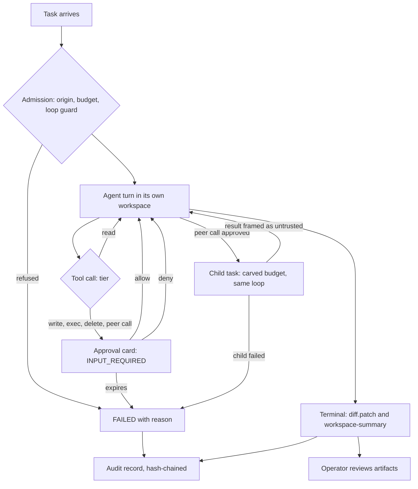
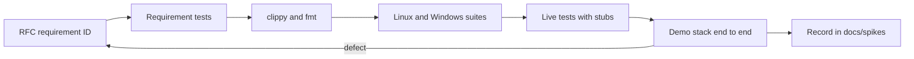

# A2A-Bus

The open [A2A](https://a2a-protocol.org) v1.0 protocol carried over a message bus, with drivers that let Hermes, Claude Code and omp collaborate on one host.

## What it does

A2A-Bus is a custom A2A protocol binding (`urn:a2abus:binding:bus:1`). It keeps the A2A data model (Task, Message, Artifact, AgentCard) and adds the pieces A2A leaves open as A2A extensions: human approval gates, budgets and loop control, scoped delegation, provenance and per-task sequencing. Reference bus: NATS with JetStream; the core is bus-agnostic.

On one host it runs as a set of processes started by the supervisor `a2ad`:

| Component | Role |
|---|---|
| Bus | `nats-server` with JetStream: request subjects, per-task event streams, agent card and presence KV buckets, audit stream. |
| Workers | One per coding agent. A worker owns the agent's tasks and speaks ACP to omp or Claude Code (`driver-acp`), or A2A HTTP to an external agent such as Hermes (`driver-a2a-http`). |
| Delegation | Agents call each other through the `a2abus-mcp-shim` MCP tool. The worker checks budget, hop count and approval before a child task goes out on the bus. |
| Approvals | Tool permission requests from an agent become A2A `INPUT_REQUIRED` tasks with an approval card. An operator approves or denies them. |
| Gateway | Exposes bus agents to stock A2A HTTP clients. |
| Operator tools | `a2a` (CLI: discover, send, watch, cancel, approvals, audit) and `a2a-tui` (console). |
| Workspaces | Each session or task gets an isolated `git worktree` (or a baseline copy for non-git sources), never the operator's checkout. Its diff is returned as a `workspace-summary` artifact. |

A typical flow: the operator sends a task to omp; omp's model asks to call Claude; the worker raises an approval; after approval the child task runs on Claude through the bus; Claude's result returns to omp wrapped as untrusted tool output; omp completes and the operator gets the reply artifact.

## Verification loop

Every piece of agent work passes through the same checks at runtime, whether the operator started it or another agent delegated it. The checks are done by the worker, the security layer and the supervisor, not by the agents. An agent cannot skip them. Requirement IDs point to the RFC rule; each has tests named after it.



1. **Admission.** A task without a budget gets a root allowance from the agent's configuration: wall time, hops, depth and number of children; tokens and cost are unlimited by default (0006-031). A delegated task whose (agent, fingerprint) pair is already in the chain, or whose receiving agent is already in it, is created FAILED with `LOOP_DETECTED` and no backend starts (0006-045, 0006-059). A circuit breaker stops repeated failures from one origin (0006-048).
2. **Tool tiers.** Every tool call gets exactly one tier: `read`, `write`, `exec` or `delete_or_move` (0006-002). Unknown tools count as `exec`. The drivers relay every ACP permission request and never answer one themselves (0009-088); omp always runs in `always-ask-cached` mode (0006-025).
3. **Approval.** A gated call turns the task `INPUT_REQUIRED` with an approval card naming the tool, tier and summary. Only the operator identities `cli` and `tui` can decide (0006-014). The worker checks origin, open state, nonce, chosen option and digest, in that order (0006-013), and each decision is single-use (0006-015). Allow-always is never offered for `exec` or `delete_or_move` (0006-010). If nobody decides within 300 s the request expires, the backend is stopped, and the task fails with `APPROVAL_TIMEOUT` (0006-017); the next task starts a fresh backend.
4. **Delegation.** An agent calls a peer through the `a2abus-mcp-shim` tool, which is itself a gated tool call. The child task gets a budget carved from the parent's and runs through this same loop on the peer's worker (0006-033). While the child waits for an approval, the parent stays `WORKING` (0015-065). The parent cannot complete while a child is still running (0015-067), and a failed child fails the parent with `CHILD_FAILED` (0015-070). Child sends are journaled and resent after a crash (0015-062); unanswered resends are retried and then abandoned with an audit note (0015-117).
5. **Untrusted output.** Peer replies, tool output and anything else not from the operator are wrapped in `A2ABUS-UNTRUSTED` markers with their trust class and origin before a model sees them (0007-124). Secrets are redacted before output is hashed, spooled or published (0013-022).
6. **Workspace review.** Each agent works in its own `git worktree`, never the operator's checkout (0012-031). When a mutating task ends, the worker writes `diff.patch` (the binary diff against the base commit plus untracked files) and attaches a `workspace-summary` artifact with files changed, insertions, deletions and the patch's SHA-256 (0012-040, 0012-042). Clean workspaces are removed and dirty ones are kept for review (0012-035).
7. **Observation.** Every task event carries a contiguous sequence number assigned by the worker. Replies carry `A2AB-Last-Seq` (0002-051), so `a2a watch`, `a2a send --follow` and the console can resume without gaps.
8. **Audit.** Every event is recorded and hash-chained per emitter (0013-026); the supervisor writes signed checkpoints hourly and at shutdown (0013-027). `a2a audit verify <file>` recomputes the chain and checkpoints, reports the first broken line, and exits 0 only when the file verifies (0013-028).

Not yet in Milestone 1:
- **Audit sink consumer.** Records reach the bus and the per-agent spool, but nothing writes the sink files yet, so `a2a audit verify` has no sink data to check on a live stack.
- **Signing.** Approval decisions and agent cards are unsigned by default (0012-043). Decisions arriving over the bus are accepted unsigned. Verification happens only when signing is turned on, and a2ad has no configuration to turn it on.
- **Readiness gating.** `/readyz` reports each agent's state in its body but does not gate on it (0013-036).

The demo stack shows the whole loop with no credentials. `send omp "WRITE_FILE" --wait` raises an approval card. `send omp "A2A_SEND:claude:review README.txt" --wait` sends a gated peer call, after which Claude's reply comes back framed as untrusted. See [Demo stack](DEV.md#demo-stack-two-agents-no-credentials).

## Layout

| Path | Contents |
|---|---|
| `docs/rfcs/` | The specification: RFCs 0000-0015 with requirement IDs and conformance tables |
| `docs/requirements.md` | Requirements, decisions D1-D23, threat model |
| `docs/interop/` | Sourced notes on A2A, Hermes, ACP, omp, Claude Code and NATS |
| `docs/spikes/` | Observed behavior on real tools and the live end-to-end run |
| `docs/architecture/` | Generated architecture diagrams (PDF) |
| `proto/` | Protobuf schemas for the A2A-Bus extensions |
| `crates/` | Rust implementation (types, bus API and bindings, core, security, audit, workspace isolation, worker, client, MCP peer-call shim, drivers, gateway, supervisor, TUI, CLI, conformance) |
| `spikes/` | Reproducible spike scripts, probes and stub model servers |
| `deploy/compose/` | Supervisor configs and profiles for the Docker stacks |

## Development checks

This is how changes to this repository are checked, as opposed to the runtime checks on agent work described under [Verification loop](#verification-loop). The repository is spec-first, so checks run from the RFC requirement down to a live run. A change is done when every layer below that it touches passes.



1. **Requirement.** Each behavior is a MUST or SHOULD with a stable ID `[NNNN-xxx]` and a Conformance row in its RFC. IDs are never renumbered. A new behavior without an RFC rule gets one first.
2. **Requirement tests.** Tests carry the requirement ID in their name (for example `req_0002_052_stream_reply_is_first_stream_element_with_last_seq`), so coverage can be found by grepping for the ID. Every defect fix lands with a regression test that fails before the fix and passes after it.
3. **Lint and format.** Clippy denies warnings and `unwrap`, `expect`, `panic`, `todo`, `unimplemented` and `dbg!` in non-test code; `unsafe` is forbidden except in the Windows Job Object module of `a2ad`.

   ```
   cargo test --workspace --all-features
   cargo clippy --workspace --all-targets --all-features -- -D warnings
   cargo fmt --all --check
   ```

4. **Both platforms.** Windows and Linux are first-class. The same suite runs natively on Windows and in the Docker `dev` container on Linux (including Arch Linux under WSL):

   ```
   docker compose run --rm dev cargo test --workspace --all-features
   docker compose run --rm dev cargo clippy --workspace --all-targets --all-features -- -D warnings
   ```

   Read the real exit code (redirect to a file and check `$?`); piping into `tail` hides a failure.
5. **Live tests.** Tests that need a real `nats-server`, omp, the Claude Code ACP adapter or Hermes are `#[ignore]` and run with `-- --ignored`. The agents talk to local stub model servers under `spikes/`, so no real model is called and no credential is needed. See `spikes/*/README.md` and `crates/a2ad/tests/e2e.rs`.
6. **Demo stack.** The whole system runs in Docker with real omp and Claude Code on stub models. This exercises the protocol end to end: readiness, discovery, tasks with `--wait` and `--follow`, approvals, peer delegation in both directions, cancel and watch.

   ```
   docker compose --profile demo build
   docker compose up -d demo demo-logs
   docker compose exec demo demo-a2a discover
   docker compose exec demo demo-a2a send omp "hello" --follow
   docker compose exec demo demo-a2a send omp "A2A_SEND:claude:review README.txt" --wait
   docker compose exec demo demo-a2a approvals list --pending
   docker compose logs -f demo-logs
   ```

   A defect found here goes back to step 1: check what the RFC specifies, fix, add the regression test, run the loop again.
7. **Record.** Live results, with the commands and what was observed, go to `docs/spikes/e2e-m1.md`. Claims about third-party tools stay in `docs/interop/`, with `[UNVERIFIED]` kept until a source or an observation backs them.

Every command for every component, native and Docker, is in [DEV.md](DEV.md).

## Status

The RFCs are `Proposed`. What has been verified live, and what has not, is in `docs/spikes/e2e-m1.md`. Live omp and Claude runs use stub models only.
