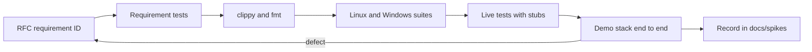

# A2A-Bus

The open [A2A](https://a2a-protocol.org) v1.0 protocol carried over a message bus, with drivers that let Hermes, Claude Code and omp collaborate on one host.

## What it does

A2A-Bus is a custom A2A protocol binding (`urn:a2abus:binding:bus:1`). It keeps the A2A data model (Task, Message, Artifact, AgentCard) and adds the pieces A2A leaves open as A2A extensions: human approval gates, budgets and loop control, scoped delegation, provenance and per-task sequencing. Reference bus: NATS with JetStream; the core is bus-agnostic.

On one host it runs as a set of processes started by the supervisor `a2ad`:

| Component | Role |
|---|---|
| Bus | `nats-server` with JetStream: request subjects, per-task event streams, agent card and presence KV buckets, audit stream. |
| Workers | One per coding agent. A worker owns the agent's tasks and speaks ACP to omp or Claude Code (`driver-acp`), or A2A HTTP to an external agent such as Hermes (`driver-a2a-http`). |
| Delegation | Agents call each other through the `a2abus-mcp-shim` MCP tool. The worker checks budget, hop count and approval before a child task goes out on the bus. |
| Approvals | Tool permission requests from an agent become A2A `INPUT_REQUIRED` tasks with an approval card. An operator approves or denies them. |
| Gateway | Exposes bus agents to stock A2A HTTP clients. |
| Operator tools | `a2a` (CLI: discover, send, watch, cancel, approvals, audit) and `a2a-tui` (console). |
| Workspaces | Each session or task gets an isolated `git worktree` (or a baseline copy for non-git sources), never the operator's checkout. Its diff is returned as a `workspace-summary` artifact. |

A typical flow: the operator sends a task to omp; omp's model asks to call Claude; the worker raises an approval; after approval the child task runs on Claude through the bus; Claude's result returns to omp wrapped as untrusted tool output; omp completes and the operator gets the reply artifact.

## Layout

| Path | Contents |
|---|---|
| `docs/rfcs/` | The specification: RFCs 0000-0015 with requirement IDs and conformance tables |
| `docs/requirements.md` | Requirements, decisions D1-D23, threat model |
| `docs/interop/` | Sourced notes on A2A, Hermes, ACP, omp, Claude Code and NATS |
| `docs/spikes/` | Observed behavior on real tools and the live end-to-end run |
| `docs/architecture/` | Generated architecture diagrams (PDF) |
| `proto/` | Protobuf schemas for the A2A-Bus extensions |
| `crates/` | Rust implementation (types, bus API and bindings, core, security, audit, workspace isolation, worker, client, MCP peer-call shim, drivers, gateway, supervisor, TUI, CLI, conformance) |
| `spikes/` | Reproducible spike scripts, probes and stub model servers |
| `deploy/compose/` | Supervisor configs and profiles for the Docker stacks |

## Verification loop

The repository is spec-first, so verification runs from the RFC requirement down to a live run. A change is done when every layer below that it touches passes.



1. **Requirement.** Each behavior is a MUST or SHOULD with a stable ID `[NNNN-xxx]` and a Conformance row in its RFC. IDs are never renumbered. A new behavior without an RFC rule gets one first.
2. **Requirement tests.** Tests carry the requirement ID in their name (for example `req_0002_052_stream_reply_is_first_stream_element_with_last_seq`), so coverage can be found by grepping for the ID. Every defect fix lands with a regression test that fails before the fix and passes after it.
3. **Lint and format.** Clippy denies warnings and `unwrap`, `expect`, `panic`, `todo`, `unimplemented` and `dbg!` in non-test code; `unsafe` is forbidden except in the Windows Job Object module of `a2ad`.

   ```
   cargo test --workspace --all-features
   cargo clippy --workspace --all-targets --all-features -- -D warnings
   cargo fmt --all --check
   ```

4. **Both platforms.** Windows and Linux are first-class. The same suite runs natively on Windows and in the Docker `dev` container on Linux (including Arch Linux under WSL):

   ```
   docker compose run --rm dev cargo test --workspace --all-features
   docker compose run --rm dev cargo clippy --workspace --all-targets --all-features -- -D warnings
   ```

   Read the real exit code (redirect to a file and check `$?`); piping into `tail` hides a failure.
5. **Live tests.** Tests that need a real `nats-server`, omp, the Claude Code ACP adapter or Hermes are `#[ignore]` and run with `-- --ignored`. The agents talk to local stub model servers under `spikes/`, so no real model is called and no credential is needed. See `spikes/*/README.md` and `crates/a2ad/tests/e2e.rs`.
6. **Demo stack.** The whole system runs in Docker with real omp and Claude Code on stub models. This exercises the protocol end to end: readiness, discovery, tasks with `--wait` and `--follow`, approvals, peer delegation in both directions, cancel and watch.

   ```
   docker compose --profile demo build
   docker compose up -d demo demo-logs
   docker compose exec demo demo-a2a discover
   docker compose exec demo demo-a2a send omp "hello" --follow
   docker compose exec demo demo-a2a send omp "A2A_SEND:claude:review README.txt" --wait
   docker compose exec demo demo-a2a approvals list --pending
   docker compose logs -f demo-logs
   ```

   A defect found here goes back to step 1: check what the RFC specifies, fix, add the regression test, run the loop again.
7. **Record.** Live results, with the commands and what was observed, go to `docs/spikes/e2e-m1.md`. Claims about third-party tools stay in `docs/interop/`, with `[UNVERIFIED]` kept until a source or an observation backs them.

Every command for every component, native and Docker, is in [DEV.md](DEV.md).

## Status

The RFCs are `Proposed`. What has been verified live, and what has not, is in `docs/spikes/e2e-m1.md`. Live omp and Claude runs use stub models only.
