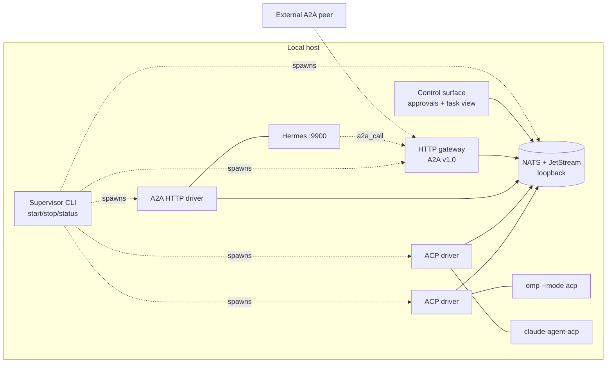

# Bus-Based Agent-to-Agent Protocol: Requirements & Threat Model

Status: draft v1. Requirements only; no wire format, no code.
Supersedes v0 and the gRPC handoff schema (see section 1).

## 0. Decisions

| ID | Decision | Consequence |
|----|----------|-------------|
| D1 | Bus-agnostic core; thin binding contract | Semantics are bus-independent. A binding adapts a concrete bus. |
| D2 | Edge-to-cloud federation | Multiple brokers, intermittent links, store-and-forward. |
| D3 | At-least-once delivery, idempotent handlers | Unique message ids, dedupe, per-task sequence numbers. |
| D4 | Threat model is a deliverable | Section 8. |
| D5 | **Interoperate with A2A v1.0 (Linux Foundation) by being a new A2A protocol binding, not a new data model** | Section 2. Reuses Task/Message/Part/Artifact/AgentCard. |
| D6 | **Milestone 1 = Hermes, Claude Code and omp collaborating on one Windows/Linux machine** | Section 5. |
| D7 | **Reference bus: NATS with JetStream** (adapters keep it replaceable) | Section 4. |
| D8 | Strictly "A2A over bus"; no bus-native features outside A2A semantics | Keeps R-I3 (stock A2A client works) true for every feature. |
| D9 | Local TUI as M1 control surface | Approvals and task view in one terminal UI; Rust TUI crate. |
| D10 | Rust implementation | One workspace: supervisor, ACP/A2A drivers, HTTP gateway, TUI, in-memory + NATS bindings. |
| D11 | omp driver ACP-only in M1 | Same driver as Claude Code; RPC later. |
| D12 | Worktree isolation configurable, default per agent session | Per-task opt-in. |
| D13 | Metering from agent usage events, self-report fallback | Hard caps are the backstop. |
| D14 | Hermes via A2A HTTP only | No kanban coupling. |
| D15 | Ed25519 per-agent keys + local allowlist for cross-host | Broker-independent; manual rotation. |
| D16 | A2A-Bus is carried as the custom A2A binding `urn:a2abus:binding:bus:1` (RFC-0002), not as a new data model | Stock A2A clients reach bus agents only through the HTTP gateway (RFC-0008). |
| D17 | RFC-first: `docs/rfcs` is the normative specification; this document is requirements context | Conflicts are resolved in the RFCs. |

## 1. What the interop research changed

The "A2A" in the handoff was a custom gRPC schema (`agent.a2a.v1`). The actual open A2A protocol, which Hermes implements, is already specified (`lf.a2a.v1`, normative protobuf at a2a-protocol.org). It already covers most of what the handoff proposed:

| Handoff concept | A2A v1.0 equivalent |
|---|---|
| `GetAgentManifest` / `ManifestResponse` | `AgentCard` (skills, capabilities, security schemes, signed via JWS `signatures`) |
| `OpenSession` bidirectional stream | `SendStreamingMessage`, `SubscribeToTask`, `contextId` for multi-turn |
| `TaskPrompt` / `TaskResult` | `Message` + `Part` (text, raw, url, data) / `Artifact` |
| `ExecutionState` | `TaskState` |
| `PermissionRequest` / `Grant` | **No equivalent.** `INPUT_REQUIRED` / `AUTH_REQUIRED` interrupted states only. |
| Heartbeat `Ping` | None (HTTP keep-alive). Bus presence replaces it. |
| Circuit breakers | None in spec. Hermes implements its own per-context turn cap. |
| MCP bridging | None in spec. |

Consequence: do not invent a parallel schema. Our value-add is (a) a bus binding, (b) approval gating, (c) loop/budget control, (d) scoped delegation, (e) local multi-agent supervision. (b) to (d) ship as A2A extensions (`AgentExtension` with URI, `required` flag), so a stock A2A peer still works and merely ignores them.

## 2. Hermes A2A comparison

Hermes (Nous Research, v0.20.0+) ships an A2A plugin implementing A2A v1.0 over HTTP, in both directions. Source: Hermes docs, "A2A (Agent-to-Agent)".

| Aspect | Hermes A2A (HTTP) | This protocol (bus) | Interop impact |
|---|---|---|---|
| Data model | A2A v1.0 Task/Message/Part/Artifact | Same | Lossless mapping. |
| Transport | JSON-RPC 2.0 over HTTP `POST /`, SSE streaming, webhook push | Pub/sub + request/reply + durable streams on a bus | Needs a gateway (bus to HTTP). |
| Discovery | `GET /.well-known/agent-card.json` (legacy `agent.json`) | Cards published on bus (retained key-value), presence | Gateway serves bus cards at the well-known path and ingests Hermes's card. |
| Methods | `SendMessage`, `SendStreamingMessage`, `GetTask`, `ListTasks`, `CancelTask`, `SubscribeToTask`, push-config CRUD, plus pre-1.0 aliases (`message/send`) | Same operation set mapped to subjects | Operation parity is a requirement (R-I2). |
| Sync model | `SendMessage` blocks until terminal or interrupted unless `return_immediately` | Async-first | Gateway must emulate blocking; Hermes `A2A_REPLY_TIMEOUT` default 300 s bounds it. |
| Auth | Bearer, per-peer tokens `A2A_PEER_TOKENS`; no token means localhost-only bind | NKey/JWT or equivalent per agent + signed envelopes | Gateway maps authenticated bus identity to a Hermes peer token. Identity is per peer name (rate limit 60/min is keyed on it). |
| Session model | Inbound task injected into a live gateway session keyed by `contextId` | `contextId` preserved end to end | Never rewrite `contextId`; Hermes ownership binding includes peer, tenant and context id. Reusing ids across peers collides. |
| Injection defense | Filters and frames inbound text as untrusted; strips operator slash commands | Capability scope plus structural untrusted marking | Avoid double filtering that corrupts content; mark provenance in `metadata`, do not pre-wrap text. |
| Loop control | `A2A_MAX_PINGPONG_TURNS` (default 5, max 20) per context | Budgets in envelope (depth, hops, tokens, time) | Bus budgets must be at least as strict; pass Hermes caps through. Hermes enforces locally regardless. |
| Audit | `~/.hermes/a2a_audit.jsonl` | Bus audit stream | Both exist; bus stream is the cross-agent source of truth. |
| Approval gating | None at A2A layer | First-class extension | Map to `INPUT_REQUIRED` with extension metadata; Hermes sees a normal interrupted task. |
| Same-host guidance | Hermes docs prefer in-process delegation or kanban locally; A2A for crossing process/framework boundaries | This is exactly the cross-framework case | Hermes's own advice does not cover mixed frameworks on one host. |
| Redaction | Outbound credential-shaped strings scrubbed | Required of any binding (R-S5) | Compatible. |

Unverified: exact `INPUT_REQUIRED` handling in Hermes inbound (its docs describe only final-reply results), and whether Hermes emits intermediate status events on `SendStreamingMessage`. Check in the M1 spike.

### Strategy

Define a **bus protocol binding** for A2A:
- `AgentInterface.protocol_binding` is an "open form string" in the spec, so a binding such as `NATS` can be advertised on the card alongside `JSONRPC`, `GRPC`, `HTTP+JSON`.
- Every bus-native agent publishes an A2A `AgentCard` whose `supported_interfaces` lists the bus binding first and, when a gateway exists, an HTTP JSON-RPC fallback.
- Non-bus agents (Hermes) are joined by **bridges**, never by modifying them.

Interop in both directions without touching Hermes:

1. **Hermes calls bus agents.** Gateway exposes an A2A v1.0 HTTP endpoint per bus agent. Add it to Hermes `a2a_agents` config. `a2a_call` / `a2a_orchestrate` then reach omp and Claude Code.
2. **Bus agents call Hermes.** Bridge is an A2A HTTP client against Hermes's `:9900`, republishing Hermes as a bus agent.
3. **External A2A peers** (LangChain, CrewAI, ADK, official `a2a-sdk`) reach bus agents through the same gateway.

To verify: whether the A2A spec has normative requirements for custom bindings (functional equivalence across bindings, error mapping). Treat as a conformance constraint until read.

## 3. Agent integration surfaces

| Agent | Native surface | Bridge |
|---|---|---|
| Hermes | A2A v1.0 HTTP server and outbound `a2a_*` tools | A2A HTTP client driver plus gateway for the reverse direction |
| omp | `omp --mode acp` (Agent Client Protocol over stdio); `--mode rpc` (custom JSONL, not JSON-RPC); `--mode json`; SDK | ACP driver (preferred: standard, has permission requests); RPC driver as fallback for omp-specific features |
| Claude Code | Headless `-p --output-format stream-json`; Agent SDK; ACP via `@agentclientprotocol/claude-agent-acp` | ACP driver through that adapter |

Notes:
- ACP is client-to-agent (editor drives agent), not peer-to-peer. The driver plays the ACP *client* and re-presents the agent as an A2A peer. One ACP driver implementation covers omp and Claude Code.
- ACP permission requests map to our approval extension (`INPUT_REQUIRED`). omp under `--no-ui` fails closed on tools needing approval, which is the right default for an unattended worker.
- Unverified: how much of the ACP client surface (filesystem, terminal) the driver must implement versus declare unsupported; behavior of `claude-agent-acp` on Windows. Spike item.

## 4. Bus selection

Requirements for the bus: runs on Windows and Linux without WSL, small footprint, request/reply, persistence with replay, per-subject authorization, federation across broker hops, mature clients for Rust/Go/TypeScript/Python.

| Bus | Windows | Persistence | Request/reply | Federation / edge | Verdict |
|---|---|---|---|---|---|
| **NATS + JetStream** | Native binary, runs as service | JetStream streams, durable consumers, de-dup by message id, KV, object store | Built in | Leaf nodes, clusters, accounts | **Recommended reference binding** |
| Zenoh | Native (Rust) | Optional storages | Queryables | Peer mesh and routers; very edge-friendly | Strong alternative; smaller ecosystem and tooling. Candidate second binding |
| MQTT 5 (Mosquitto, NanoMQ, EMQX) | Yes | Retained messages, sessions; weak replay | Response-topic convention | Bridges | Fits constrained devices; poor for large payloads and streaming replay |
| ZeroMQ / nanomsg | Yes (library) | None | Patterns, hand-built | Brokerless | Too much must be rebuilt (durability, auth) |
| Kafka / Pulsar / RabbitMQ | Possible | Strong | Awkward | Heavy | Too heavy for edge M1 |
| D-Bus | Not a native Windows citizen | None | Yes | Local only | Rejected |
| Redis Streams | No official Windows build | Yes | Hand-built | Limited | Rejected |
| Named pipes / Unix sockets | Both differ | None | Point-to-point | Local only | Not a bus; maybe a local transport for drivers |

Why NATS for M1 (single static server, loopback, one process the supervisor starts):
- Its delivery model is at-least-once with publisher-side de-duplication on a message-id header, matching D3.
- Subject-level permissions give broker-side authorization as defense in depth (A1).
- Leaf nodes give the edge-to-cloud path (D2) without changing the protocol.
- JetStream KV can hold retained agent cards; object store can hold large artifacts (default payload limit is about 1 MB, so artifacts need by-reference).

Risk: JetStream and NATS server behavior on Windows (service install, file-store paths, permissions). Spike item. Mitigation: the in-memory reference binding (R-B3) keeps development unblocked.

Binding contract (must stay this small):
- publish(subject, headers, bytes), subscribe(subject-pattern), request(subject, bytes, timeout)
- durable stream: append with message-id de-dup, consume from sequence N with ack
- key-value with TTL and watch (cards, presence)
- declared `max_message_size`, per-key ordering flag

## 5. Milestone 1: local multi-agent collaboration

Goal: Hermes, Claude Code and omp run on one machine (Windows primary, Linux required), discover each other, and exchange tasks over the bus, with a human approving gated actions from one place.

### 5.1 Components

### 5.2 M1 requirements

- M1-1 One command starts the bus, drivers and gateway; one command stops them and leaves no orphan processes (Windows job objects / Linux process groups).
- M1-2 Each agent appears on the bus with an A2A `AgentCard` generated by its driver (skills derived from what the agent can do; for Hermes, ingest its card; for omp and Claude Code, static config plus ACP-reported capabilities).
- M1-3 Any agent can discover and send a task to any other; results return as A2A `Task` with `Artifact`s.
- M1-4 Hermes can call omp and Claude Code via its stock `a2a_call` pointed at the gateway. No Hermes patch.
- M1-5 Each worker runs in an isolated working directory (git worktree or copy). Two coding agents must never edit the same checkout concurrently; the default is an error, not a lock. (Gap in everything surveyed; this is the biggest practical hazard.)
- M1-6 Permission requests from any agent surface in the control surface with: requesting agent, task chain, tool, arguments summary, working directory. Approve or deny returns to the originating agent. Default on timeout is deny.
- M1-7 Loop and budget limits are enforced (section 6, R-L). Hermes's own cap still applies.
- M1-8 Cancel from requester or operator terminates the underlying agent turn and reports `CANCELED`.
- M1-9 Driver or agent crash mid-task yields a terminal `FAILED` with cause within a bounded time; restarting the supervisor does not re-run completed tasks (idempotency).
- M1-10 Credentials: the bus uses per-agent credentials generated at first start, stored with OS-user-only permissions. Provider API keys stay in each agent's own config; nothing in this system reads or forwards them.
- M1-11 Everything is logged to one append-only audit stream: who asked whom, state transitions, approvals, budgets tripped.

### 5.3 M1 acceptance scenarios

1. omp asks Claude Code to review a file; reply arrives with an artifact.
2. Hermes (via `a2a_call` to the gateway) asks omp to run a task; streaming status is visible.
3. Claude Code asks Hermes a research question; answer returns over the HTTP driver.
4. A worker needs approval for a write; task shows `INPUT_REQUIRED`; operator approves; task completes. Repeat with deny and with timeout.
5. Two agents are configured to delegate back and forth; the breaker trips with a distinct error code; both tasks end terminal.
6. Kill the bus mid-task and restart it; no duplicate execution, task reaches a terminal state or a clearly reported failure.
7. Duplicate delivery injected for a task submission; handler executes once.
8. Cancel a long task; underlying agent turn stops.
9. An external stock `a2a-sdk` client fetches the card and sends a message to omp through the gateway.

Non-goals for M1: cross-machine federation, cross-org trust, encrypted payloads end to end, registry service, REST/JSON beyond the A2A gateway, MCP token delegation.

## 6. Requirements (cumulative)

### Interop
- R-I1 Data model is A2A v1.0 protobuf. Bus payloads are A2A messages; protocol additions are A2A extensions declared on the card.
- R-I2 Operation parity: SendMessage, SendStreamingMessage, GetTask, ListTasks, CancelTask, SubscribeToTask, extended card, push config (push may map to bus subscription).
- R-I3 A stock A2A client must work through the gateway with no knowledge of the bus.
- R-I4 Unknown extensions are ignored unless declared `required`; required-but-unsupported fails with a clear error.
- R-I5 Error mapping table between bus errors, A2A error codes and JSON-RPC errors is normative.
- R-I6 Pin and track an A2A spec version; Hermes also accepts pre-1.0 method aliases, gateway should do the same on ingress only.

### Lifecycle
- R-L1 States are A2A `TaskState`: SUBMITTED, WORKING, INPUT_REQUIRED, AUTH_REQUIRED, COMPLETED, FAILED, CANCELED, REJECTED. Handoff names map as: QUEUED to SUBMITTED, PROCESSING to WORKING, PENDING_APPROVAL to INPUT_REQUIRED plus approval extension data, SUCCEEDED to COMPLETED. Progress metadata (`urn:a2abus:ext:progress:1`) is optional and never changes state.
- R-L2 Spec has no EXPIRED; deadline expiry is FAILED with a machine-readable reason.
- R-L3 Status events carry a per-task monotonic sequence. Terminal states are immutable. Duplicates and reordering are tolerated.
- R-L4 Every task has a deadline; abandoned tasks reach a terminal state.
- R-B1 Budgets (depth, hops, tokens, wall time) travel in message metadata; a delegate may only lower them; every hop enforces locally.
- R-B2 Cycle detection via chain of agent ids plus task fingerprint.
- R-B3 Trip yields FAILED with distinct code.

### Delivery
- R-D1 Unique message id on every message; idempotent handlers; bounded dedupe window with a stated relation to maximum redelivery horizon.
- R-D2 Ordering only per task via sequence numbers.
- R-D3 Task submission redelivered to a restarted worker does not execute twice.
- R-D4 Large artifacts by reference (`Part.url` with content hash) beyond binding `max_message_size`.

### Binding / federation
- R-F1 Logical addressing by agent id and tenant; survives leaf-to-hub hop.
- R-F2 Agent cards carry no TTL; they are re-announced on change. Presence carries a TTL and is refreshed by heartbeat (L6).
- R-F3 No dependence on synchronized clocks; relative durations with issuer timestamp and skew allowance.
- R-F4 In-memory reference binding for tests plus NATS binding for M1.

### Security
- R-S1 Per-agent identity key; messages signed independently of the broker. (M1 may rely on broker auth plus audit; signing is required before cross-host.)
- R-S2 Agent Cards signed (A2A supports JWS signatures on cards).
- R-S3 Grants: bound to task id, request id and scope; single use; expiring; default deny.
- R-S4 Delegated capabilities attenuated per task. No raw long-lived secrets in envelopes.
- R-S5 Redaction of credential-shaped strings in logs, traces, and outbound content.
- R-S6 Rate limits and queue quotas per peer; overload returns REJECTED, never silent drop.
- R-S7 Task content is untrusted data. Provenance is marked in metadata, text is not rewritten; the enforced boundary is capability scope and approval, not delimiters.

### Footprint and operations
- R-O1 Core runs without registry or external database; bounded memory per task.
- R-O2 W3C trace context in every envelope.
- R-O3 Windows and Linux are both first-class: path handling, process lifecycle, file permissions, no POSIX-only assumptions.

## 7. Open questions

1. ~~Q1~~ **Decided (D8):** strictly A2A over bus. No bus-native semantics outside A2A; broadcast/fan-out only via A2A-expressible operations (e.g. `a2a_orchestrate`-style capability fan-out).
2. ~~Q2~~ **Decided (D9):** local TUI control surface for M1 (approvals + task view).
3. ~~Q3~~ **Decided (D10):** Rust for drivers, supervisor, gateway and TUI (`async-nats`; Windows-first packaging as static binaries).
4. ~~Q4~~ **Decided (D11):** omp driver is ACP-only in M1. RPC driver deferred until a concrete gap (host tools, subagent events) is identified.
5. ~~Q5~~ **Decided (D12):** worktree isolation is configurable; default one git worktree per agent per session, opt-in per task.
6. ~~Q6~~ **Decided (D13):** drivers meter from the agent's own usage events and fall back to self-reported counts. Turn, hop and wall-time caps are the hard backstop since token counts may be absent or unverifiable.
7. ~~Q7~~ **Decided (D14):** Hermes via A2A HTTP only in M1; no kanban or delegation integration.
8. ~~Q8~~ **Decided (D15):** post-M1 cross-host identity is per-agent Ed25519 keys signing envelopes and cards, with an operator-maintained public-key allowlist (no CA). Rotation manual; revocation by removing from the allowlist. M1 stays on broker auth.

## 8. Threat model

Trust assumptions
- A1 Broker is not trusted for confidentiality or integrity; broker ACLs are defense in depth.
- A2 Peers are authenticated but may be compromised or prompt-injected.
- A3 All task content, tool output and artifacts are untrusted data.
- A4 Operators are trusted; their channel is high-value.
- A5 (M1) Local host is a single trust domain, but processes of other OS users are not trusted: bus must bind loopback or a named pipe/socket with user-only permissions.

| # | Threat | Required mitigation |
|---|--------|---------------------|
| T1 | Prompt injection through task text or results | Capability scope per task, approval gates for sensitive tools, provenance marking. Delimiter wrapping is hygiene only. Hermes filtering is an extra layer, not relied on. |
| T2 | Confused deputy via delegation | Attenuated per-task capabilities; no ambient authority; chain shown in approval UI. |
| T3 | Ping-pong and cost runaway | R-B1..R-B3; each hop meters its own usage; Hermes turn cap respected. |
| T4 | Replay and duplication (inherent to at-least-once) | Ids, nonces, expiry, dedupe, single-use grants. |
| T5 | Credential leakage (provider keys, MCP tokens, bus creds) | Never in envelopes or logs; bridges never read agent provider config; redaction; bus credentials file permissions. |
| T6 | Impersonation on the bus | Per-agent broker credentials with subject permissions limited to own subjects; signatures before cross-host. |
| T7 | Forged or fatigue-driven human approval | Signed grants; UI shows actual action, scope, chain; rate-limit prompts; default deny. |
| T8 | Poisoned discovery (fake cards) | Signed cards; local allowlist of agent ids; pin expected identity before sending sensitive data. |
| T9 | Flooding | Per-peer rate limits and quotas; REJECTED on overload. |
| T10 | Metadata leakage on bus | Document; avoid sensitive data in subjects. |
| T11 | Stale authority in partitions | Hard expiries; fail closed. |
| T12 | **Gateway as new attack surface** (HTTP exposure of bus agents) | Loopback bind by default; bearer required to widen (mirrors Hermes); identity mapped to bus identity; gateway cannot grant itself approvals. |
| T13 | **Concurrent writes by multiple coding agents** (data loss, corrupt repo) | Worktree isolation (M1-5); refuse shared cwd. |
| T14 | **Driver as privileged confused deputy** (drivers hold every agent's session) | Driver runs as the same OS user as its agent, one driver per agent, no shared state between drivers. |
| T15 | **Approval bypass via agent-native modes** (e.g. an agent started with permissions skipped) | Supervisor starts agents with approval-requiring configuration and records it on the card; flags dangerous modes. |

## 9. Next steps

1. Spike (1-2 days): NATS + JetStream on Windows; `omp --mode acp` and `claude-agent-acp` driven from a minimal ACP client; one Hermes `SendMessage` round trip. Resolve the "unverified" items above.
2. Read A2A spec sections on custom bindings and extensions; fix R-I5.
3. Decide Q1, Q3.
4. Write the normative subject taxonomy and envelope/extension definitions for the NATS binding.
5. Implement in-memory binding + conformance tests, then M1 scenarios 1-9 in order.
