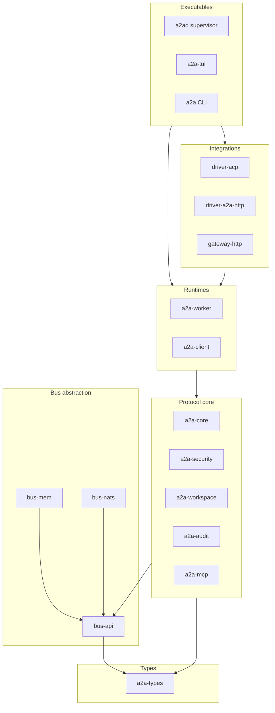
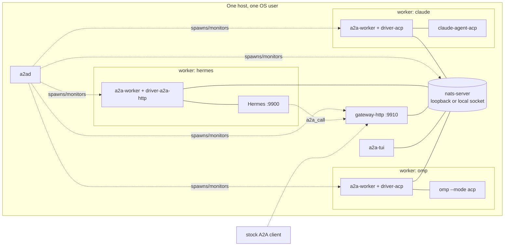

# RFC-0001: Architecture, Modularity and Shared Vocabulary

| Field | Value |
|---|---|
| Status | Proposed |
| Depends on | RFC-0000 |
| Owner area | architecture |
| Related interop notes | `docs/interop/*.md` |

## 1. Summary

A2A-Bus carries the open A2A v1.0 protocol over a message bus. This RFC fixes the layering, the module (crate) boundaries and dependency rules, the process topology for Milestone 1, and the shared vocabulary every other RFC uses. Anything defined here MUST NOT be redefined elsewhere.

## 2. Motivation and scope

Goals: a modular system where the bus, the agent integration and the HTTP gateway are independently replaceable; a protocol core that is bus-agnostic (D1) and A2A-faithful (D5, D8).

Non-goals: defining a bus; defining LLM behavior; replacing MCP or ACP.

## 3. Terminology

| Term | Meaning |
|---|---|
| A2A | Agent2Agent protocol v1.0 (`lf.a2a.v1`), the data model and operations we carry |
| Bus | Message broker plus client library (reference: NATS + JetStream) |
| Binding | Adapter between the protocol core and one bus. Also, in A2A terms, a "protocol binding" advertised on an Agent Card |
| Peer | Anything that speaks A2A-Bus on the bus: a worker, a requester, a gateway, a TUI |
| Agent | A model-driven program that performs tasks (Hermes, Claude Code, omp) |
| Backend | The agent-facing side of a driver: the thing a Worker runs tasks against |
| Driver | A process or library that adapts one Agent's native interface into an A2A-Bus Worker |
| Worker | Peer that accepts tasks and executes them via a Backend |
| Requester | Peer that submits tasks |
| Operator | Human who approves gated actions, using the TUI |
| Gateway | Process exposing bus agents as A2A HTTP endpoints and bridging external A2A HTTP agents onto the bus |
| Supervisor | Process (`a2ad`) that starts, monitors and stops the bus and all peers on a host |
| Tenant | Isolation namespace on a bus; one tenant per trust domain (M1: `local`) |
| Agent id | Stable identifier of a peer within a tenant |
| Task, Context, Message, Part, Artifact, AgentCard | As in A2A v1.0 |
| Envelope | The headers plus A2A payload that make one bus message (RFC-0002) |

## 4. Specification

### 4.1 Layers

Dependencies point downward only. A crate MUST NOT depend on a crate in the same or a higher layer, except where the table in 4.2 says so.

### 4.2 Crates

| Crate | Layer | Responsibility | May depend on |
|---|---|---|---|
| `a2a-types` | L0 | Generated Rust from A2A `a2a.proto` and `proto/*.proto` (A2A-Bus extensions); JSON mapping per A2A | none (prost, serde) |
| `bus-api` | L1 | The binding contract (RFC-0011): publish, subscribe, request, durable stream, key-value, object blob; capability flags; error type | `a2a-types` (ids only) |
| `bus-mem` | L1 | In-process reference binding; deterministic, supports fault injection (drop, duplicate, delay, partition) | `bus-api` |
| `bus-nats` | L1 | NATS + JetStream binding (RFC-0010 maps to it) | `bus-api` |
| `a2a-core` | L2 | Envelope, subject grammar, task state machine, sequencing, dedupe, budgets, error mapping | `a2a-types`, `bus-api` |
| `a2a-security` | L2 | Identity keys, signing and verification, trust allowlist, redaction, provenance marking | `a2a-types` |
| `a2a-workspace` | L2 | Worktree isolation policy and lifecycle (RFC-0012) | none (git via process) |
| `a2a-audit` | L2 | Audit event model and sink trait | `a2a-types` |
| `a2a-worker` | L3 | Worker runtime: serves the card, receives tasks, runs lifecycle, approvals, budgets against a `Backend`; hosts the delegation endpoint (RFC-0015) | L2 crates (incl. `a2a-mcp`), `bus-api`, and `a2a-client` for outbound delegation (the single same-layer edge, RFC-0015 [0015-001]) |
| `a2a-client` | L3 | Requester runtime: discovery, SendMessage, streaming, resume, cancel | L2 crates, `bus-api` |
| `driver-acp` | L4 | `Backend` implementation speaking ACP as client over stdio to omp and claude-agent-acp | `a2a-worker`, `a2a-types` |
| `driver-a2a-http` | L4 | `Backend` implementation speaking A2A v1.0 HTTP to an external agent (Hermes); this is the HTTP client bridge that puts an external A2A agent on the bus | `a2a-worker`, `a2a-types` |
| `gateway-http` | L4 | A2A HTTP JSON-RPC server exposing bus agents to HTTP peers | `a2a-client`, `a2a-security` |
| `a2a-mcp` | L2 | Peer-call MCP stdio shim (`a2abus-mcp-shim` binary) plus library: MCP stdio server, tool schemas and the worker-delegation IPC protocol types (RFC-0015). L2 because `a2a-worker` (L3) uses its IPC types; it never touches the bus or any bus credential | `a2a-types` |
| `a2ad` | L5 | Supervisor: process lifecycle, config, wires bus + drivers + gateway | L3, L4, `a2a-workspace`, `bus-nats`, `bus-mem` |
| `a2a-tui` | L5 | Operator TUI: approvals and task view | `a2a-client`, `a2a-audit` |
| `a2a` | L5 | Scriptable CLI: discover, send, watch, cancel | `a2a-client` |
| `a2a-conformance` | test | Conformance suite derived from RFC requirement IDs; runs against any binding and any driver | all of the above as needed |

Rules:
- [0001-001] Only L1 binding crates and L5 executables MAY name a concrete bus. No other crate MAY import `bus-nats` or `bus-mem`.
- [0001-002] Drivers MUST NOT depend on each other, on the gateway, or on any concrete bus.
- [0001-003] The gateway MUST NOT depend on any driver; it speaks to bus agents only through `a2a-client`/`a2a-worker`.
- [0001-004] `a2a-core` MUST NOT perform I/O other than through `bus-api`; it MUST be testable on `bus-mem` alone.
- [0001-005] Each crate carries an `AGENTS.md` stating what it owns, provides, uses; a boundary check in `a2a-conformance` enforces 4.1/4.2 from `cargo metadata`.
- [0001-006] Each swappable seam has a single trait: `Bus` (RFC-0011), `Backend` (RFC-0009), `Signer`/`Verifier` (RFC-0007), `AuditSink` (RFC-0013). Replacing an implementation MUST require no change above its layer.

### 4.3 Process topology (Milestone 1)

- [0001-007] Each Worker is its own OS process holding exactly one Backend and one agent identity. One agent per worker process; the supervisor MAY run many workers.
- [0001-008] The supervisor is the only component that starts or stops Workers, drivers, the gateway and the bus. Workers MUST NOT spawn peers. The ACP agent a driver starts, and the MCP servers that agent starts for its own sessions (the `a2a-mcp` shim), are children of that agent, not peers.
- [0001-009] Any component MAY run without the supervisor given a bus address and credentials (needed for tests and for edge deployments).

### 4.4 Shared vocabulary (normative for all RFCs)

| Item | Definition |
|---|---|
| Protocol name | A2A-Bus |
| Protocol version token | `v1` (A2A-Bus v1 carries A2A v1.0). Appears in subjects and in `AgentInterface.protocol_version` as the A2A version `1.0`. |
| Card binding identifier | `AgentInterface.protocol_binding = "urn:a2abus:binding:bus:1"` (A2A spec 5.8: custom bindings SHOULD be identified by a URI; breaking change means a new URI). One binding URI for all buses; the `url` scheme (`nats://`, ...) names the bus. RFC-0002 owns the interface URL form. |
| Tenant id | `[a-z0-9][a-z0-9-]{0,31}`; M1 uses `local` |
| Agent id | `[a-z0-9][a-z0-9-]{0,47}`; unique per tenant; M1 agent ids: `omp`, `claude`, `hermes`. Reserved service ids: `gateway`, `tui`, `cli`, `supervisor` (usable as `A2AB-Sender`, audit emitters and operator-side identities; never used for a Worker that runs tasks) |
| Task id, Context id, Message id | A2A semantics. Ids WE generate are UUIDv7 strings (Task id by the Worker, Context id by the Worker unless supplied, Message id by the sender). Ids RECEIVED from peers are opaque: any non-empty printable ASCII string of at most 256 bytes, preserved verbatim and never rewritten (Hermes sends 32-hex message ids and `task-<hex>` task ids). |
| Subject root | `a2a.v1.<tenant>.` for all A2A-Bus traffic (RFC-0002 owns what follows) |
| Extension URI form | `urn:a2abus:ext:<name>:<major>` (RFC-0003 owns activation). Defined names: `approval`, `budget`, `delegation`, `provenance`, `sequence`, `progress` |
| Failure reason carrier | Plain metadata key `a2abus.failure` in `TaskStatus.message.metadata` (not an extension); token registry owned by RFC-0005 |
| Metadata key namespace | Extension data in A2A `metadata` Structs lives under the key equal to the extension URI |
| Message identity on the bus | Header `A2AB-Msg-Id` (UUIDv7), distinct from A2A `message_id`; RFC-0002 owns all `A2AB-*` headers |
| Per-task sequence | `seq`, `uint64`, starting at 1, assigned by the Worker per task, strictly increasing over status and artifact events (RFC-0005 owns) |
| Time | Absolute times are RFC 3339 UTC; deadlines on the wire are relative (`ttl_ms`) plus issuer timestamp (RFC-0002) |

### 4.5 RFC map and ownership

| RFC | Title | Owns |
|---|---|---|
| 0001 | Architecture (this) | Layers, crates, vocabulary |
| 0002 | Bus Protocol Binding | Subjects, envelope headers, operation mapping, reply/stream semantics, errors on the wire |
| 0003 | Extensions Framework and Card | Extension activation/negotiation, AgentCard content, interface declaration, versioning |
| 0004 | Discovery and Presence | Card publication, retained cards, presence, TTL, liveness |
| 0005 | Task Lifecycle and Delivery | State machine, sequence, idempotency, dedupe, redelivery, cancel, deadlines |
| 0006 | Approval, Budgets and Loop Control | `approval` and `budget` extensions, breaker semantics, loop detection |
| 0007 | Identity, Signing and Trust | Keys, envelope signatures, card signatures, allowlist, delegation tokens, `delegation` extension, MCP bridging, provenance and untrusted content |
| 0008 | HTTP Gateway | Bus to A2A HTTP mapping both ways, Hermes interop profile |
| 0009 | Agent Backends and Drivers | `Backend` contract, ACP driver, A2A-HTTP driver, usage metering |
| 0010 | NATS Binding | Subject, stream, KV layout, permissions, deployment |
| 0011 | Bus Binding Contract and Conformance | `Bus` trait semantics, capability flags, in-memory binding, conformance suite |
| 0012 | Supervisor, Workspaces and Operator UI | Process lifecycle, worktree isolation, TUI behavior, config |
| 0013 | Observability and Audit | Audit event model, trace context, redaction rules |
| 0014 | Milestone 1 Plan | Acceptance scenarios, build order, spikes |
| 0015 | Peer-Call Tool and Delegation Plumbing | `a2a-mcp` crate, tool schemas, worker delegation IPC, grant credential use, child-task budget/chain derivation, S1 flow |

### 4.6 Locked cross-RFC decisions

These decisions are made here so RFCs can be written in parallel. The owning RFC specifies detail but MUST NOT contradict them; changing one requires editing this section.

| # | Decision | Owner RFC |
|---|---|---|
| L1 | Bus payloads are protobuf binary: `lf.a2a.v1` messages for A2A traffic (request = the A2A request message, unary reply = the A2A response message, stream element = `StreamResponse`) and `a2abus.v1` messages for A2A-Bus-only traffic (audit events). Errors = `google.rpc.Status` with `ErrorInfo` (domain `a2a-protocol.org`). `Content-Type` is `application/x-protobuf` with `A2AB-Payload-Type` naming the message; `application/json` (A2A JSON mapping) MAY be accepted for debugging. The gateway converts to the HTTP JSON-RPC form. | 0002 |
| L2 | A2A service parameters `A2A-Version` and `A2A-Extensions` travel as bus headers with the same names and semantics. A2A-Bus headers all start `A2AB-`. W3C `traceparent` is carried unchanged. | 0002, 0003 |
| L3 | Unary operations use bus request/reply on `a2a.v1.<tenant>.rpc.<agent>.<op>`. Task events (status and artifact updates) are published by the Worker to a durable per-task subject `a2a.v1.<tenant>.ev.<agent>.<task_id>`; requesters subscribe or replay from a sequence. `SendStreamingMessage` is a unary send whose reply is the initial Task/Message plus the requester's subscription to the event subject. Stream end is the first event whose status is terminal or interrupted, marked by header `A2AB-Stream-End: true`. | 0002, 0005 |
| L4 | Task ids are assigned by the Worker. Requesters address a Worker by agent id; a task is pinned to the Worker instance that created it. | 0005 |
| L5 | At-least-once delivery. Bus-level de-duplication key is `A2AB-Msg-Id`, mapped by the NATS binding to `Nats-Msg-Id`. Handlers are idempotent on `A2AB-Msg-Id` for submissions and on (task id, `seq`) for events. | 0002, 0005, 0010 |
| L6 | Cards are retained in a key-value bucket per tenant (key = agent id, no TTL); presence is a separate key-value bucket with per-key TTL refreshed by the Worker. | 0004, 0010 |
| L7 | A2A states are used as-is (SUBMITTED, WORKING, INPUT_REQUIRED, AUTH_REQUIRED, COMPLETED, FAILED, CANCELED, REJECTED). Approval is `INPUT_REQUIRED` plus extension `urn:a2abus:ext:approval:1`. Deadline expiry and breaker trips are FAILED with a machine-readable reason in the status message metadata. | 0005, 0006 |
| L8 | Per-task `seq` lives in `TaskStatusUpdateEvent.metadata` and `TaskArtifactUpdateEvent.metadata` under `urn:a2abus:ext:sequence:1`; a Task snapshot carries the latest `seq` in `Task.metadata` under the same key. It is not required of stock A2A peers (the gateway synthesizes order from stream order). | 0005 |
| L9 | Budgets travel in `Message.metadata` under `urn:a2abus:ext:budget:1` on every message that starts or continues work, and only decrease along a delegation chain. Every hop enforces locally. | 0006 |
| L10 | Resuming an INPUT_REQUIRED task is an A2A `SendMessage` with the same `task_id` and `context_id`; an approval decision is a `Part` carrying structured data under the approval extension, signed by the Operator identity when signing is enabled. | 0006 |
| L11 | Signing is Ed25519 over a canonical byte string of selected headers plus the payload digest, carried in header `A2AB-Sig`; Agent Cards use A2A JWS signatures (`AgentCard.signatures`, JCS canonicalization). Signing is OPTIONAL in M1 (broker authentication only) and REQUIRED once peers span hosts. | 0007 |
| L12 | Credentials and MCP capability material are never placed in envelopes in clear. Delegation is by reference to a task-bound, attenuated capability handled per RFC-0007; MCP access is mediated by a proxy the delegator controls unless the recipient is explicitly trusted. | 0007 |
| L13 | A driver is a `Backend` (RFC-0009): it reports lifecycle events, usage, and permission requests; the `a2a-worker` runtime owns task ids, sequence, dedupe, budgets and approvals. Drivers never touch the bus. | 0009 |
| L14 | The gateway is stateless apart from a task-id/context-id mapping cache it can rebuild from the bus; every HTTP request is authenticated and mapped to a bus identity before any bus publish. | 0008 |
| L15 | The HTTP side follows the A2A v1.0 JSON-RPC binding exactly; the Hermes interop profile (RFC-0008) only constrains what we emit and tolerate, never changes the wire shape. | 0008 |
| L16 | Every workspace-mutating worker runs in an isolated working directory (RFC-0012); two workers MUST NOT share a checkout. | 0012 |
| L17 | Audit events are published to a durable subject `a2a.v1.<tenant>.audit.<agent>` and carry no payload bodies beyond redacted summaries. | 0013 |
| L18 | Refinements to L3: a `SubscribeToTask` reply is a Task snapshot plus header `A2AB-Last-Seq`, and events replay from the ev subject starting after `A2AB-After-Seq`; a blocking `SendMessage` follows A2A spec 3.2.2 (waits for a terminal or interrupted state unless `return_immediately`). Event retention is by age; `GetTask` is authoritative once events age out. | 0002, 0005, 0010 |

## 5. Interoperability

This RFC adds no wire behavior. Its structural consequence for interop: every crate that touches A2A messages uses the `a2a-types` generated from the normative `a2a.proto` (pinned version recorded in `proto/A2A_VERSION`); A2A-Bus never defines a competing message for something A2A already models.

## 6. Security considerations

Layering confines secrets: only `a2a-security` handles private keys; only drivers handle agent-provider credentials (and they do not read them, RFC-0009); the gateway is the single HTTP-exposed component. Addresses T12, T14.

## 7. Rationale and alternatives

- Crate-per-seam rather than one binary: lets agents work in parallel and lets conformance run against any implementation of a seam.
- One agent per worker process: fault and credential isolation (T14) at the cost of more processes; edge deployments MAY co-locate by running workers in one container.
- Gateway separate from drivers: the HTTP surface is the only attack surface that needs exposure policy.

## 8. Conformance

| ID | Test idea | Level |
|---|---|---|
| 0001-001 | `cargo metadata` graph check in `a2a-conformance`: no crate outside L1 and L5 depends on `bus-nats` or `bus-mem` | CI |
| 0001-002 | `cargo metadata` graph check: no driver crate depends on another driver, on `gateway-http`, or on a concrete bus | CI |
| 0001-003 | `cargo metadata` graph check: `gateway-http` has no dependency on any `driver-*` crate | CI |
| 0001-004 | Core test suite passes using only `bus-mem` | CI |
| 0001-005 | Every crate dir contains `AGENTS.md` with owns/provides/uses | CI |
| 0001-007 | Supervisor integration test: process count equals worker count | M1 |
| 0001-006 | Compile-time check: each seam (`Bus`, `Backend`, `Signer`/`Verifier`, `AuditSink`) has one trait; swapping the `bus-mem` binding for a stub leaves crates above L1 unchanged | CI |
| 0001-008 | Supervisor test: a worker process that spawns a child process is detected and fails the boot check | M1 |
| 0001-009 | Run each component alone with a bus address and credentials, without `a2ad`; the component starts and serves | M1 |

## 9. Open issues

1. Crate naming prefix (`a2a-` vs `a2ab-`): default `a2a-` for libraries; revisit if it collides on crates.io.
2. Whether `a2a-types` should vendor the generated code: default yes, regenerate via a documented script; pinned in `proto/A2A_VERSION`.
