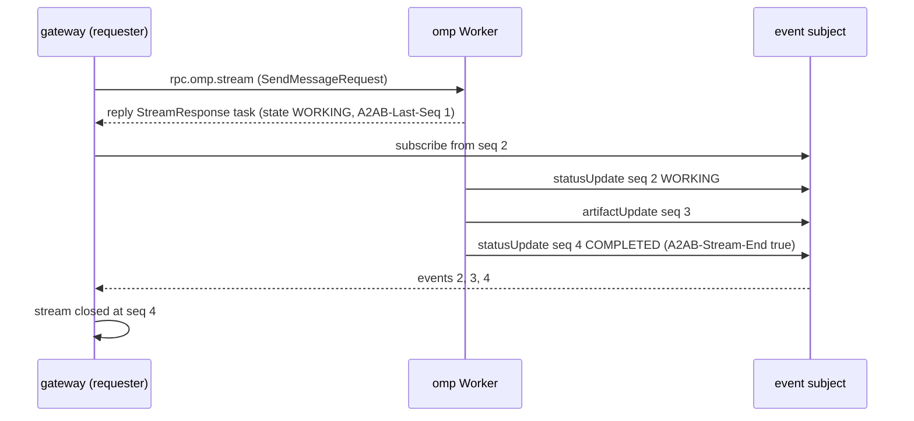

# RFC-0002: Bus Protocol Binding

| Field | Value |
|---|---|
| Status | Draft |
| Depends on | RFC-0000, RFC-0001, RFC-0003 (interface, versioning, extensions), RFC-0005 (task state, sequence, dedupe), RFC-0007 (signing and identity), RFC-0010 (NATS mapping), RFC-0011 (bus binding contract) |
| Owner area | Bus binding (wire protocol) |
| Related interop notes | `docs/interop/a2a-spec-notes.md`, `docs/interop/nats.md`, `docs/interop/hermes.md`, `docs/interop/acp-omp-claude.md` |

Normative language follows RFC-0000 section 1 (BCP 14). Requirement IDs are `[0002-NNN]`.

## 1. Summary

A2A-Bus carries the A2A v1.0 operations, data model and error semantics over a message bus. This RFC defines the wire contract: the subject layout, the operation-to-subject mapping, the bus headers, the payload encoding, the reply and event-stream rules, and how A2A errors are carried. A bus-agnostic contract (RFC-0011) defines what a bus must provide, and RFC-0010 maps that contract onto NATS with JetStream. The binding is A2A over a bus, not a new data model: every payload is an A2A protobuf message from `lf.a2a.v1`. The binding URI is `urn:a2abus:binding:bus:1`.

## 2. Motivation and scope

Hermes speaks A2A over HTTP only (D14). Claude Code and omp are reached through ACP drivers that run inside a supervisor. The local host and later federated hosts need one addressing and delivery scheme so that agents on different processes, and later different hosts, can exchange A2A operations without direct connections. A bus gives logical addressing by agent id and tenant (R-F1), store-and-forward (D2), and at-least-once delivery (D3). This RFC fixes how A2A semantics are expressed on such a bus so that a stock A2A client behind the HTTP gateway sees the same results it would see from any A2A server (D5, D8).

In scope:

- Subject layout under the root `a2a.v1.<tenant>.` (RFC-0001 4.4).
- Operation mapping for all A2A core operations plus the Worker-level extension operations used in M1.
- The bus header set, its value grammar, and its signed subset (signature content owned by RFC-0007).
- Payload encoding, size limits, large-payload references.
- Reply and event-stream semantics, including stream termination and resumption.
- Error carriage on the wire and the mapping of A2A errors to `google.rpc.Status`.
- Service parameter and extension transport.
- Time handling without synchronized clocks (R-F3).

Non-goals:

- The contract a bus must provide (RFC-0011) and the NATS stream, consumer and KV layout (RFC-0010).
- Task state machine, sequence allocation, dedupe windows, redelivery policy (RFC-0005).
- Approval and budget payload schemas (RFC-0006).
- Signature algorithm, key distribution, trust (RFC-0007).
- HTTP JSON-RPC and SSE mapping (RFC-0008).
- Discovery, presence and card storage (RFC-0004).
- Driver behavior toward ACP agents (RFC-0009).
- Use of bus-native features outside A2A semantics (D8). Bus-only operations do not exist.

## 3. Terminology

Terms below are not defined in RFC-0001.

- **Operation token**: the single lowercase subject token that names an A2A operation on a request subject (section 4.3).
- **Request subject**: `a2a.v1.<tenant>.rpc.<agent>.<op>`, used for unary requests.
- **Event subject**: `a2a.v1.<tenant>.ev.<agent>.<task_id>`, used for per-task event delivery.
- **Payload type**: the fully qualified protobuf message name carried in the `A2AB-Payload-Type` header.
- **Bus-level error**: an error produced by the binding itself (routing, size, freshness, signature), as opposed to an A2A error raised by the Worker.
- **Stream end**: the event that closes a requester's event stream, marked by `A2AB-Stream-End: true`.
- **Blob reference**: a `Part.url` pointing at content stored by the bus blob store (RFC-0011), used above the inline size limit.

## 4. Specification

### 4.1 Addressing and subject layout

[0002-001] Every subject used by A2A-Bus MUST begin with the root `a2a.v1.<tenant>.`, where `<tenant>` matches the tenant grammar of RFC-0001 4.4. M1 uses tenant `local`.

[0002-002] Agent ids in subjects MUST match the agent id grammar of RFC-0001 4.4. A binding MUST NOT place any other value in an agent token.

[0002-003] Subject tokens MUST NOT contain the characters `.`, `*`, `>`, whitespace or any character outside `[a-z0-9-]` except as already allowed by the grammars above and the task id rule in [0002-004]. A receiver MUST treat any other subject as addressed to nobody and drop it with a bus-level error where a reply is possible (section 4.7).

[0002-004] Task ids placed in subjects MUST be UUIDv7 strings in lowercase hexadecimal with hyphens (36 characters). The Worker assigns every task id (RFC-0001 4.4, L4). A Worker MUST NOT accept client-supplied task ids for new tasks.

[0002-005] Subject families are exactly:

| Subject | Direction | Purpose |
|---|---|---|
| `a2a.v1.<tenant>.rpc.<agent>.<op>` | requester -> Worker of `<agent>` | Unary A2A operations (section 4.3) |
| `a2a.v1.<tenant>.ev.<agent>.<task_id>` | Worker of `<agent>` -> subscribers | Ordered per-task events (section 4.5) |
| `a2a.v1.<tenant>.audit.<agent>` | any -> audit consumers | Audit records, owned by RFC-0013 (L17) |

No other subject family is defined by this RFC. Presence and card storage are key-value concerns of RFC-0004 and RFC-0010 (L6).

[0002-006] A Worker MUST publish events only on event subjects of its own agent id. A requester MUST NOT publish on another agent's event subject. Enforcement of these rules is by bus permissions (RFC-0007, RFC-0010) and is restated as a requirement for bus-level tests (RFC-0011).

[0002-007] Each agent id MUST be served by at most one live Worker instance per tenant at any time. Presence and lease rules are owned by RFC-0004. Because of this rule a task is pinned to its agent id, so a request for a task always reaches the Worker that created it (L4) without a task-to-instance table on the wire.

### 4.2 Tenant and identity on the wire

[0002-010] The tenant of a request is the `<tenant>` token of its request subject. If the request body carries a non-empty `tenant` field (A2A proto request messages), it MUST equal the subject tenant; otherwise the Worker MUST reply with a bus-level error `TENANT_MISMATCH` (section 4.8).

[0002-011] The sender identity is the value of `A2AB-Sender`. When the transport supplies an authenticated principal (RFC-0010 credentials), the Worker MUST compare it with `A2AB-Sender`; a mismatch MUST be rejected with `PERMISSION_DENIED`. When signing is enabled (RFC-0007), the signature MUST verify before the header is trusted; a failed signature MUST be rejected with `UNAUTHENTICATED`.

[0002-012] Cross-tenant messages are not allowed. A message whose sender is authorized only for tenant `A` MUST NOT be accepted on a subject of tenant `B`. Enforcement is by bus permissions and by [0002-010].

[0002-013] Credentials (bearer tokens, provider keys, bus credentials) MUST NOT appear in any header, payload field, subject or event of this binding (L12, T5). A Worker MUST reject an inbound `Authorization` header carried as a bus header with `MALFORMED_MESSAGE`.

[0002-014] `A2AB-Origin` is set only by the gateway (RFC-0008). A receiver MUST use `A2AB-Origin` as the effective origin of a request only when the envelope sender (`A2AB-Sender`, verified per [0002-011]) is the gateway identity; otherwise the effective origin is `A2AB-Sender`. A receiver MUST ignore `A2AB-Origin` from any other sender. `A2AB-Origin` is part of the signed set (RFC-0007).

### 4.3 Operation mapping

[0002-020] Each A2A operation has one request subject, named by its operation token. Operation tokens are lowercase, one token each, and are fixed by this RFC:

| Operation token | A2A operation (spec name) | Request payload type | Reply payload type |
|---|---|---|---|
| `send` | SendMessage | `lf.a2a.v1.SendMessageRequest` | `lf.a2a.v1.SendMessageResponse` |
| `stream` | SendStreamingMessage (section 4.5) | `lf.a2a.v1.SendMessageRequest` | `lf.a2a.v1.StreamResponse` (initial element only) |
| `get` | GetTask | `lf.a2a.v1.GetTaskRequest` | `lf.a2a.v1.Task` |
| `list` | ListTasks | `lf.a2a.v1.ListTasksRequest` | `lf.a2a.v1.ListTasksResponse` |
| `cancel` | CancelTask | `lf.a2a.v1.CancelTaskRequest` | `lf.a2a.v1.Task` |
| `subscribe` | SubscribeToTask (section 4.5) | `lf.a2a.v1.SubscribeToTaskRequest` | `lf.a2a.v1.StreamResponse` (snapshot only) |
| `push-create` | CreateTaskPushNotificationConfig | `lf.a2a.v1.CreateTaskPushNotificationConfigRequest` | `lf.a2a.v1.TaskPushNotificationConfig` |
| `push-get` | GetTaskPushNotificationConfig | `lf.a2a.v1.GetTaskPushNotificationConfigRequest` | `lf.a2a.v1.TaskPushNotificationConfig` |
| `push-list` | ListTaskPushNotificationConfigs | `lf.a2a.v1.ListTaskPushNotificationConfigsRequest` | `lf.a2a.v1.ListTaskPushNotificationConfigsResponse` |
| `push-delete` | DeleteTaskPushNotificationConfig | `lf.a2a.v1.DeleteTaskPushNotificationConfigRequest` | `google.protobuf.Empty` |
| `card-ext` | GetExtendedAgentCard | `lf.a2a.v1.GetExtendedAgentCardRequest` | `lf.a2a.v1.AgentCard` |

[0002-021] The proto message names above are those of the A2A v1.0 protobuf (`lf.a2a.v1`, L1). A binding MUST NOT add fields to them. Where A2A requires a field to be absent, the binding MUST keep it absent.

[0002-022] A Worker MUST implement every operation token whose A2A operation it can serve. An operation the Worker does not serve MUST be answered with the error defined for it in section 4.8 (capability validation, A2A section 3.3.4), not silently dropped.

[0002-023] A request subject whose operation token is not in the table of [0002-020] MUST be answered with `google.rpc.Status` code `UNIMPLEMENTED` (12), reason `UNSUPPORTED_OPERATION`, domain `a2a-protocol.org`. The binding defines no aliases on the bus: method names such as `message/send` are not valid operation tokens. Aliasing of HTTP method names is an ingress concern of the gateway only (R-I6, RFC-0008).

[0002-024] The `push-*` operations are capability-gated. A Worker that declares `capabilities.pushNotifications` false (the M1 default for bus agents, section 4.9) MUST reply to every `push-*` request with `PushNotificationNotSupportedError` (A2A section 3.3.4). Webhook delivery is therefore not a bus feature in M1; subscribers use event subjects (section 4.5).

### 4.4 Bus headers

[0002-030] Every bus message of this binding carries the headers below. Header names are case-sensitive as written. Names with the `A2AB-` prefix are owned by this binding. `A2A-Version`, `A2A-Extensions` and `traceparent` keep their standard names (L2, W3C Trace Context).

| Header | Present on | Value | Required | Owner / reference |
|---|---|---|---|---|
| `A2AB-Msg-Id` | every request, every event | UUIDv7 string, lowercase | requests: yes; events: yes | this RFC; dedupe in RFC-0005 |
| `A2AB-Causation-Id` | replies, events caused by a request | `A2AB-Msg-Id` of the cause | no | this RFC |
| `A2AB-Sender` | requests | agent id of the sender (or `gateway`, `tui`) | yes on requests | this RFC; identity in RFC-0007 |
| `A2AB-Origin` | requests sent by the HTTP gateway | authenticated HTTP peer id (string); honored only when `A2AB-Sender` is the gateway identity | no | this RFC; gateway (RFC-0008) |
| `A2AB-Ts` | requests | RFC 3339 UTC timestamp, millisecond precision, `Z` suffix | yes on requests | this RFC; signed (RFC-0007) |
| `A2AB-Ttl-Ms` | requests | decimal uint, relative expiry in milliseconds | yes on requests | this RFC; section 4.6 |
| `A2AB-Nonce` | requests when signing is enabled | 16 random bytes, base64url without padding | conditional | RFC-0007 |
| `A2AB-Kid` | signed messages | signing key id | conditional | RFC-0007 |
| `A2AB-Sig` | signed messages | signature value | conditional | RFC-0007 |
| `A2AB-Payload-Type` | every message with a body | fully qualified protobuf name of an `lf.a2a.v1` or `a2abus.v1` message (section 4.4.2) | yes | this RFC |
| `A2AB-After-Seq` | `subscribe` requests | decimal uint64 | no | this RFC; section 4.5 |
| `A2AB-Last-Seq` | replies to `send`, `stream`, `subscribe`, `cancel`, `get` (when a task is returned) | decimal uint64 | yes when a task is returned | this RFC; section 4.5 |
| `A2AB-Stream-End` | events | `true` | only on the stream-end event | this RFC; section 4.5 |
| `A2AB-SP-<key>` | requests, replies | service parameter value (section 4.7) | no | this RFC |
| `A2A-Version` | requests | `1.0` | yes on requests | RFC-0003; section 4.6 |
| `A2A-Extensions` | requests, replies | comma-separated extension URIs | no | RFC-0003 (L2) |
| `traceparent`, `tracestate` | every message | W3C Trace Context, unchanged | yes when tracing is on | RFC-0013 (R-O2) |
| `Content-Type` | every message with a body | `application/x-protobuf` | yes | this RFC (L1) |

[0002-031] `A2AB-Msg-Id` MUST be a UUIDv7 generated by the sender. For an event, the Worker MUST generate the id once when it first appends the event to its task journal and MUST persist it with the event (RFC-0005). A re-publish of the same `(task_id, seq)` MUST carry the same `A2AB-Msg-Id`, so that bus-level duplicate detection (RFC-0011) can drop it.

[0002-032] A receiver MUST ignore unknown headers whose names begin with `A2AB-` and MUST ignore unknown headers without that prefix (forward compatibility, A2A section 5.7). A receiver MUST NOT ignore a required extension (section 4.7).

[0002-033] A header value MUST be printable ASCII (0x20-0x7E) and at most 1024 bytes, except `traceparent` and `tracestate`, which follow W3C limits. A sender MUST NOT place a newline or a NUL byte in a header value. A receiver that sees a value violating this MUST reply `MALFORMED_MESSAGE` if a reply is possible.

#### 4.4.1 Time

[0002-034] Deadlines are relative. The sender states a relative expiry in `A2AB-Ttl-Ms` (section 4.6). Hosts need not have synchronized clocks. Signature timestamp skew is bounded by `max_skew_ms` (RFC-0007 [0007-040]) and affects only replay and staleness; no task behavior depends on cross-host clock comparison (R-F3).

#### 4.4.2 Payload encoding

[0002-035] Every payload is a binary protobuf encoding of the message named by `A2AB-Payload-Type`, with `Content-Type: application/x-protobuf` (L1). The named message is either an `lf.a2a.v1` message (A2A operations, responses and stream events) or an `a2abus.v1` message (audit events, RFC-0005 and RFC-0006 payloads carried on the bus). Field presence follows the A2A proto `optional` and message-typed fields, so an absent field and a default value remain distinct.

[0002-036] A receiver MUST reject a payload whose `A2AB-Payload-Type` does not match the operation (section 4.3 table) or does not parse, with `MALFORMED_MESSAGE`.

[0002-037] A JSON rendering (A2A proto-JSON mapping, including ISO 8601 UTC timestamps with `Z`, ProtoJSON enum names such as `TASK_STATE_INPUT_REQUIRED`, and camelCase fields) MAY be accepted for debugging only when the Worker is started with the debug option of RFC-0010. Without that option a JSON payload is rejected with `UNSUPPORTED_MEDIA_TYPE` (section 4.8). Examples in this RFC are proto-JSON renderings of the binary payloads and are equivalent to them.

[0002-038] Binary `bytes` fields (`Part.raw`) are carried as protobuf bytes; no base64 is applied on the bus. Enum values are protobuf enum numbers on the wire.

### 4.5 Replies, events and streams

[0002-040] For a unary operation the Worker MUST send exactly one reply to the reply subject supplied by the request mechanism (RFC-0011 request/reply). The reply payload is either the success payload of section 4.3 or a `google.rpc.Status` (section 4.8), selected by `A2AB-Payload-Type`. A requester MUST accept the first reply to a request and ignore later replies to the same request.

[0002-041] Task events are published by the Worker that owns the task, one event per message, on `a2a.v1.<tenant>.ev.<agent>.<task_id>`. Each event payload is a `lf.a2a.v1.StreamResponse` whose oneof holds exactly one of `statusUpdate` or `artifactUpdate` (L3). A `Task` or `Message` element is never published on an event subject; the initial element is delivered on the reply (section 4.5.1).

[0002-042] The per-task sequence number `seq` is defined by RFC-0005 and carried in the event metadata under `urn:a2abus:ext:sequence:1` (L8). Events of one task are published in strictly increasing `seq` order starting at 1. The Worker MUST NOT publish event `n+1` for a task before the bus has acknowledged event `n` (RFC-0011 publish acknowledgement). The Worker MUST NOT reuse a `seq` value for a different event.

[0002-043] A requester consuming an event subject MUST ignore events whose `seq` is not greater than the highest `seq` it has already processed for that task (idempotent handling, L5). A gap (a received `seq` greater than the previous highest plus one) MUST be treated as a broken stream: the requester MUST fetch the task with `get` and resubscribe from the highest processed `seq` (section 4.5.2).

[0002-044] A stream end is the first event whose `TaskStatusUpdateEvent.status.state` is terminal (`COMPLETED`, `FAILED`, `CANCELED`, `REJECTED`) or interrupted (`INPUT_REQUIRED`). That event MUST carry the header `A2AB-Stream-End: true` (L3). No event after the stream end is published for that task until the task is resumed by a new `send` (L10). Note the conflict with A2A section 3.1.2, recorded in section 7.

[0002-045] The Worker MUST NOT rely on subscribers being present. Events are durable (RFC-0010): a subscriber that connects later replays from the sequence it needs. Delivery of events to requesters through durable consumer reads is an M1 gap of the NATS binding (RFC-0010 [0010-060]; section 9 O-9).

[0002-046] Event retention is by age and size (RFC-0010 sets the stream limits). The event stream max age MUST be at least the greater of 7 days and T_task + 24 hours, where T_task is the terminal-task retention of RFC-0005 [0005-043] (RFC-0010 [0010-027]). Non-terminal events are not guaranteed to remain: once events age out, `get` (GetTask) is authoritative for the task's state and the requester MUST NOT infer state from missing events. A requester whose replay start has been removed falls back under [0002-063].

#### 4.5.1 SendMessage and SendStreamingMessage

[0002-050] `send` (SendMessage) with `configuration.returnImmediately` false or absent MUST NOT reply until the task reaches a terminal or interrupted state, or until the Worker has produced a Message response, and then MUST reply with `SendMessageResponse` holding that Task or Message. The wait is also bounded by the smaller of the caller's timeout and the task deadline (RFC-0005 [0005-046]); at that bound the reply carries the current non-terminal Task. With `returnImmediately` true the Worker MUST reply as soon as the Task (or Message) is recorded and processing continues in the background (A2A sections 3.2.2 and 3.3.3). Note the conflict with A2A section 3.1.1, recorded in section 7.

[0002-051] The reply to a `send` that carries a Task MUST contain header `A2AB-Last-Seq` equal to the highest `seq` recorded for that task at the time of the reply (0 if none), and the Task MUST carry `Task.metadata["urn:a2abus:ext:sequence:1"]` with `seq` equal to that value (RFC-0005 [0005-021]). The requester uses it as the starting point for any event subscription.

[0002-052] `stream` (SendStreamingMessage) is a unary request. The reply carries the first element of the A2A stream: a `StreamResponse` whose oneof is `task` or `message` (L3). The reply MUST carry `A2AB-Last-Seq` when it carries a Task, and that Task MUST carry the matching `Task.metadata["urn:a2abus:ext:sequence:1"]` (L8).

[0002-053] After a `stream` reply carrying a Task, the requester MUST determine whether the stream has ended from the Task state in the reply. If that state is terminal or interrupted, the requester MUST close the stream and MUST NOT subscribe. Otherwise it MUST subscribe to the task's event subject from `A2AB-Last-Seq + 1` (section 4.5.2).

[0002-054] A `stream` reply carrying a `message` is a complete stream (A2A section 3.1.2, message-only case). No subscription is made.

#### 4.5.2 SubscribeToTask and resumption

[0002-060] `subscribe` (SubscribeToTask) MUST reply with a `StreamResponse` holding the current `task` snapshot (A2A section 3.1.6: the first event is a Task snapshot). The reply MUST carry `A2AB-Last-Seq` (highest seq at reply time) and the snapshot MUST carry the same value in `Task.metadata["urn:a2abus:ext:sequence:1"]` (L8).

[0002-061] `subscribe` MAY carry `A2AB-After-Seq: <n>`, meaning the requester has fully processed events through `seq = n`. The Worker MUST NOT deliver events on the reply. The requester MUST subscribe to the event subject from `n + 1` (or from `A2AB-Last-Seq + 1` when `A2AB-After-Seq` is absent) and MUST ignore events it already processed (section 4.5 [0002-043]). The Worker validates the value only as an unsigned 64-bit integer; a larger value than `A2AB-Last-Seq` is accepted and simply yields no replay.

[0002-062] `subscribe` on a task in a terminal state MUST be answered with `UnsupportedOperationError` (A2A sections 3.1.6 and 10.4.6). A requester that needs the final state uses `get`. `subscribe` on an interrupted task is allowed and its event stream ends at the next interruption or terminal state.

[0002-063] Replay depends on retention (section 4.5 [0002-046]). If the requested start sequence is no longer retained, the attach fails locally with the retention condition (RFC-0010 [0010-077]; RFC-0011 `Unavailable` `RETENTION_EXCEEDED`). That condition is local to the requester and is not carried on the wire. The requester MUST call `subscribe` for a fresh snapshot and `A2AB-Last-Seq`, and MUST treat events it has not seen as lost. If the task is non-terminal and the attach fails again because no event is retained, the requester MUST retry with backoff and MUST NOT spin. The Worker MUST NOT fabricate events.

#### 4.5.3 Resumption from interrupted state

[0002-064] A task in `INPUT_REQUIRED` (approval, L7) resumes when a `send` arrives with the same `taskId` and `contextId` (L10). No M1 Worker emits `AUTH_REQUIRED` (RFC-0005 [0005-009]). The Worker MUST accept such a `send` only for tasks in an interrupted state. A `send` to a task in a non-interrupted, non-terminal state, and a `send` to a terminal task, MUST be answered with `UnsupportedOperationError` (A2A section 3.1.1).

[0002-065] The approval request is an `INPUT_REQUIRED` status event on the task's event subject whose `status.message.metadata["urn:a2abus:ext:approval:1"]` holds the approval request defined by RFC-0006. The decision is a `send` on the request subject for the same agent, with the same `taskId` and `contextId`, whose message carries a Part with structured data defined by RFC-0006. No separate approvals subject exists (agreed with LifecycleAuthor, RFC-0005/0006).

### 4.6 Time-to-live, freshness and expiry

[0002-070] Every request MUST carry `A2AB-Ts` and `A2AB-Ttl-Ms`. `A2AB-Ttl-Ms` MUST be an integer in `[1, 3600000]` (one hour). A value outside that range is rejected with `MALFORMED_MESSAGE`.

[0002-071] The receiver computes the request deadline as its own receipt time plus `A2AB-Ttl-Ms`. A Worker MUST NOT start processing of a request after that deadline has passed and MUST answer it with `REQUEST_EXPIRED` (section 4.8) if it has not yet started work.

[0002-072] Receivers MUST reject a request as stale when `local_now - A2AB-Ts` exceeds `A2AB-Ttl-Ms + 30000` (allowance 30 s, [INFERENCE] default), answering `REQUEST_EXPIRED`. When `A2AB-Ts` is more than 30 s ahead of local time, the receiver MUST ignore `A2AB-Ts` for the staleness check and use receipt time only. No other use of `A2AB-Ts` is permitted.

[0002-073] Expiry MUST fail closed (T11): a request whose expiry cannot be established MUST NOT be processed.

### 4.7 Service parameters, extensions and versions

[0002-080] `A2A-Version` MUST be present on every request and MUST equal `1.0`. A missing or empty value is treated as unsupported and answered `VersionNotSupportedError` (A2A section 3.6), because A2A treats an empty value as version 0.3, which this binding does not carry. A Worker MUST NOT silently fall back to another version.

[0002-081] `A2A-Extensions` lists the extension URIs the requester supports for this operation, comma-separated, each an absolute URI (L2, RFC-0003). A Worker that requires an extension it advertises as required (A2A section 3.3.4) and that is absent from the list MUST answer `ExtensionSupportRequiredError`. Unknown non-required extensions are ignored (A2A section 3.3.4).

[0002-082] The bus binding carries the A2A service parameters `Version` and `Extensions` in the headers `A2A-Version` and `A2A-Extensions` (A2A section 12.3). Any other service parameter `K` is carried in the header `A2AB-SP-<k>`, where `<k>` is `K` lowercased and restricted to `[a-z0-9-]{1,48}`. A value MUST be printable ASCII of at most 1024 bytes (section 4.4 [0002-033]). A client MUST NOT send a service parameter whose value cannot be expressed this way; it MUST fail the call with `MALFORMED_MESSAGE` locally. The binding defines no fallback body field in M1.

[0002-083] Extension URIs are `urn:a2abus:ext:<name>:<major>` for bus-defined extensions (`approval:1`, `budget:1`, `sequence:1`) (L7-L9, RFC-0003). A new URI is required for a breaking change (A2A section 4.6.3); a receiver MUST NOT fall back from a URI it does not understand to an older one.

[0002-084] Extension data in messages and events is carried in the metadata maps defined by the A2A data model (`Message.metadata`, `TaskStatus.message.metadata`, event `metadata`), keyed by extension URI. This binding adds no other field.

### 4.8 Errors on the wire

[0002-090] A Worker answers a request either with the success payload of section 4.3 or with a `google.rpc.Status` message, selected by `A2AB-Payload-Type: google.rpc.Status`. An error reply MUST carry exactly one `google.rpc.ErrorInfo` detail. Its `domain` is `a2a-protocol.org` for A2A errors and `a2abus.v1` for bus-level errors.

[0002-091] A2A errors MUST use the status code and `ErrorInfo.reason` below. The `reason` is the A2A error name in UPPER_SNAKE_CASE without the `Error` suffix (A2A section 11.6). `status.code` values are gRPC codes, and these are the codes the HTTP gateway (RFC-0008) maps to HTTP status.

| A2A error | `status.code` | `ErrorInfo.reason` |
|---|---|---|
| TaskNotFoundError | 5 NOT_FOUND | `TASK_NOT_FOUND` |
| TaskNotCancelableError | 9 FAILED_PRECONDITION | `TASK_NOT_CANCELABLE` |
| PushNotificationNotSupportedError | 9 FAILED_PRECONDITION | `PUSH_NOTIFICATION_NOT_SUPPORTED` |
| UnsupportedOperationError | 9 FAILED_PRECONDITION | `UNSUPPORTED_OPERATION` |
| InvalidParamsError | 3 INVALID_ARGUMENT | `INVALID_PARAMS` |
| ContentTypeNotSupportedError | 3 INVALID_ARGUMENT | `CONTENT_TYPE_NOT_SUPPORTED` |
| InvalidAgentResponseError | 13 INTERNAL | `INVALID_AGENT_RESPONSE` |
| ExtendedAgentCardNotConfiguredError | 9 FAILED_PRECONDITION | `EXTENDED_AGENT_CARD_NOT_CONFIGURED` |
| ExtensionSupportRequiredError | 9 FAILED_PRECONDITION | `EXTENSION_SUPPORT_REQUIRED` |
| VersionNotSupportedError | 9 FAILED_PRECONDITION | `VERSION_NOT_SUPPORTED` |
| EXTENSION_DATA_INVALID (InvalidParams, JSON-RPC -32602; RFC-0003) | 3 INVALID_ARGUMENT | `EXTENSION_DATA_INVALID` |

The table follows the A2A canonical mapping (A2A section 5.4); the gRPC codes are those of the A2A gRPC binding. [0002-091] also applies to the UnsupportedOperationError that a Worker raises for an invalid `send` (section 4.5.3). Where a detail is needed, the Worker MUST put it in `ErrorInfo.metadata` (string values), e.g. `taskId`, `detail`.

[0002-092] Bus-level errors are defined by this RFC. Their `ErrorInfo.domain` is `a2abus.v1`.

| Bus-level reason | `status.code` | Meaning |
|---|---|---|
| `UNAUTHENTICATED` | 16 | signature missing or invalid where required |
| `PERMISSION_DENIED` | 7 | sender not allowed to call the agent or operation, or sender/principal mismatch |
| `REQUEST_EXPIRED` | 4 DEADLINE_EXCEEDED | request stale or expired (section 4.6) |
| `PAYLOAD_TOO_LARGE` | 8 RESOURCE_EXHAUSTED | payload above the negotiated limit and no blob reference used (section 4.10) |
| `MALFORMED_MESSAGE` | 3 INVALID_ARGUMENT | unparseable payload, bad header, bad subject token, bad TTL |
| `UNSUPPORTED_MEDIA_TYPE` | 3 INVALID_ARGUMENT | JSON payload without debug mode |
| `TENANT_MISMATCH` | 3 INVALID_ARGUMENT | body tenant differs from subject tenant |
| `OVERLOADED` | 14 UNAVAILABLE | admission refused for load; carries `google.rpc.RetryInfo` |
| `DRAINING` | 14 UNAVAILABLE | receiving Worker is DRAINING and takes no new tasks; running tasks continue (RFC-0005 [0005-050]) |
| `DUPLICATE_IN_PROGRESS` | 10 ABORTED | repeated `A2AB-Msg-Id` while the original is still being processed; carries `RetryInfo` |

[0002-093] Bus-level errors are produced by the receiving side of a request. A requester that receives no reply because no responder exists MUST treat it as `UNAVAILABLE` locally, and a requester whose request timed out MUST treat it as `DEADLINE_EXCEEDED` locally. These two conditions are not carried on the wire.

[0002-094] Overload: a Worker that refuses a `send` for load MUST NOT drop it silently (R-S6, T9). If the Worker can record the task, it MUST create the task in state `REJECTED` with a status message explaining the overload and reply normally (A2A `REJECTED` is a terminal state of the task). If it cannot record the task, it MUST reply `OVERLOADED` with `RetryInfo`.

[0002-095] Error payloads MUST NOT contain the request body, credentials, file paths of the host or stack traces (R-S5, T5). Error `message` strings are short English sentences from a fixed set.

### 4.9 Agent Card binding declaration

[0002-100] An agent that serves this binding MUST declare, in its Agent Card, one `supportedInterfaces` entry with `protocolBinding` set to `urn:a2abus:binding:bus:1` and `protocolVersion` set to `1.0` (A2A section 12.7). The entry's `tenant` MUST equal the tenant of the subject root used by the agent.

[0002-101] The entry's `url` identifies the bus endpoint, not the agent. Its scheme names the bus implementation (`nats://` for RFC-0010), it MUST NOT contain user information (L12), and the agent id is implied by the card key (L6). Example: `nats://bus.local:4222`.

[0002-102] The card a bus agent publishes in key-value storage (RFC-0004, L6) is the same card served by the gateway. It MUST list the `supportedInterfaces` entries for every binding the agent serves. Clients select an interface by `protocolBinding` (A2A section 8.3.2). The gateway entry MUST use `JSONRPC` with `protocolVersion` `1.0` when the agent is reachable over HTTP, because the Hermes client selects the entry by `protocolBinding` string and does not use the bus entry (`docs/interop/hermes.md`, section 2).

[0002-103] Bus agents M1 declare `capabilities.streaming` true when `stream` and `subscribe` are served and `capabilities.pushNotifications` false (section 4.3 [0002-024]). `capabilities.extendedAgentCard` is true only when an extended card is configured.

[0002-104] Card signing (JWS, RFC 8785 canonicalization) is owned by RFC-0007 and RFC-0004 (L11). This RFC adds no card content beyond [0002-100] to [0002-103].

### 4.10 Payload size and large content

[0002-110] The inline payload limit for a message is the smaller of the bus limit reported by the bus binding (`max_message_size`, RFC-0011) and the limit of 262144 bytes (256 KiB, default). A sender MUST NOT publish a request or event above the inline limit unless the bus limit allows it and the content is by reference (below).

[0002-111] Content above the inline limit MUST be placed in the bus blob store (RFC-0011) and referenced from a `Part.url` with scheme `a2abus-blob` and the form `a2abus-blob://<tenant>/<sha256-hex>`, where `<sha256-hex>` is the lowercase hex SHA-256 of the bytes. `Part.mediaType` and `Part.filename` carry the media type and name (A2A section 4.1.6).

[0002-112] A receiver that dereferences a blob reference MUST verify the SHA-256 digest of the fetched bytes against the reference and MUST discard the content on mismatch. A receiver MUST NOT treat a blob reference from a tenant other than the message's tenant as valid.

[0002-113] A payload above the inline limit that is not a blob reference is refused with `PAYLOAD_TOO_LARGE`. The Worker MUST NOT truncate content.

### 4.11 Sequence diagram (normative by illustration)



### 4.12 Worked examples (informative, wire-equivalent)

Payloads are binary protobuf on the wire (L1). Bodies below are the proto-JSON rendering of the same messages. Headers are shown as name: value. Times, ids and digests are illustrative. The approval payload schema is owned by RFC-0006 and is abbreviated here.

#### 4.12.1 send (blocking) with approval interrupt

Request on `a2a.v1.local.rpc.omp.send`:

```
Content-Type: application/x-protobuf
A2AB-Msg-Id: 0196f3a2-0b7e-7c3d-a1f0-2d9e4b6c8a10
A2AB-Sender: gateway
A2AB-Origin: hermes
A2AB-Ts: 2026-03-14T10:22:30.912Z
A2AB-Ttl-Ms: 300000
A2AB-Payload-Type: lf.a2a.v1.SendMessageRequest
A2A-Version: 1.0
A2A-Extensions: urn:a2abus:ext:approval:1
traceparent: 00-4bf92f3577b34da6a3ce929d0e0e4736-00f067aa0ba902b7-01
```

```json
{
  "tenant": "local",
  "message": {
    "messageId": "0196f3a2-0b80-7e11-9c4d-61a2b3c4d5e6",
    "role": "ROLE_USER",
    "parts": [{ "text": "Refactor the parser module and run its tests." }]
  },
  "configuration": { "returnImmediately": false, "historyLength": 0 }
}
```

The Worker creates the task (ids assigned by the Worker, L4), runs until it needs approval, and replies on the reply subject. The reply does not carry events.

```
A2AB-Payload-Type: lf.a2a.v1.SendMessageResponse
A2AB-Causation-Id: 0196f3a2-0b7e-7c3d-a1f0-2d9e4b6c8a10
A2AB-Last-Seq: 2
```

```json
{
  "task": {
    "id": "0196f3a2-7c1e-7d4a-9b2e-5f1c8a3d6e21",
    "contextId": "0196f3a2-7c1d-7b00-8c11-9a2b3c4d5e6f",
    "metadata": { "urn:a2abus:ext:sequence:1": { "seq": 2 } },
    "status": {
      "state": "TASK_STATE_INPUT_REQUIRED",
      "timestamp": "2026-03-14T10:22:31.104Z",
      "message": {
        "messageId": "0196f3a2-0c01-7a00-8d00-000000000001",
        "role": "ROLE_AGENT",
        "parts": [{ "text": "Approval needed: run cargo test" }],
        "metadata": {
          "urn:a2abus:ext:approval:1": { "requestId": "ap-7f3", "action": "shell.exec", "scope": "cargo test" }
        }
      }
    }
  }
}
```

The reply carries `A2AB-Last-Seq: 2` because events 1 and 2 were published before the reply. The requester is now subscribed to the event subject from seq 3 (section 4.5.1). Because the state is interrupted, `stream` semantics would end here.

#### 4.12.2 Event delivery and stream end

The interrupt is published as event seq 3 on `a2a.v1.local.ev.omp.0196f3a2-7c1e-7d4a-9b2e-5f1c8a3d6e21`:

```
Content-Type: application/x-protobuf
A2AB-Msg-Id: 0196f3a2-7c20-7f00-a000-0000000000a3
A2AB-Payload-Type: lf.a2a.v1.StreamResponse
A2AB-Stream-End: true
traceparent: 00-4bf92f3577b34da6a3ce929d0e0e4736-00f067aa0ba902b7-01
```

```json
{
  "statusUpdate": {
    "taskId": "0196f3a2-7c1e-7d4a-9b2e-5f1c8a3d6e21",
    "contextId": "0196f3a2-7c1d-7b00-8c11-9a2b3c4d5e6f",
    "status": { "state": "TASK_STATE_INPUT_REQUIRED", "timestamp": "2026-03-14T10:22:31.104Z" },
    "metadata": { "urn:a2abus:ext:sequence:1": { "seq": 3 } }
  }
}
```

`A2AB-Stream-End: true` marks the first interrupted event (section 4.5 [0002-044]). The stream closes on the requester side. Stream closure does not end the task.

#### 4.12.3 stream reply and subscribe with After-Seq

`stream` request on `a2a.v1.local.rpc.claude.stream` with the same headers as 4.12.1 except `A2AB-Msg-Id`. Reply, with the task still working:

```
A2AB-Payload-Type: lf.a2a.v1.StreamResponse
A2AB-Last-Seq: 1
```

```json
{ "task": { "id": "0196f4b1-1a22-7c90-b3d4-0e5f6a7b8c9d", "contextId": "0196f4b1-1a21-7d00-8e00-111122223333", "status": { "state": "TASK_STATE_WORKING" }, "metadata": { "urn:a2abus:ext:sequence:1": { "seq": 1 } } } }
```

Requester subscribes to `a2a.v1.local.ev.claude.0196f4b1-1a22-7c90-b3d4-0e5f6a7b8c9d` from seq 2.

Later, a requester that already processed seq 1 and 2 calls `subscribe` on `a2a.v1.local.rpc.claude.subscribe`:

```
A2AB-Msg-Id: 0196f4c0-0001-7000-8000-00000000aa01
A2AB-Sender: gateway
A2AB-Ts: 2026-03-14T10:25:02.000Z
A2AB-Ttl-Ms: 60000
A2AB-After-Seq: 2
A2AB-Payload-Type: lf.a2a.v1.SubscribeToTaskRequest
A2A-Version: 1.0
```

```json
{ "tenant": "local", "id": "0196f4b1-1a22-7c90-b3d4-0e5f6a7b8c9d" }
```

Reply (snapshot, no events):

```
A2AB-Payload-Type: lf.a2a.v1.StreamResponse
A2AB-Last-Seq: 4
```

```json
{ "task": { "id": "0196f4b1-1a22-7c90-b3d4-0e5f6a7b8c9d", "contextId": "0196f4b1-1a21-7d00-8e00-111122223333", "status": { "state": "TASK_STATE_WORKING" }, "metadata": { "urn:a2abus:ext:sequence:1": { "seq": 4 } } } }
```

The requester subscribes from seq 3. Events 3 and 4 arrive on the event subject. Events 1 and 2 are not redelivered.

#### 4.12.4 cancel of a terminal task

Request on `a2a.v1.local.rpc.omp.cancel` with body `{ "tenant": "local", "id": "0196f3a2-7c1e-7d4a-9b2e-5f1c8a3d6e21" }` for a COMPLETED task. Reply:

```
A2AB-Payload-Type: google.rpc.Status
A2AB-Causation-Id: 0196f3a5-0000-7000-8000-00000000cc02
```

```json
{
  "code": 9,
  "message": "Task cannot be canceled.",
  "details": [
    {
      "@type": "type.googleapis.com/google.rpc.ErrorInfo",
      "reason": "TASK_NOT_CANCELABLE",
      "domain": "a2a-protocol.org",
      "metadata": { "taskId": "0196f3a2-7c1e-7d4a-9b2e-5f1c8a3d6e21" }
    }
  ]
}
```

#### 4.12.5 get of an unknown task

Request on `a2a.v1.local.rpc.omp.get` with `{ "tenant": "local", "id": "0196f3a2-ffff-7000-8000-000000000000", "historyLength": 0 }`. Reply:

```json
{
  "code": 5,
  "message": "Task not found.",
  "details": [
    { "@type": "type.googleapis.com/google.rpc.ErrorInfo", "reason": "TASK_NOT_FOUND", "domain": "a2a-protocol.org", "metadata": {} }
  ]
}
```

#### 4.12.6 version and push rejections

A request on `a2a.v1.local.rpc.omp.send` with `A2A-Version: 0.3` is answered with `code` 9, reason `VERSION_NOT_SUPPORTED` (section 4.7 [0002-080]). A `push-create` request on `a2a.v1.local.rpc.omp.push-create` is answered with `code` 9, reason `PUSH_NOTIFICATION_NOT_SUPPORTED` (section 4.3 [0002-024]). Both use `A2AB-Payload-Type: google.rpc.Status`.

#### 4.12.7 large payload by reference

A 3 MiB attachment is stored in the blob store (RFC-0011). The sender publishes a `send` whose message part is:

```json
{
  "url": "a2abus-blob://local/b94d27b9934d3e08a52e52d7da7dabfac484efe37a5380ee9088f7ace2efcde9",
  "mediaType": "application/pdf",
  "filename": "report.pdf"
}
```

The receiver fetches the blob and verifies its SHA-256 digest before use (section 4.10 [0002-112]). A mismatch discards the content.

#### 4.12.8 agent card bus entry

A card fragment for the `omp` agent in the per-tenant KV bucket (RFC-0004, L6):

```json
{
  "supportedInterfaces": [
    { "url": "nats://bus.local:4222", "protocolBinding": "urn:a2abus:binding:bus:1", "protocolVersion": "1.0", "tenant": "local" },
    { "url": "https://gateway.local:8443/a2a/omp", "protocolBinding": "JSONRPC", "protocolVersion": "1.0", "tenant": "local" }
  ],
  "capabilities": { "streaming": true, "pushNotifications": false }
}
```

## 5. Interoperability

**Stock A2A peer.** A stock A2A client never sees subjects, headers or the bus. It reaches an agent through the HTTP gateway (RFC-0008), which speaks the A2A JSON-RPC binding exactly (L15). The gateway translates JSON-RPC requests into the operation tokens of section 4.3 and maps bus replies back to A2A results and to HTTP errors using the table in section 4.8. The data model is unchanged: Task, Message, Part, Artifact and AgentCard are the A2A v1.0 objects (D5). Where A2A and this binding differ on timing (section 7), the gateway presents A2A behaviour to the HTTP client. A stock client that does not know the bus interface MUST skip it (A2A section 8.3.2 selects supported bindings only), so the card entry in [0002-100] does not break it.

**Hermes.** Hermes uses A2A over HTTP only (D14; `docs/interop/hermes.md` section 8.3). It selects the `supportedInterfaces` entry whose `protocolBinding` is `JSONRPC`, sends `A2A-Version: 1.0` on every request, and does not send `A2A-Extensions`. The bus is therefore invisible to Hermes, and [0002-102] keeps a JSONRPC entry on every Hermes-reachable card. Hermes's SSE reader and its `[INPUT_REQUIRED]` text detection (`hermes.md` section 8.5) see the same events the gateway produces from the event subject. Hermes returns `-32602` for an unsupported `A2A-Version` where A2A specifies `VersionNotSupportedError` (`hermes.md` section 1.4); this is a server-side difference on Hermes, not a bus concern, and the gateway MUST answer with the A2A error defined in section 4.8 on the bus side.

**ACP agents (Claude Code via claude-agent-acp, omp via `omp --mode acp`).** ACP agents never see the bus, subjects, headers or `A2AB-` values. Their driver is a Backend run inside the Worker process (RFC-0009, L13). The ACP JSON-RPC session (`initialize`, `session/new`, `session/prompt`, `session/update`, `session/request_permission`, `session/cancel`; `docs/interop/acp-omp-claude.md` sections 1-5) is translated by the Worker into the operations of section 4.3. The ACP `stopReason` values map to task states in RFC-0005 and RFC-0009. Nothing in this binding requires an ACP agent to change.

**What is lost.** Relative to a direct HTTP A2A exchange, the bus binding adds no loss of A2A semantics. Push webhooks are not offered on the bus in M1 (section 4.3 [0002-024]). Clients that need push use the gateway, which may implement webhook delivery from the event subject (open issue O-1).

## 6. Security considerations

- **T4 Replay and duplication.** `A2AB-Msg-Id` (UUIDv7), `A2AB-Nonce` (signed), `A2AB-Ts` and `A2AB-Ttl-Ms` bound replay. Dedupe for submissions and events is in RFC-0005 and RFC-0011. Event `A2AB-Msg-Id` is stable across re-publish (section 4.4 [0002-031]).
- **T5 Credential leakage.** No credential in any header, subject or payload (section 4.2 [0002-013]); error payloads exclude request bodies (section 4.8 [0002-095]).
- **T6 Impersonation on the bus.** `A2AB-Sender` is checked against the transport principal and, when enabled, the signature (section 4.2 [0002-011]). Publish permission on event subjects is restricted to the owning Worker (section 4.1 [0002-006]). Signature content is RFC-0007's.
- **T8 Poisoned discovery.** Cards are checked by RFC-0007 before the bus entry is trusted. This RFC does not accept unsigned cards for cross-host use (section 4.9 [0002-104]).
- **T9 Flooding.** Overload produces an explicit `REJECTED` task or `OVERLOADED` error (section 4.8 [0002-094]); rate limits are RFC-0005 and RFC-0010 concerns.
- **T10 Metadata leakage.** Subjects carry tenant, agent id and task id only. Task ids are random-suffixed UUIDv7 and are not secrets; authorization to read a task's events is enforced by bus permissions, not by subject secrecy. Content is never placed in subjects (section 4.1 [0002-003]).
- **T11 Stale authority in partitions.** Expiry is relative and fails closed (section 4.6 [0002-073]).
- **T12 Gateway as attack surface.** The gateway is a bus client with its own identity and cannot send approval decisions as another principal. Its alias handling is ingress-only (section 4.3 [0002-023]).
- **T14 Driver as confused deputy.** Drivers are Backends and never touch the bus (L13); the Worker is the only bus client for its agent's events.
- **Subject permissions.** A requester's permission to subscribe to `a2a.v1.<tenant>.ev.<agent>.>` is granted per agent it is authorized to call (RFC-0007). Task ids are not guessable by design (UUIDv7 with 74 random bits), but guessability is not a control.

## 7. Rationale and alternatives considered

**Subject layout with one rpc subject per operation.** Operation tokens are in the subject so that bus-level permissions can allow `send` and deny `cancel` per requester. The alternative, one request subject with the operation in a header, moves authorization into the Worker and makes bus ACLs useless for it.

**Events on a per-task subject, replies for the first element.** A per-task subject lets a requester subscribe to exactly one task and makes retention and replay per task natural (L3). The first element of a stream is on the reply because a unary reply is the only request/reply primitive, and a snapshot taken at reply time plus `A2AB-Last-Seq` gives a clean replay start.

**Stream end on terminal or interrupted.** L3 fixes stream end at the first terminal or interrupted status. This conflicts with A2A section 3.1.2, which says the task lifecycle stream MUST close only at terminal states, and agrees with A2A section 11.7, which closes at "terminal or interrupted". Choosing L3 means a requester that waits for an approval does not hold a stream open on a task that is blocked on a human. The conflict is recorded in section 9 and resolved in favour of L3 for the bus. HTTP clients see the same behaviour through the gateway, and the gateway's choice must be recorded by RFC-0008.

**`send` blocking default.** A2A section 3.2.2 defines `returnImmediately` default false (blocking until terminal or interrupted). Section 3.1.1 says the operation "MUST return immediately". The binding follows section 3.2.2, the more specific rule for the parameter, and keeps `returnImmediately: true` as the non-blocking form. The conflict is recorded in section 9.

**Deterministic `Msg-Id` on events.** A UUIDv7 persisted in the journal (section 4.4 [0002-031]) gives the bus a stable dedupe key without a second naming scheme and without violating the UUIDv7 rule of RFC-0001.

**`A2AB-Ts` plus `A2AB-Ttl-Ms` instead of absolute deadlines.** Relative expiry avoids clock agreement (R-F3). The 30 s allowance covers ordinary skew on one host and is adjustable by configuration; this is an [INFERENCE] default.

**No bus aliases.** Accepting `message/send` on the bus would create a second method namespace that A2A clients cannot see. Aliasing is confined to the HTTP ingress (R-I6).

**Push not offered on the bus in M1.** A2A allows the capability to be false (section 3.3.4). A webhook is an HTTP POST to a URL the requester supplies, which is a new egress path from the Worker. Keeping it off the bus avoids that path in M1 (T9, T12).

**Blob references instead of chunking.** A reference keeps the bus message small and makes the content hash the integrity check (R-D4). Chunked streams on the bus would be a bus-native feature outside A2A semantics (D8).

**Conflicts recorded for the integrator.** (a) A2A section 3.1.1 "MUST return immediately" vs section 3.2.2 blocking default (section 4.5.1). (b) A2A section 3.1.2 terminal-only stream close vs section 11.7 terminal-or-interrupted (section 4.5 [0002-044]). (c) SubscribeToTask verb is GET in the proto mapping (A2A section 10.3/10.4.6) and POST in the HTTP table (section 5.3), recorded in `docs/interop/a2a-spec-notes.md` D-1; this RFC uses the operation token `subscribe` and is verb-agnostic. (d) A2A section 12.4 cites section 3.2.2 for error handling; the correct reference is section 3.3.2 (D-3). (e) Examples in A2A use version `0.3`; this binding requires `1.0` (D-4).

## 8. Conformance

| Requirement | Test idea | Level |
|---|---|---|
| [0002-001] | Publish from a test client on subject without root; expect drop or reject | MUST |
| [0002-002] | Use an agent id outside the grammar; expect `MALFORMED_MESSAGE` | MUST |
| [0002-003] | Subject with `*` or uppercase token; expect no delivery | MUST |
| [0002-004] | Client-supplied task id on a new `send`; expect the Worker to assign its own | MUST |
| [0002-005] | Publish on an undefined family; expect no Worker reaction | MUST |
| [0002-006] | Worker publish on another agent's event subject; expect bus permission denial (bus-mem fault test) | MUST |
| [0002-007] | Start two Worker instances for one agent; expect presence conflict (RFC-0004) | MUST |
| [0002-010] | Body tenant differs from subject tenant; expect `TENANT_MISMATCH` | MUST |
| [0002-011] | Sender header differs from transport principal; expect `PERMISSION_DENIED` | MUST |
| [0002-012] | Message from tenant A on tenant B subject; expect denial | MUST |
| [0002-013] | Authorization header on bus; expect `MALFORMED_MESSAGE`; scan logs and events for secrets | MUST |
| [0002-014] | Gateway-set origin honored from gateway sender only; same header from other sender ignored | MUST |
| [0002-020] | Each operation token round-trip with proto payloads | MUST |
| [0002-021] | Diff generated proto types against `lf.a2a.v1`; no added fields | MUST |
| [0002-022] | Unserved operation returns the specified error, not silence | MUST |
| [0002-023] | Send `message/send` as operation token; expect `UNIMPLEMENTED` | MUST |
| [0002-024] | `push-create` on bus agent; expect `PUSH_NOTIFICATION_NOT_SUPPORTED` | MUST |
| [0002-030] | Header table check: presence per message kind | MUST |
| [0002-031] | Re-publish same event after simulated crash; expect identical `A2AB-Msg-Id` | MUST |
| [0002-032] | Unknown `A2AB-` header ignored; unknown required extension rejected | MUST |
| [0002-033] | Header with newline or >1024 bytes; expect `MALFORMED_MESSAGE` | MUST |
| [0002-034] | Two hosts with +5 min clock offset run a full task with no behaviour change; a signed message outside `max_skew_ms` is rejected, no other effect | MUST |
| [0002-035] | Payload decode with missing optional vs default field; presence preserved | MUST |
| [0002-036] | Wrong `A2AB-Payload-Type`; expect `MALFORMED_MESSAGE` | MUST |
| [0002-037] | JSON payload without debug flag; expect `UNSUPPORTED_MEDIA_TYPE` | MUST |
| [0002-038] | Binary `Part.raw` round-trip byte-exact | MUST |
| [0002-040] | Exactly one reply per request, duplicate reply ignored by client | MUST |
| [0002-041] | Event payload check: one of statusUpdate or artifactUpdate, no Task element | MUST |
| [0002-042] | Events of one task strictly increasing seq from 1; no publish before ack | MUST |
| [0002-043] | Duplicate seq ignored; seq gap triggers get and resubscribe | MUST |
| [0002-044] | Stream end header on first terminal or interrupted event only | MUST |
| [0002-045] | Subscriber started after completion replays all events | MUST |
| [0002-046] | Terminal-task events present 24 h after terminal; after event max age events absent and `get` serves the authoritative snapshot; max age configured at least max(7 d, T_task + 24 h) | MUST |
| [0002-050] | Blocking `send` returns only at terminal or interrupted; `returnImmediately` returns at Task | MUST |
| [0002-051] | `A2AB-Last-Seq` and `Task.metadata` seq both equal highest seq at reply time | MUST |
| [0002-052] | `stream` reply carries first element and Last-Seq | MUST |
| [0002-053] | Stream reply with terminal state: no subscription made | MUST |
| [0002-054] | Stream reply with message: no subscription made | MUST |
| [0002-060] | `subscribe` reply is a snapshot Task with Last-Seq and matching Task.metadata seq | MUST |
| [0002-061] | `subscribe` with After-Seq 2 on task at seq 4: events 3, 4 delivered | MUST |
| [0002-062] | `subscribe` on terminal task; expect `UNSUPPORTED_OPERATION` | MUST |
| [0002-063] | Attach below retention fails locally with retention condition; requester re-subscribes for snapshot and backs off without spinning | MUST |
| [0002-064] | `send` to COMPLETED task; expect `UNSUPPORTED_OPERATION`; to WORKING task; expect `UNSUPPORTED_OPERATION` | MUST |
| [0002-065] | Approval round-trip: INPUT_REQUIRED event, decision send, task resumes | MUST |
| [0002-070] | TTL 0 and TTL 3600001 rejected | MUST |
| [0002-071] | Request arriving after TTL not started; `REQUEST_EXPIRED` | MUST |
| [0002-072] | Stale Ts beyond allowance rejected; future Ts ignored for staleness | MUST |
| [0002-073] | Clock source unavailable; request not processed | MUST |
| [0002-080] | Missing `A2A-Version`; expect `VERSION_NOT_SUPPORTED`; `0.3` rejected | MUST |
| [0002-081] | Required extension absent; expect `EXTENSION_SUPPORT_REQUIRED` | MUST |
| [0002-082] | Service parameter `Tenant-Hint` maps to `A2AB-SP-tenant-hint`; oversize value rejected locally | MUST |
| [0002-083] | Unknown `urn:a2abus:ext:foo:2` not substituted by `:1` | MUST |
| [0002-084] | Extension data only in metadata maps | MUST |
| [0002-090] | Error reply carries exactly one ErrorInfo with correct domain | MUST |
| [0002-091] | Each A2A error reason and code matches the table | MUST |
| [0002-092] | Each bus-level reason and code matches the table | MUST |
| [0002-093] | No-responder maps to UNAVAILABLE locally; timeout to DEADLINE_EXCEEDED | MUST |
| [0002-094] | Overload in bus-mem fault mode: task REJECTED recorded, or OVERLOADED with RetryInfo | MUST |
| [0002-095] | Error payload scan contains no request body or path | MUST |
| [0002-100] | Card includes bus entry with correct URI, version and tenant | MUST |
| [0002-101] | Card with userinfo in `url` rejected by card check | MUST |
| [0002-102] | Hermes client selects JSONRPC entry from a card with bus entry first | SHOULD |
| [0002-103] | Capability flags match served operations | MUST |
| [0002-104] | Unsigned card rejected for cross-host use (RFC-0007 test) | MUST |
| [0002-110] | Payload just above inline limit with blob reference accepted; without it refused | MUST |
| [0002-111] | Blob URL form and hash match content | MUST |
| [0002-112] | Corrupted blob fails verification; cross-tenant reference rejected | MUST |
| [0002-113] | Oversize payload without reference: `PAYLOAD_TOO_LARGE`, no truncation | MUST |

Levels: MUST = required for any conformant bus binding; SHOULD = recommended, failures reported by the suite.

## 9. Open issues

- **O-1 Push delivery from the bus.** Whether the gateway offers webhooks by consuming event subjects. Default: no bus push in M1; the gateway MAY implement webhooks from the event subject under RFC-0008 (no bus-visible change).
- **O-2 A2A section 3.1.1 vs 3.2.2.** Default: section 4.5.1 as written (blocking default with `returnImmediately` for non-blocking). The integrator may reconcile with the A2A maintainers' intent in a later RFC erratum.
- **O-3 Stream end on interrupted vs terminal-only.** Default: L3 (terminal or interrupted). Revisit if a stock client breaks on interrupted-close.
- **O-4 Task ownership across Worker restarts.** A new Worker instance for the same agent id after failover. Default: not supported in M1; the agent id is down until its Worker returns (section 4.1 [0002-007]). RFC-0004 owns failover.
- **O-5 Origin identity for delegated calls.** The original external caller behind a gateway request is not carried on the bus. Default: `A2AB-Sender` is the gateway; original identity travels only as signed delegation data defined by RFC-0007.
- **O-6 Event retention figure.** Default: the event stream max age is the greater of 7 days and T_task + 24 hours (RFC-0010 [0010-027]; section 4.5 [0002-046]). Non-terminal events may age out before the task ends; `get` is then authoritative and the requester re-subscribes for the snapshot (section 4.5.2 [0002-063]).
- **O-7 Inline size limit.** Default: 256 KiB (section 4.10). Tuned after measurement in RFC-0014.
- **O-8 Clock allowance.** Default: 30 s (section 4.6). Configurable per deployment.
- **O-9 Consumer reads on the bus.** Default: the NATS binding MUST provide durable consumer reads on ev subjects before M1 exit. RFC-0010 [0010-060] lists this as an M1 gap. Until it closes, `stream` and `subscribe` cannot be tested end to end (section 4.5 [0002-043], [0002-053], [0002-060], [0002-061]). The wire contract does not change to work around it.
