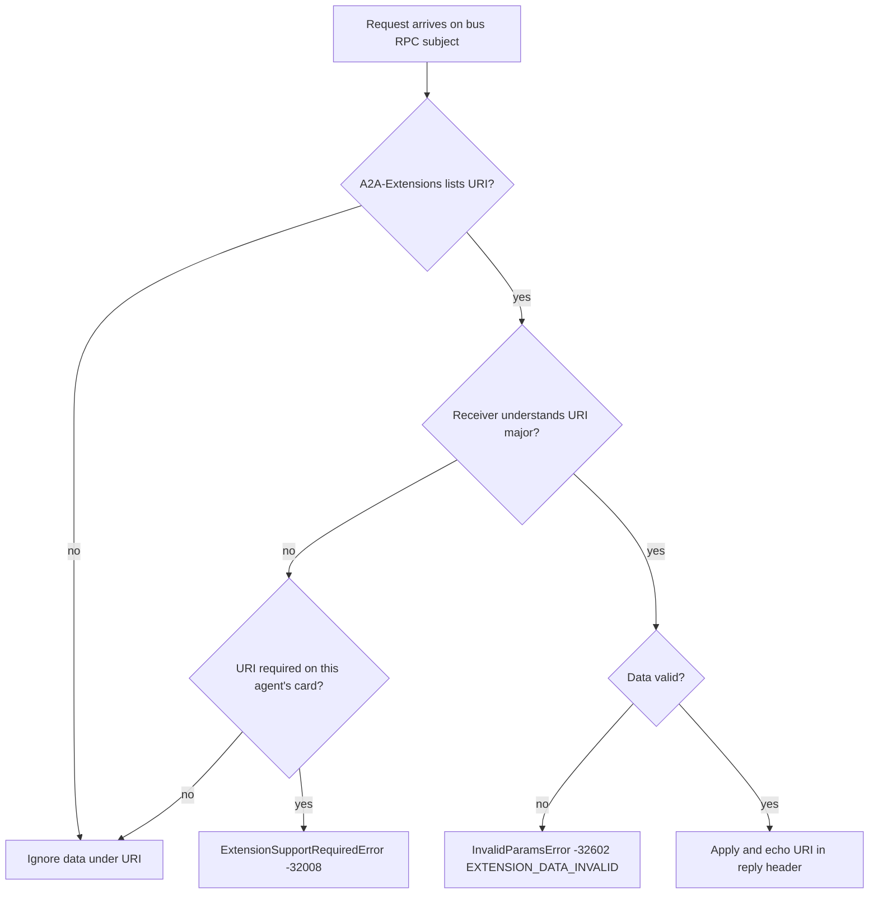

# RFC-0003: Extensions Framework and Card

| Field | Value |
|---|---|
| Status | Proposed |
| Depends on | RFC-0001 (architecture, locked decisions L1-L17, vocabulary sec 4.4); RFC-0002 bus binding (headers, error envelope); RFC-0004 discovery and presence (card storage) |
| Owner area | A2A extension mechanism, Agent Card content, card serialization and signing hook |
| Related interop notes | `docs/interop/a2a-spec-notes.md` sec 1.1, 2, 6.1, 8; `docs/interop/hermes.md` sec 2, 8.2-8.4, 10; `docs/interop/acp-omp-claude.md` sec 2.3, 4.3, 6 |

Requirement IDs in this document use the form `[0003-NNN]`. Normative keywords are per BCP 14.

## 1. Summary

A2A-Bus adds its features as A2A v1.0 extensions identified by `urn:a2abus:ext:<name>:<major>` URIs, declared on the Agent Card and activated per request with the `A2A-Extensions` header. Every M1 extension is optional, so a stock A2A peer or Hermes can call an agent and ignore what it does not understand. The Agent Card exists in two views: a bus view with the `urn:a2abus:binding:bus:1` interface, signed when signing is enabled, and an HTTP view served by the gateway, which is a plain A2A v1.0 card. This RFC defines the registry, activation and data rules, card content, card size limits, skill derivation for omp, Claude Code and Hermes, and the error mapping for extensions.

## 2. Motivation and scope

A2A v1.0 already has the mechanisms we need: `AgentCapabilities.extensions`, `A2A-Extensions` negotiation, and `metadata` keyed by extension URI (`docs/interop/a2a-spec-notes.md` sec 2). Adding bus-only fields to the core data model would break stock peers (requirement D5, D8, R-I1). Declaring bus features as extensions keeps the A2A model intact (RFC-0001 L2 and D5).

The card carries what a caller needs before it sends work: which interfaces exist, which skills the agent offers, which extensions it understands, and which policy the supervisor has set (approval mode, workspace isolation, budget ceilings, T15). Presence and discovery are in RFC-0004.

In scope:
- The extension registry and the URI rules.
- Activation (`A2A-Extensions`), data placement (`Message.metadata`, `Artifact.metadata`, status message metadata, event metadata) and the unknown-extension rules.
- Agent Card content for bus and HTTP views, size limits, skill derivation, and the signing hook (signature algorithm and canonical form are owned by RFC-0007).
- Extension-related error mapping.

Non-goals:
- Field-level semantics of approval, budget, delegation and provenance (owned by RFC-0006 and RFC-0007). This RFC owns only the carrier and the registry.
- Discovery, presence, TTL and KV layout (RFC-0004).
- Bus subjects and header wire format (RFC-0002).
- Any new A2A task state (RFC-0001 L7).

## 3. Terminology

Terms from RFC-0001 sec 4.4 are used as defined there. New terms:

- **Extension profile**: the set of extensions an agent declares on its bus card.
- **Activation**: a caller listing an extension URI in `A2A-Extensions` on a request. Activation is per request and per URI.
- **Bus card**: the Agent Card published to the tenant card bucket (RFC-0004), containing the bus interface and possibly a signature.
- **HTTP card view**: the Agent Card the gateway serves at `/agents/<agentId>/.well-known/agent-card.json`, derived from the bus card (sec 4.6).
- **Extension params**: the `params` Struct of an `AgentExtension`, carrying declared, non-secret policy values.
- **Policy declaration**: a card extension params value that states what the supervisor configured (for example approval mode). It is a statement by the owning driver and supervisor, not a self-report that callers may rely on for enforcement.

## 4. Specification

### 4.1 Extension registry

[0003-001] Every A2A-Bus extension MUST have a URI of the form `urn:a2abus:ext:<name>:<major>`, where `<name>` is lowercase ASCII letters and `-` only, and `<major>` is a positive integer. The `<major>` value MUST change for any incompatible change (sec 4.7).

[0003-002] The M1 registry is exactly the table below. Adding an entry requires an RFC amendment to this document.

| Name | URI | Owner RFC | Carried in | Declared required in M1 |
|---|---|---|---|---|
| approval | `urn:a2abus:ext:approval:1` | RFC-0006 | Status message metadata (request), Part under URI (decision) | no |
| budget | `urn:a2abus:ext:budget:1` | RFC-0006 | `Message.metadata` (request), card params (ceilings) | no |
| delegation | `urn:a2abus:ext:delegation:1` | RFC-0007 | `Message.metadata` | no |
| provenance | `urn:a2abus:ext:provenance:1` | RFC-0007 | `Message.metadata`, `Artifact.metadata` | no |
| sequence | `urn:a2abus:ext:sequence:1` | RFC-0005 | Event metadata on task events | no |
| progress | `urn:a2abus:ext:progress:1` | RFC-0009 | Status event metadata (tool-call and plan progress) | no |

[0003-003] The metadata key for each extension's data MUST be the extension URI exactly (RFC-0001 sec 4.4, "metadata key = extension URI"). No other key form is used for extension data.

[0003-004] The URI `urn:a2abus:binding:bus:1` is a binding identifier, not an extension. It MUST appear only as `AgentInterface.protocolBinding` (sec 4.5) and MUST NOT appear in `A2A-Extensions` or `AgentCapabilities.extensions`. The failure reason key `a2abus.failure` (RFC-0005) is a plain status metadata key, not an extension, and is not listed in the registry.

### 4.2 Declaration on the card

[0003-005] An agent MUST declare every extension it understands in `capabilities.extensions` of its bus card and of its HTTP card view, with `uri`, a non-empty `description`, `required`, and `params` where the extension defines params.

[0003-006] In M1 every declared extension MUST have `required: false`. A card MAY set `required: true` only for an extension whose absence makes calling the agent unsafe, and such a card MUST have a documented reason in its RFC. No M1 extension meets that bar (R-I3, R-I4: stock peers must be able to call the agent).

[0003-007] Params MUST NOT contain secrets, bearer tokens, key material, absolute host paths, or workspace contents. Params MAY contain the supervisor's policy declarations (for example the approval mode). Params MUST stay under 4 KiB serialized.

[0003-008] Declaring an extension does not grant it. A receiver MUST apply extension data only when the URI is activated on the request (sec 4.3) or, for policy declarations, when the receiver is the supervisor-enforced owner of the policy (for example the Worker enforcing its own budget ceiling).

[0003-047] The `approval` extension params (policy declaration, sec 4.2) MUST contain `mode`, `nativeMode`, `dangerous` and `workspace` (`isolation`). `mode` MUST be one of `ask-all`, `ask-exec`, `none`. `nativeMode` MUST be a canonical native mode of the backend (RFC-0009 [0009-063]), and `dangerous` MUST be `true` when it is a dangerous canonical mode. `workspace.isolation` MUST be `worktree` or `copy` (RFC-0012). The value `external` is NOT allowed in M1 and MUST NOT be declared. `mode: none` MUST be paired with `dangerous: true`. The meaning of each mode is owned by RFC-0006.

[0003-048] The `budget` extension params (sec 4.2) MUST use card ceiling keys `maxDepth`, `maxHops`, `maxTokens`, `maxWallSeconds`, under `ceilings`. A key that is absent means that dimension is not enforced at card level; the agent's runtime configuration still applies. Wire mapping to Budget fields (`max_depth`, `max_hops`, `max_tokens`, `max_wall_ms` in seconds x 1000) is owned by RFC-0006.

[0003-049] The `progress` extension (`urn:a2abus:ext:progress:1`, registry sec 4.1) carries tool-call and plan progress as metadata on status events. Its payload is owned by RFC-0009 ([0009-027]). Progress is informational: it never changes task state. A driver declares it on the card when it emits it (sec 4.2, [0003-005]).

### 4.3 Activation and data placement

[0003-009] A caller that wants an extension applied MUST list its URI in the `A2A-Extensions` header of the bus request. The header is the A2A name, unprefixed (RFC-0001 L2), value is a comma-separated list of URIs with optional spaces, and it MUST NOT be repeated across multiple header lines.

[0003-010] A receiver MUST apply data under a URI only if that URI is activated on the request. Data under a non-activated URI MUST be ignored and MUST NOT cause a failure.

[0003-011] A receiver that applies one or more extensions MUST echo the URIs it applied in the `A2A-Extensions` header of the reply, in any order. The reply MUST NOT list a URI that was not applied.

[0003-012] Extension data carriers:
- Request data: `Message.metadata[<uri>]` and `Message.extensions` (list of URIs carried by the message).
- Task status data: `TaskStatus.message.metadata[<uri>]`.
- Artifact data: `Artifact.metadata[<uri>]`.
- Event data: event metadata at the event envelope level, keyed by URI.
Data MUST be a `google.protobuf.Struct` (proto-JSON object) under its URI key. A `Part` with structured data under the URI is used only where the owner RFC says so (approval decision, L10).

[0003-013] A request that activates an extension whose data is malformed MUST fail with `InvalidParamsError` (-32602), reason `EXTENSION_DATA_INVALID` (sec 4.8), and MUST NOT partially apply the data.

[0003-014] `Message.extensions` MUST contain a URI only if the message carries data under it. A receiver MUST NOT infer activation from `Message.extensions` alone; activation is only the header.

Activation decision rule:



[0003-015] Unknown extension URIs in `A2A-Extensions` MUST be ignored unless the agent's own card declares that URI `required: true` (not used in M1), in which case the rule in [0003-016] applies.

[0003-016] If an agent's card declares a URI `required: true` and the request does not activate it, or activates a URI the agent does not support while requiring a different one, the agent MUST reject the request with `ExtensionSupportRequiredError` (-32008, reason `EXTENSION_SUPPORT_REQUIRED`, gRPC `FAILED_PRECONDITION`, HTTP 400) and MUST NOT create a task.

[0003-017] Extension data MUST NOT change the meaning of any core A2A field. A receiver MUST treat core fields exactly as A2A v1.0 defines them whether or not extensions are active.

[0003-018] Gateway rule (RFC-0008 owns the rest): the gateway MUST forward `A2A-Extensions` from an HTTP caller unchanged to the bus, MUST NOT add URIs on behalf of an HTTP caller, and MUST strip extension data under URIs the HTTP caller did not list before publishing (T12).

[0003-019] Activation is additive. An agent MUST NOT infer a different policy from the presence of an activated URI than the policy its card declares. Example: a request activating `budget` supplies per-request values, but the receiver still enforces its card ceilings (RFC-0006).

### 4.4 Versioning and evolution

[0003-020] A change that breaks an existing reader of an extension (renamed or removed required field, changed meaning of a field, changed value of an enumeration) MUST use a new major URI. Both majors MAY be declared on the same card during migration.

[0003-021] Additive changes within the same major are allowed: new optional fields, new enum values that readers can treat as unknown, new params keys. Readers MUST ignore unknown fields in extension data and unknown params keys.

[0003-022] There is no automatic fallback from a major to a lower major. A caller that needs `:2` and finds only `:1` in the card MUST treat it as unsupported (sec 4.8 rules apply).

[0003-023] A `:N` URI MUST NOT be reused for a different meaning after release, even if withdrawn.

### 4.5 Agent Card: bus view

[0003-024] The bus card is the A2A v1.0 `AgentCard` serialized as proto-JSON, carried in the tenant card bucket (RFC-0004). Required fields for bus cards: `name`, `description`, `supportedInterfaces` (at least one bus interface), `version`, `capabilities`, `defaultInputModes`, `defaultOutputModes`, `skills` (at least one). `provider` is RECOMMENDED. `documentationUrl` is OPTIONAL.

[0003-025] `supportedInterfaces` MUST list, in this order: the bus interface first, then an HTTP JSON-RPC interface only if the gateway serves this agent (RFC-0008). Each `AgentInterface` MUST set `url`, `protocolBinding`, `protocolVersion` and `tenant`.
- Bus interface: `protocolBinding` = `urn:a2abus:binding:bus:1`, `protocolVersion` = `1.0`, `url` = the bus endpoint only (no agent path segment, agreed with RFC-0002), `tenant` = `local` in M1.
- HTTP interface: `protocolBinding` = `JSONRPC`, `protocolVersion` = `1.0`, `url` = gateway URL for the agent, `tenant` as configured.

[0003-026] Clients MUST treat the first entry of `supportedInterfaces` they understand as the preferred one (A2A sec 4.4, `docs/interop/a2a-spec-notes.md` sec 8). Bus-aware clients pick the bus interface. Stock and Hermes clients never read the bus view because they use the HTTP view (sec 4.6).

[0003-027] `capabilities` on the bus card MUST set `streaming: true` for every M1 bus agent, because the bus binding delivers events for it (RFC-0002 [0002-103], RFC-0005), `pushNotifications: false` in M1, `extendedAgentCard: false` in M1, and `extensions` as in sec 4.2.

[0003-028] The bus card MUST NOT contain the HTTP bearer scheme and MUST NOT declare `securitySchemes` or `security` (RFC-0002 [0002-085]). Bus authentication is by bus identity (RFC-0010, RFC-0007). A bus card security scheme MAY be added only after RFC-0007 defines one.

### 4.6 Agent Card: HTTP view

[0003-029] The gateway MUST serve, for each exposed agent, the HTTP view at `/agents/<agentId>/.well-known/agent-card.json` (RFC-0008). The default agent (M1: `omp`) is also served at `/.well-known/agent-card.json`. The gateway MUST NOT serve `agent.json`.

[0003-030] The HTTP view MUST be derived from the bus card by these rules, and by nothing else:
1. Remove the bus `AgentInterface`s. Keep the HTTP interface (sec 4.5).
2. Remove `signatures`. The HTTP view is not signed in M1 (RFC-0007 may define a gateway signature later).
3. Keep `capabilities.streaming` as the bus card states (`true` for M1 bus agents), because the gateway serves SSE for these agents (RFC-0008 [0008-013]).
4. Add a bearer `SecurityScheme` and `securityRequirements` only when the gateway requires bearer auth for the agent (RFC-0008).
5. Keep `capabilities.extensions` unchanged so stock clients see the declarations. Keep skills unchanged.

[0003-031] The HTTP view MUST be a valid A2A v1.0 card. It MUST NOT contain a `protocolBinding` other than `JSONRPC` in its interfaces.

[0003-032] The gateway MUST NOT list a bus-only extension as activated or required in the HTTP view, and MUST NOT list a bus-only interface in it.

### 4.7 Card size and fields

[0003-033] A serialized bus card MUST be at most 32 KiB, and each HTTP view MUST be at most 32 KiB. The bus KV value limit and the bus max payload (RFC-0002, RFC-0010) MUST accommodate this.

[0003-034] Card limits: `description` at most 2048 bytes, `skills` at most 50 entries, each skill's `tags` at most 10 entries and each tag at most 64 bytes, `defaultInputModes` and `defaultOutputModes` at most 8 entries each. A card exceeding these limits MUST be rejected by the publisher before publication (RFC-0004). Hermes publishes up to 10 tags per skill (`docs/interop/hermes.md` sec 2); this limit is the same.

[0003-035] `version` is the card revision string. The publisher MUST change `version` on any change to the card content. The format is `<major>.<minor>.<patch>` (for example `1.0.3`).

### 4.8 Skills

[0003-036] Each agent's skills MUST be derived from its driver configuration and, where the backend reports them, from the backend's capability report at startup. A skill MUST NOT be advertised for a backend capability the driver does not expose.

[0003-037] Skill ids MUST be unique within a card and MUST NOT name internal tool names. Bus-native agents (omp, claude) use the form `<agentId>.<capability>` (lowercase, dot, hyphen allowed). Hermes skills are coarse: one skill per Hermes toolset, with id `hermes.<toolset>` (for example `hermes.terminal`), as required by [0003-051]. The agent id prefix is added to every ingested id, so the id is traceable to its Hermes origin.

[0003-038] Skill derivation per agent in M1:

| Agent | Source of skills | Example skill ids |
|---|---|---|
| omp | Static driver config for ACP sessions (`omp --mode acp`), with ACP `agentCapabilities` reported at `initialize` (`docs/interop/acp-omp-claude.md` sec 2.3) | `omp.code-edit`, `omp.shell`, `omp.repo-qa` |
| claude | Static driver config plus claude-agent-acp `agentCapabilities` at `initialize` (sec 4 of the same note) | `claude.code-edit`, `claude.repo-qa` |
| hermes | Ingested from Hermes card `skills[]` and grouped by toolset (`docs/interop/hermes.md` sec 2; [0003-051]) | `hermes.web`, `hermes.terminal` |

[0003-039] Skill `tags` MUST include the agent id as the first tag (for example `omp`), followed by backend-specific tags. Tag values MUST be lowercase. For ingested Hermes skills the driver MUST prepend the agent id, keep at most nine of the tags Hermes reports, and drop any tag that names an internal tool (so the limit of [0003-034] holds and [0003-051] is met).

### 4.9 Signing hook

[0003-040] A bus card MAY carry `signatures` (A2A `AgentCardSignature`). When signing is enabled (RFC-0007 defines enablement: OPTIONAL in M1, REQUIRED once peers span hosts, per L11), the publisher MUST sign the card before publication, using the agent's Ed25519 key (RFC-0007).

[0003-041] The signed payload is the RFC 8785 JCS canonical JSON of the card with `signatures` removed. The protected header MUST contain `alg` = `EdDSA` and `kid` (the agent key id, RFC-0007), and SHOULD contain `typ` = `JOSE`. The publisher MUST NOT use a key that is expired or revoked (A2A sec 8).

[0003-042] A verifier that finds `signatures` on a bus card MUST verify at least one signature with a key trusted under RFC-0007 before using the card for routing. A verifier that finds no signatures MUST reject the card when cross-host trust is enabled, and MAY accept it on a single host in M1 (RFC-0007 sets the trust policy).

[0003-043] The signed form is the bus card. The HTTP view is not signed in M1 (sec 4.6 rule 2).

#### 4.9.1 Sanitization of ingested cards

[0003-050] A bridge that ingests an external agent card (Hermes, `docs/interop/hermes.md`) MUST NOT copy that card into the bus card. It MUST build a new A2A v1.0 `AgentCard` from A2A fields only. Fields outside the A2A v1.0 AgentCard, including Hermes's card-level `security` field, MUST NOT be carried into the bus card or the HTTP view.

[0003-051] The skills of an ingested card MUST be coarse: at most one skill per external toolset, with no internal tool name in any skill id, name, description or tag. A tool that maps to no toolset is grouped under `<agentId>.other`. Skill count MUST respect [0003-034].

[0003-052] The HTTP view derived under [0003-030] from a sanitized bus card inherits the sanitization. The gateway MUST NOT serve an ingested card unchanged under any path (RFC-0008).

### 4.10 Worked examples

All examples are illustrative. The wire form of bus RPC bodies is binary protobuf (L1); proto-JSON is shown for readability. Subjects follow RFC-0002, with tenant `local`.

Example 1: bus card for `omp` (unsigned, M1 single host).

```json
{
  "name": "omp",
  "description": "Oh My Pi coding agent, driven over ACP on this host.",
  "supportedInterfaces": [
    {
      "url": "nats://bus.local:4222",
      "protocolBinding": "urn:a2abus:binding:bus:1",
      "protocolVersion": "1.0",
      "tenant": "local"
    },
    {
      "url": "https://gateway.local:8443/agents/omp/",
      "protocolBinding": "JSONRPC",
      "protocolVersion": "1.0",
      "tenant": "local"
    }
  ],
  "version": "1.0.3",
  "provider": { "organization": "agent-proto", "url": "https://github.com/" },
  "capabilities": {
    "streaming": true,
    "pushNotifications": false,
    "extendedAgentCard": false,
    "extensions": [
      {
        "uri": "urn:a2abus:ext:approval:1",
        "description": "Approval gate for tool calls via INPUT_REQUIRED.",
        "required": false,
        "params": { "mode": "ask-all", "nativeMode": "always-ask", "dangerous": false, "workspace": { "isolation": "worktree" } }
      },
      {
        "uri": "urn:a2abus:ext:budget:1",
        "description": "Per-request budget and card ceilings.",
        "required": false,
        "params": { "ceilings": { "maxDepth": 3, "maxHops": 6, "maxTokens": 500000, "maxWallSeconds": 1800 } }
      },
      {
        "uri": "urn:a2abus:ext:sequence:1",
        "description": "Per-task monotonic event sequence.",
        "required": false
      },
      {
        "uri": "urn:a2abus:ext:progress:1",
        "description": "Tool-call and plan progress on status events.",
        "required": false
      }
    ]
  },
  "defaultInputModes": ["text/plain"],
  "defaultOutputModes": ["text/plain"],
  "skills": [
    {
      "id": "omp.code-edit",
      "name": "Edit code in a workspace",
      "description": "Reads and edits files in the agent's isolated worktree.",
      "tags": ["omp", "acp", "edit"]
    },
    {
      "id": "omp.repo-qa",
      "name": "Answer questions about a repository",
      "description": "Reads files and answers questions without editing.",
      "tags": ["omp", "acp", "read"]
    }
  ]
}
```

Notes: the `approval` params are a policy declaration set by the supervisor (T15), not a self-report by omp. Budget ceilings are enforced by the Worker for every request, activated or not (sec 4.3, [0003-019]).

Example 2: HTTP view of the same agent, as served by the gateway (`GET /agents/omp/.well-known/agent-card.json`).

```json
{
  "name": "omp",
  "description": "Oh My Pi coding agent, driven over ACP on this host.",
  "supportedInterfaces": [
    {
      "url": "https://gateway.local:8443/agents/omp/",
      "protocolBinding": "JSONRPC",
      "protocolVersion": "1.0",
      "tenant": "local"
    }
  ],
  "version": "1.0.3",
  "provider": { "organization": "agent-proto", "url": "https://github.com/" },
  "capabilities": {
    "streaming": true,
    "pushNotifications": false,
    "extendedAgentCard": false,
    "extensions": [
      { "uri": "urn:a2abus:ext:approval:1", "description": "Approval gate for tool calls via INPUT_REQUIRED.", "required": false, "params": { "mode": "ask-all", "nativeMode": "always-ask", "dangerous": false, "workspace": { "isolation": "worktree" } } },
      { "uri": "urn:a2abus:ext:budget:1", "description": "Per-request budget and card ceilings.", "required": false, "params": { "ceilings": { "maxDepth": 3, "maxHops": 6, "maxTokens": 500000, "maxWallSeconds": 1800 } } },
      { "uri": "urn:a2abus:ext:sequence:1", "description": "Per-task monotonic event sequence.", "required": false },
      { "uri": "urn:a2abus:ext:progress:1", "description": "Tool-call and plan progress on status events.", "required": false }
    ]
  },
  "defaultInputModes": ["text/plain"],
  "defaultOutputModes": ["text/plain"],
  "skills": [
    { "id": "omp.code-edit", "name": "Edit code in a workspace", "description": "Reads and edits files in the agent's isolated worktree.", "tags": ["omp", "acp", "edit"] },
    { "id": "omp.repo-qa", "name": "Answer questions about a repository", "description": "Reads files and answers questions without editing.", "tags": ["omp", "acp", "read"] }
  ]
}
```

Notes: the bus interface and `signatures` are gone. The `url` is an example; RFC-0008 defines the real gateway base. A stock A2A client sees four extensions it does not activate and ignores them.

Example 3: bus card for `claude` (skills only, abridged to the differing parts). Skills: `claude.code-edit` (tags `["claude","acp","edit"]`) and `claude.repo-qa`. Extensions: the same four URIs as Example 1 with `required: false`. Interfaces: bus first, as in Example 1, `url` `nats://bus.local:4222`.

Example 4: request activating approval and budget, `SendMessage` from `claude` to `omp` through the bus.

Subject: `a2a.v1.local.rpc.omp.send`

Headers:
```
Content-Type: application/x-protobuf
A2A-Version: 1.0
A2A-Extensions: urn:a2abus:ext:approval:1, urn:a2abus:ext:budget:1
A2AB-Msg-Id: 6f1d2c0e-9a7b-4e0c-8c51-2b7a0d3e9f10
traceparent: 00-4bf92f3577b34da6a3ce929d0e0e4736-00f067aa0ba902b7-01
```

Body (proto-JSON view):
```json
{
  "message": {
    "messageId": "6f1d2c0e-9a7b-4e0c-8c51-2b7a0d3e9f10",
    "contextId": "ctx-7f3a",
    "role": "ROLE_USER",
    "parts": [{ "text": "Refactor the parser module and run its tests." }],
    "extensions": ["urn:a2abus:ext:budget:1"],
    "metadata": {
      "urn:a2abus:ext:budget:1": {
        "maxTokens": 150000,
        "maxHops": 2,
        "depth": 1,
        "maxWallSeconds": 900
      }
    }
  },
  "configuration": { "returnImmediately": false }
}
```

Notes: `budget` values are per-request and only decrease along the chain (RFC-0006); the exact keys are owned by RFC-0006, the shape here is illustrative. The `approval` URI is activated but this request carries no approval data, so approval rules of RFC-0006 apply when a tool call needs approval. Hermes sends no `A2A-Extensions` and no metadata (`docs/interop/hermes.md` sec 8.3), so Hermes requests get no budget values and only card ceilings apply.

Example 5: reply echoing applied URIs.

```
A2A-Extensions: urn:a2abus:ext:approval:1, urn:a2abus:ext:budget:1
Content-Type: application/x-protobuf
```

Bus reply headers use the same names as the request; the reply body is a `Task` with `status.state` `TASK_STATE_WORKING`.

Example 6: request activating an unsupported URI, not required by the card. The unknown URI is ignored and the reply does not echo it.

```
A2A-Extensions: urn:a2abus:ext:approval:1, urn:a2abus:ext:example:9
```

Reply header: `A2A-Extensions: urn:a2abus:ext:approval:1`. The unknown `example:9` is ignored (illustrative URI).

Example 7: malformed budget data under an activated URI (illustrative error body).

```json
{
  "error": {
    "code": -32602,
    "message": "Extension data invalid",
    "data": [
      {
        "@type": "type.googleapis.com/google.rpc.ErrorInfo",
        "reason": "EXTENSION_DATA_INVALID",
        "domain": "a2a-protocol.org",
        "metadata": { "uri": "urn:a2abus:ext:budget:1" }
      }
    ]
  }
}
```

Example 8: required-but-unsupported (the M1 registry has no required extension; illustrative only, for a future `:1` extension `urn:a2abus:ext:example:1` declared `required: true`). A request without it gets:

```json
{
  "error": {
    "code": -32008,
    "message": "Required extension not activated",
    "data": [
      {
        "@type": "type.googleapis.com/google.rpc.ErrorInfo",
        "reason": "EXTENSION_SUPPORT_REQUIRED",
        "domain": "a2a-protocol.org",
        "metadata": { "uri": "urn:a2abus:ext:example:1" }
      }
    ]
  }
}
```

### 4.11 Error mapping

[0003-044] Extension-related errors MUST use the A2A error codes and reasons, and the bus error envelope defined by RFC-0002 (`google.rpc.Status` with `ErrorInfo`, domain `a2a-protocol.org`):

| Condition | JSON-RPC code | Reason | gRPC | HTTP |
|---|---|---|---|---|
| Required extension not activated or not supported | -32008 | `EXTENSION_SUPPORT_REQUIRED` | FAILED_PRECONDITION | 400 |
| Activated extension data malformed | -32602 | `EXTENSION_DATA_INVALID` | INVALID_ARGUMENT | 400 |
| Activated extension major not supported (not required) | none (ignored, [0003-015]) | n/a | n/a | n/a |

[0003-045] `EXTENSION_DATA_INVALID` is defined by this RFC and MUST be listed in RFC-0002's error table (agreed with BindingAuthor).

[0003-046] A receiver MUST NOT return an extension-related error for a URI that was not activated, except under [0003-016].

## 5. Interoperability

Stock A2A peer (HTTP, the HTTP view only):
- Sees a valid A2A v1.0 card with a JSON-RPC interface. Extensions appear under `capabilities.extensions` with `required: false`, which the A2A spec allows a client to ignore (`docs/interop/a2a-spec-notes.md` sec 2).
- Sends no `A2A-Extensions` header, so no extension data is applied. Approval-gated tasks appear as `TASK_STATE_INPUT_REQUIRED`; the stock peer can reply with text, which is not an approval decision (RFC-0006), so the task waits and then denies on timeout (M1-6).
- Does not see the bus interface, signatures, or bus-only extension data (sec 4.6).

Hermes (A2A HTTP client, `docs/interop/hermes.md` sec 8):
- Reads only the card's `supportedInterfaces` entry with `protocolBinding: "JSONRPC"` and the RPC `url` (sec 8.3 step 2). The HTTP view provides exactly that.
- Sends no `A2A-Extensions`, no metadata, and no extension header (sec 8.3 "Not sent"). Our agents therefore apply no request-level extension data to Hermes requests; card-level ceilings still apply.
- Ignores unknown card fields in its own parse. Verified by spike hermes-a2a (stub, probe T-probe, Q7 PASS): Hermes accepted a card with unknown fields. Real-model and full-field behaviour remains [UNVERIFIED] (`docs/interop/hermes.md` sec 10). The HTTP view adds only the fields the A2A spec allows, and the M1 interop test (RFC-0014) checks it.
- Hermes capability matching uses its own `a2a_agents.<name>.capabilities` config (hermes.md sec 8.2), not our skill ids. Skill ids only matter to bus-aware clients.
- Gateway card requirements (`hermes.md` sec 10 rows 1-2, 12) are satisfied: `supportedInterfaces[0]` is the JSONRPC entry in the HTTP view, and `tenant` echo is handled by RFC-0008.

ACP agents (omp `--mode acp`, claude-agent-acp):
- Never see the bus card or A2A extensions. ACP has no A2A concept and the driver (RFC-0009) is the only component that reads ACP and builds the card (L13).
- The driver builds skills and approval params from its own config and the ACP `initialize` response (`docs/interop/acp-omp-claude.md` sec 2.3). ACP-reported capabilities are advisory until verified in the live check (`acp-omp-claude.md` sec 8).
- ACP `_meta` and `_`-prefixed names are ACP's own extension channel. We do not add ACP extension methods; approval is mapped from `session/request_permission` by the driver (RFC-0006, `acp-omp-claude.md` sec 6 `[proposal]`).
- Driver-side mapping never changes what ACP sees, so the ACP agents do not break on our extensions.

## 6. Security considerations

Threats from `docs/requirements.md` sec 8:
- **T2 (confused deputy)**: activation is per request and per URI (sec 4.3). Delegation and provenance data cannot be applied unless the caller activated them and the owner RFC accepts the chain (RFC-0007). Card ceilings are enforced regardless of activation ([0003-019]).
- **T1 (prompt injection)**: extension data from peers is untrusted input. Provenance (RFC-0007) marks it. This RFC forbids core-field semantics changes by extension data ([0003-017]), so injected extension data cannot change how a core field is read.
- **T8 (poisoned discovery)**: bus cards are signed when signing is enabled (sec 4.9); verifiers reject unsigned cards when cross-host trust is on ([0003-042]); the HTTP view is derived only by listed rules ([0003-030]).
- **T10 (metadata leakage)**: params must not hold secrets, paths or workspace contents ([0003-007]); the HTTP view removes the bus interface and signatures to avoid exposing bus endpoints ([0003-030]). Bus endpoint in a public HTTP view is forbidden by construction.
- **T12 (gateway attack surface)**: the gateway forwards only activated URIs and strips the rest ([0003-018]); size limits (sec 4.7) bound parse cost.
- **T14 (driver confused deputy)**: the driver's card must reflect the supervisor's configuration, not the backend's self-report alone (sec 3, policy declaration). Skills are only advertised for backend capabilities the driver exposes ([0003-036]).
- **T15 (approval bypass via agent modes)**: approval params are a supervisor-set policy declaration recorded on the card (`approval.dangerous`, `approval.nativeMode`), so a caller can see when an agent is in a dangerous mode. Enforcement is RFC-0006's; the card is a disclosure, not a control.
- Trust assumption A2 (peers authenticated but may be compromised): an activated extension does not make a peer more trusted; the receiver still applies its own policy.

Attack descriptions are kept generic on purpose. No attack payloads are included.

## 7. Rationale and alternatives

- **Extensions in metadata, not new fields.** A2A already defines this carrier (`Message.metadata` keyed by URI). New core fields would break stock peers (D5, D8, R-I1).
- **Per-request activation header.** The A2A header is the spec's negotiation point. A bus-only header would fork the protocol. We reuse the A2A name (L2).
- **All M1 extensions optional.** Required extensions would make stock and Hermes callers fail (R-I3, R-I4). Enforcement goes to the receiver's own policy, not to a caller-side requirement.
- **Two card views.** One card with the bus interface would be unusable by stock clients, and one HTTP-only card would lose the bus identity and signing. Deriving the HTTP view by listed rules keeps both correct.
- **Major in the URI.** Alternative: a version field inside each extension. Rejected: A2A already uses the URI as the identity of an extension, and a URI change forces explicit negotiation (A2A sec 4.6, `a2a-spec-notes.md` sec 2).
- **Skill ids per agent.** Alternative: rename Hermes skills to our form. Rejected: Hermes operators configure against `toolset.<name>`.
- **Signing the bus card only.** The HTTP view is for stock peers with their own trust (bearer). Signing it would require a second key and trust path that RFC-0007 does not yet define; deferred to Open issues.

## 8. Conformance

| ID | Test idea | Level |
|---|---|---|
| 0003-001 | Registry check: every extension URI matches the pattern and has a major. | MUST |
| 0003-002 | Compare the M1 registry table with the implementation's constant list. | MUST |
| 0003-003 | Publish an extension; assert the metadata key equals its URI. | MUST |
| 0003-004 | Assert the binding URI never appears in `A2A-Extensions` or `capabilities.extensions`. | MUST |
| 0003-005 | Card lint: every extension entry has `uri`, non-empty `description`, `required`. | MUST |
| 0003-006 | Card lint: all M1 cards have `required: false`. | MUST |
| 0003-007 | Secret and path scan of params; params size under 4 KiB. | MUST |
| 0003-008 | Send data under an activated URI and a non-activated URI; only the first is applied. | MUST |
| 0003-009 | Header parse: comma and space separated values; repeated header lines rejected. | MUST |
| 0003-010 | Non-activated data is ignored, request succeeds. | MUST |
| 0003-011 | Reply header lists exactly the applied URIs. | MUST |
| 0003-012 | Carrier check for each URI (request, status, artifact, event). | MUST |
| 0003-013 | Malformed data under an activated URI gives -32602 `EXTENSION_DATA_INVALID`; no partial apply. | MUST |
| 0003-014 | Message.extensions without the header does not activate. | MUST |
| 0003-015 | Unknown URI in header is ignored; request succeeds. | MUST |
| 0003-016 | Test with a fixture card declaring `required: true`; request without activation gets -32008, no task created. | MUST |
| 0003-017 | Extension data with core-field-like content does not alter core field meaning. | MUST |
| 0003-018 | Gateway test: HTTP caller's unlisted URI data is stripped; no URI is added. | MUST |
| 0003-019 | Budget ceiling enforced with and without activation. | MUST |
| 0003-020 | Major-change review checklist; both majors can be declared. | SHOULD |
| 0003-021 | Unknown fields and params keys are ignored by reader. | MUST |
| 0003-022 | Caller requiring `:2` with only `:1` declared treats it as unsupported. | MUST |
| 0003-023 | Reuse check: no release reuses a URI with a different meaning. | MUST |
| 0003-024 | Bus card required-fields lint. | MUST |
| 0003-025 | Interface order and fields lint (bus first, four fields each). | MUST |
| 0003-026 | Client picks the first understood entry. | SHOULD |
| 0003-027 | Capability flags: `streaming` is `true` on M1 bus cards and gateway cards. | MUST |
| 0003-028 | Bus card contains no bearer scheme, no `securitySchemes` and no `security`. | MUST |
| 0003-029 | Gateway serves the per-agent view path; `agent.json` returns 404. | MUST |
| 0003-030 | Diff test: HTTP view equals bus card after rules 1-5. | MUST |
| 0003-031 | HTTP view validates against the A2A v1.0 card schema. | MUST |
| 0003-032 | HTTP view contains no bus interface and no bus-only activation. | MUST |
| 0003-033 | Size check on both views (32 KiB). | MUST |
| 0003-034 | Limit checks per field; publisher rejects over-limit cards. | MUST |
| 0003-035 | Card version changes on every content change. | MUST |
| 0003-036 | Skills match the driver's exposed capabilities. | MUST |
| 0003-037 | Skill id uniqueness; prefix rule for omp and claude; Hermes ids are `hermes.<toolset>`; no tool name in any id. | MUST |
| 0003-038 | Snapshot test of the M1 skill derivation table. | SHOULD |
| 0003-039 | Tag rules: agent id first, lowercase; Hermes tags capped at nine plus agent id; no tool name in tags. | MUST |
| 0003-040 | Signed card publication when signing is enabled. | MUST |
| 0003-041 | JCS canonical form and EdDSA `kid` check; expired key rejected. | MUST |
| 0003-042 | Verifier rejects tampered card; rejects unsigned card when cross-host trust is on. | MUST |
| 0003-043 | HTTP view carries no signature in M1. | MUST |
| 0003-044 | Error mapping table test for -32008 and -32602. | MUST |
| 0003-045 | RFC-0002 error table contains `EXTENSION_DATA_INVALID`. | MUST |
| 0003-046 | No extension error for non-activated URIs (except 0003-016). | MUST |
| 0003-047 | Card lint: `approval.mode` is one of the three values; `external` rejected; `none` implies `dangerous: true`; `dangerous` true for a dangerous `nativeMode`; `workspace.isolation` is `worktree` or `copy`. | MUST |
| 0003-048 | Card lint: budget ceiling keys are only the four listed; absent key leaves runtime config in force. | MUST |
| 0003-049 | Card lint: `progress` is in the registry and declared only by drivers that emit it; progress data appears only on status events. | MUST |
| 0003-050 | Ingested Hermes card: bus and HTTP cards contain no `security` field and no field outside the A2A v1.0 AgentCard; diff against the fixture card. | MUST |
| 0003-051 | Fixture Hermes card with 33 tool skills: published skills are per toolset, at most 50, with no tool name in id, name, description or tags. | MUST |
| 0003-052 | Gateway request for an ingested agent's card returns only the sanitized view; the raw Hermes card is never served. | MUST |

## 9. Open issues

1. **Required-extension future.** No M1 extension is required. Default: keep `required: false` and rely on receiver policy. Revisit when a control must not be bypassed by callers that do not activate it.
2. **Gateway signing of the HTTP view.** Default: unsigned in M1 (sec 4.6 rule 2). Revisit with RFC-0007 when stock peers need to verify the HTTP card cryptographically.
3. **Hermes card tolerance.** Verified by spike hermes-a2a (stub): Hermes accepted a card with unknown fields (Q7 PASS). Default: the HTTP view keeps only A2A v1.0 fields. Remaining [UNVERIFIED]: Hermes client behaviour with a real model and with every card field (`docs/interop/hermes.md` sec 10); the M1 interop test (RFC-0014) confirms it.
4. **Streaming on HTTP view.** Closed for M1: `capabilities.streaming` is `true` on the bus card and on the gateway card for every M1 agent, because the gateway serves SSE (RFC-0008 [0008-013]) and the bus delivers events (RFC-0002 [0002-103]).
5. **Budget and approval key names.** Owned by RFC-0006; the examples here are illustrative. Default: RFC-0006 names win on conflict.
6. **Live ACP capability check.** Default: skills for omp and claude come from static config until the live `initialize` check (`acp-omp-claude.md` sec 8) confirms the reported capabilities.
7. **Toolset classification for ingested Hermes skills.** Default: classification follows the Hermes card's toolset grouping; a tool with no toolset goes to `<agentId>.other` ([0003-051]). Revisit if the Hermes card format changes.
