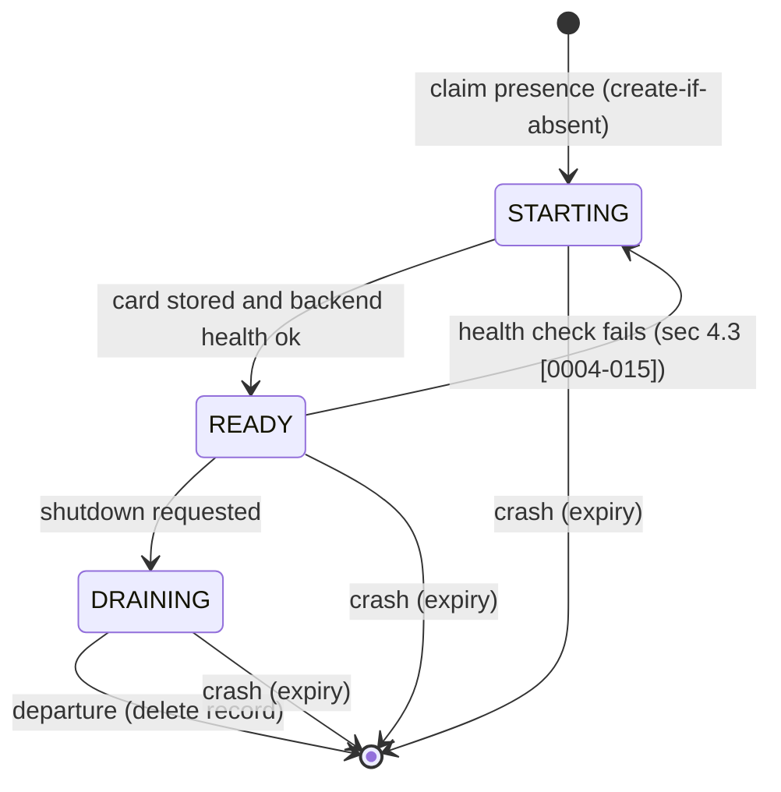

# RFC-0004: Discovery and Presence

| Field | Value |
|---|---|
| Status | Proposed |
| Depends on | RFC-0001 (architecture, locked decisions L4, L6, L13, vocabulary sec 4.4); RFC-0002 bus binding; RFC-0003 extensions framework and card (card content, limits, signing hook); RFC-0007 identity and trust; RFC-0008 HTTP gateway; RFC-0009 backends and drivers; RFC-0010 NATS binding (bucket mapping) |
| Owner area | Agent card publication and retrieval, presence and liveness, capability lookup, card trust at the discovery layer |
| Related interop notes | `docs/interop/hermes.md` sec 2, 8.1-8.3, 10; `docs/interop/nats.md` sec 4.1 (KV, per-key TTL, watch); `docs/interop/a2a-spec-notes.md` sec 8; `docs/interop/acp-omp-claude.md` sec 2.3 |

Requirement IDs in this document use the form `[0004-NNN]`. Normative keywords are per BCP 14.

## 1. Summary

Each agent publishes its Agent Card on every change into a tenant-scoped retained card store keyed by agent id, with no expiry (RFC-0001 L6), and re-writes the unchanged card every 5 minutes (sec 4.1). Liveness and readiness are a separate presence record that its owning Worker refreshes every 10 seconds under a 30-second expiry enforced by the bus, so no client needs a synchronized clock. Clients discover agents by listing or watching cards, and route only to agents whose presence is `READY`. The gateway serves HTTP views of exposed agents and maps not-ready agents to HTTP 503; Hermes is ingested by its driver, which publishes its card and presence like any other agent. Card trust at this layer is the bus write permission on the owning agent's key, plus signatures when signing is enabled.

## 2. Motivation and scope

Three agents on one host (omp, claude, hermes through its gateway) need to find each other without a hand-edited directory, and a caller must know which agents are reachable right now (R-F1, R-F2, R-F3, R-F4). Cards describe what an agent can do; presence describes whether it is answering. Mixing the two would make a card go stale in the same way that a process dies, so they are kept apart (L6).

In scope:
- Card publication, update, removal and retrieval rules.
- Presence record content, states, refresh and expiry.
- Startup, drain and departure sequences; crash behavior.
- Listing, watching, and capability lookup.
- Gateway card serving and presence-based errors.
- Ingest of the Hermes card.
- Card trust at the discovery layer and partition behavior.

Non-goals:
- Card field semantics and limits (RFC-0003).
- Bucket names, permissions and TTL mechanics on NATS (RFC-0010). This RFC states binding-neutral requirements; RFC-0010 maps them.
- Task routing after discovery (RFC-0002, RFC-0005).
- Cross-tenant federation (M1 has tenant `local` only).
- Load balancing across instances of one agent (sec 4.6 defines M1 behavior).

## 3. Terminology

Terms from RFC-0001 sec 4.4 apply. New terms:

- **Card record**: the tenant-scoped stored entry holding one agent's bus card (RFC-0003 sec 4.5). Key = agent id.
- **Presence record**: the stored entry describing whether an agent instance is running and ready. Key = agent id. Expires unless refreshed.
- **Instance id**: an identifier generated by a Worker or driver at each process start. It distinguishes a restarted agent from a live one.
- **Presence state**: one of `STARTING`, `READY`, `DRAINING` (sec 4.3).
- **Departure**: the explicit deletion of a presence record during graceful shutdown.
- **Known offline agent**: an agent with a card record and no live presence record.
- **Capability query**: a lookup over card records and presence records by agent id, skill id, tag, extension URI or mode.
- **Ingest**: publication of an external agent's card (Hermes) by the driver that represents it on the bus.

## 4. Specification

### 4.1 Card records

[0004-001] A card record MUST be keyed by agent id within a tenant. There MUST be at most one card record per (tenant, agent id).

[0004-002] A card record MUST NOT carry an expiry. It remains until its agent is decommissioned (sec 4.1 [0004-005]) or replaced by a newer revision (L6).

[0004-003] The publisher of a card record MUST be the owning agent's driver or Worker (RFC-0009, L13). No other identity MAY write the card record for an agent id. The bus binding MUST enforce this (RFC-0010).

[0004-004] Before a card record is written, the publisher MUST:
1. Validate the card against RFC-0003 limits (sec 4.5-4.7 there).
2. Sign it when signing is enabled (RFC-0003 sec 4.9, RFC-0007).
3. Set `version` to a revision greater than the stored one (RFC-0003 [0003-035]).

A publisher that fails validation MUST NOT write, and MUST log a local error.

[0004-005] A card record MUST be removed only during decommission. Decommission MUST first confirm that no presence record exists for the agent id, MUST then delete the card record, and MUST emit an audit event (RFC-0013).

[0004-006] Each driver or Worker MUST re-write its unchanged card record every 5 minutes. This is idempotent and repairs loss of the card store. A rewrite with unchanged content MUST NOT increase `version`.

[0004-007] A card update MUST replace the whole record. Partial updates are not allowed, because a reader would otherwise see a card that its signature does not cover.

### 4.2 Presence record content

[0004-008] A presence record MUST contain the following fields, serialized as proto-JSON when the bus carries JSON (the bus payload is binary protobuf, RFC-0001 L1):

| Field | Type | Meaning |
|---|---|---|
| `agentId` | string | Logical agent id; equals the record key. |
| `tenant` | string | Tenant, `local` in M1. |
| `instanceId` | string | Random id generated at process start. |
| `cardVersion` | string | The card `version` this instance serves (RFC-0003 sec 4.7). |
| `state` | enum | `PRESENCE_STATE_STARTING`, `PRESENCE_STATE_READY` or `PRESENCE_STATE_DRAINING`. |
| `startedAt` | timestamp | Informational only. Clients MUST NOT use it for expiry (sec 4.7). |
| `activeTasks` | uint32 | OPTIONAL, informational count of non-terminal tasks. Default 0 when absent. |

[0004-009] A presence record MUST be at most 1 KiB serialized.

[0004-010] `cardVersion` in a presence record MUST equal the `version` of the card record that the instance is serving. An instance MUST NOT publish `READY` for a `cardVersion` that is not yet stored.

### 4.3 Presence lifecycle and states

[0004-011] Presence MUST have a time-to-live of 30 seconds, enforced by the storage layer (the bus or its store), not by clients. Presence MUST be refreshed by the owning instance every 10 seconds while the instance is alive. The NATS binding enforces this with a per-key TTL and an explicit `Nats-TTL` on every put (RFC-0010 [0010-031]); a put that re-creates an expired key carries the TTL on the same write (verified by spike `nats`, stub).

[0004-012] An instance MUST claim its presence record with create-if-absent semantics. If the claim fails because a live record exists with a different `instanceId`, the new instance MUST NOT start serving and MUST report a duplicate-agent error (sec 4.6). A record that has expired is not live: the claim then succeeds and is fenced by the expiry marker's revision (RFC-0010 [0010-032]).

[0004-013] Presence states and transitions:

[0004-014] Only `READY` means "accepting new tasks". Clients MUST route new work only to `READY` agents. `STARTING` and `DRAINING` records MUST NOT receive new tasks, although an existing task pinned to the instance (L4) MAY still receive follow-up messages until it terminates.

[0004-015] Liveness is the presence of a non-expired record for the agent id. Readiness is `state == READY`. A driver MUST keep refreshing presence only while its backend health check passes. When the health check fails, the driver MUST move the state to `STARTING` (not `READY`) and keep refreshing it, so that the agent is alive but not routable. If the health check does not recover within 2 minutes, the driver MUST stop refreshing so that the record expires.

[0004-016] A driver MUST report the state `DRAINING` before departure. It MUST stop accepting new tasks, wait for non-terminal tasks it owns to finish or for the drain timeout (default 30 seconds, configurable), and then perform departure: delete its presence record explicitly. The card record is not deleted on departure (sec 4.1 [0004-005]).

[0004-017] A crash produces no departure record. The presence record expires within its 30 second TTL, after which the agent is a known offline agent. A restarted instance claims presence with a new `instanceId`.

[0004-018] A client that observes a presence record whose `instanceId` changed MUST treat the agent as a new instance: it MUST discard cached per-instance state, but MUST keep task ids it still needs (tasks are pinned to the creating instance, L4; the new instance will report them as not found, RFC-0005).

### 4.4 Retrieval, listing and watch

[0004-019] The bus binding MUST support, for each tenant: get a card record by agent id, list all card records, and watch card and presence changes. A watch MUST deliver an initial snapshot followed by one explicit end-of-initial-snapshot signal, so that a late joiner knows when the snapshot is complete. The signal MUST also be delivered when the snapshot is empty (RFC-0011 [0011-026]). RFC-0010 maps this to the chosen storage primitives (explicit push consumer, [0010-034]).

[0004-020] Clients MUST cache card records keyed by (agent id, `version`). A cached card is replaced when a newer `version` arrives. A client MUST NOT present a cached card as current if its watch has been disconnected for more than 60 seconds; it MUST re-read the card store on reconnect.

[0004-021] A client MUST use presence to decide routability. A card record without a live presence record is a known offline agent: a client MAY display it and MAY read its card, but MUST NOT route new work to it.

### 4.5 Capability queries

[0004-022] The discovery API MUST support these query forms, evaluated over card records joined with presence:
- by agent id (exact);
- by skill id (exact, RFC-0003 sec 4.8);
- by tag (any tag of any skill);
- by extension URI (appears in `capabilities.extensions`, RFC-0003 sec 4.2);
- by input or output mode (`defaultInputModes` or `defaultOutputModes`, or a skill's override).

[0004-023] A query result MUST list only agents whose presence record is `READY`, unless the caller asks for `include offline`. The result MUST be ordered: `READY` agents first, then by agent id in ascending byte order. The ordering MUST be deterministic for the same store contents.

[0004-024] M1 MUST have at most one live presence record per agent id (sec 4.6). Therefore a query never returns two instances of one agent. Load balancing among agents with the same skill is NOT performed by the bus. A caller that gets several agents with the same skill MUST choose one explicitly (for example by agent id or by configured preference). Automatic choice is a client policy, not part of this RFC.

### 4.6 Duplicate agent ids

[0004-025] If a second instance claims presence for an agent id that already has a live record (sec 4.3 [0004-012]), it MUST NOT serve. It MUST report a duplicate-agent error in its own logs and exit or retry claim after the existing record expires. It MUST NOT delete or overwrite the existing record.

### 4.7 Time and clocks

[0004-026] Expiry MUST be decided by the storage layer's clock. Clients and drivers MUST NOT compare `startedAt` or any other wall-clock field from another host to decide expiry (R-F3).

[0004-027] Client-side cache ages (sec 4.4 [0004-020]) MUST be measured with a local monotonic clock. The 60-second watch-gap rule is local.

[0004-028] Durations in this RFC (30 s TTL, 10 s refresh, 5 min card rewrite, 30 s drain, 60 s revalidation, 2 min health recovery) are relative durations and do not require synchronized clocks between hosts (R-F3).

### 4.8 Gateway behavior

[0004-029] The gateway MUST serve the HTTP view (RFC-0003 sec 4.6) only for agents it is configured to expose, and MUST serve a card only if a card record exists for that agent id. Otherwise the gateway MUST return HTTP 404.

[0004-030] The gateway MUST NOT publish, modify or delete card or presence records for any agent. It is a bus client for discovery (L14, RFC-0008).

[0004-031] When a request arrives for an exposed agent whose presence record is not `READY` (or is absent), the gateway MUST NOT publish the task. It MUST return HTTP 503 with `Retry-After: 5`. It MUST NOT return a task id for a request it did not publish.

[0004-032] The HTTP card view MUST NOT expose presence fields or instance ids. Presence is not part of the A2A card.

[0004-033] The gateway MUST re-derive its HTTP view when a card record changes (sec 4.4) and MUST evict it when the card record is deleted.

### 4.9 Hermes card ingest

Hermes is not on the bus. Its driver (RFC-0009) represents it: the driver fetches the Hermes card over A2A HTTP, publishes a bus card with a bus interface that it serves, and maintains presence from the health of the Hermes endpoint.

[0004-034] The Hermes driver MUST fetch the card from the configured Hermes base URL, in this order: `/.well-known/agent-card.json`, then the legacy `/.well-known/agent.json` if the first returns 404. Each request MUST time out after 30 seconds (`docs/interop/hermes.md` sec 8.3 step 1).

[0004-035] The ingest MUST normalize the Hermes card as follows:
- Use `supportedInterfaces` entries with `protocolBinding: "JSONRPC"` as the Hermes RPC endpoint. Use the legacy top-level `url` only when no such entry exists, and the base URL only when neither exists (`hermes.md` sec 8.3 step 2).
- Preserve `skills[]` ids unchanged (RFC-0003 [0003-037]).
- Set `capabilities.pushNotifications` to `false` on the bus card regardless of the Hermes value, because M1 does not deliver push (RFC-0003 [0003-027]).
- Drop any Hermes security scheme details. Hermes bearer credentials are never copied into a card (RFC-0003 [0003-007], RFC-0001 L12).
- Add the bus interface and extension declarations as in RFC-0003 sec 4.5.

[0004-036] The Hermes driver MUST refresh the ingested card every 5 minutes, and MUST bump `version` only if the normalized content changed. Failure to fetch MUST NOT delete the card record. It only stops presence refresh (sec 4.3 [0004-015]).

[0004-037] The driver MUST treat Hermes `A2A_PUBLIC_URL`-derived card URLs as untrusted input (`hermes.md` sec 2): a card `url` that points outside the configured peer host MUST be rejected for routing unless the operator lists it in the peer configuration.

### 4.10 Card trust at discovery

[0004-038] On a single host in M1, the bus binding MUST restrict each card and presence key to its owning identity (sec 4.1 [0004-003]). A card written by any other identity MUST be rejected by the bus and MUST NOT appear in discovery results.

[0004-039] Signatures on card records are verified before routing (RFC-0003 [0003-042]). For cross-host trust, the verifier MUST pin the expected (agent id, key id) pair from the local allowlist (RFC-0007, D15). A card whose signing key is not pinned for its agent id MUST NOT be used for routing.

[0004-040] Card content is discovery input and MAY be read by any tenant identity (A5). Card `description` and `skills` text are untrusted for instruction purposes: they MUST NOT be inserted into a prompt as instructions (T1, RFC-0007 provenance).

### 4.11 Partitions and returning nodes

[0004-041] During a bus partition, presence records expire on the storage side. After the partition heals, the owning instance re-claims presence with create-if-absent semantics on its next refresh attempt. If the record was expired and no other live instance holds it, the claim succeeds, and the instance returns to `READY` after its health check. The instance id is new only if the process restarted.

[0004-042] A returning node MUST NOT resume `READY` from memory. It MUST publish `STARTING` first and follow the normal path (sec 4.3). Its card record is verified again before use if it changed during the partition (RFC-0003 [0003-042]).

[0004-043] Clients that were partitioned MUST revalidate their cache (sec 4.4 [0004-020]) before routing to any agent they had seen before the partition.

## 5. Interoperability

Stock A2A peer (HTTP):
- Sees only the HTTP view served by the gateway: a normal A2A v1.0 card at `/agents/<agentId>/.well-known/agent-card.json` (default agent at `/.well-known/agent-card.json`). It does not see presence, instance ids, bus interfaces or signatures (sec 4.8, RFC-0003 sec 4.6).
- Gets HTTP 503 with `Retry-After` when an agent is not `READY`. A stock client that does not know this status treats it as a transport failure. This is generic HTTP behavior and is not an A2A error code; `[UNVERIFIED]` for stock client retry handling.
- Sees 404 for an agent that has no card record, which is the usual "unknown agent" answer.
- Card fetch timing matches A2A guidance (ETag and Cache-Control SHOULD, `docs/interop/a2a-spec-notes.md` sec 8). The gateway SHOULD emit an ETag derived from the card content (RFC-0008).

Hermes (`docs/interop/hermes.md` sec 8):
- Hermes never reads the bus. It fetches the card from the gateway URL it is configured with, using the `supportedInterfaces` JSONRPC entry (sec 8.3). The HTTP view gives it exactly that entry.
- Hermes does not discover agents. Its `a2a_agents` config lists the gateway URLs (M1-4). `a2a_list()` returns configured peers, not bus discovery results (`hermes.md` sec 8.2).
- The 503 response is returned when the agent is not ready. Hermes maps HTTP 429 and 401/403 to specific messages; for other HTTP errors it raises the generic peer error (`hermes.md` sec 8.3). `[UNVERIFIED]` exact Hermes message for 503.
- Hermes's card is ingested by its driver (sec 4.9) without Hermes changes (M1-4 "no Hermes patch").

ACP agents (omp `--mode acp`, claude-agent-acp):
- Never see the card store or presence. Their drivers build cards from static config and ACP `initialize` results (`acp-omp-claude.md` sec 2.3, RFC-0003 sec 4.8) and maintain presence from the ACP process health (sec 4.3 [0004-015]).
- A process that fails to answer `initialize` never reaches `READY`, so no task is routed to it.

## 6. Security considerations

- **T8 (poisoned discovery)**: writes to card and presence keys are restricted to the owning identity (sec 4.10 [0004-038]). Cross-host cards must be signed and pinned ([0004-039]). Unpinned keys are never routed to.
- **T10 (metadata leakage)**: card and presence are readable by tenant identities (A5). Cards must contain no secrets or paths ([0003-007]). Presence exposes `instanceId`, `activeTasks` and `state`; this is acceptable within one trust domain but MUST NOT reach the HTTP view (sec 4.8 [0004-032]).
- **T11 (stale authority in partitions)**: routing requires a live presence record (sec 4.4 [0004-021]); presence expiry is enforced by the storage layer (sec 4.3 [0004-011]); caches are revalidated after a gap (sec 4.4 [0004-020], [0004-043]). The default on uncertainty is no routing (fail closed).
- **T12 (gateway attack surface)**: the gateway serves only configured agents (sec 4.8 [0004-029]) and never publishes discovery records (sec 4.8 [0004-030]).
- **T2 (confused deputy)**: skill or tag queries may return an agent that a caller did not intend. Sensitive work MUST address an agent by id (RFC-0007 policy), and capability queries MUST NOT grant trust. Trust is a separate decision made against the pinned identity.
- **T1 (prompt injection)**: card text is untrusted (sec 4.10 [0004-040]).
- Assumption A1 (broker not trusted for confidentiality or integrity): cross-host card integrity relies on signatures, not on the broker. On a single host the bus is inside the trust domain of A5, and write restriction is the only defense; this is a stated gap until signing is required.

Attack classes are described, not demonstrated.

## 7. Rationale and alternatives

- **Separate card and presence stores.** L6 locks this. Cards are durable facts about an agent, and presence is a liveness fact. A single TTL'd record would make the card expire with the process, forcing re-signing on every heartbeat and losing the card while the agent is restarting.
- **TTL'd presence records instead of heartbeat messages.** Heartbeat messages are lost during partitions and need clock comparison. A storage-side expiry needs neither (R-F3). Cost: depends on the storage primitives (RFC-0010 sec "per-key TTL").
- **Create-if-absent claim instead of a leader election.** M1 has one instance per agent id, so the claim is enough to prevent duplicates. A fencing token would be needed only for multi-instance agents, which are out of scope.
- **No bus-side load balancing.** With one instance per agent id, there is nothing to balance. Balancing across agents with the same skill is a caller policy, which keeps the bus model simple.
- **Gateway as the only HTTP discovery surface.** Stock peers need a standard card URL. The gateway already carries the HTTP mapping (L14, RFC-0008), so it is the only publisher of HTTP-facing data.
- **Hermes ingested by its driver.** Hermes is an external HTTP agent. The driver is already the bus representative of a backend (L13). A separate ingest service would add a fourth component with no benefit.
- **Presence refresh at 10 s with 30 s TTL.** Three refresh attempts fit in one TTL. This tolerates one lost refresh and a brief pause, and keeps the bus write rate low (about 0.1 writes per second per agent).

## 8. Conformance

| ID | Test idea | Level |
|---|---|---|
| 0004-001 | Store check: one card record per (tenant, agent id). | MUST |
| 0004-002 | Store config check: card bucket has no TTL. | MUST |
| 0004-003 | Permission test: a non-owner identity cannot write `cards/<tenant>/<agentId>`. | MUST |
| 0004-004 | Publish a card that exceeds limits; assert no write. Publish valid card; assert `version` increased. | MUST |
| 0004-005 | Decommission with live presence is refused; after departure, the card is deleted and an audit event exists. | MUST |
| 0004-006 | Re-write unchanged card every 5 min; `version` unchanged. | MUST |
| 0004-007 | Partial update attempt is rejected or converted to full replace. | MUST |
| 0004-008 | Presence record decodes with all required fields. | MUST |
| 0004-009 | Presence record size check (1 KiB). | MUST |
| 0004-010 | Publish READY with unstored `cardVersion`; assert rejection in test harness. | MUST |
| 0004-011 | Presence TTL is 30 s and refresh is 10 s; no client clock used for expiry. | MUST |
| 0004-012 | Second claim with live record fails, no serving; claim over an expired record succeeds, fenced by the marker revision. | MUST |
| 0004-013 | State machine test: all transitions in the diagram; no others. | MUST |
| 0004-014 | Route test: no new task to STARTING or DRAINING. | MUST |
| 0004-015 | Health failure moves to STARTING; 2 min without recovery stops refresh; record expires. | MUST |
| 0004-016 | Shutdown: DRAINING published; in-flight tasks finish or drain timeout; presence deleted; card kept. | MUST |
| 0004-017 | Kill process; presence absent within 30 s plus bus delay. | MUST |
| 0004-018 | Changed instance id is detected and per-instance cache cleared. | MUST |
| 0004-019 | Watch delivers snapshot then end-of-snapshot marker; empty store and late joiner both see the marker; late joiner sees all cards. | MUST |
| 0004-020 | Disconnect watch 61 s; cache not used as current until revalidated. | MUST |
| 0004-021 | Card without presence is listed as offline and not routed. | MUST |
| 0004-022 | Query tests for each of the five forms. | MUST |
| 0004-023 | Default query returns READY only; order is READY first then byte order. | MUST |
| 0004-024 | Two agents with same skill: both returned; no merged or dropped result. | MUST |
| 0004-025 | Duplicate claim does not overwrite existing record. | MUST |
| 0004-026 | Skewed host clock test: expiry unchanged. | MUST |
| 0004-027 | Cache age uses monotonic clock. | MUST |
| 0004-028 | Durations match the constants in this RFC. | MUST |
| 0004-029 | Gateway: unknown agent returns 404; unexposed agent returns 404. | MUST |
| 0004-030 | Gateway writes no discovery record (permission test). | MUST |
| 0004-031 | Request to a not-READY agent returns 503 with `Retry-After: 5` and publishes nothing. | MUST |
| 0004-032 | HTTP view contains no presence fields or instance id. | MUST |
| 0004-033 | Card change re-derives HTTP view; card delete evicts it. | MUST |
| 0004-034 | Hermes fixture: first path 404 then legacy path used; 30 s timeout. | MUST |
| 0004-035 | Hermes normalization: JSONRPC entry used; legacy url only as fallback; push false; no bearer copied. | MUST |
| 0004-036 | Hermes fetch failure keeps card; presence stops after health failure. | MUST |
| 0004-037 | Card `url` outside configured host is not used for routing. | MUST |
| 0004-038 | Non-owner card write rejected; not visible in discovery. | MUST |
| 0004-039 | Unpinned signing key: card not routed. | MUST |
| 0004-040 | Prompt-assembly test: card text is passed as data, not instructions. | MUST |
| 0004-041 | Partition test: presence expires; reclaim succeeds after heal. | MUST |
| 0004-042 | Returning node publishes STARTING before READY. | MUST |
| 0004-043 | Partitioned client revalidates cache before routing. | MUST |

## 9. Open issues

1. **Per-key TTL on NATS.** Closed by spike `nats` (stub): per-key TTL is set with `limit_markers` (RFC-0010 [0010-031]) and explicit `Nats-TTL` on every put. Watch snapshot end uses an explicit push consumer (RFC-0010 [0010-034]). The fallback (bucket-level TTL with periodic re-claim) is not needed. `[UNOBSERVED]`: presence expiry in a live multi-process test under the M1 interop run (RFC-0014).
2. **Presence for multi-instance agents.** Default: not supported in M1 (sec 4.6). Revisit with L4 instance pinning if one agent id needs several workers.
3. **503 handling by stock clients.** Default: 503 with `Retry-After: 5`. Stock client behavior is `[UNVERIFIED]`; Hermes behavior is `[UNVERIFIED]`. Confirm in the M1 interop test (RFC-0014).
4. **Include-offline query.** Default: the option exists but is off by default (sec 4.5 [0004-023]).
5. **Hermes ingest owner.** Default: the Hermes driver (RFC-0009) performs ingest. If RFC-0009 assigns it elsewhere, sec 4.9 moves with it.
6. **Requirement R-F2 wording.** R-F2 says cards carry a TTL and are re-announced. L6 locks the opposite split (no TTL on cards, TTL on presence). This RFC follows L6; the difference is listed in the final message to the integrator.
