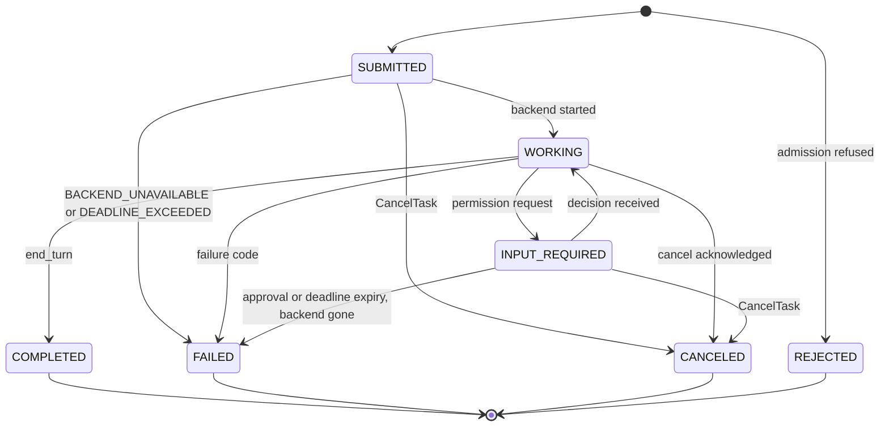

# RFC-0005: Task Lifecycle and Delivery

| Field | Value |
|---|---|
| Status | Proposed |
| Depends on | RFC-0001 (vocabulary, locked decisions L3-L5, L7-L8, L13); RFC-0002 (headers, reply and error mapping); RFC-0003 (extension activation); RFC-0006 (approval and budget payloads, loop breaker); RFC-0009 (Backend contract and stop reasons); RFC-0010 (NATS storage, dedupe window) |
| Owner area | Worker runtime: task lifecycle, sequence, delivery |
| Related interop notes | `docs/interop/a2a-spec-notes.md` sections 3, 4, 6; `docs/interop/hermes.md` sections 6, 8, 10; `docs/interop/acp-omp-claude.md` sections 2.5, 2.9, 3.5; `docs/interop/nats.md` sections 2.2, 2.3, 4.1 |

## 1. Summary

Every A2A-Bus task is owned by exactly one Worker, which assigns its id, commits every state change and event to a durable store, and publishes events in strict per-task order. Delivery is at least once, so every submission and event carries an identity that makes redelivery harmless. Tasks move through the A2A TaskState values along a single normative transition table; terminal states are immutable, and every failure carries one machine-readable reason code. Deadlines, cancellation, crash recovery and replay are defined so that no task runs twice and no task stays non-terminal forever. Stock A2A peers see ordinary A2A tasks; the sequence number and failure codes ride in metadata.

## 2. Motivation and scope

Requirements R-L1 to R-L4, R-D1 to R-D3 and R-S6 in `docs/requirements.md` section 6 require a single lifecycle model that works over a bus that can duplicate, reorder and lose messages, and where a worker, backend or bus can die mid-task. Scenarios 4 to 8 of section 5.3 and M1-6, M1-8, M1-9 depend on it. Threats T3 (runaway work, bounded here by deadlines and terminal states), T4 (replay and duplication) and T11 (stale authority in partitions) are addressed here.

In scope: task identity and ownership, the state machine, event sequencing, event replay, submission idempotency and the dedupe window, crash and restart recovery, cancellation, deadlines and retention, read consistency, and the failure reason registry.

Non-goals:
- Approval payloads, budget fields, loop detection and breaker policy: RFC-0006. This RFC only defines the transitions they trigger and the codes they use.
- Header names, subject grammar, error envelopes: RFC-0002. Stream storage and dedupe configuration: RFC-0010.
- Agent identity, signing and grants: RFC-0007.
- Changes to A2A proto messages. Everything here uses existing A2A objects plus metadata.

## 3. Terminology

Terms from RFC-0001 (Worker, Backend, task, seq, ev subject) are used as defined there.

- **Owner Worker**: the Worker instance (one agent id, one durable store) that created a task. Only the owner publishes events for it.
- **Store**: the owner Worker's durable task store. It is authoritative for task state, sequence numbers, admission records and the event outbox.
- **Outbox entry**: a committed event that has not yet been acknowledged by the bus. Each entry holds its seq, its A2AB-Msg-Id and its payload.
- **Admission record**: a store entry that maps a submission identity (A2AB-Msg-Id, or requester plus Message.messageId) to a task id.
- **H**: maximum age, measured from the issuer timestamp, at which the bus may still deliver or retain a submission. Default 1 hour (the inbound stream max age, RFC-0010).
- **Staleness allowance**: 30 seconds, the fixed allowance added to a request's Ttl by RFC-0002 [0002-072]. It is not a configurable clock-skew tolerance.
- **W**: admission-record retention window. Required to be at least 2 x H.
- **T_task**: terminal retention. Default 24 hours after a task becomes terminal.
- **Failure code**: one value from the registry in section 4.9, stored under the key `a2abus.failure`.
- **Backend session**: the live connection and session the Worker holds with its Backend for one task.

## 4. Specification

### 4.1 Identity and ownership

- [0005-001] The owner Worker MUST assign the task id (UUIDv7) for every task it creates. A requester MUST NOT choose a task id for a new task; a SendMessage carrying an unknown task id returns TaskNotFoundError.
- [0005-002] If a new SendMessage omits contextId, the Worker MUST assign one (UUIDv7). Context ids are scoped by (effective origin, contextId) as defined in RFC-0008; the same contextId string from another origin names a different context and never matches. The gateway never rewrites contextId. A continuation (section 4.2, [0005-008]) MUST carry both the task id and the contextId of the existing task; a mismatch returns TaskNotFoundError, not a new task.
- [0005-003] Only the owner Worker MAY publish events for a task. Requests for a task id addressed to any other agent MUST return TaskNotFoundError.
- [0005-004] A task is visible only to its effective origin (RFC-0008; for a bus caller, the agent identity that created it) and to operator identities (RFC-0007). This applies to GetTask, ListTasks, CancelTask, SubscribeToTask and contextId history. Requests from any other origin MUST return TaskNotFoundError (wire: gRPC NOT_FOUND with ErrorInfo reason `TASK_NOT_FOUND` and domain `a2a-protocol.org` per RFC-0002 [0002-091]; JSON-RPC -32001 via RFC-0008), so that task ids cannot be probed. A ListTasks result contains only tasks visible to the requester.

### 4.2 States and transitions

- [0005-005] Task states MUST be the A2A TaskState values. TASK_STATE_UNSPECIFIED MUST NOT be emitted; a request that names it is rejected with InvalidParamsError.
- [0005-006] A Worker MUST apply only the transitions in Table 4.2. Any other transition attempt is refused, logged to audit (RFC-0013) and not applied.
- [0005-007] Terminal states (COMPLETED, FAILED, CANCELED, REJECTED) are immutable. The Worker MUST NOT change a terminal task's status, and MUST NOT publish any event for it after the terminal event. Late backend output for a terminal task is dropped and audited. This decides the gap noted as D-7 in `a2a-spec-notes.md` section 10.
- [0005-008] INPUT_REQUIRED is an interrupted, non-terminal state. A SendMessage carrying the same task id and contextId resumes an interrupted task. A SendMessage for a terminal task returns UnsupportedOperationError.
- [0005-009] Workers MUST NOT emit AUTH_REQUIRED in M1, since no M1 backend needs it and Hermes has no handler for it (`hermes.md` section 1.3 and 8.5). AUTH_REQUIRED is not a bus state. A peer AUTH_REQUIRED is never propagated: the driver maps it to FAILED with BACKEND_ERROR and health class PEER_AUTH_FAILED (RFC-0009 [0009-047]).
- [0005-010] A FAILED or REJECTED status MUST carry exactly one failure code (section 4.9) in its status message metadata. A FAILED status without a code is invalid and MUST NOT be emitted.
- [0005-011] There is no EXPIRED state (R-L2). Deadline expiry is FAILED with DEADLINE_EXCEEDED or APPROVAL_TIMEOUT.

Table 4.2: Transitions

| From | To | Trigger | Failure code | Rule |
|---|---|---|---|---|
| (create) | SUBMITTED | admission committed | - | [0005-024] |
| (create) | REJECTED | admission refused (overload, quota) | RATE_LIMITED, QUEUE_FULL | [0005-028] |
| (create) | FAILED | delegated task whose (agent, fingerprint) pair is already in the lineage, or whose receiving agent is already in the lineage (re-entrancy); no backend start | LOOP_DETECTED | RFC-0006 [0006-045], [0006-059] |
| SUBMITTED | WORKING | backend session started; no other turn open in the context | - | [0005-025], [0005-054] |
| SUBMITTED | FAILED | backend could not start; workspace refused or lost; deadline reached | BACKEND_UNAVAILABLE, WORKSPACE_FAILED, DEADLINE_EXCEEDED | [0005-041], [0005-053] |
| SUBMITTED | CANCELED | CancelTask | - | [0005-036] |
| WORKING | INPUT_REQUIRED | backend permission request | - | RFC-0006 |
| WORKING | COMPLETED | backend stop reason end_turn | - | [0005-012] |
| WORKING | FAILED | backend or agent failure; deadline; budget or loop trip; child failure; workspace failure | any code in 4.9 whose final state is FAILED | [0005-012], [0005-032], [0005-041], [0005-039], [0005-053] |
| WORKING | CANCELED | cancel acknowledged, or grace expired | - | [0005-037] |
| INPUT_REQUIRED | WORKING | decision received for the open request | - | RFC-0006, [0005-008] |
| INPUT_REQUIRED | FAILED | approval expired; deadline; backend gone; workspace lost | APPROVAL_TIMEOUT, DEADLINE_EXCEEDED, BACKEND_CRASHED, WORKSPACE_FAILED | [0005-041], [0005-031], [0005-035], [0005-053] |
| INPUT_REQUIRED | CANCELED | CancelTask | - | [0005-036] |




- [0005-012] Backend stop reasons (RFC-0009 maps ACP `session/prompt` results; the mapping is fixed here) MUST be applied as: `end_turn` to COMPLETED; `cancelled` to CANCELED only after a CancelTask (otherwise FAILED BACKEND_CRASHED); `refusal` to FAILED AGENT_REFUSED; `max_tokens` and `max_turn_requests` to FAILED AGENT_LIMIT.

### 4.3 Events and sequence

- [0005-013] Every committed state transition, and every artifact update, produces exactly one event on `a2a.v1.<tenant>.ev.<agent>.<task_id>`. The Task snapshot returned by a reply is not an event and has no seq.
- [0005-014] The first event of a task is its SUBMITTED status (or its REJECTED status, for refused admission) with seq 1. Each further event has seq one greater than the previous event. Status and artifact events share this single sequence (L8).
- [0005-015] The seq and the event payload MUST be committed to the store in the same transaction as the state change (transactional outbox). An event is never published before its transition is committed.
- [0005-016] A2AB-Msg-Id for an event is generated once, at commit, and stored with the outbox entry. Re-publication after a crash or a bus outage MUST reuse the stored value and seq, so that a bus-level duplicate is recognizable.
- [0005-017] A consumer MUST apply events of one task in seq order, keyed by (task id, seq): an event with seq equal to last applied plus 1 is applied; an event with seq at or below last applied is a duplicate and is ignored; an event with seq above last applied plus 1 is held and a replay is requested from last applied (L5, R-D2).
- [0005-018] An event whose status is INPUT_REQUIRED, COMPLETED, FAILED, CANCELED or REJECTED MUST carry header `A2AB-Stream-End: true`. It ends the stream of the subscription that receives it; no further event is delivered on that subscription (L3, `a2a-spec-notes.md` section 4.2).
- [0005-019] Replay: the reply to a SubscribeToTask carries only the current Task snapshot and header `A2AB-Last-Seq: <L>` (RFC-0002 sections 4.5 and 4.12), where L equals the seq in the snapshot metadata of [0005-021]. Events are not carried on the reply. The requester subscribes to `a2a.v1.<tenant>.ev.<agent>.<task_id>` starting at `A2AB-After-Seq + 1` when that header was supplied, otherwise at `L + 1`. `A2AB-After-Seq: 0` therefore replays from seq 1. Replay MAY be served from the store or the event stream (RFC-0010); the observable contract is that every committed event with seq at or above the start point is delivered, in seq order, with none missing.
- [0005-020] SubscribeToTask on a terminal task returns UnsupportedOperationError (A2A rule). A requester that missed a terminal event MUST use GetTask, whose snapshot carries the final state.
- [0005-021] Every Task snapshot returned by SendMessage, GetTask and SubscribeToTask MUST carry `Task.metadata["urn:a2abus:ext:sequence:1"]` set to SequenceInfo with the last committed seq, and SubscribeToTask replies MUST also carry `A2AB-Last-Seq` with the same value. This addition to L8 lets a requester resume without knowing earlier seq values, and is flagged to the integrator.
- [0005-022] Artifact updates use the A2A append and lastChunk semantics. Each artifact update is one event in the sequence (see example 4).

### 4.4 Submission identity, idempotency and dedupe

- [0005-023] A Worker MUST keep admission records keyed by (a) the A2AB-Msg-Id of the submission and (b) the pair (effective origin, Message.messageId), where effective origin is defined in RFC-0008. A submission matching either key returns the current Task of the recorded task id and MUST NOT invoke the backend again (L5, R-D1, R-D3, scenario 7). Key (b) covers gateway retries: an HTTP retry gets a fresh A2AB-Msg-Id but keeps the same messageId, so it creates no second admission (Hermes counts admissions per message).
- [0005-024] Admission is atomic: the task record, both admission keys, the SUBMITTED event and its outbox entry are committed in one transaction before the reply is sent or any backend is started.
- [0005-025] The Worker MUST record that the backend session started (store write) before invoking the backend. Restart recovery (section 4.5) depends on this record.
- [0005-026] Admission records MUST be retained for at least W = 2 x H (defaults: H = 1 hour, W = 2 hours), and for at least as long as the task they created: expiry = max(created + W, terminal + T_task). The NATS duplicate window (default 2 minutes, `nats.md` section 2.2) is a first line of defence only; correctness rests on the store, not on the bus window (decision for RFC-0010).
- [0005-027] The owner Worker MUST NOT admit a submission whose receipt is past its Ttl plus the 30-second staleness allowance (RFC-0002 [0002-072]). As the receiver it answers `REQUEST_EXPIRED` ([0002-072]), creates no task and audits the refusal (R-F3). The check uses the envelope Ttl and the local clock only; no cross-host clock comparison is made beyond that allowance.
- [0005-028] Overload: when a per-peer rate limit or queue quota is exceeded (R-S6), the Worker MUST create a task in REJECTED with code RATE_LIMITED or QUEUE_FULL, commit it, publish its single event with seq 1 and `A2AB-Stream-End: true`, and reply with that Task. No backend is started. A silent drop is not permitted.
- [0005-054] A Worker MUST run at most one backend turn per (origin, context_id) (origin scoping per [0005-002] and RFC-0002 [0002-089]); turns of different contexts MAY run concurrently. The holder of a context is the task whose backend turn has started and has not reached a terminal state. INPUT_REQUIRED does NOT release the context: the open approval belongs to the holder's turn, and only the holder's terminal state releases it. Every other SUBMITTED task in that context MUST wait in admission order, with no backend start. When the holder's terminal state is committed, the Worker MUST start the oldest waiting task of that context only after that commit. A decision for the holder's open request (RFC-0006) or a resume of the holder ([0005-008]) is delivered to its open turn and MUST NOT wait behind a queued task. A SendMessage naming a waiting task does not change its queue position or start it. A waiting task's deadline runs from admission ([0005-040]); its expiry commits FAILED DEADLINE_EXCEEDED ([0005-041]) with no backend start, and CancelTask on it commits CANCELED ([0005-036]). The number of waiting tasks per context is bounded by the queue quota of [0005-028]; a submission beyond it is REJECTED with QUEUE_FULL and is not queued.

### 4.5 Delivery, redelivery and crash recovery

- [0005-029] Delivery is at least once. Handlers MUST NOT assume single delivery and MUST be idempotent under [0005-023] and [0005-017].
- [0005-030] A completed or terminal task MUST NEVER be run again. A restart or a redelivery may only re-publish outbox entries or return snapshots.
- [0005-031] On Worker start, the Worker MUST process every non-terminal task as follows:
  1. SUBMITTED with no recorded backend start: start execution (it has never run), or keep it waiting if its context has an open turn ([0005-054]).
  2. Backend start recorded but no live backend session: commit FAILED with BACKEND_CRASHED. The Worker MUST NOT re-run an in-flight turn, because the turn may already have caused side effects (M1-9).
  3. INPUT_REQUIRED: keep the open approval if it has not expired and the backend session is alive; if it has expired, commit FAILED APPROVAL_TIMEOUT; if the session is gone, a later decision commits FAILED BACKEND_CRASHED.
  4. Re-publish every outbox entry not yet acknowledged, with its stored seq and A2AB-Msg-Id.
- [0005-032] A backend that exits or stops responding while a task is WORKING MUST lead to FAILED BACKEND_CRASHED within 30 seconds of detection. Detection bounds are owned by RFC-0009. This satisfies M1-9.
- [0005-033] During a bus outage the Worker MUST keep outbox entries durable and retry publication with capped exponential backoff (initial 100 ms, cap 30 s). Backend work and deadline timers continue during the outage. Outbox entries MUST survive a Worker restart.
- [0005-034] A requester that lost events MUST recover with SubscribeToTask and A2AB-After-Seq (or GetTask for a terminal task). A requester that retries a SendMessage MUST reuse the Message.messageId, so that it receives the existing task (section 4.4).
- [0005-035] Partitions: the owner Worker is the only enforcer of deadlines and approvals. A decision or event arriving after the relevant expiry MUST NOT change state; the expiry wins (T11, fail closed).

### 4.6 Cancellation

- [0005-036] CancelTask on SUBMITTED or INPUT_REQUIRED commits CANCELED immediately. An open approval is closed, and the backend, if waiting on it, receives a cancelled answer (RFC-0006).
- [0005-037] CancelTask on WORKING records `cancel_requested` in the store and calls the backend cancel (ACP `session/cancel`, `acp-omp-claude.md` section 2.9). The task becomes CANCELED once the backend acknowledges the stop. If the backend has not acknowledged within 15 seconds, the Worker kills the backend session and then commits CANCELED. The reply to CancelTask is the Task in its current state, which may still be WORKING; the terminal CANCELED event follows on the event subject. This makes M1-8 observable: the status is CANCELED only after the turn has stopped.
- [0005-038] CancelTask on CANCELED returns the existing Task (idempotent). CancelTask on COMPLETED, FAILED or REJECTED returns TaskNotCancelableError.
- [0005-039] When a task with delegated child tasks enters CANCELED, FAILED with DEADLINE_EXCEEDED, FAILED with BUDGET_EXHAUSTED, or FAILED with LOOP_DETECTED, the owner Worker issues CancelTask once to every child task it created that is non-terminal. Children that refuse are logged. RFC-0006 defines the breaker side of this rule.

### 4.7 Deadlines, retention and clocks

- [0005-040] Every task MUST have a deadline (R-L4). At admission the Worker computes deadline = admission time + min(agent default task deadline, budget.max_wall_ms when present in the admitting message, RFC-0006). The agent default is 3600 seconds unless configured.
- [0005-041] When the deadline passes while a task is non-terminal, the Worker MUST cancel the backend without grace and commit FAILED with DEADLINE_EXCEEDED. If the task is INPUT_REQUIRED and its approval expires first, the code is APPROVAL_TIMEOUT instead. Time spent in INPUT_REQUIRED counts toward the deadline.
- [0005-042] Only the owner Worker evaluates deadlines. Deadlines are stored as absolute local UTC instants and enforced with the local clock. No cross-host clock comparison is needed (R-F3). The only cross-host comparison is the staleness check in [0005-027].
- [0005-043] Terminal tasks are retained for T_task (default 24 hours) and then purged. After purge, GetTask and CancelTask return TaskNotFoundError. The admission records for a purged task are retained per [0005-026].

### 4.8 Read consistency and history

- [0005-044] GetTask and ListTasks MUST be served from the owner store and MUST reflect the last committed state. ListTasks is ordered by last update, newest first, with the A2A paging defaults (pageSize 50, maximum 100). Every ListTasks reply MUST carry `nextPageToken` (empty on the last page) and `totalSize` (A2A section 3.1.4). `statusTimestampAfter` selects tasks whose status timestamp is at or after the given value, not strictly after. The result contains only tasks visible under [0005-004].
- [0005-045] historyLength is interpreted as: unset returns all retained messages; 0 returns no history (the field is omitted); N greater than 0 returns at most the N most recent messages. History contains messages only, never events. The rule applies to SendMessage, SendStreamingMessage, GetTask and ListTasks; SubscribeToTask has no historyLength (A2A section 3.1.6) and is not affected. This resolves the wording conflict D-2 and GAP-C.
- [0005-046] With returnImmediately false, SendMessage MUST wait until the task is interrupted (INPUT_REQUIRED, or AUTH_REQUIRED per A2A section 3.2.2; M1 never emits AUTH_REQUIRED, [0005-009]) or terminal, or until the smaller of the caller's timeout and the task deadline. If the wait ends first, the reply is the Task in its current non-terminal state, and the task continues. With returnImmediately true, the reply follows the commit of the SUBMITTED state.
- [0005-047] A new task may share a contextId with an earlier task. A SendMessage without a task id always creates a new task, even inside an existing context (`a2a-spec-notes.md` section 3.5).

- [0005-051] A CancelTask from an origin other than the task's origin MUST return TaskNotFoundError (wire -32001, `TASK_NOT_FOUND`), never TaskNotCancelableError (-32002). TaskNotCancelableError applies only to a same-origin cancel of a terminal task ([0005-038]). A bridge fronting an external agent MUST apply the same rule to that agent's replies (Hermes returned -32002 for a cross-origin cancel in spike hermes-a2a, T23).

- [0005-052] A bridge that forwards to an external agent with a shared context model (Hermes) MUST namespace the external contextId per bus origin, derived from the origin and the bus contextId, so that two origins never share model history. The bridge MUST NOT forward GetTask, CancelTask or SubscribeToTask for a task id owned by another origin (it returns TaskNotFoundError, [0005-004]), and MUST NOT send ListTasks to an external agent at all. RFC-0008 and RFC-0009 implement this rule; this RFC states it. Spike hermes-a2a: T21 shared model history, T22 cross-origin GetTask returned the full task, T24 ListTasks exposed another origin's tasks.

### 4.9 Failure code registry

- [0005-048] A FAILED or REJECTED status MUST use one of the codes below, and only in the state given in its Final state column. Adding a code requires a new RFC revision.
- [0005-049] The code is stored as `status.message.metadata["a2abus.failure"] = {"code": "<CODE>", "detail": {...optional, redacted}}`. The status message also carries a human-readable text part, for example `task failed: deadline exceeded`, so that stock peers see a readable reason. The text is informational only; bus peers read the code from the key, never from the text.

| Code | Final state | Meaning | Defined by |
|---|---|---|---|
| DEADLINE_EXCEEDED | FAILED | Task deadline reached | 0005 |
| APPROVAL_TIMEOUT | FAILED | Approval expiry reached with no decision | 0005 (trigger), 0006 (expiry) |
| APPROVAL_DENIED | FAILED | Operator denied and the backend ended the turn without success | 0006 |
| BUDGET_EXHAUSTED | FAILED | A budget dimension is spent; the dimension is in detail | 0006 |
| LOOP_DETECTED | FAILED | Cycle, re-entry into an agent already in the chain, or repeated task fingerprint in the chain | 0006 |
| CHILD_FAILED | FAILED | A delegated child ended FAILED; its code is in detail | 0006 |
| BACKEND_CRASHED | FAILED | Backend exited, stopped responding, or was found mid-turn after restart | 0005 (rules), 0009 (detection) |
| BACKEND_UNAVAILABLE | FAILED | Backend could not be started or initialized (driver spawn or initialize failure; peer unreachable at start) | 0009 |
| BACKEND_ERROR | FAILED | JSON-RPC error or unknown stop reason from the backend; peer reply context mismatch; peer AUTH_REQUIRED or auth failure | 0009 |
| BACKEND_TIMEOUT | FAILED | Backend turn idle timeout or peer reply-timeout marker | 0009 |
| BACKEND_LOST_TASK | FAILED | Peer reports the task unknown on poll or resubscribe (`-32001`) | 0009 |
| AGENT_REFUSED | FAILED | Backend stop reason refusal | 0005 (mapping) |
| AGENT_LIMIT | FAILED | Backend stop reason max_tokens or max_turn_requests | 0005 (mapping) |
| WORKSPACE_FAILED | FAILED | Task workspace refused, lost or busy (RFC-0012); the token is in detail | 0005 (mapping), 0012 (tokens) |
| RATE_LIMITED | REJECTED | Per-peer rate limit exceeded | 0005 |
| QUEUE_FULL | REJECTED | Queue quota exceeded | 0005 |

- [0005-050] A Worker whose presence state is `DRAINING` (RFC-0004 [0004-016]) MUST refuse each new `send` or `stream` that would create a task with a bus-level error: status code `UNAVAILABLE` (14), ErrorInfo domain `a2abus.v1`, reason `DRAINING` (RFC-0002 section 4.8). The refusal creates no task. Tasks the Worker already owns continue to run and commit their terminal states; the drain timeout of RFC-0004 governs departure.

- [0005-053] A workspace refusal or loss (RFC-0012) raised while a task exists MUST commit FAILED with code WORKSPACE_FAILED and detail `{"token": "<token>"}`, where token is one of the workspace tokens of RFC-0012 (the table in section 4.8): non_git_refused, copy_link_rejected, path_occupied, branch_exists, lease_lost, workspace_busy, state_invalid, path_escape, config, shared_checkout, copy_limit, path_too_long, git_failed, io. A refusal raised before any task exists stops the Worker start (RFC-0012) and creates no task.

### 4.10 Worked examples

Values: tenant `local`; requester `hermes` through the gateway (RFC-0008); owner `omp`. Ids are examples. Headers shown are the A2AB headers of RFC-0002. Bodies are proto3 JSON.

**Example 1: approval interrupt and resume ([0005-008], [0005-018], RFC-0006 0006-007, L10).**

1. Submission on `a2a.v1.local.rpc.omp.send`, header `A2AB-Msg-Id: 6f1d2c3e-0a4b-4c5d-9e8f-1a2b3c4d5e6f`. No taskId and no contextId, so the Worker creates a task and a context:
```json
{"message":{"messageId":"c2a1f0e4-8d3b-4f6a-9b7c-5e4d3c2b1a09","role":"ROLE_USER","parts":[{"text":"Run the test suite and fix failures."}]}}
```
2. The owner commits SUBMITTED (seq 1), WORKING (seq 2), then INPUT_REQUIRED (seq 3) when the backend sends `session/request_permission`. Event on `a2a.v1.local.ev.omp.0195f3a2-6c10-7e21-9b4d-2a7c8e9f0a11`, headers `A2AB-Msg-Id: 1b7e9d20-5c3a-4f71-8e02-9a6b4c3d2e10` (assigned at commit) and `A2AB-Stream-End: true`:
```json
{"taskId":"0195f3a2-6c10-7e21-9b4d-2a7c8e9f0a11","contextId":"0195f3a2-6c00-7d3c-8f10-4b5a6c7d8e9f",
 "status":{"state":"TASK_STATE_INPUT_REQUIRED","timestamp":"2025-06-01T10:05:00.120Z",
   "message":{"messageId":"4a9d2b10-3c7e-4e8f-a1b2-c3d4e5f6a7b8","role":"ROLE_AGENT",
     "parts":[{"text":"Approval needed: bash (exec). Summary: cargo test in repo root"}],
     "metadata":{"urn:a2abus:ext:approval:1":{"requestId":"0195f3a2-7000-7a11-8b22-3c33d44e55f6","taskId":"0195f3a2-6c10-7e21-9b4d-2a7c8e9f0a11","tool":"bash","tier":"APPROVAL_TIER_EXEC","summary":"cargo test in repo root","requester":"omp","chain":["omp"],"options":[{"optionId":"allow-once","name":"Allow once","kind":"APPROVAL_OPTION_KIND_ALLOW_ONCE"},{"optionId":"reject-once","name":"Reject once","kind":"APPROVAL_OPTION_KIND_REJECT_ONCE"}],"expiresAt":"2025-06-01T10:10:00Z","nonce":"nZ3vQe7Lw8Kq1x0RkJ2aYg=="}}}},
 "metadata":{"urn:a2abus:ext:sequence:1":{"seq":"3"}}}
```
3. The reply to step 1 (returnImmediately false) returns when the task is interrupted: `{"task":{"id":"0195f3a2-6c10-7e21-9b4d-2a7c8e9f0a11","contextId":"0195f3a2-6c00-7d3c-8f10-4b5a6c7d8e9f","status":{"state":"TASK_STATE_INPUT_REQUIRED"},"metadata":{"urn:a2abus:ext:sequence:1":{"seq":"3"}}}}`. A stock client sees INPUT_REQUIRED and the readable text.
4. The operator decides through the TUI. Request on `a2a.v1.local.rpc.omp.send` with the same taskId and contextId, header `A2AB-Msg-Id: 3c8e5f11-9a2b-4d6c-8f7e-0b1a2c3d4e5f`. The decision is a Part whose data is an ApprovalDecision and whose metadata carries the approval key. The operator identity format is owned by RFC-0007:
```json
{"message":{"messageId":"e5f6a7b8-1c2d-4e3f-8a9b-0c1d2e3f4a5b","role":"ROLE_USER","taskId":"0195f3a2-6c10-7e21-9b4d-2a7c8e9f0a11","contextId":"0195f3a2-6c00-7d3c-8f10-4b5a6c7d8e9f",
 "parts":[{"data":{"requestId":"0195f3a2-7000-7a11-8b22-3c33d44e55f6","taskId":"0195f3a2-6c10-7e21-9b4d-2a7c8e9f0a11","optionId":"allow-once","nonce":"nZ3vQe7Lw8Kq1x0RkJ2aYg==","decidedBy":"operator:alice@host-1","decidedAt":"2025-06-01T10:06:12Z"},"metadata":{"urn:a2abus:ext:approval:1":{}}}]}}
```
5. The owner checks the decision (RFC-0006 0006-013), sets `decided_by` from the verified identity, and commits WORKING (seq 4), an artifact update (seq 5) and COMPLETED (seq 6). The reply to step 4 is the terminal Task at seq 6. The COMPLETED event carries `A2AB-Stream-End: true`. A retry of step 4 with the same `A2AB-Msg-Id` returns this Task and runs nothing.

**Example 2: replay after lost events ([0005-019], [0005-034]).**

A requester holds events through seq 4 of a long-running task `0195f3a2-6c20-7e21-9b4d-2a7c8e9f0a12` (state WORKING, last seq 7).

1. `a2a.v1.local.rpc.omp.subscribe` with header `A2AB-After-Seq: 4` and body `{"id":"0195f3a2-6c20-7e21-9b4d-2a7c8e9f0a12"}`.
2. The reply is the snapshot, with header `A2AB-Last-Seq: 7`:
```json
{"task":{"id":"0195f3a2-6c20-7e21-9b4d-2a7c8e9f0a12","contextId":"0195f3a2-6c50-7d3c-8f10-4b5a6c7d8e9f","status":{"state":"TASK_STATE_WORKING"},"metadata":{"urn:a2abus:ext:sequence:1":{"seq":"7"}}}}
```
3. The requester subscribes to `a2a.v1.local.ev.omp.0195f3a2-6c20-7e21-9b4d-2a7c8e9f0a12` from seq 5. It receives seq 5 and 6 (artifact updates), seq 7 (status), and then live events. Without `A2AB-After-Seq`, it would start at seq 8 and receive only live events.

**Example 3: overload REJECTED ([0005-028], R-S6).**

1. Hermes exceeds its per-peer queue quota. Its `SendMessage` on `a2a.v1.local.rpc.omp.send` gets a new task in REJECTED. No backend starts.
2. The reply and the single event (seq 1, on `a2a.v1.local.ev.omp.0195f3a2-6c30-7e21-9b4d-2a7c8e9f0a13`, with `A2AB-Stream-End: true`) carry the same Task. The text part is informational; bus peers read the code from `a2abus.failure`:
```json
{"task":{"id":"0195f3a2-6c30-7e21-9b4d-2a7c8e9f0a13","contextId":"0195f3a2-6c60-7d3c-8f10-4b5a6c7d8e9f","status":{"state":"TASK_STATE_REJECTED","timestamp":"2025-06-01T10:07:45.002Z","message":{"messageId":"7e8f9a0b-1c2d-4e3f-8a4b-5c6d7e8f9a0b","role":"ROLE_AGENT","parts":[{"text":"task rejected: rate limit exceeded"}],"metadata":{"a2abus.failure":{"code":"RATE_LIMITED"}}}},"metadata":{"urn:a2abus:ext:sequence:1":{"seq":"1"}}}}
```

**Example 4: FAILED with a reason ([0005-041], [0005-049]).**

1. Task `0195f3a2-6c20-7e21-9b4d-2a7c8e9f0a12` reaches its deadline while WORKING. The owner cancels the backend without grace and commits FAILED at seq 9. The event on the ev subject carries `A2AB-Stream-End: true`:
```json
{"taskId":"0195f3a2-6c20-7e21-9b4d-2a7c8e9f0a12","contextId":"0195f3a2-6c50-7d3c-8f10-4b5a6c7d8e9f",
 "status":{"state":"TASK_STATE_FAILED","timestamp":"2025-06-01T10:40:00.000Z","message":{"messageId":"9a0b1c2d-3e4f-4a5b-8c6d-7e8f9a0b1c2d","role":"ROLE_AGENT","parts":[{"text":"task failed: deadline exceeded"}],"metadata":{"a2abus.failure":{"code":"DEADLINE_EXCEEDED"}}}},
 "metadata":{"urn:a2abus:ext:sequence:1":{"seq":"9"}}}
```
2. A stock peer shows "task failed: deadline exceeded" and state FAILED. Bus peers read the code from `a2abus.failure`.

## 5. Interoperability

Stock A2A peer (A2A v1.0 client or server):
- It sees ordinary Tasks, TaskStatusUpdateEvents and TaskArtifactUpdateEvents. Task states use the spec's values. Nothing new is required of it.
- It does not read `urn:a2abus:ext:sequence:1` (L8). Ordering is taken from stream order by the gateway (RFC-0008), which synthesizes it for HTTP clients.
- It sees FAILED and REJECTED with a text reason. The machine code is in metadata, which the spec allows.
- It does not receive `A2AB-Stream-End`; the gateway closes the HTTP stream on the same event.
- It never receives AUTH_REQUIRED from our workers (section 4.2, [0005-009]).

Hermes (A2A HTTP client and server, `hermes.md`):
- Hermes reads reply text from artifacts or status message text (`hermes.md` 8.4). Our replies therefore carry readable text in the status message, which satisfies its reader.
- Hermes does not read INPUT_REQUIRED from the state enum; it looks for a text marker (`hermes.md` 8.5). The gateway (RFC-0008) must render an approval wait as text and must not depend on Hermes reading the enum. This is the unresolved item `hermes.md` section 11.3 [UNVERIFIED].
- Hermes' anti-loop cap refuses with REJECTED and no JSON-RPC error (`hermes.md` 6.2). Our REJECTED from overload is a different case with a code, and the gateway maps both to a Task reply in REJECTED.
- Hermes counts an admission per contextId for its cap; a resumption after an approval is one more admission on that context (`hermes.md` 10, row 9). Callers that loop should use a new contextId per logical turn.
- Hermes' default client timeout is 120 seconds (`hermes.md` 10, row 8) and its server reply timeout is 300 seconds (`hermes.md` 6.4). The blocking cap in [0005-046] returns the current non-terminal Task rather than blocking past the caller's timeout. The gateway decides how to present that to Hermes.
- Hermes sends a UUID4 hex `messageId` on each request (`hermes.md` 8.3, 10). [0005-023] makes retries that reuse it idempotent. Whether Hermes' client retries with the same `messageId` is `[UNVERIFIED]`.

ACP agents (omp `--mode acp`, `claude-agent-acp`, `acp-omp-claude.md`):
- ACP agents never see bus states or sequence numbers. The Worker runtime (RFC-0009) owns the mapping in section 4.2 [0005-012].
- A permission request is `session/request_permission` (`acp-omp-claude.md` 2.10), which maps to INPUT_REQUIRED. A cancelled answer is what the Worker sends on cancellation (2.9).
- `session/cancel` followed by a `stopReason` of `cancelled` matches [0005-037]. Background children of a Claude Code session keep running after cancel (`acp-omp-claude.md` 4.4). The Worker kills the session process at grace expiry, which covers that case.
- Neither ACP driver is told about seq, A2AB headers or the registry. Unknown ACP session/update kinds are ignored, as ACP requires (`acp-omp-claude.md` section 7 item 9).

## 6. Security considerations

- T4 (replay and duplication): admission keys ([0005-023]), outbox id reuse ([0005-016]), seq-based idempotency ([0005-017]) and terminal immutability ([0005-007]) make replayed submissions and events inert. Single-use approval grants are in RFC-0006.
- T3 (runaway cost): every task has a deadline ([0005-040]); cancel cascades ([0005-039]); terminal states cannot be reopened. Budgets and loop breakers are RFC-0006.
- T11 (stale authority): deadlines and approval expiry are enforced by the owner only, and a late decision cannot revive a task ([0005-035]). Failures are closed (FAILED), never open.
- Visibility: invisible tasks return TaskNotFoundError ([0005-004]), so ids cannot be probed.
- Only the owner publishes on its ev subject ([0005-003]). The NATS permission model (RFC-0010) must enforce this; the rule is stated here so that RFC-0010 can test it.
- Redaction (R-S5): event payloads and failure details are redacted before commit (RFC-0013 [0013-022]). Raw prompts, raw tool arguments and file content never appear in failure detail or audit records (L17; RFC-0013 [0013-023]).
- Overload ([0005-028]) returns REJECTED with a code and no backend call; it never drops silently (R-S6).
- The worker never re-runs an in-flight turn ([0005-031]), which prevents duplicate side effects after a crash.

## 7. Rationale and alternatives considered

- **Outbox in the owner store, not JetStream as the source of truth.** The store already holds state and seq; a bus outage or a bus restart then cannot make a sequence number disappear. The bus is a transport. Rejected alternative: letting JetStream sequence numbers stand in for task seq, which fails as soon as a message is lost before a consumer acknowledges it.
- **Re-publish with stored Msg-Id.** A fresh UUIDv7 on retry would defeat bus-level dedupe. Storing the id once keeps the bus dedupe useful for the common case, while the store remains the real guard.
- **Dedupe window tied to H and task retention.** A window shorter than the redelivery horizon lets an old submission run twice; a window tied to H is the bound R-D1 requires. Stating the relation in code and in the RFC is the point.
- **No automatic re-run of in-flight turns.** Re-running an agent turn after a crash can repeat writes and commands. Failing the task with BACKEND_CRASHED is visible and safe; the requester can resubmit as a new task. This is the M1-9 behaviour.
- **FAILED with a code, not EXPIRED.** R-L2 forbids EXPIRED. A code in metadata gives the same machine-readable information without a new A2A state.
- **Metadata key `a2abus.failure`, not an extension URI.** RFC-0001 defines five extension names and no lifecycle extension. A failure code is informational and does not need activation, so a plain namespaced metadata key avoids adding a sixth extension. Flagged to the integrator.
- **CANCELED only after the backend stops.** Reporting CANCELED while a turn still runs would let a requester start new work while the old turn writes files (T13 risk). The cost is a short window with the task still WORKING after CancelTask.
- **Approval deny resumes the backend.** M1-6 says deny returns to the originating agent. The backend therefore sees the reject answer and decides how to end; the Worker records APPROVAL_DENIED only if the turn then fails. Timeout is different: no answer is given, so the task fails with APPROVAL_TIMEOUT.
- **Deadline in local clock only.** Requiring clock agreement across hosts would break R-F3. Only the owner acts on its deadline, so a local clock is enough.
- **Snapshot carries seq.** Without it a requester that subscribes after a snapshot cannot tell whether an event was already reflected. Rejected alternative: requiring a requester to replay from seq 1 every time, which is correct but expensive.

## 8. Conformance

| ID | Test idea | Level |
|---|---|---|
| 0005-001 | Send with a client-chosen task id; expect TaskNotFoundError and no task created | MUST |
| 0005-002 | Continuation with mismatched contextId; expect TaskNotFoundError | MUST |
| 0005-003 | Second agent requests a task owned by another; expect TaskNotFoundError | MUST |
| 0005-004 | Unrelated identity calls GetTask, ListTasks, CancelTask or SubscribeToTask; expect TaskNotFoundError; ListTasks lists only visible tasks | MUST |
| 0005-005 | Inject TASK_STATE_UNSPECIFIED in a request; expect InvalidParamsError; check no emission | MUST |
| 0005-006 | Attempt COMPLETED to WORKING via test hook; expect refusal and audit record | MUST |
| 0005-007 | Deliver a backend event after COMPLETED; expect no event published and audit record | MUST |
| 0005-008 | Resume INPUT_REQUIRED with same task id and contextId; expect WORKING | MUST |
| 0005-009 | Scan all emitted states across M1 scenarios; no AUTH_REQUIRED | MUST |
| 0005-010 | Force a backend failure without a code; the Worker MUST refuse to emit FAILED and log an internal error | MUST |
| 0005-011 | Grep the registry; no EXPIRED value anywhere | MUST |
| 0005-012 | Table-driven test of stop-reason mapping with a fake backend | MUST |
| 0005-013 | One event per transition and per artifact; count matches | MUST |
| 0005-014 | First event seq 1; consecutive events +1 with no gaps over 100 random transitions | MUST |
| 0005-015 | Kill the Worker between commit and publish; restart; event appears once with same seq | MUST |
| 0005-016 | Re-publish after bus outage; A2AB-Msg-Id identical to first attempt | MUST |
| 0005-017 | Consumer fed duplicates, reordered and gapped sequences; final state correct | MUST |
| 0005-018 | Every interrupted or terminal event carries A2AB-Stream-End true; none before | MUST |
| 0005-019 | SubscribeToTask with A2AB-After-Seq 2; expect reply snapshot with A2AB-Last-Seq and ev subscription delivering seq 3 onward | MUST |
| 0005-020 | SubscribeToTask on terminal task; expect UnsupportedOperationError | MUST |
| 0005-021 | Snapshot metadata seq equals last committed seq in all three operations | MUST |
| 0005-022 | Artifact append and lastChunk semantics checked against example 4 | SHOULD |
| 0005-023 | Deliver the same submission twice with same Msg-Id, and again with new Msg-Id and same messageId; backend invoked once | MUST |
| 0005-024 | Kill during admission; no half-created task (no task without SUBMITTED event) | MUST |
| 0005-025 | Kill after backend start recorded, before any output; restart yields BACKEND_CRASHED | MUST |
| 0005-026 | Admission records survive 2 x H in test clock; expire no earlier than max(created + W, terminal + T_task) | MUST |
| 0005-027 | Submission with receipt older than Ttl plus 30 s staleness allowance; `REQUEST_EXPIRED` reply, no task created, audit record | MUST |
| 0005-028 | Exceed per-peer rate limit; REJECTED task with RATE_LIMITED, no backend start | MUST |
| 0005-029 | Run the handler suite with every message duplicated; results identical | MUST |
| 0005-030 | Restart with a COMPLETED task; no backend invocation | MUST |
| 0005-031 | Restart matrix for SUBMITTED, WORKING, INPUT_REQUIRED, outbox pending; each row as stated | MUST |
| 0005-032 | Kill backend mid-WORKING; FAILED BACKEND_CRASHED within 30 s | MUST |
| 0005-033 | Stop the bus for 5 minutes mid-task; outbox persists; events arrive in order after restart | MUST |
| 0005-034 | Lost-events requester recovers via A2AB-After-Seq; no duplicate processing | MUST |
| 0005-035 | Decision arrives after approval expiry; state stays FAILED APPROVAL_TIMEOUT | MUST |
| 0005-036 | CancelTask in SUBMITTED and INPUT_REQUIRED; CANCELED committed immediately, approval closed | MUST |
| 0005-037 | CancelTask in WORKING with a responsive backend and with a hung one; CANCELED after stop or after 15 s | MUST |
| 0005-038 | CancelTask on CANCELED returns the Task; on COMPLETED returns TaskNotCancelableError | MUST |
| 0005-039 | Parent with two children is cancelled; both children reach CANCELED | MUST |
| 0005-040 | Task with budget.max_wall_ms smaller than agent default; deadline equals the smaller value | MUST |
| 0005-041 | Deadline expires in WORKING and INPUT_REQUIRED; codes DEADLINE_EXCEEDED and APPROVAL_TIMEOUT | MUST |
| 0005-042 | Owner clock skewed by one hour in test; deadlines still fire at the local configured time | SHOULD |
| 0005-043 | Terminal task purged after T_task; GetTask returns TaskNotFoundError | MUST |
| 0005-044 | ListTasks paging and ordering against a populated store; `nextPageToken` and `totalSize` on every reply; `statusTimestampAfter` at or after | MUST |
| 0005-045 | historyLength unset, 0 and N; returned history matches each rule | MUST |
| 0005-046 | Blocking send with a short caller timeout returns the non-terminal Task and the task continues; a simulated INPUT_REQUIRED also returns the blocking send | MUST |
| 0005-047 | Second SendMessage without task id in an existing context creates a new task | MUST |
| 0005-048 | Static check: every code emitted appears in the registry table | MUST |
| 0005-049 | FAILED status carries key a2abus.failure and a readable text part | MUST |
| 0005-050 | Presence DRAINING: new send refused UNAVAILABLE with reason DRAINING and no task created; a running task still finishes | MUST |
| 0005-051 | Cross-origin CancelTask expects TaskNotFoundError, not -32002; same-origin cancel of a terminal task still gets TaskNotCancelableError | MUST |
| 0005-052 | Two origins send the same contextId through the Hermes bridge: no shared model history; cross-origin GetTask, CancelTask and SubscribeToTask are not forwarded; ListTasks is not sent | MUST |
| 0005-053 | Inject a workspace loss during a task (token `lease_lost`); expect FAILED with code WORKSPACE_FAILED and detail token; a refusal at Worker start creates no task | MUST |
| 0005-054 | Two tasks in one context: the second stays SUBMITTED until the first is terminal; INPUT_REQUIRED keeps the holder; a decision reaches the holder while another task waits; a queued deadline or cancel gives no backend start; a task in another context starts; a submission past the queue quota is REJECTED QUEUE_FULL | MUST |

## 9. Open issues

1. **Single worker per agent id.** Default: one live Worker per agent id per tenant, enforced by a lease in the store; a second instance refuses to start. Multi-instance owners are out of M1 scope.
2. **Event stream retention.** Default: `max_age = max(7 days, T_task + 24 h)` on the ev stream (RFC-0010 owns the stream configuration). T_task defaults to 24 hours (0005-043), so T_task + 24 h is 48 hours and M1 uses max_age 7 days. Replay for a live or recently terminal task is therefore always possible from the stream. RFC-0010 may add a store-side replay fallback; the contract in [0005-019] does not change.
3. **Failure key location.** Default: `a2abus.failure` in the status message metadata, as in [0005-049]. The integrator may ask for a lifecycle extension instead; the code table would not change.
4. **Bus error mapping.** Default: A2A error types (TaskNotFoundError, InvalidParamsError, UnsupportedOperationError, TaskNotCancelableError) use ErrorInfo domain `a2a-protocol.org` with A2A reasons, as RFC-0002 defines. Bus-level errors use domain `a2abus.v1`. This RFC defines one bus-level refusal, reason `DRAINING` ([0005-050]); failure codes are metadata (4.9), not errors. This RFC names the A2A error types only, plus DRAINING.
5. **Grace for backend cancel.** Default: 15 seconds, then kill. Per-backend override belongs in RFC-0009.
6. **Stream end for stock peers.** Default: the gateway closes the HTTP stream on the event that carries `A2AB-Stream-End: true` (RFC-0008).
