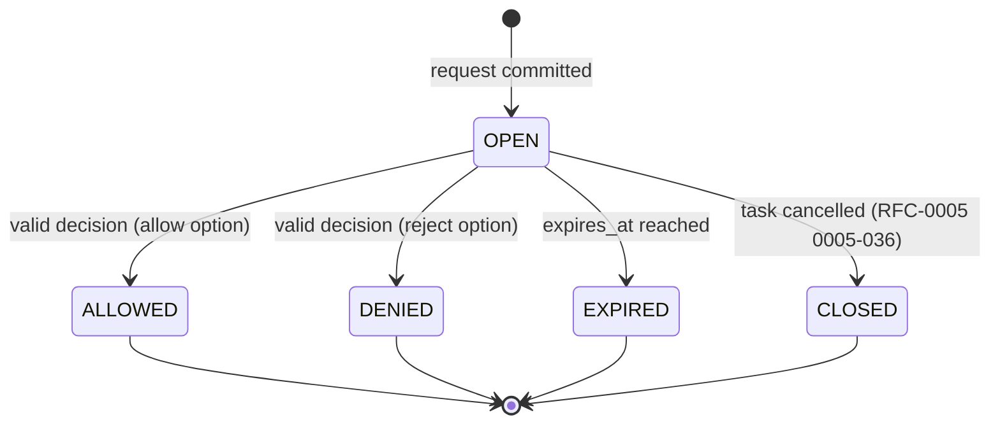

# RFC-0006: Approval, Budgets and Loop Control

| Field | Value |
|---|---|
| Status | Proposed |
| Depends on | RFC-0001 (L9, L10, L13, L17; shared vocabulary); RFC-0002 (headers, Message.metadata); RFC-0003 (`approval`, `budget`, `sequence` activation and card keys); RFC-0005 (state transitions, failure codes, deadlines, cancel cascade); RFC-0007 (operator identity, signing, grants); RFC-0009 (Backend permission and usage hooks, stop reasons); RFC-0013 (audit) |
| Owner area | Worker runtime: approvals, budgets, delegation accounting, loop breaker |
| Related interop notes | `docs/interop/acp-omp-claude.md` sections 2.8, 2.9, 2.10, 3.3, 4.3, 4.4; `docs/interop/hermes.md` sections 6.2, 8.3, 10; `docs/interop/a2a-spec-notes.md` section 3.3; `docs/spikes/omp-acp.md` (Q4); `docs/spikes/claude-acp.md` (Q4); `docs/spikes/hermes-a2a.md` (Q4) |

## 1. Summary

A tool call that needs permission becomes an approval request: an INPUT_REQUIRED status event carrying an `ApprovalRequest` with a single-use nonce and a short expiry. Only an authenticated operator may decide it; the answer is honored once, while the request is open, and anything else denies. Each task chain carries a budget allowance (tokens, cost, wall time, hops, depth, children) that every hop enforces locally and that can only shrink along a delegation chain. Loops are caught by a chain of (agent, fingerprint) pairs, and repeated budget or loop trips open a per-origin breaker. Every trip ends in FAILED with a distinct machine-readable code from RFC-0005. Stock A2A peers see ordinary input-required and failed tasks; the policy lives in metadata and in the Worker.

## 2. Motivation and scope

Requirements M1-6 (permission requests surface with requester, chain, tool, arguments summary and working directory; default deny on timeout), M1-7 (loop and budget limits enforced), R-S3 (grants bound to task id, request id and scope; single use; expiring; default deny), R-B1 to R-B3 (budgets in metadata, cycle detection, distinct failure code), D13 (metering from usage events with self-report fallback; hard caps as backstop) and threats T3 (ping-pong and cost runaway), T7 (forged or fatigue-driven approval) and T11 (stale authority in partitions) define what this RFC must satisfy. Scenarios 4 (approval) and 5 (breaker) in `requirements.md` section 5.3 depend on it.

In scope: approval request and decision wire shape, approval lifecycle and expiry, operator authority, fatigue limits, ACP and driver mapping for permissions, budget allowance and accounting rules, metering inputs, loop detection, breaker behaviour, and child-failure propagation.

Non-goals:
- Sequence, state transitions, dedupe and cancel mechanics: RFC-0005. This RFC names the transitions it triggers.
- Operator identity, key management, signature verification and delegation tokens: RFC-0007. This RFC consumes them.
- The per-tool tier catalogue for each backend: RFC-0009 maps backend tools to tiers using the rules in section 4.1.
- Hermes-side admission caps: Hermes owns them (`hermes.md` 6.2). This RFC does not reimplement them.

## 3. Terminology

- **Gated call**: a backend tool call whose tier is prompted under the agent's approval mode (section 4.1).
- **Approval request**: one open `ApprovalRequest` (approval.proto), created by the owner Worker for one gated call.
- **Decision**: an `ApprovalDecision` (approval.proto) sent as a DataPart under the approval URI.
- **Allowance**: a `Budget` (budget.proto) that a hop may spend. Allowances are remaining values, not totals.
- **Reserve**: the part of a parent's remaining allowance set aside for a child until the child is terminal.
- **Hop**: one dispatch of work to one Worker for one task. A delegation creates a child task and therefore one hop.
- **Fingerprint**: the digest defined in section 4.5, computed over the text of a message.
- **Lineage**: `Budget.chain`, the ordered list of hops from the root to the current hop.
- **Unlimited sentinel**: `18446744073709551615` (2^64 - 1), valid only at the root for tokens, cost and wall time.

## 4. Specification

### 4.1 Gating and tiers

- [0006-001] A Worker MUST treat every backend permission request (ACP `session/request_permission`, or a driver-equivalent prompt) as gated, and MUST NOT let the tool call proceed without an answer from the Worker. A tool call with no answer is refused. This is the default-deny rule (R-S3, M1-6).
- [0006-002] Every tool call MUST be assigned exactly one tier: `read`, `write`, `exec` or `delete_or_move` (`APPROVAL_TIER_*` in approval.proto). A call whose tier is unknown MUST be assigned `exec`. An MCP tool MUST be assigned at least `write`. These rules follow omp's own defaults (`acp-omp-claude.md` 3.3) and are stricter than them where they differ.
- [0006-003] The agent's approval mode decides which tiers prompt. The modes and their meanings are:

| Mode (card value) | read | write | exec | delete_or_move | Meaning |
|---|---|---|---|---|---|
| `ask-all` | prompt | prompt | prompt | prompt | every tier prompts |
| `ask-exec` | auto-allow | auto-allow | prompt | prompt | writes and reads run without a prompt (generic rule; omp uses the omp table below) |
| `none` | auto-allow | auto-allow | auto-allow | auto-allow | no gate; the card MUST also set `dangerous: true` |

  `external` is not an M1 value. A Worker MUST refuse to start with an approval mode it does not implement. Auto-allow is recorded in audit (RFC-0013) but creates no `ApprovalRequest`.

Omp rows (observed with the stub, `docs/spikes/omp-acp.md` gating table). The card value for omp is `ask-exec`, which is `always-ask-cached` (0006-025). `elicitation` is form elicitation (0006-052); `permission` is `session/request_permission` (0006-027).

| omp `approvalMode` | read | write | exec (bash) | Channel | M1 status |
|---|---|---|---|---|---|
| `always-ask` | auto-allow | prompt | prompt | write: elicitation; exec: permission | refused (0006-025) |
| `always-ask-cached` (`ask-exec`) | prompt | prompt | prompt | read, write: elicitation; exec: permission | the only omp mode allowed |
| `write` | auto-allow | auto-allow | prompt | exec: permission | refused (dangerous, 0009-063) |
| `yolo` | auto-allow | auto-allow | auto-allow | none | refused (dangerous, 0009-063) |

A cache option lets a later call of the same tool run without a prompt; the Worker never offers one (0006-057). Keying by path or folder is `[UNOBSERVED]` (Section 9 issue 2). Other tool kinds (grep, glob, find) are `[UNOBSERVED]` for prompts. A tool name the Worker does not know is tier exec (0006-002). No omp tool kind for `delete_or_move` is observed.

- [0006-004] The default mode for every M1 agent is `ask-all`, except omp, whose default is `ask-exec`. A driver MUST NOT declare `ask-all` for omp: omp's `always-ask` mode runs reads with no prompt (observed-with-stub), and prompts for tool kinds other than write, read and exec (grep, glob, find) are `[UNOBSERVED]` (0006-025, RFC-0009 [0009-083]). Under any mode that offers options, only once options are offered for exec and delete_or_move tiers (0006-057). The mode in effect MUST be the mode advertised in the agent card (RFC-0003), and a driver MUST NOT run a session in a backend mode more permissive than the card mode (section 4.7). A driver MUST NOT declare a mode its backend cannot enforce.

### 4.2 Approval request

- [0006-005] A gated call MUST create an open approval request. The owner Worker commits the request (with its nonce, expiry and options) before it publishes the event in [0006-007]. Each request has a fresh request id (UUIDv7) and a nonce of at least 128 random bits.
- [0006-006] Each request MUST carry all fields of `ApprovalRequest` (approval.proto): `request_id`, `task_id`, `tool`, `tier`, `summary`, `requester`, `chain`, `options`, `expires_at`, `nonce`, `working_directory` and `workspace_mode`. `working_directory` MUST be the canonical path of the gated call's working directory, and `workspace_mode` MUST be the owner agent's `workspace.mode` (`per-session` or `per-task`, RFC-0012). The default expiry is 300 seconds after creation. A deployment MAY set expiry between 30 seconds and 3600 seconds.
- [0006-007] The request is published as a TaskStatusUpdateEvent with state `TASK_STATE_INPUT_REQUIRED` on `a2a.v1.<tenant>.ev.<agent>.<task_id>`, with `ApprovalRequest` in `status.message.metadata["urn:a2abus:ext:approval:1"]` and header `A2AB-Stream-End: true` (RFC-0005 [0005-018]). No separate subject is used (agreed with BindingAuthor).
- [0006-008] `summary` MUST be built by the Worker from the structured tool call fields (tool name, redacted argument summary, working directory, target paths), never from free text the backend wrote. Redaction follows RFC-0013; the summary is truncated to 512 characters. The summary is untrusted data (R-S7) and the UI MUST render it as data, without interpretation.
- [0006-009] `options` MUST include at least one option of kind `APPROVAL_OPTION_KIND_ALLOW_ONCE` and one of kind `APPROVAL_OPTION_KIND_REJECT_ONCE`. Option ids MUST be unique within a request. The kinds mirror ACP `allow_once`, `allow_always`, `reject_once` and `reject_always`.
- [0006-010] `ALLOW_ALWAYS` and `REJECT_ALWAYS` MUST be scoped to the task and its chain. The Worker MUST NOT store them as persistent grants, and MUST NOT offer `ALLOW_ALWAYS` for tiers `exec` or `delete_or_move`. A backend that asks for `allow_always` on those tiers is answered as `allow_once` for that one call.
- [0006-011] The approval request MUST carry `requester`, the agent id of the owner Worker that issued the gated call, and `chain`, the agent ids of `Budget.chain` in order (RFC-0006 [0006-043]), so that the operator sees the delegation path (M1-6). The last element of `chain` MUST equal `requester`. For a root task, `chain` is `[requester]`, the single Hop of the root hop's `Budget.chain` (0006-043).



### 4.3 Decision

- [0006-012] A decision MUST be a SendMessage on `a2a.v1.<tenant>.rpc.<agent>.send` (op token `send`, RFC-0002 section 4.3) carrying the same `task_id` and `context_id` as the open request, and one DataPart whose `metadata` has key `urn:a2abus:ext:approval:1` and whose `data` is an `ApprovalDecision` (approval.proto). A Part is a decision if and only if that metadata key is present (agreed with BindingAuthor, ExtensionsAuthor).
- [0006-013] A decision is honored only if the following hold, checked in this order:
  1. the origin is valid: when signing is enabled (RFC-0007), the envelope `A2AB-Sig` verifies (RFC-0007 [0007-039]), the signer is an operator identity for the task's tenant (0006-014), and `decided_by` matches the verified identity (0006-014). Origin failures are refused with the RFC-0007 reason that applies (for example `SIGNATURE_MISSING`, `KEY_ROLE_DENIED`, `SIGNATURE_IDENTITY_MISMATCH`), not with `APPROVAL_NOT_APPLICABLE`;
  2. the request is open (state OPEN in 4.2);
  3. `nonce` equals the request nonce;
  4. `option_id` is one of the request's options;
  5. the decision arrives before `expires_at`, by the owner's local clock.
  A decision failing any of checks 2 to 5 is refused with InvalidParamsError (ErrorInfo domain `a2a-protocol.org`, reason `INVALID_PARAMS`, `metadata.detail` `APPROVAL_NOT_APPLICABLE`) and audited. It changes no state.
- [0006-051] An `ApprovalDecision` MUST carry `request_sha256` (proto field 7; JSON `requestSha256`): the lowercase hex SHA-256 of the protobuf binary encoding of the `ApprovalRequest` that the Worker emitted for that request. The Worker stores this digest when it opens the request. A decision whose `request_sha256` is missing or differs from the stored digest is refused as in 0006-013, with `metadata.detail` `APPROVAL_NOT_APPLICABLE`. Only the owner Worker computes and checks the digest, so no cross-implementation canonical form is needed. The operator signature (RFC-0007) covers the whole decision, so the signed decision binds the exact grant: tool, tier, summary, options, chain and expiry.
- [0006-014] Authority: only an operator identity defined by RFC-0007 may decide. An agent identity, including the requester, MUST NOT decide. The gateway forwards HTTP-originated decisions only when the caller presents operator credentials per RFC-0008. The Worker MUST set `decided_by` to the verified identity; a non-empty `decided_by` from the client that differs from the verified identity is refused. When signing is enabled (RFC-0007), the envelope `A2AB-Sig` MUST verify before any check in 0006-013 is applied.
- [0006-015] Single use: the first honored decision closes the request (state ALLOWED or DENIED) and is recorded with `decided_at`. A later decision for the same request id returns the stored result if it names the same option id, and is otherwise refused with InvalidParamsError (ErrorInfo domain `a2a-protocol.org`, reason `INVALID_PARAMS`, `metadata.detail` `APPROVAL_ALREADY_RESOLVED`). A byte-identical redelivery of a signed envelope is refused with `SIGNATURE_REPLAYED` under RFC-0007 [0007-041] before this rule runs; a fresh signed envelope carrying the same decision reaches this rule. Duplicated bus deliveries of the first decision are therefore harmless: they change no state (RFC-0005 [0005-023]).
- [0006-016] A decision scope is exactly the request: task id, request id, tool and tier. It grants nothing to any other call, task or child (R-S3).
- [0006-017] Expiry: when `expires_at` passes with the request still open, the Worker closes it (state EXPIRED), answers the backend with the ACP outcome `cancelled` (0006-027), and commits FAILED with `APPROVAL_TIMEOUT` (RFC-0005 table, 4.2). Default on timeout is deny (M1-6). A decision arriving after expiry is refused (RFC-0005 [0005-035]).
- [0006-018] A cancel of the task closes every open request (state CLOSED) and answers the backend with `cancelled`, as RFC-0005 [0005-036] requires.
- [0006-019] After a DENIED decision, the Worker answers the backend with the selected reject option and the task returns to WORKING (RFC-0005 table). The backend decides how to end its turn. If the turn then ends FAILED, the Worker commits FAILED with `APPROVAL_DENIED`; if it ends COMPLETED, the task completes normally and the refusal stays in the transcript.
- [0006-020] After an ALLOWED decision, the Worker answers the backend with the selected allow option and the task returns to WORKING.

### 4.4 Fatigue and abuse limits (T7)

- [0006-021] Coalescing: a gated call whose (task id, tool, tier, summary digest) equals an open request's within 30 seconds MUST join that request (same request id, same options). Coalesced calls are answered with the same decision.
- [0006-022] Open requests per task: at most 3. A fourth gated call while three are open for the same task is answered with the reject option automatically, audited as `APPROVAL_FLOOD`, and the backend turn continues. This is a refusal of the call, not a task failure. `APPROVAL_FLOOD` is an audit reason only; it is not a task failure code and is not in the RFC-0005 registry. This cap is per task. RFC-0007 [0007-099] separately caps pending operator prompts per agent across its tasks (default 3); the two caps apply independently.
- [0006-023] Decision rate: an operator identity may submit at most 10 decisions per minute per tenant. Excess decisions are refused with bus-level `OVERLOADED` (RFC-0002, domain `a2abus.v1`, with `google.rpc.RetryInfo`), `ErrorInfo.metadata.detail` `RATE_LIMITED`, and change no state.
- [0006-024] The operator surface (RFC-0012) MUST show, before a decision: the action (tool and tier), the summary, the working directory, the requester and the full chain, and the expiry time. It MUST NOT offer bulk approval, and it MUST NOT pre-select an option. The `ApprovalDecision` has no note field: a note the operator types stays local to the console and is never sent on the bus.

### 4.5 Driver and backend mapping

- [0006-025] Omp (`--mode acp`): the driver MUST start every bus session with `tools.approvalMode` set to `always-ask-cached`, the value the operator configures as `ask-exec`. It MUST NOT use `always-ask` (omp's mode for `ask-all`: it runs `read` with no prompt, observed-with-stub, `docs/spikes/omp-acp.md` Q4), `write` or `yolo`; both are dangerous modes (RFC-0009 [0009-063]). Under `always-ask-cached` omp raises read and write approvals as form elicitation (0006-052) and exec (bash) approvals as `session/request_permission`; the Worker gates every one as an operator decision under 4.1, and the omp table in 0006-003 governs. The generic `ask-exec` row (writes auto-allow) does not apply to omp. A tool call that proceeds without an answered approval is a fault that fails the task with `BACKEND_CRASHED`. The driver MUST NOT rely on omp's default answers. The driver advertises `elicitation.form` (RFC-0009 [0009-018]) and relays both channels (RFC-0009 [0009-088]). Omp starts under this mode without a further gate; the allow path is verified by stub (0006-029).
- [0006-026] Claude Code (`claude-agent-acp`): the supervisor MUST set `permissions.defaultMode` to `default` in `CLAUDE_CONFIG_DIR/settings.json` (RFC-0009 [0009-084]). The `_meta.claudeCode.options.settings` override is ignored by adapter 0.97.0 (observed-with-stub, `docs/spikes/claude-acp.md`) and MUST NOT be relied on. The driver MUST NOT set `acceptEdits`, `bypassPermissions`, `dontAsk` or `auto`, or any mode that auto-accepts tool calls for a bus session (CAA-MODES, `acp-omp-claude.md` 4.3). A bus session that starts in a stricter mode than the card is acceptable.
- [0006-027] Every `session/request_permission` MUST be answered with `outcome: selected` and an `optionId` offered in that request, or with `outcome: cancelled` (ACP-TOOL). The Worker MUST NOT answer with an option kind it did not authorize (0006-010).
- [0006-028] On `session/cancel`, the driver MUST answer every pending `session/request_permission` with `cancelled` (`acp-omp-claude.md` 2.9) and every pending form elicitation with `{"action":"cancel"}` (0006-053). An elicitation left unanswered after `session/cancel` breaks the omp session: the next prompt fails with `ACP cancel cleanup timed out`, then `Unsupported ACP session` (observed-with-stub, `docs/spikes/omp-acp.md` Q5). This answers the backend and closes open requests (0006-018).
- [0006-029] Conformance gate for omp (see 0006-025), observed with stub (`docs/spikes/omp-acp.md` Q4, Q5): under `always-ask-cached` with `elicitation.form` not advertised, a write is denied and a read fails, so neither proceeds. With `elicitation.form` advertised, an operator `allow-once` (the once label, 0006-053) lets the write proceed, `reject-once` denies it, and `session/cancel` with the elicitation answered `cancel` ends the turn with the session still usable. Not verified: a real model run; per-path or folder keying of the cache; the other tool kinds (grep, glob, find); the Approve Directory option; omp's timeout for an unanswered elicitation. These are Section 9 issue 2. Until they close, `ask-all` stays undeclared for omp (0006-004).
- [0006-052] Form `elicitation/create` (sent only when the driver advertised `elicitation.form`, RFC-0009 [0009-018]) opens an approval request under 4.2 when its `message` begins with the line `Allow tool: <name>`. The Worker takes the tier from `<name>` (0006-002) and takes the request summary from `<name>` alone. The rest of `message` is untrusted agent text: it MAY be shown to the operator, redacted under 0006-008, and it MUST NOT be used to decide or to choose an option. omp's elicitation has no `toolCallId`, title or kind, so the Worker cannot bind it to a `tool_call` (Section 9 issue 13). The driver keys the pending elicitation by its JSON-RPC `id`. The options offered to the operator are `allow-once` and `reject-once`; `allow-always` and every cache or always label are never offered (0006-010, 0006-057). An elicitation whose `message` has no `Allow tool:` first line MUST be declined and audited as `ELICITATION_UNCORRELATED`; no request opens.
- [0006-053] The answer maps as follows. Operator `allow-once` answers `{"action":"accept","content":{"value":L}}`, where L is the enum label in `requestedSchema.properties.value.enum` that the request offers for a single approval (omp `always-ask-cached`: `Approve Once`; omp `always-ask`: `Approve`). The Worker MUST select L from the request and MUST NOT construct it. A label outside the enum is denied by omp (observed-with-stub), so the Worker MUST NOT send one. If the request offers no unambiguous once label, the answer is `decline` and the audit reason is `ELICITATION_SCHEMA_UNSUPPORTED`. Operator `reject-once` answers `{"action":"decline"}`. Cancel, expiry and session cancel (0006-028) answer `{"action":"cancel"}`.
- [0006-054] An `elicitation/create` with any mode other than `form` MUST be answered `decline` and creates no request. `elicitation/complete` changes no approval state.
- [0006-055] Permission options are selected by `kind`, not by id. The Worker answers with the offered option whose kind is `allow_once` or `reject_once`; if no option of that kind is offered, the answer is `cancelled`. The Worker MUST NOT select `allow_always` (including Claude's `allow-with-updates`). Claude option ids are passed through unchanged (observed-with-stub, `docs/spikes/claude-acp.md` Q4).
- [0006-056] When the backend process exits or restarts, every open approval request for it is closed (CLOSED, RFC-0005) and no answer is sent. A later operator decision for a closed request is refused. A recovered agent session never inherits an open approval (RFC-0009 [0009-013]).
- [0006-057] The Worker MUST NOT offer a cache or always option in `ask-all`, and MUST NOT offer one for the `exec` or `delete_or_move` tier, for any agent. Cache and always options are `allow_always` (any id) and omp labels such as `Approve File`, `Always Approve File`, `Approve Directory`, and `Approve write for this session`. In those cases only once options are offered (`allow-once`, `reject-once`).

### 4.6 Budget allowance and accounting

- [0006-030] Each delegated message MUST carry `Budget` in `Message.metadata["urn:a2abus:ext:budget:1"]` (budget.proto). The receiving hop enforces the allowance it received and never uses a larger one, even if a later message carries a larger one (L9).
- [0006-031] Root allowance: when a request arrives without a budget, the Worker MUST build the root allowance from the agent's configuration, capped by the card ceilings (RFC-0003). Defaults: `max_tokens` and `max_cost_units` from configuration (unlimited sentinel if the deployment chooses no cap); `max_wall_ms` 3600000 (matching RFC-0005 [0005-040]); `max_hops` 8; `max_depth` 3; `max_children` 8. When a request carries a budget, the root allowance is the component-wise minimum of the request's budget and these values.
- [0006-032] Zero means none remaining. A hop with `max_tokens` 0 may not spend tokens, and so on for each dimension. The unlimited sentinel MUST NOT appear on any non-root hop and is not valid for `max_hops`, `max_depth` or `max_children`.
- [0006-033] Delegation: before a hop creates a child, all of the following MUST hold, otherwise the create is refused and the hop continues without the child:
  - `max_depth` >= 1, `max_hops - hops_used` >= 1 and `children_used` < `max_children`;
  - the child allowance is computed as: `child.max_hops = (max_hops - hops_used) - 1`; `child.max_depth = max_depth - 1`; `child.max_children = max_children - 1`; for `max_tokens`, `max_cost_units` and `max_wall_ms`, the child receives the parent's available amount minus margin, where available = allowance - used - reserved (0006-034), margin is 0 for tokens and cost, and 1000 ms for wall time.
- [0006-034] Reserve model: the parent subtracts each child allowance from its available amount at creation (available = allowance - used - reserved, for tokens, cost and wall time). When the child reaches a terminal state, the child's final `BudgetUsage` (section 4.7) is charged to the parent (used increases by the child's usage), and the reserve is released, so the unused part returns to the parent's available amount. The parent's `children_used` increases by one at creation. Monotonic rule: no hop's allowance increases along a chain.
- [0006-035] Wall time is relative. Each hop starts its own monotonic timer on receipt and never compares its clock with a remote timestamp (R-F3). The margin in 0006-033 absorbs transfer latency.
- [0006-036] Hop accounting: `hops_used` counts backend dispatches made by the hop. The Worker increments it before each backend turn. `depth` is the hop's depth from the root (root = 0).

### 4.7 Metering and enforcement

- [0006-037] Metering sources (D13): the Worker charges `tokens_used` from per-turn token counts reported by the backend (ACP stop data or driver result fields, RFC-0009). If a backend cannot report per-turn tokens, the Worker uses its self-reported count if the backend provides one; if neither exists, `tokens_used` is not advanced and the audit record marks the dimension `unmetered`. `cost_units_used` is charged in integer cost units from a reported cost (ACP `usage_update.cost`, Claude `total_cost_usd`) as the increase over the highest cost sample already charged in the session. The sample is treated as cumulative (stub, RFC-0009 [0009-056]; `[UNVERIFIED]` on the real tier, Section 9 issue 11). Claude prompt usage is a per-turn sum and is charged once per turn (RFC-0009 [0009-086]). `wall_ms_used` is measured by the Worker.
- [0006-038] The ACP `usage_update` fields `used` and `size` describe context occupancy, not spend (`acp-omp-claude.md` 2.8). The Worker MUST NOT add successive `used` values into `tokens_used`.
- [0006-039] Enforcement points, each one a hard stop:
  - before each backend turn: every enforced dimension MUST have remaining above zero, and `hops_used` < `max_hops`;
  - after each usage report during a turn: if a dimension is exhausted, the Worker cancels the turn (RFC-0005 [0005-037] with grace) and fails the task;
  - at child creation: [0006-033].
- [0006-040] A trip commits FAILED with `BUDGET_EXHAUSTED` and detail `{ "dimension": "<name>", "limit": "<n>", "used": "<n>" }`. Detail contains numbers and dimension names only. The owner then cancels its non-terminal children (RFC-0005 [0005-039]).
- [0006-041] The `BudgetUsage` of a hop is emitted in its terminal TaskStatusUpdateEvent metadata under `urn:a2abus:ext:budget:1` (budget.proto). It is the input to the parent's reserve accounting (0006-034).
- [0006-042] Hard caps are the backstop (D13). A deployment MUST NOT rely on token metering alone: wall time, hops and depth are always enforced, whether or not tokens are metered.

### 4.8 Loop detection and breaker

- [0006-043] Lineage: the root hop's `Budget.chain` holds exactly one Hop, for the root owner (its `agent_id`), with the fingerprint of the message that started the root task. Each delegation appends a `Hop` whose `agent_id` is the receiving Worker of the child and whose `fingerprint` is the fingerprint of the message that starts the child. The child receives the appended chain. So every chain starts with the root owner and loop detection (0006-045) covers the root. `chain` is never shortened or rewritten (monotonic rule for lineage).
- [0006-044] Fingerprint: the lowercase hex encoding of the first 16 bytes of SHA-256 over the UTF-8 bytes of `<target agent id> LF <normalized text>`, where normalized text is the concatenation of the message's text parts after Unicode NFC normalization and collapsing each run of whitespace to one space. Tool arguments, metadata and file content are not part of the fingerprint.
- [0006-045] Loop rule: at admission of a delegated task, if the pair (receiving agent id, fingerprint) already appears in the parent's `chain` (before the new `Hop` is appended), the Worker MUST create the task directly in FAILED with `LOOP_DETECTED`, with no backend start and no child. This creates a new transition not in the RFC-0005 table: `(create) -> FAILED`, which RFC-0005 Table 4.2 now carries (section 10, request 1).
- [0006-046] Ping-pong between two agents with different text is not a loop under [0006-045], but a return to an agent already in the chain is a re-entrancy and fails under [0006-059]. Chains therefore hold distinct agents, which `max_hops` and `max_depth` (R-B1) bound. Hermes' own cap on its side still applies (`hermes.md` 6.2).
- [0006-047] Hermes' anti-loop cap refuses with REJECTED and no JSON-RPC error (`hermes.md` 6.2). The Worker treats a remote child that ends REJECTED as a child failure (0006-049). The Worker does not reimplement Hermes' counters.
- [0006-048] Breaker: for each origin, if three tasks from that origin end FAILED with `BUDGET_EXHAUSTED` or `LOOP_DETECTED` within 10 minutes, the breaker opens for 10 minutes. While open, a new submission from that origin is refused with REJECTED and code `RATE_LIMITED` with detail `{ "breaker": "open" }` (RFC-0005 [0005-028]). A successful (non-failed) task from that origin closes the breaker early. Breaker state is stored durably (RFC-0005 [0005-031]).
- [0006-049] Child failure: every delegation is required in M1. A parent MUST commit FAILED with `CHILD_FAILED` (detail: child task id and child code) when a required child ends FAILED, REJECTED or CANCELED for any reason other than a CancelTask issued by the parent.
- [0006-050] A budget trip or a loop trip on a task cancels its children (RFC-0005 [0005-039]). A breaker trip applies to new submissions only and never cancels running tasks.
- [0006-059] Re-entrancy: at admission of a delegated task, if the receiving Worker's own agent id already appears in the parent's `chain` (the incoming `Budget.chain` without the final Hop that names this Worker, as in [0006-045]), the Worker MUST create the task directly in FAILED with `LOOP_DETECTED` and detail `{"reason":"reentrant"}`, before any queueing and with no backend start. The check does not depend on the fingerprint, so a return to an ancestor is a loop even when its text differs. It is needed because turns are serialized per `context_id` (RFC-0009 [0009-020]) and a delegated task on the RFC-0015 path shares its parent's context (RFC-0015 [0015-059]): a queued re-entrant task would wait behind the turn that is waiting for it, until the deadline.

## 5. Interoperability

Stock A2A peer (A2A v1.0 client or server):
- It sees a normal TaskStatusUpdateEvent with state INPUT_REQUIRED and a text part describing the action. The approval payload is in metadata, which the spec allows. Nothing new is required of it.
- A stock peer cannot answer an approval unless it is an operator identity. A plain A2A SendMessage without operator credentials is refused with InvalidParamsError (0006-014), which the peer receives as a normal JSON-RPC error.
- A FAILED task from a budget or loop trip carries a readable text part and the code in metadata (RFC-0005 [0005-049]).
- The budget and sequence metadata keys are ignored by stock peers, as the A2A spec allows for unknown metadata.

Hermes (A2A HTTP client and server, `hermes.md`):
- Hermes reports interrupted work through the TaskState enum, and strips the `[INPUT_REQUIRED]` text marker (observed-with-stub, `docs/spikes/hermes-a2a.md` Q4). An INPUT_REQUIRED task from Hermes is an input request for the operator, not an `ApprovalRequest`. The gateway renders the wait as `[INPUT_REQUIRED]` text (RFC-0008). A follow-up reuses the namespaced contextId, not `message.taskId` (RFC-0009 [0009-078]).
- [0006-058] Hermes sends no metadata (`hermes.md` 8.3). A Hermes-originated request therefore receives the root allowance from 0006-031, not a caller budget. The gateway MUST NOT invent a budget from HTTP headers.
- Hermes counts admissions per contextId for its own cap, default 5 (`hermes.md` 6.2). A decision that resumes a task in the same context is one additional admission on Hermes' side (`hermes.md` 10). Callers that loop should use new contextIds.
- Hermes' REJECTED result (anti-loop) is mapped as a child that ended REJECTED (0006-047).

ACP agents (omp, claude-agent-acp):
- They see `session/request_permission` for tool permissions, form `elicitation/create` for omp approvals (only when `elicitation.form` is advertised), and `session/cancel`. These are standard ACP. They never see budgets, lineage or fingerprints.
- The omp risk in 0006-025 is the only place where a default answer could bypass the gate. It is gated by the conformance test in 0006-029, by the omp mode rule in RFC-0009 [0009-083], and by the rule that an unanswered tool call is a fault.
- Claude subagents keep running after a session cancel (`acp-omp-claude.md` 4.4). The Worker kills the session process at grace expiry (RFC-0005 [0005-037]), which bounds that spend and the wall time.

## 6. Security considerations

- T7 (forged or fatigue-driven approval): decisions need an operator identity (0006-014), a fresh nonce (0006-013), single use (0006-015), exact scope (0006-016), a short expiry (0006-006), redacted actual-action summaries (0006-008), coalescing and per-task caps (0006-021, 0006-022) and a decision rate limit (0006-023). ALLOW_ALWAYS is never persistent and is not offered for exec or delete (0006-010).
- Default deny is the rule everywhere: no answer means cancelled or reject (0006-001, 0006-017, 0006-027), and no elicitation answer means cancel or decline (0006-053, 0006-054).
- T3 (ping-pong and cost runaway): allowances decrease monotonically (0006-034), each hop enforces locally (0006-039), depth and hops are always enforced (0006-042), the breaker stops repeated abuse by origin (0006-048), and re-entry into a chain is refused at admission (0006-059).
- T11 (stale authority in partitions): approval and budget expiries are checked by the owner only, using its local clock; a late decision cannot revive a task (0006-013 step 5, RFC-0005 [0005-035]).
- Prompt injection: summaries and tool text are untrusted (0006-008). The enforced boundary is scope and approval, not delimiters (R-S7).
- Redaction (R-S5, L17): budget detail and audit records hold numbers and names only; no argument values, prompts or file content.
- A breaker and a decision rate limit are denial-of-service controls against the operator as well as against agents. They fail closed for new work and never cancel running tasks.

## 7. Rationale and alternatives considered

- **Approval as INPUT_REQUIRED, not a new state.** A2A already has the state; R-L1 maps PENDING_APPROVAL to it with extension data. A new state would break stock peers.
- **Dedicated approval subject rejected.** Agreed with BindingAuthor. The event subject already carries the request to the requester, and the decision path is the normal rpc subject. Authority is checked by identity, not by subject.
- **Decision as DataPart with a metadata marker.** A Part is a decision iff its metadata key is present. This keeps decisions out of the text channel that stock peers and the gateway render.
- **Default deny on timeout and on missing answers.** M1-6 requires it, and it fails closed under partition (T11).
- **ALLOW_ALWAYS not persistent.** A persistent grant would outlive the request and the operator's intent; scope to the task is enough for the common case, and exec or delete is never offered as always.
- **Remaining-allowance model with a reserve, not totals.** Totals would need the parent to sum child usage on every event; remaining values make each hop's check a local comparison, which the owner can run without the other hops. The reserve makes parallel children safe.
- **Relative wall time with a fixed margin.** Clock agreement across hosts would break R-F3. A 1-second margin per hop is small against the 1-hour default and absorbs transfer.
- **Zero means none, sentinel means unlimited.** A zero-means-unlimited convention would let a child of a depth-1 parent look unlimited after a decrement. Keeping zero as "none" and using one explicit sentinel at the root removes that failure mode.
- **Lineage inside Budget.** A separate lineage key would need its own monotonic check and its own transport. Lineage travels with the allowance it constrains, and the monotonic rules cover both.
- **Fingerprint over text only.** Hashing tool arguments would make loops invisible when arguments change slightly; hashing the target agent and text catches repeated instructions without reading tool data.
- **Breaker per origin, not per agent.** Origin is the caller's identity, which is what abuse follows. Per-agent breakers would punish the agent for a caller's behaviour.
- **Child failure is required in M1.** Optional children would need a policy language. Required children make the parent's outcome explicit and let the operator see the chain.

## Appendix A. Worked examples (informative)

### A.1 Approval request (owner `claude`, task `0190f2a4-7c1e-7d3a-9b2f-5e6a7b8c9d01`, delegated by `omp`)

Subject: `a2a.v1.local.ev.claude.0190f2a4-7c1e-7d3a-9b2f-5e6a7b8c9d01`

Headers: `A2AB-Msg-Id: 0190f2a5-0001-7000-8000-000000000001`, `A2AB-Stream-End: true`.

Body (proto-JSON, TaskStatusUpdateEvent):

```json
{
  "taskId": "0190f2a4-7c1e-7d3a-9b2f-5e6a7b8c9d01",
  "contextId": "0190f2a4-0000-7000-8000-00000000c001",
  "status": {
    "state": "TASK_STATE_INPUT_REQUIRED",
    "timestamp": "2025-06-01T10:15:00Z",
    "message": {
      "messageId": "0190f2a5-0002-7000-8000-000000000002",
      "role": "ROLE_AGENT",
      "parts": [{"text": "Approval needed: write src/lib.rs (working dir: /work/claude-1)"}],
      "metadata": {
        "urn:a2abus:ext:approval:1": {
          "requestId": "0190f2a5-0003-7000-8000-000000000003",
          "taskId": "0190f2a4-7c1e-7d3a-9b2f-5e6a7b8c9d01",
          "tool": "edit",
          "tier": "APPROVAL_TIER_WRITE",
          "summary": "edit src/lib.rs: replace 14 lines (args redacted)",
          "requester": "claude",
          "chain": ["claude"],
          "options": [
            {"optionId": "allow", "name": "Allow once", "kind": "APPROVAL_OPTION_KIND_ALLOW_ONCE"},
            {"optionId": "deny", "name": "Reject once", "kind": "APPROVAL_OPTION_KIND_REJECT_ONCE"}
          ],
          "expiresAt": "2025-06-01T10:20:00Z",
          "nonce": "nZ3vQe7Lw8Kq1x0RkJ2aYg==",
          "workingDirectory": "/work/claude-1",
          "workspaceMode": "per-task"
        }
      }
    }
  },
  "metadata": {"urn:a2abus:ext:sequence:1": {"seq": "5"}}
}
```

Stock A2A peers see INPUT_REQUIRED with the readable text part. Hermes sees the gateway's `[INPUT_REQUIRED]` text marker (RFC-0008).

### A.2 Decision (operator `tui`)

Subject: `a2a.v1.local.rpc.claude.send`

Headers: `A2AB-Msg-Id: 0190f2a6-0001-7000-8000-000000000001`, `A2AB-Sig: <signature by operator key, RFC-0007>`.

Body:

```json
{
  "message": {
    "messageId": "0190f2a6-0002-7000-8000-000000000002",
    "taskId": "0190f2a4-7c1e-7d3a-9b2f-5e6a7b8c9d01",
    "contextId": "0190f2a4-0000-7000-8000-00000000c001",
    "role": "ROLE_USER",
    "parts": [
      {
        "data": {
          "requestId": "0190f2a5-0003-7000-8000-000000000003",
          "taskId": "0190f2a4-7c1e-7d3a-9b2f-5e6a7b8c9d01",
          "optionId": "allow",
          "requestSha256": "<64 lowercase hex chars: SHA-256 of the A.1 ApprovalRequest, see 0006-051>",
          "decidedBy": "operator:alice@host-1",
          "decidedAt": "2025-06-01T10:16:12Z"
        },
        "metadata": {"urn:a2abus:ext:approval:1": {}}
      }
    ]
  }
}
```

The Worker verifies the signature, sets `decidedBy` from the verified identity, checks 0006-013, and answers the backend with `selected` and `optionId: allow`. The reply is the Task in WORKING.

### A.3 Budget on a delegated hop (omp to claude)

Subject: `a2a.v1.local.rpc.claude.send`

Body (Message.metadata excerpt):

```json
{
  "message": {
    "messageId": "0190f2a7-0001-7000-8000-000000000001",
    "contextId": "0190f2a4-0000-7000-8000-00000000c001",
    "role": "ROLE_USER",
    "parts": [{"text": "Refactor the parser module."}],
    "metadata": {
      "urn:a2abus:ext:budget:1": {
        "maxTokens": "180000",
        "maxCostUnits": "400",
        "maxWallMs": "599000",
        "maxHops": "5",
        "maxDepth": "1",
        "maxChildren": "6",
        "chain": [
          {"agentId": "omp", "fingerprint": "3c9a1e7f5b2d4a8c0e6f1b9d7a3c5e2f"},
          {"agentId": "claude", "fingerprint": "7d2e4b9a1c0f3e5d6a8b9c0d1e2f3a4b"}
        ]
      }
    }
  }
}
```

The parent omp had 600000 ms remaining and one hop already used, so its child receives wall 600000 - 1000 = 599000 ms and hops (7 - 1) - 1 = 5, depth 2 - 1 = 1 and children 7 - 1 = 6 (0006-033). This example assumes omp is the root owner, so its Hop is first in the chain (0006-043).

### A.4 Usage report on terminal event (claude)

Subject: `a2a.v1.local.ev.claude.0190f2a8-0000-7000-8000-000000000001`, header `A2AB-Stream-End: true`.

```json
{
  "taskId": "0190f2a8-0000-7000-8000-000000000001",
  "contextId": "0190f2a4-0000-7000-8000-00000000c001",
  "status": {"state": "TASK_STATE_COMPLETED", "timestamp": "2025-06-01T10:18:44Z"},
  "metadata": {
    "urn:a2abus:ext:budget:1": {
      "tokensUsed": "12034",
      "costUnitsUsed": "37",
      "wallMsUsed": "81234",
      "hopsUsed": "2",
      "childrenUsed": "0",
      "depth": "1"
    },
    "urn:a2abus:ext:sequence:1": {"seq": "9"}
  }
}
```

The parent charges these to its reserve and returns the unused part (0006-034).

### A.5 Budget trip (FAILED)

```json
{
  "taskId": "0190f2a4-7c1e-7d3a-9b2f-5e6a7b8c9d01",
  "contextId": "0190f2a4-0000-7000-8000-00000000c001",
  "status": {
    "state": "TASK_STATE_FAILED",
    "timestamp": "2025-06-01T10:30:02Z",
    "message": {
      "messageId": "0190f2a9-0001-7000-8000-000000000001",
      "role": "ROLE_AGENT",
      "parts": [{"text": "task failed: budget exhausted (max_wall_ms)"}],
      "metadata": {
        "a2abus.failure": {
          "code": "BUDGET_EXHAUSTED",
          "detail": {"dimension": "max_wall_ms", "limit": "600000", "used": "600004"}
        }
      }
    }
  },
  "metadata": {"urn:a2abus:ext:sequence:1": {"seq": "12"}}
}
```

Stream end: this event carries `A2AB-Stream-End: true`.

### A.6 Form elicitation approval (omp, `ask-exec`)

The omp elicitation arrives with no preceding `tool_call` and no `toolCallId`. Field names are as observed with the stub (`docs/spikes/omp-acp.md` Q4); the message is shortened.

```json
{"jsonrpc":"2.0","id":7,"method":"elicitation/create","params":{
  "sessionId":"S","mode":"form",
  "message":"Allow tool: write\nPath: notes.txt\nContent:\n...",
  "requestedSchema":{"type":"object","properties":{"value":{"type":"string",
    "enum":["Approve Directory: ...","Approve File","Always Approve File","Approve Once","Deny"]}},
    "required":["value"]}}}
```

The driver opens a request for tool `write` (tier `write`, 0006-052). The summary is the tool name; the rest of the message is shown only as redacted, untrusted detail. After the operator's allow-once decision (A.2), the driver selects the once label from the enum and answers (observed-with-stub):

```json
{"jsonrpc":"2.0","id":7,"result":{"action":"accept","content":{"value":"Approve Once"}}}
```

Reject-once answers `{"action":"decline"}`. Expiry or session cancel answers `{"action":"cancel"}` (0006-053).

### A.7 ACP permission mapping (Claude, `default`)

Agent to Worker driver:

```json
{"jsonrpc":"2.0","id":7,"method":"session/request_permission","params":{
  "sessionId":"S",
  "toolCall":{"toolCallId":"t1"},
  "options":[{"optionId":"allow-once","name":"Yes","kind":"allow_once"},{"optionId":"allow-with-updates","name":"Yes, allow all edits during this session","kind":"allow_always"},{"optionId":"reject","name":"No","kind":"reject_once"}]}}
```

After the operator's allow-once decision, the driver selects the offered `allow_once` option by kind (0006-055). It never selects `allow-with-updates`:

```json
{"jsonrpc":"2.0","id":7,"result":{"outcome":{"outcome":"selected","optionId":"allow-once"}}}
```

On expiry or cancel, the driver answers `{"outcome":{"outcome":"cancelled"}}` (0006-017, 0006-028).

## 8. Conformance

| ID | Test idea | Level |
|---|---|---|
| 0006-001 | Backend tool call with no Worker answer; the tool call does not run | MUST |
| 0006-002 | Unknown tool name gets tier exec; MCP tool gets at least write | MUST |
| 0006-003 | Table test: each mode and tier, in the generic table and the omp table, produces the prompt or auto-allow shown | MUST |
| 0006-004 | Default mode ask-all for non-omp agents; omp starts with ask-exec; ask-all declared for omp is refused; an unimplemented mode is refused | MUST |
| 0006-005 | Crash after commit and before publish; restart yields one request with one nonce | MUST |
| 0006-006 | Request fields all present, including `working_directory` and `workspace_mode`; expiry default 300 s; configured expiry outside 30 to 3600 s rejected | MUST |
| 0006-007 | Request is INPUT_REQUIRED on the ev subject with A2AB-Stream-End true; no other subject used | MUST |
| 0006-008 | Summary built from structured fields; prompt-injection text in backend output does not appear as instruction | MUST |
| 0006-009 | Request with no reject option; expect the Worker to refuse to publish | MUST |
| 0006-010 | Backend asks allow_always for exec; answered as allow once; no grant stored | MUST |
| 0006-011 | Request shows requester and full chain | MUST |
| 0006-012 | Decision without rpc send shape or without metadata key is not a decision | MUST |
| 0006-013 | Origin checks fail in turn (bad or missing signature, non-operator role, decided_by mismatch) with the RFC-0007 reason; request checks fail in turn (closed, nonce, option, expiry) with APPROVAL_NOT_APPLICABLE; no state change and audit record | MUST |
| 0006-014 | Agent identity sends decision; refused. Client-supplied decidedBy mismatch refused | MUST |
| 0006-015 | Two decisions with the same option; second returns stored result. Different option refused APPROVAL_ALREADY_RESOLVED. Byte-identical envelope redelivery refused SIGNATURE_REPLAYED (0007-041); fresh envelope with the same option returns stored result | MUST |
| 0006-016 | Decision for request A does not allow request B or a child task | MUST |
| 0006-017 | Decision after expiry refused; backend receives cancelled; FAILED APPROVAL_TIMEOUT | MUST |
| 0006-018 | Cancel with an open request; request CLOSED and backend cancelled | MUST |
| 0006-019 | Deny then backend ends FAILED; FAILED APPROVAL_DENIED. Deny then COMPLETED; completes | MUST |
| 0006-020 | Allow then backend continues; task WORKING | MUST |
| 0006-021 | Identical call within 30 s joins the open request | MUST |
| 0006-022 | Fourth open request for one task refused automatically with APPROVAL_FLOOD; task continues | MUST |
| 0006-023 | Eleventh decision in a minute refused OVERLOADED with detail RATE_LIMITED; no state change | MUST |
| 0006-024 | UI test: fields shown; no bulk approve; no preselected option | MUST |
| 0006-025 | Omp session starts with approvalMode always-ask-cached (configured ask-exec); always-ask, write and yolo never set; omp Start in any other mode refused; both channels relayed (0009-088); a write or exec that proceeds without an answered approval is BACKEND_CRASHED | MUST |
| 0006-026 | Claude settings file under CLAUDE_CONFIG_DIR has permissions.defaultMode default; acceptEdits, bypassPermissions, dontAsk and auto never set; _meta override not relied on | MUST |
| 0006-027 | Every request_permission answered with selected (offered id) or cancelled | MUST |
| 0006-028 | session/cancel with a pending permission and a pending form elicitation; driver answers cancelled and cancel; the next omp prompt completes | MUST |
| 0006-029 | Omp under always-ask-cached without elicitation.form: write denied and read not run; with elicitation advertised: write proceeds only after an operator allow-once, reject-once denies, and cancel ends the turn with the session usable. Residual items in issue 2 | MUST |
| 0006-030 | Delegated message carries budget; receiver does not use a larger allowance than received | MUST |
| 0006-031 | Root without budget gets configured defaults; with a budget gets the component-wise minimum | MUST |
| 0006-032 | Zero means none (tool refused); sentinel rejected on non-root hop | MUST |
| 0006-033 | Child allowance equals parent minus one hop and depth and minus 1000 ms wall; create refused at zero | MUST |
| 0006-034 | Parent reserve reduced at creation; child usage charged and unused part returned | MUST |
| 0006-035 | Child receives message with skewed issuer clock; wall budget unaffected | MUST |
| 0006-036 | Hops counter increments per backend turn | MUST |
| 0006-037 | Backend without tokens: tokens dimension marked unmetered; cost charged as the high-water difference of usage_update.cost; hops and wall still enforced | MUST |
| 0006-038 | Successive usage_update used values are not summed into tokens_used | MUST |
| 0006-039 | Exhaust each dimension mid-turn; turn cancelled and FAILED BUDGET_EXHAUSTED | MUST |
| 0006-040 | Trip detail contains only dimension, limit, used; children cancelled | MUST |
| 0006-041 | Terminal event carries BudgetUsage matching backend totals | MUST |
| 0006-042 | Tokens unmetered; wall time still stops the task at deadline | MUST |
| 0006-043 | Root chain holds one Hop for the root owner; each delegation appends one Hop; never shortened; loop check sees the root | MUST |
| 0006-044 | Fingerprint vector test: NFC and whitespace variants equal; tool args change nothing | MUST |
| 0006-045 | Repeated (agent, fingerprint) pair at admission creates FAILED LOOP_DETECTED with no backend start | MUST |
| 0006-046 | Two-agent alternation: the return to the first agent is FAILED LOOP_DETECTED with detail reason reentrant (0006-059), not BUDGET_EXHAUSTED | MUST |
| 0006-047 | Remote child ends REJECTED (Hermes cap); parent FAILED CHILD_FAILED | MUST |
| 0006-048 | Three budget or loop failures from one origin open breaker; next submission REJECTED RATE_LIMITED; closes after 10 min | MUST |
| 0006-049 | Required child FAILED; parent FAILED CHILD_FAILED with child id and code | MUST |
| 0006-050 | Budget or loop trip cancels children; breaker trip leaves running tasks untouched | MUST |
| 0006-059 | Delegated task whose receiving agent is already in the parent chain (different text) is created FAILED LOOP_DETECTED with detail reason reentrant; no queueing and no backend start | MUST |
| 0006-051 | Decision with missing or different request_sha256 refused APPROVAL_NOT_APPLICABLE with no state change; matching digest honored | MUST |
| 0006-052 | Form elicitation whose message starts `Allow tool: <name>` opens a request; tier and summary come from the name only; no such line gives decline with ELICITATION_UNCORRELATED; answer keyed by JSON-RPC id; no allow_always or cache label offered | MUST |
| 0006-053 | Operator allow-once gives accept with content.value equal to the once label in requestedSchema; reject-once gives decline; cancel, expiry and session cancel give cancel; no once label gives decline with ELICITATION_SCHEMA_UNSUPPORTED | MUST |
| 0006-054 | Elicitation in any mode other than form is declined with no request; elicitation/complete changes no approval state | MUST |
| 0006-055 | Permission answer selects the offered option by kind (allow_once or reject_once); no option of that kind gives cancelled; allow_always never selected; Claude ids passed through | MUST |
| 0006-056 | Backend exit or restart closes open requests with no answer sent; later decision for a closed request refused; recovered session holds no open approval | MUST |
| 0006-057 | In ask-all, and for exec or delete_or_move, only allow-once and reject-once are offered; no allow_always or cache label is sent | MUST |
| 0006-058 | The gateway derives no budget from HTTP headers; a Hermes-originated request takes the root allowance (0006-031), not a caller budget | MUST |

## 9. Open issues

1. **Integrator request: new transition.** `(create) -> FAILED` with LOOP_DETECTED (0006-045) is not in the original RFC-0005 table. Default: LifecycleAuthor added the row to RFC-0005 Table 4.2; integrator to confirm.
2. **Omp approval path.** Verified by stub (`docs/spikes/omp-acp.md` Q4, Q5 and gating table): under `always-ask-cached` without `elicitation.form`, omp denies `write` and fails `read`; with it, an allow-once through elicitation proceeds, reject-once denies, and session cancel with the elicitation answered `cancel` ends the turn with the session usable. `always-ask` runs `read` with no prompt. Still `[UNOBSERVED]`: a real model run; cache keying beyond tool name (per path or folder; `Approve Directory` untested); prompts for other tool kinds (grep, glob, find), which gate whether `ask-all` can be declared; omp's timeout for an unanswered elicitation (none within 40 s); omp's error code for an undeclared method (RFC-0009 issue 4). Default: 0006-025 and 0006-029; RFC-0009 [0009-083] starts omp in `always-ask-cached`. Owner: RFC-0009 driver.
3. **Approval expiry default.** Default: 300 seconds (0006-006). Operator-tunable within 30 to 3600 seconds.
4. **Fatigue thresholds.** Defaults: 3 open requests per task, 10 decisions per minute per tenant, 30 s coalescing. Tune after M1 measurement.
5. **Breaker thresholds.** Defaults: 3 failures in 10 minutes, open for 10 minutes (0006-048). Breaker state location: RFC-0005 store.
6. **Hop margin.** Default: 1000 ms wall per hop (0006-033). Revisit if measured transfer latency exceeds it.
7. **Token metering per backend.** Default: per-turn counts from the backend where available; otherwise unmetered and enforced only by wall, hops and depth (0006-037). RFC-0009 owns the per-backend source table.
8. **Operator identity format.** Default: owned by RFC-0007. This RFC requires only that decided_by be the verified identity string.
9. **Minted grant token not bound to the decision.** Default: not bound in M1. The decision binds the grant through `request_sha256` (0006-051), the operator signature, and the fields tool, tier, summary, chain and expiry. The root grant token bytes are not in `ApprovalRequest`, so a token digest is not checked. Owner: RFC-0007 token minting. Revisit if a token digest field is required in the request or decision.
10. **Accept content shape.** Resolved for the stub tier: the accept `content` is `{"value": <label>}`, with the label taken from `requestedSchema` (observed-with-stub, `docs/spikes/omp-acp.md` Q4; a label outside the enum is denied). Real-model runs are `[UNOBSERVED]`. Default: 0006-053. Owner: RFC-0009 driver.
11. **Cost cumulative per session.** Stub: `usage_update.cost` reads as a cumulative sample (RFC-0009 [0009-056]). Whether it is cumulative per session on the real tier is `[UNOBSERVED]`. Default: charge high-water differences (0006-037); a decreasing sample charges nothing and records a fault.
12. **Ask-exec write column.** Resolved for omp: the omp table in 0006-003 governs, and every omp write and read is operator-gated. The generic `ask-exec` row still shows write auto-allow for other backends. Whether that row changes is for RFC-0003 and the integrator.
13. **Elicitation binding.** omp's elicitation carries no `toolCallId` or tool name field. The bus binds the decision to the request by JSON-RPC `id` and to the tool name on the message's first line (0006-052). The message is agent-controlled, so the detail shown may not match the call omp runs. Default: accept this residual risk for M1 with once options only (0006-057). Revisit if omp adds a tool call id to elicitation. Owner: RFC-0006 and RFC-0009 driver.
