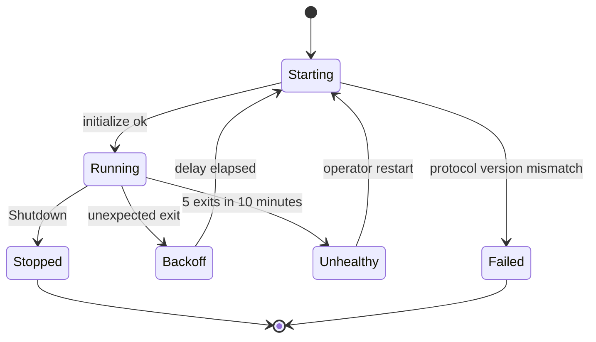

# RFC-0009: Agent Backends and Drivers

| Field | Value |
|---|---|
| Status | Proposed |
| Depends on | RFC-0001, RFC-0003, RFC-0005, RFC-0006, RFC-0007, RFC-0008, RFC-0011, RFC-0012, RFC-0013 |
| Owner area | Agent drivers: `Backend` seam, `driver-acp`, `driver-a2a-http`, usage metering |
| Related interop notes | `docs/interop/acp-omp-claude.md`, `docs/interop/hermes.md`, `docs/interop/a2a-spec-notes.md`, `docs/spikes/omp-acp.md`, `docs/spikes/claude-acp.md`, `docs/spikes/hermes-a2a.md` |

Normative language: BCP 14 (RFC 2119, RFC 8174): MUST, MUST NOT, SHOULD, MAY in capitals.

## 1. Summary

The `Backend` seam (RFC-0001 L13) is the only interface through which a worker drives an agent. This RFC defines it as a language-neutral command and event model, with a Rust sketch in Appendix A. Two drivers implement it: `driver-acp` for omp and claude-agent-acp over ACP stdio, and `driver-a2a-http` for Hermes as an A2A v1.0 HTTP peer. Drivers report normalized agent facts and never touch the bus; the worker keeps task ids, sequence, dedupe, budgets and approvals. The RFC also fixes usage metering (D13), the supervision contract, a backend contract suite with a deterministic mock, and the driver-side controls for T14 and T15.

## 2. Motivation and scope

### 2.1 Motivation

Milestone 1 runs three agents with three different control protocols on one host: omp speaks ACP over stdio, claude-agent-acp speaks ACP over stdio with different capabilities, and Hermes speaks A2A HTTP. Without one seam, each agent's protocol quirks would leak into the worker, the approval gate, and the budget logic. A single `Backend` seam with two drivers keeps protocol knowledge in one layer and lets the worker enforce policy the same way for every agent.

### 2.2 In scope

- The `Backend` command and event model, and its ownership split with the worker.
- `driver-acp`: ACP client behavior for omp and claude-agent-acp, including capability declaration, turn lifecycle, message mapping, permissions, cancel, and launch.
- `driver-a2a-http`: the HTTP client bridge that puts an external A2A v1.0 peer on the bus (RFC-0001 crate table), with Hermes as the M1 peer. Its peer-facing behavior is A2A v1.0 HTTP client behavior.
- Usage metering inputs (D13).
- The supervision contract the driver exposes to the supervisor (RFC-0012).
- Approval-mode allowlist, refuse-start rule, and credential boundary at the child process (T14, T15, T5, M1-10).
- The backend contract suite and its mock.

### 2.3 Non-goals

- Bus subjects, headers, and envelopes (RFC-0002, RFC-0010). Drivers never see them.
- The task state machine, sequence, dedupe, and deadline rules (RFC-0005).
- Approval and budget extension schemas, loop control, and the circuit breaker (RFC-0006).
- Delegation, MCP bridging, provenance, and identity (RFC-0007).
- HTTP gateway mappings and the Hermes interop profile as seen by HTTP clients (RFC-0008).
- Process supervision details, worktree isolation, config file format, and the TUI (RFC-0012).
- The audit event schema (RFC-0013).
- Native (non-ACP) omp or Claude Code protocols (D11: omp is ACP-only in M1).
- Any agent other than omp, claude-agent-acp, and Hermes.

## 3. Terminology

Terms below are not defined in RFC-0001.

- **Backend**: the seam a worker uses to drive one agent instance. Defined by Section 4.2 and Appendix A.
- **Driver**: an implementation of `Backend`. In M1: `driver-acp` and `driver-a2a-http`.
- **Command**: a worker-to-driver instruction (Section 4.2).
- **Event**: a driver-to-worker report of agent facts (Section 4.2).
- **Turn**: one agent-side unit of work started by a `Start` command and closed by exactly one `Terminal` event.
- **Turn reference** (`turn_ref`): a driver-scoped identifier of a turn, assigned by the worker in `Start`.
- **Agent session**: an agent-native conversation (an ACP `sessionId`, or a Hermes peer `contextId` reused on the same peer). Keyed by A2A `contextId`.
- **Agent-native mode**: an approval or permission mode configured inside the agent (omp `--approval-mode`, claude `permissions.defaultMode`).
- **Gauge**: a value that reports a current level (for example context occupancy). A gauge is never summed.
- **Counter**: a value that accumulates across turns (turns, wall time, token counts, cost).
- **Reason token**: an upper-snake-case failure identifier from Section 4.11. Carried in the plain metadata key `a2abus.failure` on `TaskStatus.message.metadata` (RFC-0001). RFC-0005 owns the token registry. Reason tokens are not `ErrorInfo` values; bus-level errors use the `a2abus.v1` domain (RFC-0002), and this RFC emits none.

## 4. Specification

### 4.1 Layering and ownership

- [0009-001] A worker MUST drive each agent instance through exactly one `Backend` instance. A driver MUST NOT publish to or subscribe from any bus subject.
- [0009-002] A driver MUST NOT assign task ids, sequence numbers, or A2A task states. It reports normalized agent facts (Section 4.2). The worker maps those facts to A2A states as RFC-0005 defines.
- [0009-003] A worker process MUST host exactly one agent, and each agent instance MUST have exactly one driver instance (RFC-0001 0001-007).
- [0009-004] A driver MUST NOT share sockets, child processes, session stores, or in-memory state with another driver, with another agent, or with the gateway (T14). A driver MUST NOT depend on another driver, on the gateway, or on a concrete bus binding (RFC-0001 crate rules).

### 4.2 Commands and events

Commands are sent by the worker and never answered by an event unless the table says so.

| Command | Fields | Effect |
|---|---|---|
| `Start` | `turn_ref`, `context_id`, input parts, `deadline_ms`, stored session handle (optional) | Begins one turn in the agent session for `context_id`. |
| `ResolvePermission` | `request_id`, `option_id` or `cancelled` | Answers one pending permission request (Section 4.5.5). |
| `Cancel` | `turn_ref` | Stops the turn (Section 4.5.6). Idempotent. |
| `Capabilities` | none | Returns the capability record (Section 4.3). |
| `Health` | none | Returns liveness and restart state. |
| `Shutdown` | `grace_ms` | Ends the agent process tree (Section 4.8). |

Events are emitted by the driver.

| Event | Fields | Meaning |
|---|---|---|
| `Status` | `turn_ref`, `kind` (Progress, Notice, SessionBound), payload | Non-terminal progress or notice. `SessionBound` carries the agent session handle to persist. |
| `ArtifactDelta` | `turn_ref`, `artifact_key`, `text`, `append`, `last` | Text delta for an output artifact. |
| `Usage` | `turn_ref`, `source`, counters or gauges (Section 4.7) | Metering sample. |
| `PermissionRequest` | `turn_ref`, `request_id`, tool summary, options | Agent asks for permission. |
| `InputRequired` | `turn_ref`, text | Peer interrupted the turn and needs input (driver-a2a-http only). |
| `Terminal` | `turn_ref`, `outcome`, `reason` (if Failed or Refused), `health_class` (optional, driver-local, never a bus token; Section 4.11), `detail` | Ends the turn. |
| `Fault` | `kind`, `detail` | Driver-level problem not tied to a turn outcome. |

- [0009-005] The worker-to-driver command set is exactly the set in the first table. Other command kinds MUST NOT be added to the seam without a revision of this RFC.
- [0009-006] Every turn-scoped event MUST carry `turn_ref` and `event_no`. `event_no` starts at 1 for each turn and increases by exactly 1 per event within that turn.
- [0009-007] Every turn MUST end with exactly one `Terminal` event. No turn-scoped event may follow a `Terminal` for the same `turn_ref`. `outcome` is one of `Completed`, `Canceled`, `Refused`, or `Failed`. `Failed` and `Refused` carry a reason token from Section 4.11. The worker maps `Refused` and `Failed` to the A2A state and code that RFC-0005 section 4.9 registers for that token (`AGENT_REFUSED` and `BACKEND_*` are FAILED; `RATE_LIMITED` is REJECTED).
- [0009-008] A turn MUST NOT resume across driver incarnations. After a driver restart, the worker MUST treat any open turn of the prior incarnation as ended by its `Terminal` (Section 4.11, BACKEND_CRASHED) and MUST NOT replay its input.
- [0009-009] `Cancel` MUST be idempotent. After a `Cancel`, the driver MUST still deliver exactly one `Terminal` for the turn (Section 4.5.6).
- [0009-010] A `ResolvePermission` for an unknown or already-answered `request_id` MUST be ignored without a `Fault`.

Worked example (language-neutral JSON form of a driver event, omp turn 3):

```json
{"event":"PermissionRequest","turn_ref":"turn-0003","event_no":4,
 "request_id":"perm-0001",
 "tool":{"kind":"execute","title":"bash: cargo test"},
 "options":[{"option_id":"allow-once","kind":"allow_once"},
            {"option_id":"reject-once","kind":"reject_once"}]}
```

```json
{"event":"Terminal","turn_ref":"turn-0003","event_no":9,
 "outcome":"Failed","reason":"BACKEND_CRASHED",
 "detail":"agent process exited with code 1"}
```

### 4.3 Capabilities

- [0009-011] Every driver MUST answer `Capabilities` with: `protocol` (`acp` or `a2a-http`), `resume` (boolean), `cancel` (boolean), `usage_sources` (subset of `acp-usage`, `a2a-peer`, `driver-counted`), `approval_modes` (list of canonical modes, Section 4.9), and `streaming_text` (boolean). The worker MUST use these to choose features and MUST NOT use them to override RFC-0005 or RFC-0006 rules.

### 4.4 Agent sessions and restore

- [0009-012] The driver MUST key agent sessions by A2A `context_id`: one agent session per `context_id` per driver instance. The driver reports the agent session handle in a `Status` event of kind `SessionBound`. The worker persists the mapping in its state directory (RFC-0012 owns the directory).
- [0009-013] On `Start` with a `context_id` that has a stored handle, the driver MUST try restore in this order: `session/load` if `agentCapabilities.loadSession` is true; else `session/resume` if `sessionCapabilities.resume` is present; else a new session. When restore fails, or the agent answers `ACP session not found` or `ACP session load was cancelled` to `session/load` or `session/resume`, the driver MUST treat the session as new, MUST emit a `Status` notice that prior context was not restored, and MUST NOT let the worker report restored context. The worker then rebuilds the context from the Worker task history on the bus and MUST NOT assume resume. Omp returns these answers when the launch or directory conditions of 0009-087 do not hold (observed-with-stub).
- [0009-014] A turn that was in flight at a crash MUST NOT be replayed on restore. It ends with `Failed` `BACKEND_CRASHED` (Section 4.11).

### 4.5 driver-acp

#### 4.5.1 Transport and protocol version

- [0009-015] `driver-acp` MUST act as an ACP client using JSON-RPC 2.0 over the agent child process stdio with ACP stdio framing.
- [0009-016] The driver MUST negotiate `protocolVersion` 1 during `initialize`. If the agent returns any other version, the driver MUST close the connection, emit `Fault`, and MUST NOT start a turn. ACP v2 is not used in M1.
- [0009-017] Paths sent to an agent MUST be absolute. `session/new` MUST send `cwd` set to the worker's workspace root (RFC-0012, L16) and `mcpServers` as an array. The array is empty unless RFC-0007 provides MCP entries, because ACP sessions do not discover MCP servers on disk. An MCP entry counts as available only after a probe call confirms its tools: omp returned success from `session/new` for an MCP server whose command did not exist (observed-with-stub). The `cwd` of an omp session MUST be the same on every restart (0009-087).

Worked example (ACP requests from driver to omp; fields abbreviated):

```json
{"jsonrpc":"2.0","id":1,"method":"initialize",
 "params":{"protocolVersion":1,
   "clientCapabilities":{"fs":{"readTextFile":false,"writeTextFile":false},
                         "terminal":false,"auth":{"terminal":false},
                         "elicitation":{"form":{}}}}}
```

```json
{"jsonrpc":"2.0","id":2,"method":"session/new",
 "params":{"cwd":"C:/a2a/ws/omp/ctx-7c0a","mcpServers":[]}}
```

#### 4.5.2 Client capabilities

- [0009-018] `clientCapabilities` MUST declare `fs.readTextFile` false, `fs.writeTextFile` false, `terminal` false, and `auth.terminal` false. It MUST declare `elicitation` with `form` (an empty object), because omp sends its read and write approvals as form elicitation only when that capability is present; without it omp denies them outright (`docs/spikes/omp-acp.md` Q4). It MUST NOT declare `elicitation.url` or any other elicitation mode.

The consequence is deliberate: agents use their own file and shell tools. The approval gate covers permissions an agent raises through `session/request_permission` (Claude; omp bash approvals, observed-with-stub) and form elicitations (omp read and write approvals, 0009-082). Section 6 records this as a trade-off.

- [0009-019] If an agent calls a client method that was not declared (file, terminal, or any unlisted client method other than `elicitation/create`), the driver MUST reply with a JSON-RPC error and MUST NOT perform the operation. `elicitation/create` is answered under 0009-082. The error code is -32601 (method not found), which is `[UNVERIFIED]` against omp's own error (Section 9 issue 4).

#### 4.5.3 Turn lifecycle and stop reasons

- [0009-020] A `Start` MUST map to one `session/prompt`. The driver MUST NOT send a second prompt on a session while one is open. The worker serializes turns per `context_id` (RFC-0005 [0005-054]).
- [0009-021] A `stopReason` MUST map to the outcome in this table. Any other stop reason string MUST map to `Failed` `BACKEND_ERROR`, because a turn must always end.

| `stopReason` | Outcome | Reason |
|---|---|---|
| `end_turn` | Completed | none |
| `cancelled` | Canceled | none |
| `refusal` | Refused | `AGENT_REFUSED` |
| `max_tokens` | Failed | `AGENT_LIMIT` |
| `max_turn_requests` | Failed | `AGENT_LIMIT` |

- [0009-022] A JSON-RPC error response to `session/prompt` MUST map to `Failed` `BACKEND_ERROR`. The detail is the error message after redaction (Section 4.10).
- [0009-023] Process exit or stdout end-of-file while a turn is open MUST map to `Failed` `BACKEND_CRASHED`. The terminal event MUST be emitted at detection, and no later than 5 seconds after the exit is observed.
- [0009-024] A turn with no agent activity for `turn_idle_timeout` (default 600 seconds, configurable by the operator) MUST map to `Failed` `BACKEND_TIMEOUT`. The driver then runs the cancel path in Section 4.5.6.

#### 4.5.4 Message mapping

- [0009-025] `agent_message_chunk` text MUST map to `ArtifactDelta` with append semantics on a turn-scoped text artifact. The final delta of the turn MUST set `last` true. Non-text content blocks MUST NOT become artifacts in M1; they are counted and dropped.
- [0009-026] `agent_thought_chunk` MUST NOT be emitted as artifact text. It is dropped by default. An operator MAY enable it as `Status` `Progress`. The default protects against leaking private reasoning into a peer-visible artifact.
- [0009-027] `tool_call` and `tool_call_update` MUST map to `Status` `Progress` with metadata under the key `urn:a2abus:ext:progress:1`, accepted for M1 and registered with RFC-0003. The payload is `{"toolCallId", "kind", "title", "status"}`, where `status` is one of `pending`, `in_progress`, `completed`, `failed`. It MUST NOT carry raw tool output bodies.
- [0009-028] `plan` MUST map to `Status` `Progress` under the key `urn:a2abus:ext:progress:1`, with payload `{"plan":{"entries":[...]}}`. Each entry is carried as received after redaction, without enum validation. A plan MUST NOT become an artifact.
- [0009-029] `usage_update` MUST map to a `Usage` event (Section 4.7). `notice` MUST map to `Status` `Notice`.
- [0009-030] Any other `sessionUpdate` kind, and any unknown enum string inside a known update, MUST be dropped and counted. It MUST NOT fail the turn. This keeps the driver forward-compatible with ACP additions. A `stopReason` is not an enum inside an update; it is covered by [0009-021].
- [0009-031] Text from the agent is untrusted content (R-S7). The driver MUST NOT rewrite or strip text beyond the redaction in Section 4.10, and MUST mark its events as agent-originated so the worker can attach provenance (RFC-0007).

Worked example (one streamed text chunk and one progress status, as the worker sees them from `session/update`):

```json
{"jsonrpc":"2.0","method":"session/update",
 "params":{"sessionId":"sess_01",
   "update":{"sessionUpdate":"agent_message_chunk",
             "content":{"type":"text","text":"Running tests..."}}}}
```

The driver emits `ArtifactDelta` with `text` "Running tests..." and `append` true. The tool call that follows becomes a progress status. The worker publishes it on `a2a.v1.local.ev.omp.<task_id>` (L3). The driver does not publish it.

```json
{"event":"Status","kind":"Progress","turn_ref":"turn-0003","event_no":3,
 "metadata":{"urn:a2abus:ext:progress:1":
   {"toolCallId":"tc_9","kind":"execute","title":"bash: cargo test","status":"in_progress"}}}
```

#### 4.5.5 Permissions

- [0009-032] `session/request_permission` MUST map to `PermissionRequest`. The driver assigns a `request_id` unique within the driver instance. The event carries a redacted tool summary (kind and title) and the offered options with `option_id` and `kind` as the agent sent them (`allow_once`, `allow_always`, `reject_once`, `reject_always`). Claude sends ids `allow-once`, `allow-with-updates`, and `reject` (observed-with-stub); the driver MUST NOT depend on the ids, and the worker selects by kind (RFC-0006 0006-055).
- [0009-033] Each permission request MUST be answered exactly once, by one of two sources: a `ResolvePermission` command, or the driver's own permission timeout (`permission_timeout`, default 300 seconds). The driver MUST NOT answer a permission request on its own choice. The driver answers `selected` only with an `option_id` that was in the offered list; otherwise it answers `cancelled`.
- [0009-034] The driver MUST NOT select `allow_always` or `reject_always` by default. A choice of such an option MUST come from a `ResolvePermission` that the worker issued after an operator decision (RFC-0006, RFC-0007 signed decisions). Claude's `allow-with-updates` is `allow_always`.

Worked example (approval flow on the agent wire):

```json
{"jsonrpc":"2.0","id":"p-1","method":"session/request_permission",
 "params":{"sessionId":"sess_01",
   "toolCall":{"toolCallId":"tc_9","title":"bash: cargo test","kind":"execute","status":"pending"},
   "options":[{"optionId":"allow-once","name":"Allow once","kind":"allow_once"},
              {"optionId":"reject","name":"Reject","kind":"reject_once"}]}}
```

After the worker's approval decision arrives as `ResolvePermission(option_id = "allow-once")`, the driver answers:

```json
{"jsonrpc":"2.0","id":"p-1",
 "result":{"outcome":{"outcome":"selected","optionId":"allow-once"}}}
```

On timeout or cancel, the answer is `{"outcome":{"outcome":"cancelled"}}`.

The worker turns the `PermissionRequest` into `INPUT_REQUIRED` plus the approval extension (RFC-0005, RFC-0006, L7, L10). The approval extension schema belongs to RFC-0006.

- [0009-082] `elicitation/create` with `mode` `form` MUST map to `PermissionRequest` (Section 4.5.5) with a `request_id`, a kind of `form-elicitation`, and a tool summary built only from the tool name on the first line of `message` (`Allow tool: <name>`; RFC-0006 0006-052). An elicitation whose `message` has no such first line MUST be answered `decline` with no `PermissionRequest`. The rest of `message` and all of `requestedSchema` are untrusted text: they MUST NOT be used as the approval summary, as a decision input, or to choose an answer. The driver keys the pending elicitation by its JSON-RPC `id` and ignores an answer for an `id` it does not hold open. The driver answers only after `ResolvePermission` or its permission timeout (0009-033). A `ResolvePermission` naming `allow-once` gives an `accept` result with `content` `{"value": L}`, where L is the enum label in `requestedSchema` that offers a single approval, selected from the request and never constructed (RFC-0006 0006-053). A label outside the enum MUST NOT be sent: omp denies it (observed-with-stub). `reject-once` gives `decline`; `cancelled`, including a session cancel (0009-035), gives `cancel`. If the request offers no unambiguous once label, the driver answers `decline` and raises `Fault` `elicitation-schema-unsupported`. An `elicitation/create` with any mode other than `form` MUST be answered `decline` with no `PermissionRequest` (RFC-0006 0006-054). `elicitation/complete` changes no state.

Worked example (form elicitation from omp, observed with the stub; `message` abbreviated):

```json
{"jsonrpc":"2.0","id":"e-1","method":"elicitation/create",
 "params":{"sessionId":"sess_01","mode":"form",
   "message":"Allow tool: write\nReason: target not yet approved\n...",
   "requestedSchema":{"type":"object","properties":{"value":{"type":"string",
     "enum":["Approve Directory: ...","Approve File","Always Approve File","Approve Once","Deny"]}},
     "required":["value"]}}}
```

The worker's `allow-once` decision selects the once label from the enum (observed-with-stub):

```json
{"jsonrpc":"2.0","id":"e-1","result":{"action":"accept","content":{"value":"Approve Once"}}}
```

After `reject-once`:

```json
{"jsonrpc":"2.0","id":"e-1","result":{"action":"decline"}}
```

- [0009-088] For omp, the driver MUST relay both approval channels: form elicitation (0009-082) and `session/request_permission` (0009-032). It MUST NOT suppress or auto-answer either one. The channel for each tool kind follows the omp table in RFC-0006 0006-003.
- [0009-089] For omp, a peer-call route (`xd://mcp__<server>_<tool>`, RFC-0015 [0015-116]) reaches the driver as a `write` form elicitation under 0009-082. The driver MUST relay it as a `PermissionRequest` whose tier and summary come from the name only, MUST NOT suppress or auto-answer it (0009-088), and MUST NOT attach peer-call attribution to the request. Any auto-allow is decided by the Worker under RFC-0006 [0006-061].

#### 4.5.6 Cancel

- [0009-035] On `Cancel`, the driver MUST send a `session/cancel` notification for the session. It MUST then answer every pending `session/request_permission` with `cancelled` and every pending form elicitation with `cancel` (0009-082). An elicitation left unanswered after `session/cancel` breaks the omp session: the next prompt fails with `ACP cancel cleanup timed out`, then `Unsupported ACP session` (observed-with-stub, `docs/spikes/omp-acp.md` Q5). It MUST emit `Status` `Progress` for each open tool call with status `failed` and detail `canceled`, because ACP has no cancelled tool status. It MUST then await the `stopReason` of the pending prompt. Claude returned `cancelled` within about 30 ms even with an unanswered permission request (observed-with-stub).
- [0009-036] If the pending prompt does not return within `cancel_grace` (default 10 seconds), the driver MUST terminate the agent process tree (Section 4.8), emit `Terminal` `Canceled`, and apply the restart policy. A `Canceled` terminal MUST be emitted in all cases, so the turn ends within the bound (M1-8).

Worked example (cancel on the wire):

```json
{"jsonrpc":"2.0","method":"session/cancel","params":{"sessionId":"sess_01"}}
```

The agent then returns `{"jsonrpc":"2.0","id":3,"result":{"stopReason":"cancelled"}}`, which maps to `Terminal` `Canceled`.

#### 4.5.7 Launch

- [0009-037] The driver MUST spawn agent executables by absolute path without a shell. Shell strings, `cmd /c`, and shell interpolation MUST NOT be used.
- [0009-038] On Windows, claude-agent-acp MUST be launched as `node <absolute path to the package entry>` rather than through `cmd /c npx`. This launch form was observed with the stub (`docs/spikes/claude-acp.md`). The bin name is `claude-agent-acp` (verified against the published package, v0.97.0). The package entry is `dist/index.js` in the notes' example; the Windows install path is `[UNVERIFIED]` (Section 9).
- [0009-039] omp MUST be launched as `omp --mode acp --cwd <workspace root> --approval-mode ask-exec` (or `omp acp` with `--config` when an overlay file is needed). The driver MUST NOT pass `--session-dir` (0009-087). The driver MUST pass `--approval-mode` explicitly on every launch and MUST NOT rely on the schema default. Under ACP, read and write approvals arrive as form elicitation under `always-ask-cached` (0009-082), and exec (bash) approvals arrive as `session/request_permission` (0009-088).

- [0009-087] omp session persistence. The driver MUST NOT pass `--session-dir` to omp. The supervisor MUST keep one `PI_CODING_AGENT_DIR` per agent, unchanged across restarts (RFC-0012 [0012-063]), and the driver MUST send the same workspace `cwd` on every restart. Observed with the stub (`docs/spikes/omp-acp.md` Q7): with the default session directory, the same `PI_CODING_AGENT_DIR` and the same `cwd`, `session/load` and `session/resume` restored the session and the next prompt ended `end_turn`. With `--session-dir`, the same restart got `ACP session not found`. A different `cwd` got `ACP session load was cancelled` (cause `[UNOBSERVED]`); a different `PI_CODING_AGENT_DIR` got `ACP session not found`.

### 4.6 driver-a2a-http

- [0009-040] `driver-a2a-http` MUST send `A2A-Version: 1.0` on every request. It MUST NOT send `A2A-Extensions`, and MUST NOT send any `urn:a2abus:` metadata or `A2AB-*` header to the peer. Budget and provenance are enforced locally at every hop (L9). Hermes sends none of these, and unknown fields may be rejected by the peer.
- [0009-041] Discovery is best-effort. The driver MUST fetch `/.well-known/agent-card.json`, fall back to `agent.json` on 404, and use a timeout of `min(timeout, 30)` seconds. A failed fetch MUST NOT be fatal. The RPC URL is the card `supportedInterfaces` entry with `protocolBinding` `JSONRPC`, else the card `url`, else the configured base URL.
- [0009-042] When the card or peer config sets a `tenant`, the driver MUST send that value in `params.tenant`. Hermes accepted a mismatched tenant in the Hermes spike (observed-with-stub), which contradicts the Hermes 400 described in `docs/interop/hermes.md` sections 1.1 and 1.7; the driver MUST NOT rely on the tenant for isolation (0009-080).
- [0009-043] The driver MUST send `SendMessage` by default. It MUST use `SendStreamingMessage` only when the peer card advertises `capabilities.streaming` true and the peer config enables streaming. The `contextId` MUST be the namespaced peer context id of 0009-076, derived from the A2A `contextId` in `Start`, and MUST NOT be replaced by any other value.
- [0009-044] Outbound text MUST pass through the redaction function (R-S5) before it is sent.
- [0009-045] A resend after a connection failure, where no response was received, MUST reuse the original `messageId`. A new `messageId` would count as a new admission against the peer's anti-loop cap (hermes.md sections 4 and 6.2).
- [0009-076] The driver MUST apply the per-origin contextId namespacing of RFC-0008 [0008-097] to every request it sends; the raw bus `context_id` MUST NOT be sent to the peer. Hermes shares model history across peers that reuse a `contextId` (observed-with-stub, `docs/spikes/hermes-a2a.md` Q6).
- [0009-077] The driver MUST send `GetTask`, `SubscribeToTask`, and `CancelTask` only for task ids it received in a reply to its own `SendMessage` for the same origin and context. It MUST NOT send `ListTasks` to the peer, and MUST NOT forward a request that would reach a task created under another origin (RFC-0005 [0005-052]). Hermes returns other origins' tasks from `GetTask`, `CancelTask`, and `ListTasks` (observed-with-stub, Q6).
- [0009-078] A follow-up to a peer task in `INPUT_REQUIRED` MUST reuse the namespaced `contextId` (RFC-0008 [0008-096]). The driver MUST NOT rely on `message.taskId` to continue the task: Hermes ignores it and creates a new task (observed-with-stub, Q4). The driver MUST NOT require the `[INPUT_REQUIRED]` text marker: Hermes strips it, and the state enum decides (0009-048).
- [0009-079] The driver MUST tolerate the Hermes error deviations listed in RFC-0008 [0008-098]. It MUST NOT require `error.data` (ErrorInfo) and MUST classify by JSON-RPC `error.code` and HTTP status. On `GetTask` or `SubscribeToTask`, Hermes `-32002` and `-32001` MUST map to `Failed` `BACKEND_LOST_TASK` (Hermes uses `-32002` for a cross-origin cancel, observed-with-stub Q5; the bus-facing `TaskNotFound` mapping is RFC-0005 [0005-051]). Hermes `-32602` (invalid version or non-object body, where the spec gives -32009 and -32600) MUST map to `Failed` `BACKEND_ERROR`.
- [0009-080] Hermes does not enforce `params.tenant` (observed-with-stub: a mismatched value was accepted). The driver MUST send only the tenant configured for the peer and MUST NOT treat the tenant as an isolation boundary; origin namespacing (0009-076) and visibility (0009-077) are the isolation mechanism.
- [0009-081] The driver MUST ingest the peer card under 0009-041 and MUST NOT pass the peer card-level `security` field, tool names, or toolset tags to the bus. The bus card is built from A2A fields only with coarse skills (RFC-0008 [0008-099]; RFC-0003 [0003-050] to [0003-052]). Hermes exposes 33 toolset-derived skills, each tagged with tool names, and a card-level `security` entry (observed-with-stub, Q2).

Worked example (Hermes, `SendMessage`, card-resolved RPC URL):

```http
POST / HTTP/1.1
Content-Type: application/json
A2A-Version: 1.0
Authorization: Bearer <configured peer token>

{"jsonrpc":"2.0","id":"5f2c81a0d4e34b7c9a1e2f3041526374","method":"SendMessage",
 "params":{"message":{"role":"ROLE_USER",
                      "parts":[{"text":"Summarize the build log.","mediaType":"text/plain"}],
                      "messageId":"9b1e4c2a6d3f4e8a9b7c1d2e3f405162",
                      "contextId":"ctx-7c0a4e21"}}}
```

Hermes replies with a bare Task or a `{"task":...}` wrapper. The driver accepts either. The reply, with `artifacts` present only when the task is COMPLETED with text, looks like:

```json
{"task":{"id":"task-0123456789abcdef","contextId":"ctx-7c0a4e21",
         "status":{"state":"TASK_STATE_COMPLETED","timestamp":"2026-01-15T10:22:31.402Z"},
         "artifacts":[{"parts":[{"text":"Build failed at link step: 2 unresolved symbols."}]}]}}
```

- [0009-046] Reply text MUST be read in this order: artifact text, then `status.message` text, then message parts. A reply whose `contextId` differs from the one sent MUST produce `Fault` and `Failed` `BACKEND_ERROR`.
- [0009-047] Peer states MUST map as follows. `SUBMITTED` and `WORKING` map to `Status`. `COMPLETED` maps to `Completed` with the artifacts delivered. `CANCELED` maps to `Canceled`. `REJECTED` maps to `Refused` `AGENT_REFUSED`, which the worker commits as FAILED (RFC-0005 section 4.9). `INPUT_REQUIRED` maps to `InputRequired`, which passes through as input-required and is not an approval. `AUTH_REQUIRED` maps to `Failed` `BACKEND_ERROR` with `health_class` `PEER_AUTH_FAILED`; the bus never carries AUTH_REQUIRED (RFC-0005 0005-009). `FAILED` maps to `Failed` `BACKEND_TIMEOUT` when the text is the peer's reply-timeout marker (text per hermes.md section 6.4), otherwise to `Failed` `BACKEND_ERROR`.
- [0009-048] The driver MUST rely on the TaskState enum for `INPUT_REQUIRED`, not on text markers. The Hermes client reads the state enum (`protocol.py` `STATE_INPUT_REQUIRED`; `tools.py`; hermes.md section 8.5). The driver MUST NOT parse free text to decide the state.
- [0009-049] If a streamed response ends before a terminal state, or a `SendMessage` returns a non-terminal Task, the driver MUST reattach with `SubscribeToTask` where streaming applies. If reattach fails, or no stream applies, the driver MUST poll `GetTask` with an interval starting at 2 seconds and capped at 10 seconds, until a terminal state or the deadline (RFC-0008 uses the same cadence for the gateway side).
- [0009-050] `-32001` (TaskNotFound) on `GetTask` or `SubscribeToTask` MUST map to `Failed` `BACKEND_LOST_TASK`.
- [0009-051] HTTP 401 or 403, JSON-RPC `-32050`, or `-32052` MUST map to `Failed` `BACKEND_ERROR` with `health_class` `PEER_AUTH_FAILED`. HTTP 429 or `-32051` MUST map to `Refused` `RATE_LIMITED` (bus state REJECTED, RFC-0005 section 4.9) with `health_class` `PEER_RATE_LIMITED`. `health_class` is a driver-local classification for bridge health and is never a bus reason token. Neither class is retried automatically; the worker decides (RFC-0006). Any other JSON-RPC error maps to `Failed` `BACKEND_ERROR`, with the detail redacted.
- [0009-052] A bearer token MUST NOT be sent to a non-loopback `http://` URL. The driver MUST refuse to start such a peer config.
- [0009-053] The driver's `timeout` MUST default to 330 seconds, which is the Hermes server default reply timeout (300 seconds) plus a margin. The Hermes client default of 120 seconds is shorter than the Hermes server reply timeout (hermes.md section 10), so it would give up first. On timeout, the driver MUST send `CancelTask` on a best-effort basis and emit `Failed` `BACKEND_TIMEOUT`.

### 4.7 Usage metering

- [0009-054] Each `Usage` event MUST carry `source`, one of `acp-usage`, `a2a-peer`, or `driver-counted`, and only the fields that source provides. Counters are `turns`, `wall_ms`, `tokens_in`, `tokens_out`, and `cost` (amount with ISO 4217 currency). The worker sums counters. Gauges are reported separately.
- [0009-055] The driver MUST count `turns` and `wall_ms` for every turn, with source `driver-counted`. The worker enforces turn and wall-time caps (RFC-0006, D13 backstop). The driver does not enforce them.
- [0009-056] For ACP, `usage_update.used` and `usage_update.size` MUST be reported as gauges, never summed, and MUST NOT be treated as billing tokens. `usage_update.cost`, when present, is a cumulative sample: the driver MUST report it as the `cost` counter without summing it, and the worker charges the difference from the highest sample already charged (RFC-0006 0006-037).
- [0009-057] The driver MUST NOT estimate tokens from text length, model output, or any other proxy. When no agent reports tokens, token meters stay absent. This is the D13 self-report fallback as this RFC reads it (Section 9).
- [0009-058] Operator option `require_token_metering` (default false) MUST cause the worker to stop the agent and report a configuration failure when the first completed turn produced no `acp-usage` sample. The driver emits the `Usage` events that let the worker decide.
- [0009-086] For Claude, the prompt result `usage` (observed-with-stub: `inputTokens`, `outputTokens`, `totalTokens`) MUST be emitted as one `Usage` event with source `acp-usage` for the turn, mapping input and output to `tokens_in` and `tokens_out`. The value is already the sum over the turn's model calls, so the driver MUST NOT add per-call figures again. A cancelled turn reports zero usage. `_meta.quota` and `model_usage` are not mapped in M1.

Worked example (ACP usage sample, driver output, counters and gauge together):

```json
{"event":"Usage","turn_ref":"turn-0003","event_no":7,"source":"acp-usage",
 "gauge":{"context_used":41200,"context_size":200000},
 "counters":{"turns":1,"wall_ms":84210,"cost":{"amount":"0.0412","currency":"USD"}}}
```

### 4.8 Supervision

- [0009-059] The driver MUST expose its spawn spec, liveness (child exit notification), and a graceful `Shutdown` to the supervisor (RFC-0012). The supervisor owns process-tree termination: a Windows job object or a Linux process group.
- [0009-060] No agent process may outlive its worker (M1-1). When a worker exits, the driver MUST run `Shutdown`: close the agent's stdin (RFC-0012 [0012-061]), wait `shutdown_grace` (default 5 seconds), then kill the process tree (RFC-0012 [0012-018] Windows job object and [0012-021] stale run records). On Windows, closing stdin is observed to end claude-agent-acp and omp cleanly (Section 9 issue 7).
- [0009-061] Restart policy: after an unexpected exit, the driver restarts the agent after 1 second, then 2 seconds, then 4 seconds, with the delay capped at 60 seconds. When 5 unexpected exits occur within 10 minutes, the driver MUST enter the Unhealthy state and MUST NOT restart until the operator restarts it (RFC-0012 command).
- [0009-062] A restart MUST restore contexts as Section 4.4 requires. It MUST NOT replay any input from an earlier turn.

Mermaid, driver restart state (normative):



### 4.9 Approval modes

- [0009-063] Allowed canonical modes are: omp `always-ask-cached` (configured as `ask-exec`); claude `default` and `plan`. Dangerous canonical modes are: omp `write` and `yolo`; claude `acceptEdits`, `bypassPermissions`, `dontAsk`, and `auto`. Claude alias `bypass` MUST be canonicalized to `bypassPermissions` before any check. Any mode in neither list, including omp `always-ask` (under which omp auto-approves read; observed-with-stub), MUST be refused as `config-refused`.
- [0009-064] `Start` of an agent whose configured mode is not in the allowed set MUST be refused. The refusal is a `Fault` of kind `config-refused`. The only exception is an operator config that names the exact dangerous mode and sets `acknowledge_dangerous` true.
- [0009-065] The mode MUST come from operator config only. The driver MUST NOT set a mode from an agent card, a peer request, or task content. Cards are not trusted for this (RFC-0007).
- [0009-066] The card value of the resolved mode MUST be recorded on the card as the `approvalMode` parameter of the `urn:a2abus:ext:approval:1` entry (written by the supervisor). For omp this is `ask-exec`, which maps to canonical `always-ask-cached`. Every `PermissionRequest` the driver emits carries the same `approvalMode`. The card field shape is for RFC-0003 and RFC-0006 to confirm (Section 9).
- [0009-067] If the agent switches into a dangerous mode during a session (ACP `switch_mode` tool kind, or any mode notification into the dangerous set), the driver MUST refuse the switch, cancel the turn (Section 4.5.6), and emit `Fault` of kind `config-refused`.
- [0009-083] The driver MUST start omp only in `always-ask-cached` (configured as `ask-exec`) and MUST NOT declare the omp `ask-all` mode. Omp `ask-all` stays undeclared until every tool kind omp runs (including grep, glob and find, `[UNOBSERVED]`) is observed to surface an approval prompt (RFC-0006 0006-004, D21). The omp allow path is verified by stub (RFC-0006 0006-029); the residual items are in RFC-0006 issue 2. The omp card carries `approvalMode` `ask-exec`, the card value that maps to `always-ask-cached` (RFC-0006 0006-003).

Worked example (card extension entry, shape proposed):

```json
{"urn:a2abus:ext:approval:1":{"approvalMode":"always-ask-cached"}}
```

### 4.10 Environment and credentials

- [0009-068] The child environment MUST be built from a fixed allowlist of non-secret names: at least `PATH`, `SYSTEMROOT`, `USERPROFILE`, `HOME`, `TEMP`, `TMP`, `LANG`, and `PI_NO_TITLE` for omp. The supervisor MAY add `CLAUDE_CONFIG_DIR` (0009-084). The operator config MAY add non-secret names. Nothing else from the worker environment is inherited (RFC-0012 [0012-062]).
- [0009-069] The driver MUST NOT read, copy, log, or forward any provider credential value (keys, tokens, OAuth material). Provider credentials stay in each agent's own configuration (T5, M1-10). The supervisor MUST strip provider key variables, including `ANTHROPIC_API_KEY`, from the child environment unless the operator config names that variable or configures the child to inherit the environment untouched (RFC-0012 [0012-062]). The driver itself MUST NOT set provider key variables.
- [0009-070] Credential-shaped values MUST NOT appear in `Backend` events, `Fault` details, logs, or envelopes. Detail strings MUST pass redaction (R-S5, RFC-0013 owns the rules).
- [0009-071] The driver MUST NOT pass peer bearer tokens or operator tokens to an ACP agent. Peer tokens for `driver-a2a-http` come from operator config and are sent only in the `Authorization` header to the configured peer.
- [0009-084] For `claude-agent-acp`, the supervisor MUST set `CLAUDE_CONFIG_DIR` to a directory it owns and write `settings.json` there as RFC-0012 [0012-063] requires, with `permissions.defaultMode` set to the canonical mode (`default` in M1). The driver MUST NOT rely on the `_meta.claudeCode.options.settings` override, which the adapter ignored for `defaultMode` in v0.97.0 (observed-with-stub). The supervisor MUST NOT write `acceptEdits`, `bypassPermissions`, `dontAsk`, or `auto` (0009-063).
- [0009-085] The first `_auth/status_update` after `initialize` is non-authoritative. Its reported auth kind can change with inherited provider keys (observed-with-stub: `api_key` with an inherited `ANTHROPIC_API_KEY`, `none` with the key stripped, while `claude auth status --json` reported logged in; Section 9 issue 18). The driver and the worker MUST NOT use it for any decision, and MUST NOT read or log credentials to resolve the discrepancy.

### 4.11 Failure outcomes

The driver produces the reason tokens below. Reason tokens are carried in the `a2abus.failure` metadata key (RFC-0001); RFC-0005 section 4.9 owns the registry. The worker produces `LOOP_DETECTED`, `BUDGET_EXHAUSTED` and the other loop and breaker tokens (RFC-0006); they are not driver outputs.

| Token | Producer | Trigger |
|---|---|---|
| `BACKEND_CRASHED` | `driver-acp`, `driver-a2a-http` | Agent process exit or stdout EOF during an open turn; driver restart with an open turn (Section 4.4); peer unreachable after bounded retries. |
| `BACKEND_UNAVAILABLE` | `driver-acp` | Agent process could not be spawned, or `initialize` failed. |
| `BACKEND_ERROR` | both | JSON-RPC error on prompt or peer call; unknown stop reason; reply context mismatch; peer `AUTH_REQUIRED`; peer auth failure. |
| `BACKEND_TIMEOUT` | both | Turn idle timeout; peer reply-timeout marker; client timeout. |
| `BACKEND_LOST_TASK` | `driver-a2a-http` | `-32001` on `GetTask` or `SubscribeToTask`; Hermes `-32002` on the same calls (0009-079). |
| `AGENT_LIMIT` | `driver-acp` | `stopReason` `max_tokens` or `max_turn_requests`. |
| `AGENT_REFUSED` | both | `stopReason` `refusal`; peer `REJECTED`. |
| `RATE_LIMITED` | `driver-a2a-http` | Peer HTTP 429 or `-32051`. |

- [0009-072] A driver MUST use only the tokens in Section 4.11 as bus reasons for `Failed` and `Refused` outcomes. Each token MUST be emitted only by a driver listed as its producer in that table. `health_class` values `PEER_AUTH_FAILED`, `PEER_RATE_LIMITED`, and `EXTERNAL_VERSION_MISMATCH` (RFC-0008 0008-071) are not reason tokens. They MUST NOT appear in bus status metadata; they MAY appear only in bridge health (RFC-0008) and in driver logs after redaction.

### 4.12 Contract suite and mock backend

- [0009-073] The `Backend` contract suite MUST live in `a2a-conformance` and MUST run against any `Backend` implementation. It drives a deterministic scripted mock backend, and runs the same cases against each real driver where the case applies.
- [0009-074] The mock MUST be able to inject: a crash mid-turn; duplicate events; a delayed permission request; a cancel race; a restart with load; an unsupported `protocolVersion`; unknown `sessionUpdate` kinds and unknown enum strings (which MUST be ignored); stdout end-of-file; a JSON-RPC error on prompt; a peer returning `REJECTED` or `FAILED`; a form `elicitation/create` whose message starts with `Allow tool:`; an `ACP session not found` answer to load or resume; and a task id from another origin.
- [0009-075] For every case, the suite MUST assert: `event_no` is strictly increasing per turn; exactly one `Terminal` per turn; no event after `Terminal`; `Cancel` produces `Canceled` within `cancel_grace`; and the reason token is in Section 4.11.

## 5. Interoperability

What each peer sees from this design.

| Peer | Sees | Lost or changed | How the design avoids breaking it |
|---|---|---|---|
| Stock A2A v1.0 client | Nothing of the drivers. It talks to the gateway (RFC-0008) and sees standard A2A states and artifacts. | Tool-call detail is status metadata only. | Drivers never emit A2A-invalid shapes. Extension data lives only under extension URIs (RFC-0001). |
| Hermes (as A2A peer) | `driver-a2a-http` is a standard A2A HTTP client: `SendMessage`, `A2A-Version: 1.0`, `ROLE_USER` text parts, a contextId namespaced per bus origin (0009-076), and `GetTask` or `SubscribeToTask` only for tasks it created (0009-077). | No `A2A-Extensions` header, no bus metadata, no budget or provenance sent. Peer sees a derived contextId, not the bus context id. | Matches the body and headers recorded in `docs/interop/hermes.md` section 8.3. Peer-side budgets are enforced locally (L9). Anti-loop cap is respected by reusing `messageId` on resend (0009-045). Peer error shapes are tolerated (0009-079). |
| Hermes (as A2A server, reached through gateway) | Not applicable. The driver is the client. | Not applicable. | See RFC-0008 for the server-side profile. |
| omp (ACP agent) | An ACP client on protocol version 1 that declares `elicitation.form` and no fs, terminal, or auth terminal capability; `cwd` set to the workspace; `mcpServers` from RFC-0007 only, after a probe call (0009-017). | omp's own file and shell tools run without client mediation. Read and write approvals arrive as form elicitation under `always-ask-cached`; bash approvals use `session/request_permission` (0009-088). | Explicit `--approval-mode ask-exec` (0009-039) and no `--session-dir` (0009-087). Start only in `always-ask-cached` (0009-083). Refuse-start for dangerous modes (0009-064). Cancel path ends every turn (0009-035). |
| claude-agent-acp (ACP agent) | The same ACP client profile as omp, with `session/request_permission` for approvals. Default mode is set in the supervisor-owned settings file (0009-084). | Same as omp for file and shell tools. Background subagents keep running after `session/cancel` in the notes (`docs/interop/acp-omp-claude.md`); the driver cannot stop them through ACP. | The worker's turn deadline and the supervisor's process-tree kill (0009-036, 0009-060) bound them. Open issue in Section 9. |

Notes on what each ACP agent may do with an unknown client method: it may fail its own operation (0009-019). That is the expected result of declaring no fs or terminal capability and is recorded in the trade-offs. `elicitation/create` in form mode is answered under 0009-082, not refused.

## 6. Security considerations

| Threat (`docs/requirements.md` section 8) | Addressed by |
|---|---|
| T1 prompt injection through agent or peer output | Untrusted-content marking (0009-031). No text rewriting beyond redaction. Thought chunks off by default (0009-026). Peer text never parsed for control state (0009-048). Elicitation text is untrusted; only its `Allow tool:` name line feeds the summary (0009-082). Hermes card text sanitized before publication (0009-081). |
| T3 cost runaway | Turn and wall-time counters from the driver (0009-055). Caps are enforced by the worker (RFC-0006). Token caps only where tokens are metered (0009-057, 0009-058). |
| T5 credential leakage | Fixed environment allowlist (0009-068). Supervisor strips provider key variables unless the operator allows them (0009-069). Driver never reads key values. Redaction of events and errors (0009-070). Bearer tokens refused over cleartext (0009-052). First auth status is non-authoritative (0009-085). |
| T14 driver as confused deputy | One driver per agent (0009-003). No shared state (0009-004). Child runs as the same OS user, with no widened privileges (0009-037). A driver answers permissions and elicitations only from `ResolvePermission` or its own timeout (0009-033, 0009-082). |
| T15 approval bypass through agent-native modes | Allowed and dangerous mode lists (0009-063). Refuse-start (0009-064). Mode from operator config only (0009-065). Mid-session switch into a dangerous mode refused (0009-067). Explicit `--approval-mode` (0009-039). omp started only in `always-ask-cached` (0009-083). Claude default mode set in the supervisor-owned settings file (0009-084). Recorded mode on the card and in every permission event (0009-066). |
| M1-1 no orphan processes | Shutdown on worker exit (0009-060). Job object or process group (0009-059). |
| M1-6 permission flow, default deny | Exactly-once answer, default cancelled on timeout (0009-033). No default `allow_always` (0009-034). Form elicitation answered from the same path (0009-082). |
| M1-8 cancel ends the turn | Cancel path and grace bound (0009-035, 0009-036). |
| M1-9 crash yields FAILED within a bounded time | Terminal at detection (0009-023). In-flight turns not replayed (0009-014). |
| M1-10 provider keys stay in each agent's config | Section 4.10 as a whole. |

Attack classes, described without payloads:
- A malicious agent could request a permission with a deceptive title. The driver passes the title through redacted, but the title is untrusted; the worker shows the tool kind and options to the operator and does not auto-decide on title text.
- An agent could try to switch its own mode to a dangerous one mid-session. Refused and cancelled (0009-067).
- An agent could call a client method it was never offered, hoping the driver performs a file or shell operation. The driver refuses (0009-019).
- A peer could return a reply whose context identifier differs from the one sent, to inject into another conversation. Rejected (0009-046).
- An agent could send an elicitation whose text misstates the action it asks about. The driver uses only the `Allow tool:` name line as the summary and never as a decision input. omp gives no tool call id, so the approval cannot be bound to one tool call (0009-082, RFC-0006 0006-052; Section 9 issue 24).
- A peer could read or cancel another origin's task through a shared Hermes context. Rejected by 0009-076 and 0009-077.

Trade-off recorded deliberately: declaring no fs or terminal capability (0009-018) means agents use their own file and shell tools. The gate covers the permission requests an agent raises through `session/request_permission` and form elicitations (0009-082). This is a weaker gate than mediating file and terminal calls, and it is accepted for M1 because mediated calls would require a much larger client surface. The conformance suite must test that unadvertised methods are refused (Section 8).

## 7. Rationale and alternatives considered

- **Language-neutral seam first, trait second.** The command and event tables are the contract. Appendix A is a sketch of the same model. Drivers can be written in other languages without changing the worker.
- **Drivers report, the worker decides.** A driver that assigned task states would duplicate RFC-0005 and drift from it. Keeping the mapping from agent facts to A2A states in the worker keeps one state machine.
- **ACP protocol version 1 only.** The notes say claude serves v2 only when the client asks for 2 or more (`docs/interop/acp-omp-claude.md`). M1 uses v1 for both agents, so one negotiation path covers both.
- **No client-mediated file or terminal capabilities.** Mediating them would put the driver in the file-system path and increase the trusted surface. The cost is the weaker gate in Section 6. A later RFC can add mediated capabilities without changing this seam.
- **`SendMessage` by default for Hermes.** Hermes' own client uses `SendMessage` and does not stream (hermes.md section 10). Streaming is an option when the card advertises it, so the default matches what Hermes is known to handle.
- **Usage counters from the driver, caps from the worker.** The driver reports what it can measure. Enforcement sits in one place (RFC-0006), so a driver bug cannot widen a budget.
- **Headless claude as a fallback driver was rejected for M1.** Its stop behavior on Windows is unverified (`docs/interop/acp-omp-claude.md`), and it adds a second claude path with its own permissions. See Section 9.
- **Token estimation was rejected.** An estimate would look like a meter and would be wrong. D13 requires metering from agent usage events.
- **Form elicitation for omp approvals.** omp sends read and write approvals as form elicitation only when the client advertises `elicitation.form`, and denies them outright without it; bash approvals use `session/request_permission` (`docs/spikes/omp-acp.md` Q4). Declaring it is the only route to an approval gate on omp short of `yolo`, which removes the gate and is refused (0009-063).
- **Namespacing and visibility in the bridge.** Hermes shares model history by contextId and returns other origins' tasks (`docs/spikes/hermes-a2a.md` Q6). Relying on Hermes isolation would fail, so the bridge enforces it (0009-076, 0009-077).

## 8. Conformance

Level values: `contract` (mock backend in `a2a-conformance`), `driver` (real agent or real peer in a lab run), `integration` (worker plus bus), `review` (document or code inspection).

| ID | Test idea | Level |
|---|---|---|
| 0009-001 | Worker hosts one `Backend`; a driver test asserts no bus client is created by a driver crate (`cargo metadata` check). | contract |
| 0009-002 | Driver emits no A2A state or task id; the mock asserts the events carry only agent facts. | contract |
| 0009-003 | Supervisor integration test: process count equals worker count (RFC-0001 0001-007). | integration |
| 0009-004 | Boundary check: no driver crate depends on another driver, the gateway, or a bus crate. | contract |
| 0009-005 | Compile-time check that the command enum has exactly the listed variants. | contract |
| 0009-006 | Mock emits events with a gap in `event_no`; suite fails the run. | contract |
| 0009-007 | Mock emits zero or two `Terminal` events per turn; suite fails each case. | contract |
| 0009-008 | Restart with an open turn; no replay of input in the new incarnation. | contract |
| 0009-009 | Cancel twice; exactly one `Terminal`. | contract |
| 0009-010 | `ResolvePermission` with an unknown id; no event emitted. | contract |
| 0009-011 | `Capabilities` returns all six fields for each driver. | contract |
| 0009-012 | Two `Start` calls on one `context_id` reuse one session; `SessionBound` persisted. | contract |
| 0009-013 | Restore order: `loadSession` true uses `session/load`; only `resume` uses `session/resume`; neither gives a new session with a notice. `ACP session not found` or `ACP session load was cancelled` on load or resume gives a new session with a notice and no restored-context claim. | contract |
| 0009-014 | Crash mid-turn after restart; the in-flight turn is `Failed` `BACKEND_CRASHED`, not replayed. | driver |
| 0009-015 | Frame parser test with split and joined messages on stdio. | contract |
| 0009-016 | Stub agent answers `protocolVersion` 2; driver closes and emits `Fault`. | contract |
| 0009-017 | `session/new` request has absolute `cwd` and array `mcpServers`; a configured MCP entry is used only after a probe call confirms its tools; omp `cwd` is unchanged across restarts (0009-087). | contract |
| 0009-018 | `initialize` request has `fs` false, `terminal` false, `auth.terminal` false, and `elicitation.form` present; no `elicitation.url`. | contract |
| 0009-019 | Stub agent calls `fs/read_text_file` and an undeclared `terminal/create`; driver replies with an error and performs no operation. `elicitation/create` is covered by 0009-082. | contract |
| 0009-020 | Second `Start` while a prompt is open is rejected by the driver. | contract |
| 0009-021 | Each `stopReason` in the table maps to the listed outcome; an unknown string maps to `BACKEND_ERROR`. | contract |
| 0009-022 | JSON-RPC error on prompt maps to `BACKEND_ERROR`; detail is redacted. | contract |
| 0009-023 | Kill stub agent mid-turn; terminal emitted within 5 seconds. | contract |
| 0009-024 | Stub agent silent past `turn_idle_timeout`; `BACKEND_TIMEOUT` and cancel path run. | contract |
| 0009-025 | Stub sends text chunks and a non-text block; only text becomes deltas, `last` set on final. | contract |
| 0009-026 | Thought chunks produce no artifact text by default; enabling the option produces progress only. | contract |
| 0009-027 | Tool-call update produces progress metadata with no raw output body. | contract |
| 0009-028 | Plan update produces `Status` `Progress` under `urn:a2abus:ext:progress:1` with the plan payload and no artifact. | contract |
| 0009-029 | Usage and notice updates map to `Usage` and `Status` `Notice`. | contract |
| 0009-030 | Unknown `sessionUpdate` kinds and unknown enum strings are dropped and counted; turn completes. | contract |
| 0009-031 | Agent text containing control-like content is passed unchanged except redaction; events carry agent-originated marking. | contract |
| 0009-032 | Permission request maps to `PermissionRequest` with a unique `request_id`, a redacted tool summary, and options with the agent's ids and kinds; Claude ids `allow-once`, `allow-with-updates`, `reject` are passed as received. | contract |
| 0009-033 | Permission with no resolution is answered `cancelled` at `permission_timeout`; an option not offered is answered `cancelled`. | contract |
| 0009-034 | No `allow_always` chosen without a `ResolvePermission` that names it. | contract |
| 0009-035 | Cancel with an open permission, an open form elicitation, and an open tool call; `session/cancel` sent, then `cancelled` and `cancel` answers, failed tool status emitted. Against omp, the next prompt completes after the elicitation is answered `cancel`. | contract |
| 0009-036 | Agent ignores cancel; driver kills tree after `cancel_grace` and emits `Canceled`. | contract |
| 0009-037 | Launch spec with a shell string is rejected at config load. | contract |
| 0009-038 | Windows launch uses `node` with an absolute entry path; no `cmd /c`. | driver |
| 0009-039 | Launch argv for omp includes `--mode acp`, `--cwd`, and `--approval-mode ask-exec`, and does not include `--session-dir`. | contract |
| 0009-040 | Hermes request carries `A2A-Version: 1.0`; no `A2A-Extensions` or `urn:a2abus:` metadata appears on the wire. | contract |
| 0009-041 | Card fetch with 404 on the primary path falls back to `agent.json`; card failure does not abort the turn. | contract |
| 0009-042 | Configured tenant is sent in `params.tenant`; a mismatched echo is not treated as isolation (0009-080). | contract |
| 0009-043 | Default request is `SendMessage`; streaming used only when the card advertises it; `contextId` is the namespaced id (0009-076). | driver |
| 0009-044 | Outbound text with credential-shaped content is redacted before send. | contract |
| 0009-045 | Simulated connection drop before response; resend reuses `messageId`. | contract |
| 0009-046 | Reply with a different `contextId` yields `Fault` and `BACKEND_ERROR`; reply text order follows the rule. | contract |
| 0009-047 | Each peer state maps to the listed outcome, including the reply-timeout marker case. | contract |
| 0009-048 | Reply whose text says input is needed but whose state is `WORKING` produces no `InputRequired`. | contract |
| 0009-049 | Stream drop triggers `SubscribeToTask`; on failure, polling runs with 2 to 10 second cadence. | contract |
| 0009-050 | `-32001` on reattach maps to `BACKEND_LOST_TASK`. | contract |
| 0009-051 | 401, 403, `-32050`, `-32052` map to `BACKEND_ERROR` with `health_class` `PEER_AUTH_FAILED`; 429 and `-32051` map to `RATE_LIMITED` (REJECTED) with `PEER_RATE_LIMITED`; no automatic retry; `health_class` absent from bus metadata. | contract |
| 0009-052 | Bearer token configured with a non-loopback `http://` peer URL; driver refuses to start. | contract |
| 0009-053 | Default client timeout is 330 seconds; timeout sends `CancelTask` and emits `BACKEND_TIMEOUT`. | contract |
| 0009-054 | `Usage` events carry `source`; sums are over counters only. | contract |
| 0009-055 | Every turn produces `turns` and `wall_ms` with source `driver-counted`. | contract |
| 0009-056 | `usage_update` `used` and `size` are gauges; `cost` is a cumulative sample and is never summed by the driver. | contract |
| 0009-057 | Turn with no usage source produces no token fields; no estimate present. | contract |
| 0009-058 | With `require_token_metering` true and no `acp-usage` sample, the worker stops the agent and reports a configuration failure. | integration |
| 0009-059 | Stop on supervisor: job object or process group contains the whole tree. | integration |
| 0009-060 | Kill the worker process; no agent process remains after `shutdown_grace`. | integration |
| 0009-061 | Repeated crash injection; delays are 1, 2, 4, then capped at 60 seconds; the fifth crash in 10 minutes enters Unhealthy. | contract |
| 0009-062 | After restart, the driver sends no prior-turn input. | contract |
| 0009-063 | Mode canonicalization: `bypass` resolves to `bypassPermissions`; each listed mode is classified as allowed or dangerous; a mode in neither list, including omp `always-ask`, is refused. | contract |
| 0009-064 | Start with a dangerous mode and no acknowledgement is refused with `config-refused`; omp Start with `ask-exec` is allowed and omp Start with `ask-all` is refused (0009-083). | contract |
| 0009-065 | Mode supplied by an agent card or task content is ignored. | contract |
| 0009-066 | Card approval entry carries `approvalMode`; each permission event carries the same mode. | integration |
| 0009-067 | Stub agent issues a `switch_mode` into a dangerous mode; switch refused, turn cancelled, `config-refused` fault. | contract |
| 0009-068 | Child environment contains only allowlisted names and the supervisor-set `CLAUDE_CONFIG_DIR`; a planted non-allowlisted name is absent. | contract |
| 0009-069 | Provider key variables, including `ANTHROPIC_API_KEY`, are absent from the child environment unless the operator config names them or configures inheritance; the driver never reads key values. | contract |
| 0009-070 | Events, faults and logs scanned for credential-shaped values; none found. | contract |
| 0009-071 | Peer bearer token absent from every ACP child environment and every ACP message. | contract |
| 0009-072 | Each failure path produces a token from Section 4.11; no token outside the table; `health_class` values absent from bus metadata. | contract |
| 0009-073 | Contract suite runs against the mock and each real driver; results recorded. | contract |
| 0009-074 | Each listed fault injection is exercised in the mock and produces the asserted outcome. The list also includes a form elicitation (0009-082), an `ACP session not found` answer to load or resume (0009-013), and a task id from another origin (0009-077). | contract |
| 0009-075 | Suite assertions (event order, one terminal, cancel bound, reason tokens) run on every case. | contract |
| 0009-076 | Two bus origins start a turn on the same bus `context_id`; the peer sees different `contextId` values and no shared history. | driver |
| 0009-077 | A task id from origin A sent with `GetTask`, `CancelTask`, or `SubscribeToTask` for origin B is not forwarded; `ListTasks` is never sent. | contract |
| 0009-078 | A follow-up to an `INPUT_REQUIRED` task reuses the namespaced `contextId`; `message.taskId` alone never continues it; the marker-stripped reply maps by state enum only. | contract |
| 0009-079 | Hermes `-32002` on `GetTask` or `SubscribeToTask` maps to `BACKEND_LOST_TASK`; `-32602` maps to `BACKEND_ERROR`; a peer error with no `error.data` is handled. | contract |
| 0009-080 | A mismatched `params.tenant` echo is not treated as isolation; the driver sends only the configured tenant. | contract |
| 0009-081 | An ingested Hermes card with card-level `security` and tool-name tags yields a bus card with no `security` and one coarse skill; the gateway HTTP view is unchanged (RFC-0008). | contract |
| 0009-082 | Stub agent sends a form `elicitation/create` whose message starts `Allow tool: write` and whose enum offers `Approve Once` and `Deny`; `allow-once` answers `accept` with `content.value` `Approve Once`; `reject-once` answers `decline`; cancel answers `cancel`; a label not in the enum is never sent; a message without the `Allow tool:` line is declined with no event; a non-form mode is declined with no event; an answer for an unknown JSON-RPC id is ignored. | contract |
| 0009-083 | omp Start in `always-ask-cached` (card value `ask-exec`) is allowed; omp Start with `ask-all` is refused with `config-refused`; the omp card carries `approvalMode` `ask-exec`. | contract |
| 0009-084 | Claude launch sets `CLAUDE_CONFIG_DIR`; the settings file contains `permissions.defaultMode` `default`; the `_meta` override is not relied on. | driver |
| 0009-085 | An initialize-time `_auth/status_update` that disagrees with later state changes no driver or worker decision. | contract |
| 0009-086 | Claude prompt usage is counted once per turn; a cancelled turn reports zero; `cost` samples are cumulative and the worker charges high-water differences (RFC-0006 0006-037). | contract |
| 0009-087 | omp launch has no `--session-dir`; load and resume restore after restart with the same `PI_CODING_AGENT_DIR` and `cwd`; a different `cwd` or `PI_CODING_AGENT_DIR` gives the fresh-session outcome of 0009-013. | contract |
| 0009-088 | omp bash approval arrives as `session/request_permission` and write and read approvals as form elicitation; both are answered and neither is suppressed. | contract |
| 0009-089 | omp peer-call route arrives as a write form elicitation, relayed as PermissionRequest; no peer-call attribution attached; not auto-answered | contract |

## 9. Open issues

Each issue has a default. The default applies until a lab run or a revision changes it.

1. **omp approvals.** Verified by stub (`docs/spikes/omp-acp.md` Q4 and gating table): read and write approvals arrive as form elicitation under `always-ask-cached`; bash approvals arrive as `session/request_permission` in every mode except `yolo`; allow-once through elicitation works with the enum label; decline, reject, and cancel answers behave as 0009-082 and 0009-035. Still `[UNOBSERVED]`: a real model run; cache keying beyond tool name; other tool kinds (grep, glob, find); omp's timeout for an unanswered elicitation (none within 40 s). Default: the driver advertises `elicitation.form` (0009-018), maps form elicitation to `PermissionRequest` (0009-082), relays both channels (0009-088), and starts omp in `always-ask-cached` (0009-083). The residual items are RFC-0006 issue 2.
2. **Session restore on claude and omp.** Stub tier: claude `session/load` and `session/resume` both restore after restart, and an unknown id returns `-32002` (`docs/spikes/claude-acp.md` Q7). omp `session/load` and `session/resume` restore after restart only with the default session directory, the same `PI_CODING_AGENT_DIR`, and the same `cwd` (0009-087); with `--session-dir` they return `ACP session not found`. Why a different `cwd` gives `ACP session load was cancelled` is `[UNOBSERVED]` (`docs/spikes/omp-acp.md` Q7, blocker B3). Live resume with a real model is `[UNOBSERVED]`. Default: `session/load`, then `session/resume`, then a new session with a notice; `not found` and `load was cancelled` both mean a new session (0009-013).
3. **omp `--no-ui` in ACP.** The behavior under ACP is `[UNVERIFIED]`. Default: the driver does not pass `--no-ui`; the gate relies on `--approval-mode ask-exec` and form elicitation (0009-039, 0009-082).
4. **ACP error code for an unadvertised method.** omp's own error code is `[UNVERIFIED]`; the -32601 seen in the omp spike was the probe's answer, not omp's. Default: -32601 (0009-019). A lab run decides whether any agent needs another code.
5. **claude-agent-acp bin name and Windows install.** The bin name `claude-agent-acp` is verified against the published package v0.97.0. Launch as `node <absolute entry>` on Windows is observed with the stub (`docs/spikes/claude-acp.md`). The Windows install path is `[UNVERIFIED]`. Default: resolve `dist/index.js` from the installed package root, and run `node` on that absolute path (0009-038).
6. **claude usage sub-fields.** Stub tier (`docs/spikes/claude-acp.md` Q5): the prompt result `usage` has `inputTokens`, `outputTokens`, and `totalTokens`; `usage_update` has `used`, `size`, and `cost` (later updates only). Real values are `[UNOBSERVED]`. Default: map these fields as 0009-056 and 0009-086, and nothing else.
7. **Windows stop semantics.** Observed on Windows with claude-agent-acp and omp (`docs/spikes/claude-acp.md`, `docs/spikes/omp-acp.md` Q8): closing stdin exits 0 within 0.02 to 0.1 s with no surviving child; `Popen.terminate`, `kill`, and `taskkill /T /F` exit 1; CTRL_BREAK exits 3221225786; no child survived 3 s in any variant. The mechanism is `[UNOBSERVED]`. Headless claude is not in M1. Default: close stdin, then kill the process tree (0009-060).
8. **Hermes `INPUT_REQUIRED` detection.** Resolved: the Hermes client reads the TaskState enum (`protocol.py` `STATE_INPUT_REQUIRED`; `tools.py`; hermes.md section 8.5). Default: rely on the state enum only (0009-048).
9. **Hermes intermediate statuses.** Whether Hermes streams progress beyond the documented frames is `[UNVERIFIED]`. Default: rely on SSE status frames when streaming is enabled, else none (0009-043).
10. **Turn idle timeout and permission timeout values.** The defaults of 600 and 300 seconds are proposals, not measured. Default: keep them, and make them operator config (0009-024, 0009-033).
11. **Peer timeout alignment.** The 330-second default assumes the Hermes server default of 300 seconds (0009-053). Default: the operator sets the peer's `A2A_REPLY_TIMEOUT` and the driver timeout together, and the config loader warns if the driver timeout is below the peer value.
12. **D13 self-report fallback.** The requirements name a self-report fallback without defining it. Default: no estimation (0009-057). The fallback is counters only.
13. **Progress extension name.** Resolved by RFC-0001: `progress` is a defined extension name, so `urn:a2abus:ext:progress:1` is used as written in 0009-027. RFC-0003 owns activation. No further action.
14. **Approval-mode card field.** The `approvalMode` parameter (0009-066) is proposed. Default: RFC-0003 and RFC-0006 confirm the shape, and RFC-0007 cites it.
15. **Background agent subagents after cancel.** claude background children keep running after `session/cancel` (`docs/interop/acp-omp-claude.md`). Default: the process-tree kill (0009-036) bounds them, and the supervisor reports leftover processes in the audit trail (RFC-0013).
16. **Retry policy for peer rate limits.** Default: no automatic retry; the worker decides under RFC-0006 (0009-051).
17. **Backend error tokens in RFC-0005.** Resolved: `BACKEND_ERROR`, `BACKEND_TIMEOUT`, `BACKEND_LOST_TASK` and `BACKEND_UNAVAILABLE` are registered in RFC-0005 section 4.9 as FAILED. Section 4.11 matches the registry.
18. **Claude auth status discrepancy.** With an inherited `ANTHROPIC_API_KEY`, the first `_auth/status_update` reported kind `api_key`; with the key stripped it reported `none`, while `claude auth status --json` reported logged in (real, `docs/spikes/claude-acp.md` Q3). The cause is `[UNVERIFIED]`. Default: the first `_auth/status_update` is non-authoritative and no decision uses it (0009-085).
19. **Claude config directory and login state.** Whether a supervisor-owned `CLAUDE_CONFIG_DIR` (0009-084) still finds the operator's existing Claude login is `[UNOBSERVED]`. Default: the operator config names the directory; if login is lost, the operator points `CLAUDE_CONFIG_DIR` at the existing login directory. The driver never copies credentials (0009-069).
20. **Hermes cross-peer state.** Shared contextId history and cross-peer task visibility were observed on Hermes v0.22.5 (stub, `docs/spikes/hermes-a2a.md` Q6). Default: bridge namespacing and visibility rules (0009-076, 0009-077). Re-run Hermes Q6 after any Hermes upgrade.
21. **Hermes error shapes not observed.** The HTTP 413 body (request above 1 MiB, where the client saw WinError 10053), the JSON-RPC body code for HTTP 429, HTTP 403, and `WWW-Authenticate` are `[UNOBSERVED]`. Default: map by HTTP status and JSON-RPC code under 0009-051 and 0009-079; any unlisted case is `BACKEND_ERROR`.
22. **Hermes SSE keepalive and cancel of non-terminal tasks.** Keepalive over long turns and cancel of a non-terminal task are `[UNOBSERVED]` (the Hermes spike streamed for 0.21 s only). Default: reattach and poll per 0009-049; cancel is best effort (0009-053).
23. **omp residual unobserved items.** Real model turns (update kinds and usage, Q3); per-path or folder cache keying and `Approve Directory`; prompts for other tool kinds; omp behaviour after 40 s unanswered elicitation; replay updates on a successful load and MCP reconnect on load (Q7); cancel during streaming (Q6); omp's error code for an undeclared method (issue 4). Default: as issues 1 and 2; `ask-all` stays undeclared (0009-083). Owner: RFC-0009 driver, with the lab record.
24. **Elicitation binding.** omp's elicitation has no tool call id, so the bus binds an approval to the tool name on the first line of the message, not to one call (0009-082; RFC-0006 issue 13). Default: accept this residual risk for M1 with once options only (RFC-0006 0006-057). Owner: RFC-0009 driver and RFC-0006.

## Appendix A. Rust trait sketch (non-normative)

This sketch restates Section 4.2 for implementers. The language-neutral model above is normative. RFC-0000 section 5 reserves Rust types for RFC-0001 and RFC-0011; this appendix is an explicit exception requested for the seam, to be confirmed by the integrator.

```rust
/// Worker-side view of one agent instance. One implementation per driver crate.
pub trait Backend: Send {
    fn capabilities(&self) -> Capabilities;
    fn health(&self) -> Health;
    fn start(&mut self, cmd: StartTurn, sink: &mut dyn BackendSink) -> Result<(), BackendError>;
    fn resolve_permission(&mut self, request_id: RequestId, answer: PermissionAnswer)
        -> Result<(), BackendError>;
    fn cancel(&mut self, turn: TurnRef) -> Result<(), BackendError>;
    fn shutdown(&mut self, grace: std::time::Duration) -> Result<(), BackendError>;
}

/// Driver-to-worker event sink. Events for one turn arrive in event_no order.
pub trait BackendSink: Send {
    fn emit(&mut self, event: BackendEvent);
}

pub enum BackendEvent {
    Status { turn: TurnRef, event_no: u64, kind: StatusKind, payload: StatusPayload },
    ArtifactDelta { turn: TurnRef, event_no: u64, artifact_key: String, text: String,
                    append: bool, last: bool },
    Usage { turn: TurnRef, event_no: u64, sample: UsageSample },
    PermissionRequest { turn: TurnRef, event_no: u64, request: PermissionRequest },
    InputRequired { turn: TurnRef, event_no: u64, text: String },
    Terminal { turn: TurnRef, event_no: u64, outcome: Outcome },
    Fault { kind: FaultKind, detail: String },
}

pub enum Outcome {
    Completed,
    Canceled,
    Refused { reason: ReasonToken, health_class: Option<HealthClass> },
    Failed { reason: ReasonToken, health_class: Option<HealthClass>, detail: String },
}

/// Driver-local classification for bridge health. Never a bus reason token (Section 4.11).
pub enum HealthClass {
    PeerAuthFailed,
    PeerRateLimited,
}

pub enum PermissionAnswer {
    Selected { option_id: String },
    Cancelled,
}
```

`ReasonToken` is a closed enum over the tokens in Section 4.11. Adding a token requires a revision of this RFC and RFC-0005.
</content>
