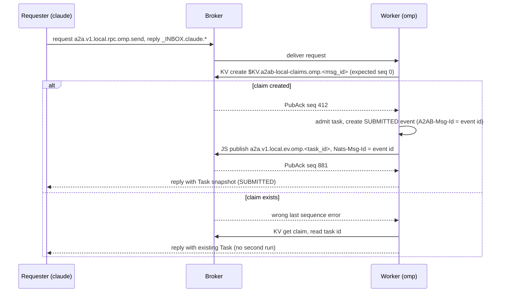

# RFC-0010: NATS Binding

| Field | Value |
|---|---|
| Status | Proposed |
| Depends on | RFC-0001 (layers, vocabulary, L1-L17), RFC-0011 (bus contract), RFC-0002 (subjects, headers, envelopes), RFC-0005 (sequence, redelivery, task TTL), RFC-0004 (cards and presence schemas), RFC-0007 (signing), RFC-0012 (state directory, process lifecycle), RFC-0013 (audit records) |
| Owner area | Subject, stream, KV layout, permissions, deployment |
| Related interop notes | `docs/interop/nats.md` (sections 1-10), `docs/interop/a2a-spec-notes.md` (sections 1, 3, 6) |
| Normative language | BCP 14 (RFC 2119, RFC 8174) |

## 1. Summary

This RFC realises the bus contract of RFC-0011 on NATS 2.x with JetStream, the reference bus `bus-nats` (RFC-0001 L1). It fixes the M1 deployment (one loopback-only nats-server child process owned by a2ad), the subject space, the JetStream streams, consumers, KV buckets and object store, the NKey identities and permission lists, and the rule that makes a submission survive a broker restart without duplicate execution. Names and layouts here are normative; other RFCs reference them and do not redefine them. Cross-site federation is sketched as a post-M1 extension only.

## 2. Motivation and scope

RFC-0011 is transport-neutral. M1 needs one concrete mapping that (a) survives a broker restart without duplicate task execution (M1 scenario 6), (b) executes a duplicate submission once (M1 scenario 7), (c) keeps local peers from reading each other's private traffic beyond what M1 can enforce, and (d) runs on Windows and Linux with the same layout.

In scope: broker deployment and supervision; identities and authentication; subject mapping; streams, KV buckets and the object store; the submission claim; event publish and replay; consumers; permission lists; reply inboxes; backup, upgrade and stop.

Non-goals: A2A message semantics, task states and redelivery policy (RFC-0002, RFC-0005); signing (RFC-0007); audit record schema (RFC-0013); the HTTP gateway (RFC-0008); accounts, operator JWTs, TLS and leafnodes in M1; per-agent streams; encryption at rest; multi-host clusters. Confidentiality of payloads from other local identities is not provided in M1 (section 6).

## 3. Terminology

Only terms not defined in RFC-0001:

- **Broker**: the nats-server process run by this binding.
- **Stream, consumer**: JetStream stream (durable log with subject filters) and consumer (server-side view on a stream). An **ordered consumer** is ephemeral and client-managed; a **durable consumer** keeps server-side state.
- **Bucket**: a JetStream-backed KV store. Object store buckets are named the same way.
- **Claim**: a KV entry recording the task created for one submission (section 4.8).
- **Presence lease**: the presence key of an agent; its single writer is the live instance (section 4.6).
- **Identity**: one NKey-authenticated NATS user. Agent identities are the agent ids of RFC-0001 (`omp`, `claude`, `hermes`). Reserved service identities are `gateway`, `tui`, `cli` and `supervisor`; they are not agent ids.
- **Inbox prefix**: the per-identity reply subject prefix `_INBOX.<identity>.`.
- **Tenant**: a subject token and bucket-name component. M1 has one tenant, `local`.

## 4. Specification

### 4.1 Deployment

- [0010-001] In M1 the broker MUST be one nats-server process started and stopped by a2ad as a child process. Lifecycle is owned by RFC-0012. No cluster, gateway or leafnode listener is configured.
- [0010-002] The client listener MUST bind to loopback with `host: "127.0.0.1"` and `port: 4222` (port overridable by RFC-0012 configuration). A configuration with any other listen address MUST be refused at start.
- [0010-003] Monitoring HTTP MUST be disabled (no `http` or `http_port` key). Broker health is checked by the supervisor over its own client connection.
- [0010-004] The JetStream store directory MUST be `<state>/nats/jetstream` in the RFC-0012 state directory (Windows: `%LOCALAPPDATA%\a2a-bus\nats\jetstream`; Linux: `$XDG_STATE_HOME/a2a-bus/nats/jetstream`, default `~/.local/state/a2a-bus/nats/jetstream`). It MUST NOT be placed on a network share. Long-path support is a spike item (section 9).
- [0010-005] JetStream limits MUST be explicit: `max_memory_store` 268435456 bytes (256 MiB) and `max_file_store` 4294967296 bytes (4 GiB). The server default (75% of memory) MUST NOT be used.
- [0010-006] M1 MUST use one global account. The tenant is a subject and bucket component (sections 4.4, 4.6). Accounts per tenant and operator JWTs are post-M1.
- [0010-007] The broker MUST end with a2ad. On Windows a kill-on-close job object MUST hold the broker; on Linux the child MUST receive a parent-death signal. A Windows service is not used in M1.
- [0010-008] a2ad MUST NOT start any agent or gateway process until the broker accepts a client connection and JetStream answers an account-info request.

Example server configuration (illustrative; NKeys are placeholders, not real keys):

```
server_name: "a2ab-local"
host: "127.0.0.1"
port: 4222
max_payload: 1048576
jetstream {
  store_dir: "C:/Users/<user>/AppData/Local/a2a-bus/nats/jetstream"
  max_memory_store: 268435456
  max_file_store: 4294967296
}
authorization {
  users = [
    { nkey: "<public NKey of omp>",    permissions: { ... } }   # expanded per 4.11
    { nkey: "<public NKey of gateway>", permissions: { ... } }
  ]
}
```

No `http` key is present (0010-003). Verified by spike `nats` (stub): with no `http` key and no `-m`, nothing listens on 8222. Seeds are never in this file (0010-010).

### 4.2 Identities and authentication

- [0010-009] Authentication MUST use NKey users in `authorization { users = [...] }`. The configuration MUST contain public NKeys only. Seeds MUST NOT appear in configuration, command lines or logs.
- [0010-010] Each identity seed MUST be stored in `<state>/creds/<identity>.nk`, readable only by the owning OS user: Linux mode 0600 in a 0700 directory; Windows owner-only DACL. a2ad MUST check these permissions at every start and MUST refuse to start an identity whose seed is more widely readable.
- [0010-011] M1 identities are `omp`, `claude`, `hermes` (agent ids), and `gateway`, `tui`, `cli`, `supervisor` (reserved). Each identity has exactly one role (section 4.11). No two identities share a seed.
- [0010-012] Plaintext on loopback is accepted in M1. A non-loopback listener MUST require TLS; M1 configurations never contain one (0010-002).
- [0010-013] NATS authentication identifies the connection, not the task author. A2A-layer identity and card signatures (RFC-0007) remain authoritative for task authorship; the broker never decides who may act for an agent beyond section 4.11.

### 4.3 Limits

- [0010-014] Broker `max_payload` MUST be 1048576 bytes (1 MiB).
- [0010-015] Before publishing, a sender MUST reject a message whose body exceeds 524288 bytes (512 KiB) or whose headers plus body exceed 1048576 bytes. This budget keeps the message within `max_payload` whether or not the server counts headers toward it. Verified by spike `nats` (stub, partial): async-nats 0.50.0 counts headers toward `max_payload` (client-side rejection: body 1048000 bytes plus about 621 bytes of headers rejected at 1048621 bytes; body 1046000 bytes plus about 1621 bytes of headers accepted). Server-side header counting `[UNOBSERVED]` (section 9).
- [0010-016] A `Part.raw` value MUST be inline only if its decoded size is at most 262144 bytes (256 KiB). Larger content MUST be sent as `Part.url` (section 4.7).

### 4.4 Subjects

- [0010-017] Message bodies MUST be ProtoJSON with `Content-Type: application/a2a+json` (per RFC-0002 and the spec REST rule). Binary protobuf for A2A bodies is post-M1. The one binary payload in M1 is the audit record `a2abus.v1.AuditEvent` (schema RFC-0013), identified by header `A2AB-Payload-Type: a2abus.v1.AuditEvent` (RFC-0001 L1, widened).
- [0010-018] Subjects MUST follow `a2a.v1.<tenant>.<class>...` with `<class>` one of `rpc`, `ev`, `audit`. The M1 tenant is `local`.
- [0010-019] Tokens MUST match: tenant `[a-z0-9][a-z0-9-]{0,31}`; agent id `[a-z0-9][a-z0-9-]{0,47}`; task id: lowercase canonical UUIDv7 (36 characters); op token: `[a-z][a-z0-9]{0,31}` (operation names owned by RFC-0002). A subject MUST be built only from tokens that pass validation; any token containing `.`, `*`, `>`, whitespace or a control character MUST be rejected before the subject is built.
- [0010-020] A subject MUST NOT exceed 255 bytes. The longest event subject (tenant 32, agent 48, task 36) is about 130 bytes. The 255-byte cap is this RFC's own rule; the server accepted 1000-byte subjects in spike `nats` (stub), so the server does not impose the cap.
- [0010-021] The subject mapping is:

| Purpose | Subject or store | Transport | Notes |
|---|---|---|---|
| Request to an agent | `a2a.v1.<tenant>.rpc.<agent>.<op>` | core request/reply | RFC-0001 L3. Ops such as `send` (SendMessage), `stream` (SendStreamingMessage), `get`, `cancel`, `subscribe`, `list` per RFC-0002. |
| Task events | `a2a.v1.<tenant>.ev.<agent>.<task_id>` | JetStream publish into `A2AB_EV_<tenant>` | Published only by the owning agent (0010-060). |
| Audit records | `a2a.v1.<tenant>.audit.<identity>` | JetStream publish into `A2A_AUDIT_<tenant>` | RFC-0001 L17; schema RFC-0013. |
| Agent cards | `$KV.a2ab-<tenant>-cards.<agent>` | KV | Section 4.6. |
| Presence | `$KV.a2ab-<tenant>-presence.<agent>` | KV | Section 4.6. |
| Submission claims | `$KV.a2ab-<tenant>-claims.<agent>.<msg_id>` | KV | Section 4.8. `<agent>` is the claiming worker, which is the rpc target. |
| Artifacts | object store `a2ab-<tenant>-artifacts` | object store | Section 4.7. |

- [0010-022] Agent ids and KV keys in section 4.6 are the same tokens as in subjects. Logical store names used by RFC-0004 map as: `cards/<tenant>/<agentId>` to bucket `a2ab-<tenant>-cards`, key `<agentId>`; `presence/<tenant>/<agentId>` to bucket `a2ab-<tenant>-presence`, key `<agentId>`.
- [0010-023] Submission and event ids (`A2AB-Msg-Id`) MUST be UUIDv7 in canonical form, generated by the sender before the first attempt, and reused on every retry of the same message.

### 4.5 Streams

- [0010-024] Stream `A2AB_EV_<tenant>` (M1: `A2AB_EV_local`) MUST have: subjects `a2a.v1.<tenant>.ev.>`; retention `limits`; storage `file`; `max_age` 7 d; `max_bytes` 1 GiB; `max_msg_size` 1 MiB; `discard` `new`; `num_replicas` 1; `duplicate_window` 3630 s (the 3600 s request TTL cap of RFC-0011 plus 30 s skew); `allow_direct` true; `deny_delete` true; `deny_purge` true. Publish permission on `ev.<agent>.>` belongs only to that agent (0010-060). No identity holds a core subscribe on `ev` subjects.
- [0010-025] Stream `A2A_AUDIT_<tenant>` (M1: `A2A_AUDIT_local`) MUST have: subjects `a2a.v1.<tenant>.audit.>`; retention `limits`; storage `file`; `max_age` 7 d; `max_bytes` 512 MiB; `max_msg_size` 64 KiB; `discard` `new`; `num_replicas` 1; `duplicate_window` 15 min; `deny_delete` true; `deny_purge` true.
- [0010-026] `duplicate_window` MUST be 3630 s on `A2AB_EV_<tenant>` (covers the publisher retry horizon R = 10 min of 0010-046) and 15 min on `A2A_AUDIT_<tenant>` (0010-025). The server default of 2 min is not used. Core rpc requests are not stored, so the server does not deduplicate them; their idempotency is the claim (0010-041). JetStream deduplication is a first line of defence only; correctness rests on the handler-side idempotency store of RFC-0005.
- [0010-027] `A2AB_EV_<tenant>.max_age` MUST be at least the greater of 7 d and T_task + 24 h, where T_task is the RFC-0005 task retention (default 24 h, so M1 uses 7 d). Retention is by age and size, not by task state. The terminal event of a task is kept at least 7 d after publish. JetStream cannot keep the events of a non-terminal task beyond `max_age`; past that point they are gone, and a requester MUST use GetTask (RFC-0002 [0002-046]), which is served from the authoritative worker store (open issue 10).
- [0010-028] Stream names MUST match `[A-Za-z0-9_-]+`. They MUST NOT contain `.`, `*`, `>`, whitespace, `/` or `\`, because the server rejects `.` and wildcard characters.

### 4.6 KV buckets

- [0010-029] Buckets are per tenant and MUST be named `a2ab-<tenant>-cards`, `a2ab-<tenant>-presence` and `a2ab-<tenant>-claims`. Their backing streams are `KV_<bucket>`.
- [0010-030] Cards bucket: `history` 1; no TTL; `max_value_size` 262144; `allow_direct` true. Key: agent id. Value: ProtoJSON `AgentCard` (contents owned by RFC-0004; signatures by RFC-0007). Only the owning worker MAY write its key. A delete marker means decommission; it is written by the owner or by the supervisor on operator request.
- [0010-031] Presence bucket: `history` 1; `limit_markers` on (async-nats `kv::Config` option `limit_markers`; Go `LimitMarkerTTL`; server effect `allow_msg_ttl: true` and `subject_delete_marker_ttl`); `max_value_size` 4096; `allow_direct` true. Key: agent id. Value: a small JSON record (schema owned by RFC-0004). Each put MUST carry header `Nats-TTL: 30s`, including the put that re-creates a key after expiry or purge. The owning worker refreshes every 10 s (RFC-0004 values). Only the owner MAY write its key. Writers MUST NOT rely on `create_with_ttl` for a re-created key: async-nats 0.50.0 drops the TTL when the last entry is a Purge or Delete marker (`kv/mod.rs` `create_maybe_ttl` falls back to `update()`). A re-create after expiry or purge MUST set `Nats-TTL` explicitly and be fenced with `Nats-Expected-Last-Subject-Sequence` equal to the revision of the marker. Verified by spike `nats` (stub): fresh-key TTL honoured (marker op Purge at expiry); purged-key re-create with explicit `Nats-TTL` accepted with purge-revision fence. Bucket creation command `[UNOBSERVED]`.
- [0010-032] Presence is a single-instance lease. A starting worker MUST create its key with `Nats-Expected-Last-Subject-Sequence: 0` only when the key has never had an entry. If the key has a live entry, the create fails and another live instance holds the lease: the worker MUST NOT serve and MUST exit with an error. The supervisor restarts it after the lease expires. If the key exists only as an expiry or purge marker, the worker MUST re-create it with `Nats-TTL` set and `Nats-Expected-Last-Subject-Sequence` equal to the marker revision (0010-031). Verified by spike `nats` (stub): `key already exists` on a live key (fence PASS). The expected-sequence-0 create over an expiry marker is `[INFERENCE]` (JetStream checks the last sequence of the subject); the re-create with the marker revision is verified.
- [0010-033] A refresh MUST carry `Nats-Expected-Last-Subject-Sequence` equal to the sequence of the instance's previous put. A conflict, or a missed refresh past the TTL, means the lease was lost: the instance MUST stop serving and exit (fencing). Verified by spike `nats` (stub): stale expected sequence returns `wrong last sequence` (error code 10071).
- [0010-034] Watchers of the cards and presence buckets MUST surface the end of the initial snapshot to the application, so a late joiner knows when its view is complete. Watchers MUST use an explicit push consumer (`DeliverPolicy::LastPerSubject`, filter `$KV.<bucket>.>`); the message whose ACK reply has `pending == 0` marks the end of the snapshot. An empty bucket delivers no such message, so the watcher MUST check the consumer's `num_pending == 0` at creation and emit the end marker immediately. Verified by spike `nats` (stub, 1-entry bucket): explicit push consumer PASS; async-nats `watch_all()` delivered 0 entries (root cause `[INFERENCE]`, in `push.rs` and `kv/mod.rs` `Watch::poll_next`); the empty-bucket path is `[UNOBSERVED]`.
- [0010-035] Claims bucket: `history` 1; `max_age` 48 h; `max_value_size` 1024; `allow_direct` true. Key: `<agent>.<msg_id>`, where `<agent>` is the claiming worker (the rpc target; the same token as in 0010-041). Value: the task id as ASCII. `max_age` MUST be at least T_task + 24 h (M1: 48 h, consistent with RFC-0005 default T_task = 24 h and admission window W = 2 h). A deployment raising T_task above 24 h MUST raise this value at the same time.

### 4.7 Object store (artifacts)

- [0010-036] Bucket `a2ab-<tenant>-artifacts` (object store, backing streams `OBJ_<bucket>`, chunk subjects `$O.<bucket>.C.>`, metadata subjects `$O.<bucket>.M.>`): chunk size 131072 bytes (128 KiB); `max_bytes` 2 GiB; `max_age` at least T_task + 48 h (M1: 72 h). Per-object size cap 64 MiB, enforced by the sender.
- [0010-037] Object names MUST be the lowercase SHA-256 hex of the content (content addressing). A reader MUST verify SHA-256 and size after download; a mismatch is a hard error and MUST NOT be retried as a transient fault.
- [0010-038] On the bus, a `Part.url` MUST use the form `nats-obj://<tenant>/<bucket>/<sha256-hex>?sha256=<hex>&size=<bytes>`. RFC-0002 owns `Part`; this RFC owns the bus form of the URL.
- [0010-039] Only the owning worker MAY write artifacts. Any agent, the gateway and operator identities MAY read them.

Example:

```json
{
  "url": "nats-obj://local/a2ab-local-artifacts/3a7bd3e2360a3d29eea436fcfb7e44c735d117c42d1c1835420b6b9942dd4f1b?sha256=3a7bd3e2360a3d29eea436fcfb7e44c735d117c42d1c1835420b6b9942dd4f1b&size=1048576",
  "filename": "report.pdf",
  "mediaType": "application/pdf"
}
```

### 4.8 Submission and claim

- [0010-040] A submission is a core request/reply on `rpc` op `send` or `stream` (RFC-0001 L3). Submissions MUST NOT be captured into a stream; durability comes from the claim below. The request carries `A2AB-Msg-Id` and `Nats-Msg-Id` with the same value (RFC-0001 L5). The broker does not deduplicate core requests in M1, so the claim (0010-041) is the only idempotency mechanism for submissions.
- [0010-041] Before admitting a task, the worker MUST create the claim with KV create: put to `$KV.a2ab-<tenant>-claims.<self>.<A2AB-Msg-Id>` with header `Nats-Expected-Last-Subject-Sequence: 0`, value = the new task id.
- [0010-042] If the claim create fails because the key exists, the worker MUST NOT run a second turn. It MUST read the claim, return the existing task id to the requester, and make sure that task's stored SUBMITTED event has been acknowledged (publishing it now if not, with the same `A2AB-Msg-Id`).
- [0010-043] The worker MUST NOT reply to a submission until the SUBMITTED event has a PubAck. An acknowledged submission is therefore always visible in the events stream.
- [0010-044] A claim whose task id is unknown to the worker store (store lost) MUST NOT be silently re-run. The worker MUST return the claimed task id, and the requester's GetTask then reports not-found. Recovery of a lost store is out of M1 scope and is covered by backup (0010-068).
- [0010-045] Claims are bus-level records. They do not replace the RFC-0005 admission record, which stays the authority for dedupe inside the worker.

Example: submission request from claude to omp (core request; reply goes to the requester's inbox):

```
PUB a2a.v1.local.rpc.omp.send _INBOX.claude.1f3c0a9e2b7d4c6f8a1e5d9b0c2f4a6e
A2A-Version: 1.0
A2AB-Msg-Id: 0190f3a2-7c41-7d2e-9b6a-3e5f1c8d2a47
Nats-Msg-Id: 0190f3a2-7c41-7d2e-9b6a-3e5f1c8d2a47
Content-Type: application/a2a+json
traceparent: 00-4bf92f3577b34da6a3ce929d0e0e4736-00f067aa0ba902b7-01
```

```json
{
  "tenant": "local",
  "message": {
    "messageId": "0190f3a2-7c41-7d2e-9b6a-3e5f1c8d2a47",
    "role": "ROLE_USER",
    "parts": [ { "text": "Summarise docs/rfcs/0010-nats-binding.md" } ]
  }
}
```

Reply on the inbox, sent only after the SUBMITTED PubAck (0010-043):

```json
{ "task": { "id": "0190f3a3-5b2e-7c00-a1d4-0f9e8b7c6d5e", "contextId": "0190f3a1-6e2c-7b44-9d1f-2a7c5e8b0f13", "status": { "state": "TASK_STATE_SUBMITTED", "timestamp": "2026-05-01T10:00:00.000Z" } } }
```

- [0010-047] The worker MUST assign per-task `seq` values in its store, monotonically, and MUST serialize publishes per task: the next event is published only after the previous PubAck. Exactly one publisher exists per task subject: the lease holder for that agent (0010-032). Permissions (0010-060) confine the publish subject to that agent.

Sequence (normal path and claim conflict):



### 4.9 Events and replay

- [0010-046] Each event is published as a JetStream publish with `Nats-Msg-Id` = `A2AB-Msg-Id` of that event (RFC-0001 L5). The worker assigns the event id when the event is written to its store, before the first publish; retries reuse it. The publish retry horizon R is 10 min. The duplicate window (0010-026) covers R.
- [0010-048] Every event MUST carry its `seq` under the metadata key `urn:a2abus:ext:sequence:1` (schema owned by RFC-0005). Requesters use it for ordering and deduplication.
- [0010-049] When a worker restarts it MUST resume `seq` from the last acknowledged event read from the stream with a direct get on `last_by_subj` (the task's subject), never from memory. The stored event id, not the stream sequence, is the resume point.
- [0010-050] A requester that attaches to a task (SubscribeToTask or a resumed stream) MUST create an ordered consumer with `filter_subject` = the task's event subject and `deliver_policy` `all`, and MUST drop every event whose `seq` is at most the `A2AB-After-Seq` value it supplied (0 if none). The gap rule of 0010-077 applies to every attach. Stream sequence numbers are internal to the binding and MUST NOT be exposed to A2A clients.
- [0010-051] On reconnect, a requester MUST resume with `deliver_policy` `by_start_sequence` set to its last observed stream sequence plus one, and MUST still drop events with `seq` at most its last observed `seq`.
- [0010-052] Ordered consumers MUST use `ack_policy` `none`, `flow_control` true, `idle_heartbeat` 5 s, `mem_storage` true and `replay_policy` `instant`. A client that misses heartbeats for 15 s MUST treat the consumer as disconnected and re-attach.
- [0010-053] If a worker cannot publish an event within the retry horizon (0010-046), it MUST stop the backend turn. Once the bus recovers it MUST publish a terminal FAILED event with reason `bus-outage`. If that publish is also impossible, the terminal state stays in the worker store and is served by GetTask.
- [0010-077] Before delivering any event, a requester attaching by 0010-050 or 0010-051 MUST check the first event its consumer delivers. Let `k` be its last observed `seq` (the `A2AB-After-Seq` value, or 0 if none; sequence numbers start at 1). If the first delivered event has `seq` greater than `k + 1`, the events from `k + 1` to `seq - 1` have expired under `max_age` (0010-027). The requester MUST end the attach with Unavailable and reason `RETENTION_EXCEEDED` (ErrorInfo domain `a2abus.v1`; RFC-0002 owns the reason list) and MUST NOT start later silently. If the consumer delivers no event at all and `k` is greater than 0, the requester MUST also return `RETENTION_EXCEEDED`, because it cannot tell an empty tail from expired events. The requester then recovers through GetTask, which is authoritative (0010-027).

Example: SUBMITTED event published by worker omp:

```
PUB a2a.v1.local.ev.omp.0190f3a3-5b2e-7c00-a1d4-0f9e8b7c6d5e
Nats-Msg-Id: 0190f3a4-0d1e-7a10-8f2c-6b9e4d7a1c35
A2AB-Msg-Id: 0190f3a4-0d1e-7a10-8f2c-6b9e4d7a1c35
A2A-Version: 1.0
Content-Type: application/a2a+json
```

```json
{
  "statusUpdate": {
    "taskId": "0190f3a3-5b2e-7c00-a1d4-0f9e8b7c6d5e",
    "contextId": "0190f3a1-6e2c-7b44-9d1f-2a7c5e8b0f13",
    "status": { "state": "TASK_STATE_SUBMITTED", "timestamp": "2026-05-01T10:00:00.000Z" },
    "metadata": { "urn:a2abus:ext:sequence:1": { "seq": 1 } }
  }
}
```

PubAck returned to the worker:

```json
{ "stream": "A2AB_EV_local", "seq": 881, "duplicate": false }
```

A retry of the same publish within the window returns `"duplicate": true` with the same `seq`.

Example: requester replay of a task after reconnect (ordered consumer create on the events stream):

```json
{
  "stream_name": "A2AB_EV_local",
  "config": {
    "deliver_policy": "all",
    "ack_policy": "none",
    "filter_subject": "a2a.v1.local.ev.omp.0190f3a3-5b2e-7c00-a1d4-0f9e8b7c6d5e",
    "replay_policy": "instant",
    "flow_control": true,
    "idle_heartbeat": 5000000000,
    "mem_storage": true,
    "num_replicas": 1
  }
}
```

The requester sent `A2AB-After-Seq: 4` in its request, so events with `seq` 1 to 4 are dropped by the rule in 0010-050.

### 4.10 Durable consumers

- [0010-054] M1 has one durable consumer: `audit-archiver` on `A2A_AUDIT_<tenant>`. It MUST be created and owned by the supervisor. Its behaviour is owned by RFC-0013.
- [0010-055] The archiver consumer MUST set `max_deliver` explicitly (10). An unlimited value is forbidden. `ack_wait` MUST equal the first entry of `backoff` (30 s).
- [0010-056] Archiver consumer configuration (durations in nanoseconds):

```json
{
  "durable_name": "audit-archiver",
  "filter_subject": "a2a.v1.local.audit.>",
  "deliver_policy": "all",
  "ack_policy": "explicit",
  "ack_wait": 30000000000,
  "max_deliver": 10,
  "backoff": [30000000000, 60000000000, 120000000000, 300000000000],
  "max_ack_pending": 256,
  "replay_policy": "instant"
}
```

The consumer handles max-delivery exhaustion through the advisory subject `$JS.EVENT.ADVISORY.CONSUMER.MAX_DELIVERIES.<stream>.<consumer>` (observed in spike `nats` (stub), payload 198 bytes; example `$JS.EVENT.ADVISORY.CONSUMER.MAX_DELIVERIES.A2AB_SPIKE_ADV.adv`).

### 4.11 Permissions

- [0010-057] Every identity MUST have an explicit NATS user entry with `publish.allow`, `subscribe.allow` and, for responders, `allow_responses`. Allow lists are the access model. Deny lists MAY be added only where an explicit exclusion is needed.
- [0010-058] Wildcards MUST be whole tokens only (`>` and `*` as the last or a full token). Stream and bucket names MUST be enumerated. Partial wildcards such as `A2AB_*` or `KV_a2ab-*` are forbidden.
- [0010-059] The read bundle for each stream S behind a bucket or audit/event stream is: `$JS.API.STREAM.INFO.S`, `$JS.API.CONSUMER.CREATE.S`, `$JS.API.CONSUMER.CREATE.S.>`, `$JS.API.CONSUMER.INFO.S.>`, `$JS.API.CONSUMER.DELETE.S.>`, `$JS.API.DIRECT.GET.S`, `$JS.API.DIRECT.GET.S.>`, `$JS.API.STREAM.MSG.GET.S`. Spike `nats` (stub) confirmed that permission-violation logs yield a working read bundle; the minimal subject set is `[UNOBSERVED]` and is fixed from those logs (section 9).
- [0010-060] Role `agent` (identities `omp`, `claude`, `hermes`; `<self>` is the identity):
  - publish: `a2a.v1.local.rpc.*.*` (send to any agent); `a2a.v1.local.ev.<self>.>`; `a2a.v1.local.audit.<self>` (own audit records only); `$KV.a2ab-local-cards.<self>`; `$KV.a2ab-local-presence.<self>`; `$KV.a2ab-local-claims.<self>.*`; `$O.a2ab-local-artifacts.C.>` and `$O.a2ab-local-artifacts.M.>` (writer only; see 0010-039). Read bundle for `A2AB_EV_local`, `KV_a2ab-local-cards`, `KV_a2ab-local-presence`, `KV_a2ab-local-claims` and `OBJ_a2ab-local-artifacts`. No read access to `A2A_AUDIT_local`.
  - subscribe: `_INBOX.<self>.>`; `a2a.v1.local.rpc.<self>.*` (serving). No identity holds a core subscribe on `a2a.v1.local.ev.>`; stored event reads go through consumers, which is the accepted gap below.
  - `allow_responses` with `max` 1 (0010-061).
- [0010-061] Each rpc request is answered by exactly one reply. Responders MUST use `allow_responses` with `max` 1 and a short `expires`. A reply count above one is a permission violation. Operations that need more are owned by RFC-0002 and require an erratum.
- [0010-062] Role `gateway`: publish `a2a.v1.local.rpc.*.*`; read bundle as for `agent`; publish own card, presence and audit (`<self>` = `gateway`); subscribe `_INBOX.gateway.>`; no event-stream writes.
- [0010-063] Role `operator` (identities `tui`, `cli`): publish `a2a.v1.local.rpc.*.*`; read-only KV (no writes to cards, presence or claims); read bundle for audit view; publish own audit (`audit.tui`, `audit.cli`); subscribe `_INBOX.<self>.>`.
- [0010-064] Role `supervisor` (identity `supervisor`): stream create/update/info for the names in sections 4.5-4.7 only; durable archiver API (`$JS.API.CONSUMER.*` for `A2A_AUDIT_local.audit-archiver`), `$JS.API.CONSUMER.MSG.NEXT.A2A_AUDIT_local.audit-archiver`, `$JS.ACK.>`; reaper publish on `a2a.v1.local.ev.*.>` for FAILED events of dead workers (`bus-outage` or `worker-lost`, owned by RFC-0005); subscribe `$JS.EVENT.ADVISORY.>`; subscribe `_INBOX.supervisor.>`.
- [0010-065] Permission violations MUST be logged by a2ad and mapped to the bus error FORBIDDEN (ErrorInfo domain `a2abus.v1`) in the audit stream (RFC-0013); no request is silently dropped.

Example expansion for `omp` (publish and subscribe excerpts; the full list is generated from the roles above):

```
{ nkey: "<public NKey of omp>",
  permissions: {
    publish:   { allow: [ "a2a.v1.local.rpc.*.*", "a2a.v1.local.ev.omp.>",
                          "a2a.v1.local.audit.omp", "$KV.a2ab-local-cards.omp",
                          "$KV.a2ab-local-presence.omp", "$KV.a2ab-local-claims.omp.*",
                          "$JS.API.STREAM.INFO.A2AB_EV_local", "..." ] },
    subscribe: { allow: [ "_INBOX.omp.>", "a2a.v1.local.rpc.omp.*" ] },
    allow_responses: { max: 1, expires: "2m" }   # syntax accepted by nats-server v2.15.2 (spike `nats` (stub))
  } }
```

Accepted M1 gaps (stated, not hidden):

- Consumer filters cannot be enforced by permissions, so any identity with read bundle access can replay the whole events stream. Payload confidentiality between local identities is not provided in M1.
- Any agent can send an rpc request to any other agent. The A2A layer (cards, RFC-0007) decides whether to accept.
- In fallback inbox mode (0010-067), any identity can subscribe to every inbox.

### 4.12 Reply inboxes

- [0010-066] Each identity MUST set its client inbox prefix to `_INBOX.<identity>.` and MUST subscribe only to `_INBOX.<identity>.>`.
- [0010-067] If a client library cannot set the inbox prefix, the identity MAY use the fallback subscription `_INBOX.>`. The fallback MUST be recorded as a known gap in the deployment record and MUST be removed once the library supports the prefix.

### 4.13 Operations

- [0010-068] Backup MUST be taken with the broker stopped (after drain), by copying the JetStream store directory and the state directory together. A stream snapshot via the server API is an alternative `[UNOBSERVED]`. Verified by spike `nats` (stub): offline copy restore and online `stream backup` / `stream restore` for `A2AB_EV_local` and the presence stream; KV online backup `[UNOBSERVED]`.
- [0010-069] Upgrade MUST pin the nats-server version. a2ad MUST verify the binary's SHA-256 against the release manifest before start. Upgrade drains all clients, stops the broker, replaces the binary, and starts it again. Downgrade is forbidden because JetStream on-disk state is not guaranteed to be readable by an older server.
- [0010-070] Graceful stop MUST drain clients first (agents and gateway stop accepting work and finish turns), then stop the process. The Windows graceful server stop is `GenerateConsoleCtrlEvent(CTRL_BREAK_EVENT)` sent to a process group created with `CREATE_NEW_PROCESS_GROUP`, which exits 0 (verified by spike `nats` (stub)). The Windows service stop (`sc.exe`) is `[UNOBSERVED]`. Process termination after drain is the fallback; a job object with `KILL_ON_JOB_CLOSE` exits 0 (verified).
- [0010-071] Broker stdout and stderr MUST be captured by a2ad into `<state>/logs/`, rotated by a2ad (RFC-0012). Seeds and payload bodies MUST NOT be logged by the broker or by a2ad.
- [0010-072] M1 does not enable encryption at rest. The state directory ACL (0010-010 for seeds, RFC-0012 for the rest) is the only at-rest protection in M1.

### 4.14 Federation (post-M1)

These requirements apply only when the post-M1 federation work is accepted. They are stated now so M1 choices do not block them.

- [0010-073] (post-M1) Each site runs its own broker as a leafnode with its own JetStream domain. Events are stored in the producer's domain. Cross-site live delivery uses forwarded core subjects; cross-site replay uses the domain-qualified API (`[UNOBSERVED]`).
- [0010-074] (post-M1) Leafnode connections MUST use TLS.
- [0010-075] (post-M1) rpc submissions MUST fail fast when the target site is partitioned. They MUST NOT be stored and forwarded, because a delayed submission could act on a stale authority (threat T11). Events and audit records MAY be stored and forwarded within their domain.
- [0010-076] (post-M1) Presence is not replicated across sites; presence is site-local.

## 5. Interoperability

- **Stock A2A peer**: sees only the HTTP, JSON-RPC or gRPC surface of the gateway (RFC-0008). It never sees a NATS subject, a KV bucket or an inbox. A2A operations, states and errors are unchanged. Bus-level failures map to the A2A error envelope recommended in `docs/interop/a2a-spec-notes.md` section 1.2 (`google.rpc.Status` with `ErrorInfo`). Bus-level errors use ErrorInfo domain `a2abus.v1`; A2A-defined errors keep `a2a-protocol.org` (RFC-0001 ruling). The reason strings are `[INFERENCE]` and owned by RFC-0002. Example bus error reply for an agent with no subscriber (NATS status 503, no responders):

```json
{ "error": { "code": 503, "status": "UNAVAILABLE", "message": "agent omp has no subscriber",
  "details": [ { "@type": "type.googleapis.com/google.rpc.ErrorInfo",
                 "reason": "AGENT_UNAVAILABLE", "domain": "a2abus.v1" } ] } }
```

- **Hermes**: reaches the bus only through the gateway over A2A HTTP. Hermes-side details are in `docs/interop/hermes.md` `[UNVERIFIED]` for this RFC.
- **ACP agents** (claude-agent-acp, omp in ACP mode): reach the bus only through their driver, which speaks ACP to the agent and this binding to the bus. The agents never see subjects, buckets or identities. `docs/interop/acp-omp-claude.md` governs the ACP side.
- **What is lost**: nothing in A2A semantics. The binding adds only transport detail. A2A ordering is kept by the per-task `seq` (spec ordering rule, `docs/interop/a2a-spec-notes.md` section 3.5 and the sequence extension).
- **What the binding does not do**: NATS JetStream is not an A2A binding URI visible to stock peers. The AgentCard advertises the bus interface only to bus-capable peers (RFC-0004, RFC-0011).

## 6. Security considerations

- **Local trust boundary (A5)**: the broker listens on loopback only (0010-002), requires NKeys for every connection (0010-009), and keeps seeds in owner-only files (0010-010). Monitoring is off so no unauthenticated endpoint exists (0010-003).
- **Store and seeds (T5)**: the JetStream store and seed files live under the state directory with owner-only permissions. Backups contain the store, so they inherit the same ACL requirement (0010-068).
- **Cross-identity reads**: M1 does not enforce consumer filters, so any identity with a read bundle can read every event and audit record (section 4.11 gaps). This is accepted for M1 because all identities run under one OS user on one host. The post-M1 mitigation candidates are per-agent streams and per-tenant accounts. Threat T10 is not fully met by M1 and is recorded as a gap for RFC-0007 to accept or reject.
- **Impersonation on rpc**: any identity can publish an rpc request to any agent. The receiving worker authenticates task authorship via RFC-0007; the broker does not.
- **Duplicate execution (M1 scenarios 6 and 7)**: the claim (0010-041), the reply-after-ack rule (0010-043) and the seq-based replay keep one task per submission across retries and restarts.
- **Stale authority (T11)**: rpc submissions are never stored and forwarded (0010-075). Lease fencing (0010-033) stops a stalled worker from serving after its lease is lost.
- **Message-size abuse**: senders reject oversize messages (0010-015); the broker caps payloads at 1 MiB (0010-014); the object store caps objects at 64 MiB.
- **Sensitive data in logs**: seeds and bodies are never logged (0010-071).
- **Attack patterns**: subject injection through crafted ids is blocked by token validation (0010-019), not by the broker.

## 7. Rationale and alternatives considered

- **Core request/reply for submissions, claim for durability.** Capturing rpc requests in a stream would make every request a durable message and turn the broker into a second source of truth. RFC-0001 L3 keeps request/reply. The claim gives the one property needed (no second execution) at a fixed size per submission.
- **One stream per agent.** Would enable per-agent consumer enforcement but multiplies streams and limits for M1 with three agents. Deferred to post-M1 with accounts.
- **Accounts per tenant now.** Adds JWT operator management before a single tenant needs it. Deferred.
- **Windows service for the broker.** Rejected for M1: a2ad owns lifecycle (RFC-0012), a service adds a second supervisor and a SCM configuration path. A job object gives the same kill-on-exit guarantee.
- **Monitoring endpoint enabled.** Rejected: it is unauthenticated and reachable by other local users.
- **KV for presence rather than a stream.** KV gives per-key TTL and a single-writer lease in one primitive (`Nats-Expected-Last-Subject-Sequence`). Chosen.
- **Binary protobuf bodies.** Rejected for M1 for A2A message bodies: ProtoJSON matches the A2A REST content type and is debuggable with the tools available on both platforms. The audit record is the one binary payload (0010-017). Post-M1 option for A2A bodies.
- **Shorter claims TTL.** A claim shorter than the task retention would allow a second execution after the claim expired while the task was still known. 48 h is chosen (0010-035).

## 8. Conformance

| ID | Test idea | Level |
|---|---|---|
| 0010-001 | Start a2ad; one nats-server child; no cluster or leafnode listener in config | M1 |
| 0010-002 | Config with non-loopback host is refused at start | M1 |
| 0010-003 | No http key in generated config; no monitoring port listens | M1 |
| 0010-004 | Store dir resolves under state dir; network-share path refused | M1 |
| 0010-005 | Generated config contains both explicit JetStream limits | M1 |
| 0010-006 | Config has one account; second tenant needs no account change | M1 |
| 0010-007 | Kill a2ad; broker process exits (job object on Windows, PDEATHSIG on Linux) | M1 |
| 0010-008 | Agent start before broker ready is blocked | M1 |
| 0010-009 | Config grep finds no seed material; only public NKeys | M1 |
| 0010-010 | Seed file mode/DACL checked; wider permissions refuse start | M1 |
| 0010-011 | Identity table matches section 4.11; no duplicate seeds | M1 |
| 0010-012 | Non-loopback listener with no TLS is refused | M1 |
| 0010-013 | Broker-accepted identity cannot publish outside its role | M1 |
| 0010-014 | Config max_payload equals 1048576 | M1 |
| 0010-015 | Sender rejects body over 512 KiB and headers plus body over 1 MiB before publish; header bytes counted | M1 |
| 0010-016 | Part.raw over 256 KiB is sent as Part.url | M1 |
| 0010-017 | Bodies carry application/a2a+json; other content types rejected | M1 |
| 0010-018 | Subjects match grammar for all classes | M1 |
| 0010-019 | Tokens with dot, wildcard, space, control rejected before subject build | M1 |
| 0010-020 | Subject over 255 bytes rejected | M1 |
| 0010-021 | Each purpose uses the table's subject or store | M1 |
| 0010-022 | cards/presence logical keys map to bucket and key as stated | M1 |
| 0010-023 | Ids are canonical UUIDv7 and reused on retry | M1 |
| 0010-024 | A2AB_EV_local config matches every field | M1 |
| 0010-025 | A2A_AUDIT_local config matches every field | M1 |
| 0010-026 | duplicate_window is 3630 s on EV and 15 min on AUDIT; publish retry at 10 min still deduped | M1 |
| 0010-027 | Events max_age is at least max(7 d, T_task + 24 h); older non-terminal events gone; GetTask serves snapshot | M1 |
| 0010-028 | Stream names with a dot or wildcard rejected | M1 |
| 0010-029 | Bucket names match the three names per tenant | M1 |
| 0010-030 | Cards bucket config; non-owner write denied; decommission delete marker | M1 |
| 0010-031 | Presence put carries Nats-TTL 30s; key expires without refresh; re-create after expiry fenced by marker revision | M1 |
| 0010-032 | Second instance Create fails on a live key; re-create over expiry marker fenced by marker revision; it exits without serving | M1 |
| 0010-033 | Refresh with stale expected sequence causes exit | M1 |
| 0010-034 | Explicit push-consumer watch delivers snapshot end (pending 0) to a late joiner; empty bucket emits end immediately | M1 |
| 0010-035 | Claims max_age is 48 h; deployment raising T_task fails validation without claims raise | M1 |
| 0010-036 | Artifact bucket config matches | M1 |
| 0010-037 | Object written by sha256 name; corrupted chunk is detected and not retried | M1 |
| 0010-038 | Part.url uses nats-obj form with sha256 and size query | M1 |
| 0010-039 | Non-worker artifact put denied | M1 |
| 0010-040 | rpc request never appears in any stream | M1 |
| 0010-041 | Claim create with expected seq 0 precedes admission | M1 |
| 0010-042 | Duplicate submission returns existing task; no second turn; unacked SUBMITTED republished | M1 |
| 0010-043 | Reply not sent before SUBMITTED PubAck (kill broker between) | M1 |
| 0010-044 | Claim present, store empty: no re-run; GetTask not-found | M1 |
| 0010-045 | Claim does not gate store admission; store remains authority | M1 |
| 0010-046 | Event publish retry reuses A2AB-Msg-Id; duplicate true | M1 |
| 0010-047 | Per-task publishes serialized; seq monotonic | M1 |
| 0010-048 | Every event carries sequence metadata key | M1 |
| 0010-049 | Restart resumes seq from stored event, not memory | M1 |
| 0010-050 | Attach drops seq at most A2AB-After-Seq; stream seq not exposed | M1 |
| 0010-051 | Reconnect resumes by start sequence; duplicates dropped by seq | M1 |
| 0010-052 | Ordered consumer config matches; missed heartbeats trigger re-attach | M1 |
| 0010-053 | Publish impossible past horizon: backend stopped; bus-outage FAILED after recovery | M1 |
| 0010-077 | Attach below retention returns Unavailable RETENTION_EXCEEDED; no silent later start; empty retained set with k > 0 returns the same | M1 |
| 0010-054 | Only audit-archiver durable exists; owned by supervisor | M1 |
| 0010-055 | max_deliver is 10; ack_wait equals backoff[0] | M1 |
| 0010-056 | Archiver config JSON matches section 4.10 | M1 |
| 0010-057 | Every identity has explicit allow-list entry | M1 |
| 0010-058 | Config contains no partial wildcard; stream names enumerated | M1 |
| 0010-059 | Permission-violation logs yield the read bundle; minimal subject set derived from those logs | M1 |
| 0010-060 | Agent role: writes only to own ev, audit, cards, presence, claims; serves only own rpc | M1 |
| 0010-061 | Second reply on a request is denied; late reply after expiry is denied | M1 |
| 0010-062 | Gateway role publishes rpc and own records only | M1 |
| 0010-063 | Operator role cannot write cards, presence or claims | M1 |
| 0010-064 | Supervisor role limited to listed streams and archiver consumer | M1 |
| 0010-065 | Violation logged and audited as FORBIDDEN | M1 |
| 0010-066 | Client inbox prefix is `_INBOX.<identity>.`; other inboxes not received | M1 |
| 0010-067 | Fallback inbox mode recorded as known gap | M1 |
| 0010-068 | Backup with broker stopped restores store and state; ACL on backup; stream backup and restore of the event stream | M1 |
| 0010-069 | Upgrade with wrong SHA-256 refused; downgrade refused | M1 |
| 0010-070 | Drain before stop; CTRL_BREAK graceful stop exits 0; in-flight turns complete or fail with bus-outage | M1 |
| 0010-071 | Logs captured to state dir; no seed or body in logs | M1 |
| 0010-072 | No encryption-at-rest setting present in M1 config | M1 |
| 0010-073 | Two sites, domain per site, events stored in producer domain | post-M1 |
| 0010-074 | Leafnode without TLS refused | post-M1 |
| 0010-075 | Partitioned site rpc fails fast; no stored submission forwarded | post-M1 |
| 0010-076 | Presence not replicated across sites | post-M1 |

## 9. Open issues

Each entry has a default that applies unless the integrator decides otherwise.

1. **Windows graceful stop.** Closed for the process path by spike `nats` (stub): `GenerateConsoleCtrlEvent(CTRL_BREAK_EVENT)` to a `CREATE_NEW_PROCESS_GROUP` group exits 0; a `KILL_ON_JOB_CLOSE` job object exits 0. `[UNOBSERVED]`: `sc.exe` service stop (no service in M1, section 7). Default: drain, then graceful stop (0010-070); process termination only as fallback.
2. **Windows long paths.** Verified by spike `nats` (stub): a 357-character store path works with `LongPathsEnabled=1`. `[UNOBSERVED]`: behaviour with `LongPathsEnabled=0`. Default: a2ad reads `LongPathsEnabled` at start; if it is 0 and the store path exceeds 260 characters, the store path is shortened within the state directory (RFC-0012) and the condition is logged.
3. **Seed ACL on Windows.** Mechanism verified by spike `nats` (stub): `icacls <file> /inheritance:r /grant:r "<user>:F"` leaves only the owner, on a dummy file. `[UNOBSERVED]`: real seed files. Default: owner-only DACL set and verified by a2ad at every start (0010-010).
4. **Client library on Windows (MSVC).** Closed: async-nats 0.50.0 builds and runs on MSVC (spike `nats`, stub). No alternate client is needed.
5. **Read bundle subjects.** Partial: permission violations produce a working read bundle (spike `nats`, stub). `[UNOBSERVED]`: the minimal subject set. Default: start from section 4.11 and derive the minimal set from permission-violation logs (0010-059).
6. **Inbox prefix support.** Closed: `_INBOX.<id>.` works and the default `_INBOX.<nuid>` is denied (spike `nats`, stub). Fallback 0010-067 is not needed.
7. **Max-delivery advisory subject.** Closed: `$JS.EVENT.ADVISORY.CONSUMER.MAX_DELIVERIES.<stream>.<consumer>` observed (payload 198 bytes, spike `nats`, stub). Default: archiver DLQ handling is RFC-0013's.
8. **allow_responses syntax.** Closed for syntax and expiry (spike `nats`, stub): `max: 1, expires: "2m"` accepted; a second reply and a late reply are denied; a request with no responder returns `no responders`. RFC-0002 may request more replies only through an erratum (0010-061).
9. **Header counting toward max_payload.** Partial: async-nats 0.50.0 counts headers (client-side, spike `nats`, stub). `[UNOBSERVED]`: server-side counting. Default: the 512 KiB body and 1 MiB total sender rule (0010-015) holds in both cases.
10. **Long-running tasks beyond events max_age.** Events older than the event max age are gone (0010-027, M1: 7 days). Default: requesters use GetTask after the window; the worker store holds the authoritative history. RFC-0002 [0002-046] states this: non-terminal events are not guaranteed to remain, and GetTask is authoritative once they age out. Closed against RFC-0002; RFC-0005 open issue 2 states the same figure.
11. **Store loss.** Claims with no store record are not re-run (0010-044). Default: backup (0010-068) is the recovery path; automatic reconciliation is not in M1.
12. **Payload format.** ProtoJSON for A2A bodies (0010-017). Audit records are binary protobuf `a2abus.v1.AuditEvent`. Default: binary protobuf for A2A bodies is a post-M1 option.
13. **Encryption at rest.** Default: off in M1 (0010-072), relying on owner-only state directory ACLs.
14. **Config reload.** Default: changes to permissions or limits require a broker restart after drain (0010-069).
15. **T_task above 24 h.** Default: any deployment raising it MUST raise claims max_age and events and artifact max_age together (0010-027, 0010-035, 0010-036).
16. **Integrator requests.** Resolved: RFC-0001 now lists the reserved identities `gateway`, `tui`, `cli` and `supervisor`, and this RFC's identity table (0010-011) matches it. No request from this RFC remains open.
17. **Event id for SUBMITTED.** Default: the SUBMITTED event has its own `A2AB-Msg-Id` (0010-046), so no change to RFC-0002 or RFC-0005 envelopes is needed. RFC-0005 must confirm that its admission record stores the event id before publish.
18. **KV snapshot marker and TTL re-create.** Closed for the explicit push-consumer path (0010-034) and the purge-revision fenced re-create (0010-031, 0010-032), spike `nats` (stub). async-nats `watch_all()` delivered 0 entries on a 1-entry bucket; root cause `[INFERENCE]` (`push.rs`, `kv/mod.rs` `Watch::poll_next`); it is not used. `[UNOBSERVED]`: the empty-bucket path and the expected-sequence-0 create over an expiry marker.

**Spike checklist (M1 gate, Windows and Linux), status after spike `nats` (stub).** Closed: long store path with `LongPathsEnabled=1`; graceful stop by CTRL_BREAK; seed ACL mechanism; MSVC client build; KV snapshot marker via push consumer; per-key TTL on presence (fresh key and marker re-create); heartbeat 2 s; read bundle from permission violations (works). Residual `[UNOBSERVED]`: `sc.exe` service stop; `LongPathsEnabled=0`; server-side header budget; real seed-file ACL; read-bundle minimal set; KV online backup and `stream snapshot` API; empty-bucket snapshot; port 4222 conflict and exclusion ranges; Defender prompt on first start of nats-server.

**Verification items marked `[UNVERIFIED]` in this RFC.** Resolved by spike `nats` (stub): section 4.1 (`http` key, monitoring), 4.3 (header budget, client side), 4.4 (subject length), 4.6 (TTL option name, watch marker), 4.10 (advisory subject), 4.11 (allow_responses syntax), 4.13 (stream backup and restore, Windows stop). Still open: 4.7 (object-store subject encoding, not run), 4.13 (`stream snapshot` API), 4.14 (domain-qualified replay, post-M1).
