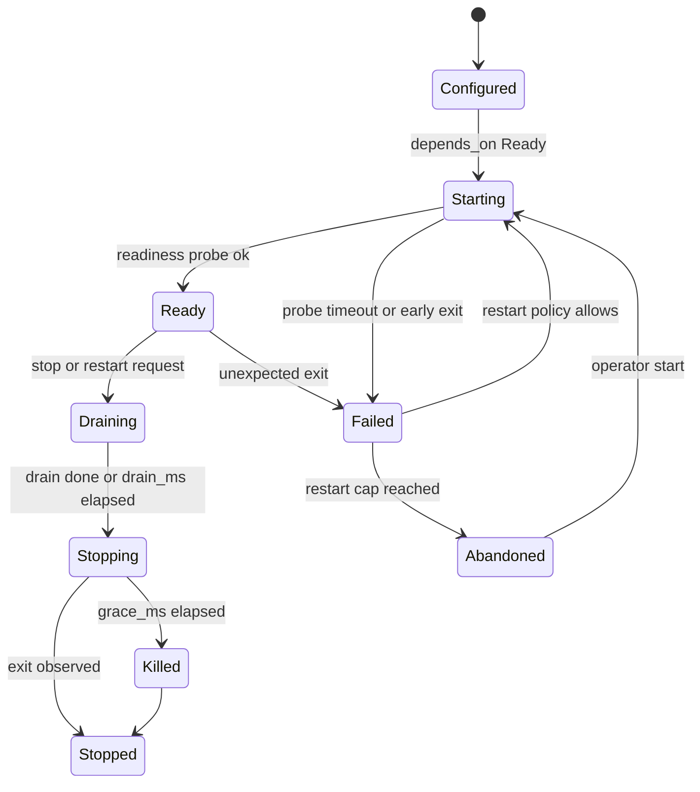

# RFC-0012: Supervisor, Workspaces and Operator UI

| Field | Value |
|---|---|
| Status | Proposed |
| Depends on | RFC-0001 (locked decisions L1-L17, rules 0001-001 to 0001-009); RFC-0002 (headers, subjects); RFC-0004 (presence bucket); RFC-0005 (task lifecycle, cancel, crash to FAILED, sequence); RFC-0006 (approval payload, budgets, expiry); RFC-0007 (keys, Operator identity, allowlist); RFC-0008 (gateway process); RFC-0009 (Backend profiles); RFC-0010 (NATS credentials and permissions); RFC-0011 (Bus seam); RFC-0013 (audit events) |
| Owner area | Supervisor (`a2ad`), workspaces (`a2a-workspace`), operator TUI (`a2a-tui`), `a2a` CLI |
| Related interop notes | `docs/interop/nats.md` sec 1, 5, 9; `docs/interop/acp-omp-claude.md` sec 3.1, 3.3, 4.1, 4.5; `docs/interop/hermes.md` sec 9.3, 11 |

## 1. Summary

The supervisor (`a2ad`) is the only process that starts and stops A2A-Bus processes on a host. It reads one TOML configuration file, starts the bus, external peers, the gateway and one `a2a-worker` per agent in dependency order, restarts them under a bounded policy, and stops them in reverse order with drain, cancel, graceful and forced phases. On Windows every child is contained by a Job Object; on Linux every child is in its own process group and workers exit when their supervisor's lifeline closes. Mutating agents run only in isolated git worktrees or copy-mode workspaces that never share a checkout, and the operator TUI and `a2a` CLI give the operator a bounded, signed, fatigue-resistant approval surface.

## 2. Motivation and scope

Milestone 1 requires one command to start and stop the whole host without orphans (M1-1), one isolated worktree per worker that refuses a shared checkout (M1-5), an approval surface that shows the real action and defaults to deny (M1-6, T7), per-agent bus credentials with owner-only permissions (M1-10), and a local TUI control surface (D9). Decision D12 sets the default workspace to one per agent session with per-task opt-in. Locked decision L16 requires that two workers never share a checkout.

In scope:

- Supervisor configuration (TOML), start order, readiness, restart and shutdown.
- Process containment on Windows and Linux.
- Per-agent bus credential bootstrap and the rule that the supervisor never handles provider API keys.
- Workspace modes, git worktree lifecycle, copy mode for non-git directories, artifacts, and path rules.
- Operator TUI screens, approvals inbox fields, keybindings, disconnected behavior, operator identity.
- The `a2a` CLI command set and exit codes.

Non-goals:

- Remote or multi-host supervision. One supervisor per host (cross-host bus is RFC-0010/RFC-0011 scope).
- Container or VM sandboxing of agents. Agent-native permission modes are governed by RFC-0006 and RFC-0007; this RFC only flags dangerous modes (T15).
- Installing the NATS server as a Windows service (operational detail in `docs/interop/nats.md` sec 9; RFC-0010).
- Any GUI beyond the terminal UI.
- Peer-visible transport. Nothing in this RFC adds wire fields; the TUI and CLI are bus clients.

## 3. Terminology

Terms not defined in RFC-0001:

- **Drain**: the phase in which a worker stops accepting new tasks while in-flight tasks continue.
- **Readiness probe**: a check the supervisor runs before dependents start. Kinds: `tcp`, `http`, `bus-presence`, `card`.
- **Workspace**: the directory tree a mutating agent uses as its working directory. It is either a git worktree or a copy-mode tree with a private baseline commit.
- **Session workspace**: one workspace per worker process lifetime (`mode = "per-session"`).
- **Task workspace**: one workspace per task id (`mode = "per-task"`).
- **Shared checkout**: any two working directories where one equals, contains, or is contained by the other.
- **Lifeline**: on Linux, the pipe from supervisor to worker whose EOF means the supervisor is gone.
- **Run record**: a small file under `run/` holding the process id, process group or job name, and process start time of a child, used for stale-tree reaping.
- **Operator**: the human-facing identity (default id `tui`) whose Ed25519 key (RFC-0007) signs approval decisions.
- **Approval card**: the rendered view of one approval request (RFC-0006 approval payload plus workspace facts) shown in the TUI.

## 4. Specification

### 4.1 Configuration file

The supervisor reads one TOML file. Default locations: Windows `%APPDATA%\a2abus\config.toml`; Linux `$XDG_CONFIG_HOME/a2abus/config.toml`, falling back to `~/.config/a2abus/config.toml`. `--config <path>` overrides both.

- [0012-001] MUST parse the file as TOML with `config_version = 1`. Unknown keys MUST cause start to fail before any process is started, and the error MUST name the key and its table path.
- [0012-002] MUST require every `[[agent]]` `id` to match the RFC-0001 agent id pattern and be unique. The ids `tui`, `cli` and `supervisor` MUST NOT appear as an `[[agent]]`; the TUI and CLI are operator-started and the supervisor is not supervised. These ids are reserved as audit emitter ids (RFC-0013). `[[agent]]` tables with `kind = "external"` name processes, not agents: their ids (`bus` for the NATS server, `hermes-peer` for the Hermes process) MUST NOT equal the id of any worker or gateway, and `bus` is reserved for the NATS process.
- [0012-003] MUST require `kind` to be one of `worker`, `gateway`, `external`. A `worker` MUST name a `backend` profile (profile contents are RFC-0009). An `external` MUST name `command` and a `readiness` probe.
- [0012-004] MUST validate the complete file, including workspace path rules and readiness definitions, before starting the first process.

Full example (Windows paths; Linux equivalents in 4.2). Secrets are never in this file; `token_env` names an environment variable whose value is read by the peer itself.

```toml
config_version = 1
tenant = "local"

[paths]
state_dir = 'C:\Users\op\AppData\Local\a2abus'
repos_root = 'C:\Users\op\dev'

[supervisor]
drain_ms = 15000            # default; sec 4.5
grace_ms = 10000            # default; sec 4.5
operator_id = "tui"         # RFC-0007 operator identity

[[agent]]                   # bus: the NATS server, started first
id = "bus"
kind = "external"
command = ["nats-server", "-c", 'C:\Users\op\AppData\Local\a2abus\nats\nats-server.conf']
readiness = { kind = "tcp", address = "127.0.0.1:4222", timeout_ms = 10000 }
restart = "on-failure"

[[agent]]                   # omp via ACP (docs/interop/acp-omp-claude.md sec 3.1)
id = "omp"
kind = "worker"
backend = "acp-omp"         # profile owned by RFC-0009; launches `omp --mode acp --cwd {workspace}`
depends_on = ["bus"]
repo = 'C:\Users\op\dev\agent-proto'
workspace = { mode = "per-session", base_ref = "HEAD", non_git = "refuse" }
approval_mode = "ask-all"  # RFC-0006 mode; driver sets omp always-ask (0006-025); dangerous modes refused (4.10)
env_require = ["OMP_API_KEY"] # presence check by name only (4.7)
env_allow = []             # provider key names this agent may receive (0012-062); empty by default
readiness = { kind = "bus-presence", timeout_ms = 30000 }
restart = "on-failure"

[[agent]]                   # Claude Code via claude-agent-acp (acp-omp-claude.md sec 4.1)
id = "claude"
kind = "worker"
backend = "acp-claude"      # profile owned by RFC-0009
depends_on = ["bus"]
repo = 'C:\Users\op\dev\agent-proto'
workspace = { mode = "per-task", base_ref = "HEAD", non_git = "refuse" }
approval_mode = "ask-all"   # RFC-0006 mode; driver sets Claude permission mode `default` (0006-026); dangerous modes refused (4.10)
env_require = ["ANTHROPIC_API_KEY"]
env_allow = ["ANTHROPIC_API_KEY"]  # explicit operator allow (0012-062); an inherited key otherwise changes claude's auth kind
readiness = { kind = "bus-presence", timeout_ms = 30000 }
restart = "on-failure"

[[agent]]                   # Hermes process (hermes.md sec 9.3); serves HTTP only, not a bus agent
id = "hermes-peer"
kind = "external"
command = ["hermes", "gateway"]  # the profile MUST have gateway.standalone true (0008-100); default profile exits 78
depends_on = ["bus"]
env = { A2A_PORT = "9900", A2A_HOST = "127.0.0.1" }  # non-secret only
readiness = { kind = "http", url = "http://127.0.0.1:9900/health", timeout_ms = 60000 }
restart = "on-failure"

[[agent]]                   # bus agent `hermes`: driver-a2a-http bridge to hermes-peer (RFC-0008 [0008-070])
id = "hermes"
kind = "worker"
backend = "a2a-http"        # profile owned by RFC-0009 (driver-a2a-http)
depends_on = ["hermes-peer"]
readiness = { kind = "bus-presence", timeout_ms = 30000 }
restart = "on-failure"

[[agent]]                   # gateway (RFC-0008) fronting the workers over A2A HTTP
id = "gateway"
kind = "gateway"
command = ["a2a-gateway", "--config", 'C:\Users\op\AppData\Local\a2abus\gateway.toml']
depends_on = ["bus"]
readiness = { kind = "card", url = "http://127.0.0.1:9910/.well-known/agent-card.json", timeout_ms = 15000 }
restart = "on-failure"
```

`[[agent]]` tables with `kind = "gateway"` and `kind = "external"` have no workspace. Only `kind = "worker"` may declare `workspace`.

### 4.2 Paths, environment and the state directory

- [0012-005] MUST hold an exclusive lock on `<state_dir>/run/supervisor.lock` for the supervisor lifetime (`LockFileEx` on Windows; `flock` on Linux). A second supervisor on the same state directory MUST exit with code 6 and a message naming the lock holder pid.
- [0012-006] MUST create the state directory layout `creds/`, `ws/`, `artifacts/`, `audit/` (RFC-0013 sink), `run/`. On Linux directories are mode `0700`; on Windows the DACL grants only the current user. Supervisor MUST refuse to start if an existing directory is broader.

Linux defaults: state `$XDG_STATE_HOME/a2abus` (fallback `~/.local/state/a2abus`); config as in 4.1. Windows defaults: state `%LOCALAPPDATA%\a2abus`; the workspace root is `<state_dir>\ws` to keep paths short (4.8).

### 4.3 Start order and readiness

- [0012-007] MUST start processes in dependency order: a process starts only after every entry in its `depends_on` is Ready. With no `depends_on`, `bus` is started first by convention and workers, gateway and externals depend on it.
- [0012-008] MUST treat a process that is not Ready within `readiness.timeout_ms` as Failed. Its dependents MUST NOT start in this pass.
- [0012-009] MUST define worker readiness as the agent's presence key present in the presence bucket with state `PRESENCE_STATE_READY` (RFC-0004 presence contract). A worker whose backend fails to start (for example `omp` not on PATH) never publishes `READY` and therefore times out.
- [0012-010] MUST define the readiness kinds as: `tcp` (connect succeeds), `http` (2xx status within timeout), `card` (HTTP 2xx with a JSON body that parses as an A2A agent card), `bus-presence` (009). Probes MUST NOT send credentials.



### 4.4 Restart policy

- [0012-011] MUST restart a Failed process with `restart = "on-failure"` (the default for all kinds). Backoff starts at 1 s and doubles to a 60 s cap; the backoff resets after 10 minutes in Ready.
- [0012-012] MUST move a process to Abandoned after 5 failures within 10 minutes. An Abandoned process MUST NOT restart until an operator runs `a2a start <id>` or restarts the supervisor. The transition MUST emit an audit event (RFC-0013).
- [0012-013] MUST NOT re-dispatch, resume or re-assign tasks that were in flight on a process that crashed. Those tasks become FAILED with reason `BACKEND_CRASHED` (RFC-0005 failure reasons, M1-9). A restarted worker is a new instance; task ids stay pinned to the old instance (L4).

### 4.5 Shutdown

Shutdown is triggered by `a2a stop`, by the supervisor's console control events, or by the operator closing the supervisor. Phases run per agent in reverse dependency order: gateway and workers first, then externals, then `bus` last.

- [0012-014] MUST run the phases in this order: (1) Draining: the worker stops accepting new `SendMessage`, refuses each with the bus-level `UNAVAILABLE` status (RFC-0002 error table) and creates no task; (2) wait up to `drain_ms` for in-flight tasks to reach a terminal state; (3) cancel remaining tasks through RFC-0005 cancel; (4) graceful stop signal, then wait up to `grace_ms`; (5) forced kill.
- [0012-015] MUST default `drain_ms` to 15000 and `grace_ms` to 10000. Both MUST be configurable per supervisor.
- [0012-016] MUST use the forced kill only after the grace deadline passes. The final state is Stopped with reason `graceful`, `forced` or `exited_during_drain`, and the reason is recorded in the audit event.
- [0012-017] MUST treat a graceful signal as: Linux `SIGTERM` to the process group; Windows `CTRL_BREAK_EVENT` to the child's process group (child created with `CREATE_NEW_PROCESS_GROUP`), which exits 0 for `nats-server` (0012-064). For ACP children, the stdin-close step of 0012-061 runs before any signal. Forced kill is `SIGKILL` to the process group on Linux and `TerminateJobObject` on Windows. CTRL_BREAK on `claude-agent-acp` exits 0xC000013A and is therefore not a graceful stop (0012-064). Stop-signal behavior of the ACP children on Windows beyond the stub is `[UNVERIFIED]`; the supervisor falls back to forced kill at `grace_ms`.

### 4.6 Process containment (M1-1)

- [0012-018] MUST place every child on Windows in a Job Object with `JOB_OBJECT_LIMIT_KILL_ON_JOB_CLOSE` set. The child is created suspended, assigned to the job, then resumed. Breakaway MUST NOT be permitted. Closing the supervisor's job handle, including on supervisor crash, kills the whole tree.
- [0012-019] MUST place every child on Linux in its own process group (std `CommandExt::process_group(0)`). Stop signals (017) MUST be sent to the group, not only the leader.
- [0012-020] MUST, on Linux, give each worker a lifeline: a pipe whose write end the supervisor holds. When the read end sees EOF, the worker MUST send `SIGTERM` to its own process group (which holds its backend child) and exit. This covers supervisor crash on Linux.
- [0012-021] MUST, at supervisor start and before starting any child, read `run/*.json` records and terminate any recorded tree whose pid still exists and whose process start time matches the record. A recorded tree whose start time differs MUST be treated as reused and skipped. Run records are written before the child is resumed.
- [0012-022] MUST build child environments from the supervisor's environment with the provider key names removed as 0012-062 requires, and add only `A2AB_*` variables (for example `A2AB_AGENT_ID`, `A2AB_STATE_DIR`, `A2AB_CREDS_FILE`, `A2AB_WORKSPACE`, `A2AB_LIFELINE_FD` on Linux). The `env` table of 4.1 may add or override non-secret names. The environment is passed untouched only when the operator sets `env_passthrough = "all"` (0012-062).
- [0012-060] MUST keep `forbid(unsafe_code)` as the default for every crate. The `a2ad` crate MAY use `unsafe` only inside a module named `platform`, and only for the Windows Job Objects FFI of 018; every other module of `a2ad` MUST compile with `deny(unsafe_code)`. Linux containment (019, 020) uses only safe std APIs.
- [0012-061] MUST, for ACP children (`acp-omp` and `acp-claude`), begin graceful stop by closing the child's stdin, wait up to `grace_ms` for exit, and send a graceful signal only if the child has not exited. Observed on the stub: omp exits 0 within 0.1 s of stdin EOF; claude exits 0 on stdin close (`docs/spikes/omp-acp.md`, `docs/spikes/claude-acp.md`). Real-model cleanup is `[UNVERIFIED]`.
- [0012-062] MUST strip provider key environment variables from child environments by name (at least `ANTHROPIC_API_KEY`, `OPENAI_API_KEY`, `OMP_API_KEY`, and any name in `env_require` that the agent does not allow) unless the agent's `env_allow` names it. `env_require` is a presence check only (0012-026) and never allows a name. The operator may set `[supervisor] env_passthrough = "all"`; when set, the supervisor MUST pass the environment untouched and MUST write an audit event at start. The supervisor MUST NOT read or log key values. Reason: an inherited `ANTHROPIC_API_KEY` changed claude's reported auth kind (claude-acp spike).
- [0012-063] MUST give each ACP worker a supervisor-owned configuration directory under `<state_dir>/run/<agent>/`. For claude, `CLAUDE_CONFIG_DIR` holds a supervisor-written `settings.json` whose `permissions.defaultMode` follows 0006-026; `_meta.claudeCode.options.settings` MUST NOT be relied on (ignored by adapter 0.97.0). For omp, `PI_CODING_AGENT_DIR` names the directory. The supervisor MUST treat the first `_auth/status_update` of a child as non-authoritative.
- [0012-064] MUST, on Windows, start `nats-server` with `CREATE_NEW_PROCESS_GROUP` and stop it with `CTRL_BREAK_EVENT`, which exits 0. `TerminateProcess` exits 1 and is a forced stop. `claude-agent-acp` exits 0xC000013A on CTRL_BREAK and MUST NOT be treated as graceful (0012-061 applies to it). Verified by spike nats and claude-acp (stub); `sc.exe` stop is UNOBSERVED.
- [0012-065] MUST, on Windows, set a seed file DACL with `icacls <file> /inheritance:r /grant:r "<user>:F"` (0012-025). Verified on a dummy file only by spike nats; seeds in a real state directory are UNOBSERVED.
- [0012-066] MUST, at supervisor start on Windows, read `LongPathsEnabled` (`HKLM\SYSTEM\CurrentControlSet\Control\FileSystem`). If it is 0 and any managed store path exceeds 260 characters, the supervisor MUST refuse to start with `path_too_long`. Observed: a 357-character path passed with `LongPathsEnabled` 1 (spike nats). Behavior with `LongPathsEnabled` 0 is UNOBSERVED.

Windows and Linux are both first-class. Neither platform's containment mechanism is assumed to exist on the other. Remaining Linux gap (abrupt supervisor death before the next start reaps stale trees) is listed in sec 9.

### 4.7 Credential bootstrap

- [0012-023] MUST generate, at the first start of each agent, a NATS user NKey pair (`docs/interop/nats.md` sec 5, user prefix `U`). The seed MUST be stored at `creds/<agent>.nk` and MUST NOT leave the state directory. The public key MUST be registered through the RFC-0010 permission mechanism before the agent's first bus connection.
- [0012-024] MUST, on Linux, create seed files with mode `0600` and verify the mode before every start; the supervisor MUST refuse to start the agent if the mode is broader or the owner is another user.
- [0012-025] MUST, on Windows, set the seed file DACL to grant access only to the current user, remove inherited ACEs (mechanism of 0012-065), and verify the DACL before every start; the supervisor MUST refuse to start the agent if verification fails. Reason code: `credential_acl`.
- [0012-026] MUST NOT open, parse, copy into any file, log, audit, or envelope the value of any provider API key (for example `OMP_API_KEY`, `ANTHROPIC_API_KEY`). The supervisor MAY check that a name listed in `env_require` is set; a presence check reads the name, not the value. Values are passed to children only through the inherited environment (022). This implements M1-10 and L12.
- [0012-027] MUST NOT place any credential material on a command line, in an environment variable written by the supervisor, or in an `A2AB_*` value. Children receive a path (`A2AB_CREDS_FILE`), never seed content.

Rotation and revocation are manual in M1 (remove the public key via RFC-0010 mechanism, delete the seed, restart the agent); see sec 9.

### 4.8 Workspaces (D12, L16, M1-5, T13)

The workspace root is `<state_dir>\ws` on Windows and `<state_dir>/ws` on Linux. Layout: `<root>/<tenant>/<agent>/<short-id>`, where `<short-id>` is the first 12 hexadecimal characters of the UUIDv7 session id (per-session) or task id (per-task). Branch name: `a2abus/<agent>/<short-id>`.

- [0012-028] MUST give every `kind = "worker"` agent a workspace. Default `workspace.mode = "per-session"` (D12). Gateway and external kinds have none.
- [0012-029] MUST allow `workspace.mode = "per-task"` as explicit opt-in per agent; the workspace is created when a task starts and removed by the rules in 035.
- [0012-030] MUST ensure a mutating worker's working directory (`{workspace}`, `A2AB_WORKSPACE`) is a git worktree or copy-mode workspace created by `a2a-workspace`. The operator's checkout MUST NOT be a working directory of any worker (L16, M1-5).
- [0012-031] MUST refuse to start an agent whose workspace equals, contains, or is contained by any other running agent's workspace or by the operator's `repo`. Paths are compared canonically (symlinks and junctions resolved, `\\?\` prefix removed, case-insensitive on Windows). Reason code: `shared_checkout`.
- [0012-032] MUST create worktrees with `git -C <repo> worktree add -b <branch> <path> <base_ref>`; `base_ref` defaults to `HEAD`. The supervisor MUST NOT push, fetch, or run any remote operation, and MUST NOT check out or reset the operator's branches.
- [0012-033] MUST serialize mutating tasks on one per-session workspace: two non-terminal tasks MUST NOT run in the same checkout at the same time. Per-task workspaces are independent and MAY run in parallel.
- [0012-034] MUST refuse a non-git directory when `non_git = "refuse"` (the default). When `non_git = "copy"`, the supervisor MUST copy the tree into the workspace, run `git init`, and commit a baseline; it MUST reject symlinks and Windows reparse points, and MUST stop with reason `copy_limit` above 2 GiB or 100000 files.
- [0012-035] MUST, when a workspace is no longer needed (per-task at task terminal; per-session at worker stop), remove the worktree and its branch if the worktree has no uncommitted changes, no untracked files, and no commits beyond `base_ref`. Otherwise MUST retain it and record it as retained in `ws/index.json` with the reason. Removal failure (for example a Windows file lock) MUST be retried at the next start and MUST NOT delete a retained workspace silently.
- [0012-036] MUST enforce retention: retained workspaces are deleted oldest first when they are older than 14 days or when the retained total exceeds 20 GiB. A workspace referenced by a non-terminal task MUST NOT be deleted.
- [0012-037] MUST, on Windows, pass `-c core.longpaths=true` to every git invocation that touches a worktree and MUST refuse to create a workspace whose root path is longer than 180 characters, with reason `path_too_long`. The supervisor MUST NOT assume `LongPathsEnabled` is set on the host.
- [0012-038] SHOULD keep the Windows workspace root short (`<state_dir>\ws`) so that typical repository paths fit within the 180-character budget of 037.
- [0012-039] MUST run git with an explicit argv (no shell), `GIT_TERMINAL_PROMPT=0`, and a fixed working directory. Git output is parsed, never executed.

### 4.9 Artifacts and diffs

- [0012-040] MUST, when a mutating task reaches a terminal state, write `artifacts/<task_id>/diff.patch` produced by `git diff --binary <base_commit>` plus the list of untracked files. `base_commit` is the commit recorded when the workspace was created.
- [0012-041] MUST cap the patch at 16 MiB. Above the cap the patch is truncated at a line boundary, the file ends with the line `[truncated by a2ad at 16 MiB]`, and the summary sets `truncated = true`.
- [0012-042] MUST produce a summary text part for the A2A artifact: files changed, insertions, deletions, `sha256` of the written patch file (lowercase hex), and the artifact-relative path. The summary MUST NOT include absolute workspace or operator paths (T10).

Patch files are local to the host. Peers on other hosts receive the summary only; delivering patches cross-host is in sec 9.

### 4.10 Operator TUI (D9)

`a2a-tui` is a bus client built on `a2a-client` and `a2a-audit` (RFC-0001 crate table). It runs in the operator's terminal and is not started by the supervisor.

- [0012-043] MUST sign every approval decision with the operator key (RFC-0007). Without a valid operator key in the allowlist, the TUI MUST show the Approvals screen read-only and disable decision actions. The TUI MUST NOT hold provider API keys.
- [0012-044] MUST show every field of the approval card in table 4.10.1 for each pending request. Fields missing from a request MUST be shown as `missing`, never omitted.
- [0012-045] MUST treat expiry as deny. A request whose expiry passes without an operator decision is recorded as denied with reason `expired` (M1-6). The default expiry is 300 seconds from issue, set by RFC-0006.
- [0012-046] MUST NOT accept an approve action unless the approval card's detail view has been open for at least 2 seconds. Deny actions have no dwell requirement.
- [0012-047] MUST rate-limit new approval notices to at most one per 5 seconds per requesting agent; further requests queue behind the notice. When one agent has three or more pending requests (the RFC-0006 open-request limit, [0006-022]), the Approvals screen MUST show a burst banner with the count.
- [0012-048] MUST NOT provide bulk approve, approve-all, or any key that decides more than one request.
- [0012-049] MUST escape control characters and terminal escape sequences in every remote-supplied string before display (task text, tool names, argument summaries, notes, agent cards). Remote text MUST NOT be auto-copied to the clipboard or auto-opened as a URL.
- [0012-050] MUST disable decision actions when the bus is disconnected (no heartbeat for 5 seconds). A decision that was sent but not acknowledged MUST be shown as `unknown` and MUST NOT be resent automatically. Each decision carries a unique decision id so the operator can re-check it.
- [0012-051] MUST show a DANGEROUS flag on any agent whose mode is classified dangerous by RFC-0009 [0009-063], or whose backend reports a native bypass mode (T15). The supervisor MUST refuse to start such an agent unless its `[[agent]]` table sets `acknowledge_dangerous = true` and names the exact dangerous mode (RFC-0009 [0009-064]), and MUST emit `DANGEROUS_MODE_ACTIVE` (RFC-0013 [0013-042]) at each start.
- [0012-052] MUST NOT stop agents when the TUI quits. Ctrl+C in the TUI quits the TUI only.
- [0012-053] SHOULD keep the keybindings in table 4.10.2 stable across versions. Changes MUST be listed in the RFC changelog.

Table 4.10.1: approval card fields (all required in the view; values come from the RFC-0006 approval payload unless marked `local`).

| Field | Source | Purpose (threat) |
|---|---|---|
| Request id | RFC-0006 | Name for decision and audit |
| Requesting agent id | RFC-0006 | Who asks (T2) |
| Task chain | RFC-0006 delegation chain, root to leaf (`agent/task`) | Confused deputy (T2, T14) |
| Tool name | RFC-0006 | What runs |
| Argument summary | RFC-0006, redacted and normalized, max 512 characters | Shows the real action (T7) |
| Working directory | `local`, canonical workspace path | Where it runs (T13) |
| Workspace mode | `local` (per-session or per-task, worktree or copy) | Isolation |
| Risk tier | RFC-0006 (`read`, `write`, `exec`, `delete_or_move`; `APPROVAL_TIER_*`, [0006-002]) | Severity |
| Budget remaining at this hop | RFC-0006 budget extension | Cost (T3) |
| Requested scope | RFC-0006 option kind: `once` is `APPROVAL_OPTION_KIND_ALLOW_ONCE`; `task` is `APPROVAL_OPTION_KIND_ALLOW_ALWAYS`, scoped to the task and its chain ([0006-010]) | Limits grant |
| Expiry time (`expires_at`) | RFC-0006 ([0006-006]) | Default deny (T7) |
| Signature status | RFC-0007 verification result | Impersonation (T6) |

Table 4.10.2: TUI keybindings (advisory names; keys are normative for M1).

| Key | Action |
|---|---|
| `1`-`6` | Screens: Agents, Tasks, Task, Approvals, Budget, Audit tail |
| `Tab` / `Shift+Tab` | Next or previous pane |
| `j` / `k` or arrows | Move selection |
| `Enter` | Open selected item |
| `Esc` | Back |
| `/` | Filter current list |
| `a` | Go to Approvals |
| `y` | Approve once (detail view only, dwell applies, 046) |
| `n` | Deny (detail view only) |
| `N` | Deny with note (note up to 280 plain characters) |
| `c` | Cancel selected task (confirm with `y`) |
| `r` | Refresh |
| `?` | Help |
| `q` | Quit TUI (agents keep running, 052) |

Screen contents:

- Agents: agent id, presence (`STARTING`, `READY`, `DRAINING` or `absent`, with the age of the last refresh; RFC-0004 sec 4.3), backend profile, workspace mode and path (truncated), approval mode, DANGEROUS flag, restart count, last failure reason.
- Tasks: grouped by `context_id`, then by delegation parent.
- Task: state history, `seq` values with gaps shown as `missing seq N` (RFC-0005 sequence rules), artifacts, status message text (escaped, 049).
- Budget: per-task budget remaining and last trip reason from RFC-0006.
- Audit tail: reads the durable audit subject (RFC-0013) from its own consumer; read-only.

Disconnected behavior is in 050. On reconnect, the TUI re-fetches pending approvals and marks expired ones as denied.

### 4.11 `a2a` CLI

- [0012-054] MUST provide these commands: `a2a discover`, `a2a send <agent> <text|->` (with `--context <id>` and `--wait`), `a2a watch <task_id>`, `a2a cancel <task_id>`, `a2a approvals list [--pending]`, `a2a approvals approve <request_id> [--scope once|task]`, `a2a approvals deny <request_id> [--note <text>]`, `a2a start <agent>`, `a2a stop [<agent>]`, `a2a audit verify <file>` (RFC-0013 [0013-028]). Commands that take an agent id MUST validate it against RFC-0001 pattern before use.
- [0012-055] MUST use these exit codes: 0 success; 1 generic failure; 2 usage error; 3 not found; 4 rejected or denied; 5 timeout; 6 supervisor lock held or bus unavailable.
- [0012-056] MUST emit `--json` output as proto-JSON of existing A2A or A2A-Bus messages. The CLI MUST NOT define a new output schema.
- [0012-057] MUST, for `approvals approve` and `deny`, print the approval card fields (4.10.1) before deciding. In a non-interactive session (stdin not a TTY) the command MUST require `--yes`; in an interactive session it asks for confirmation of the card.
- [0012-058] MUST NOT read provider API keys. The CLI uses the operator key of 4.10 for signing decisions.
- [0012-059] SHOULD print ANSI color only when the console supports VT sequences, and MUST honor `--no-color`.

### 4.12 Normative and advisory split

Only requirements with IDs in sec 4 are normative. Advisory notes (not normative, no IDs): the TUI layout beyond the listed fields, column widths, default theme, and the ordering of Agents rows.

## 5. Interoperability

What peers see:

- **Stock A2A peer**: nothing from this RFC directly. The supervisor, workspaces and TUI add no wire fields. A stock peer talking to the gateway (RFC-0008) sees the same A2A v1.0 JSON-RPC surface. Workspace paths and artifact paths are never in peer-visible messages (042).
- **Hermes** (`docs/interop/hermes.md`): the supervisor starts the external process `hermes-peer` through its own gateway command (`hermes gateway`, sec 9.3) and the bus worker `hermes`, whose backend is `driver-a2a-http` (RFC-0008 [0008-070]). The readiness probe for `hermes-peer` uses its `/health` route (sec 1.1). The supervisor passes non-secret `A2A_PORT` and `A2A_HOST` values only; `A2A_BEARER_TOKEN` and `A2A_PEER_TOKENS` are inherited from the environment and never written to config or logs (4.7). Hermes' exact Windows gateway command is `[UNVERIFIED]` (hermes.md sec 9.3, 11).
- **ACP agents** (`docs/interop/acp-omp-claude.md`): `omp` is launched with the worker's backend profile; the workspace path is passed as the ACP `cwd` and omp's `--cwd` (acp-omp-claude.md sec 3.1). The supervisor does not change ACP capabilities: `fs` and `terminal` stay declined (sec 1, 2.11). `claude-agent-acp` sees the same working directory as a normal session. The `approval_mode` setting maps to omp approval tiers (sec 3.3) and Claude permission modes (sec 4.3); `bypassPermissions` is refused unless 051 is satisfied.

How the design avoids breaking them: no new headers or subjects are introduced here; all process control is local; the inherited environment means existing provider setups keep working; worktrees keep each agent's files in a separate checkout so existing CLI behavior in the operator's checkout is unchanged.

## 6. Security considerations

- **T13 concurrent writes**: refusal of shared checkouts (031), serialization of per-session tasks (033), per-task isolation (029) and branch-per-workspace (032).
- **T5 credential leakage**: seeds stay in `creds/` with owner-only permissions (024, 025); provider keys are never read (026); no credentials in argv or audit (027).
- **M1-10 and L12**: per-agent bus credentials are separate per agent (023), so one agent's compromise does not expose another's bus identity.
- **T7 forged or fatigued approval**: signed decisions (043); full card (044); expiry denies (045); dwell (046); rate limit (047); no bulk approve (048); remote text escaping (049) against terminal injection from prompt-injected content (T1).
- **T15 approval bypass via native modes**: DANGEROUS flag (051) and start refusal without explicit config.
- **T14 driver as confused deputy**: task chain shown on each approval card (044) so the operator sees the delegation root.
- **T10 metadata leakage**: no absolute paths in peer-visible artifacts (042).
- **T3 cost runaway**: budget remaining shown per hop (044).
- **Process-level risk**: an orphaned process holding a bus credential is a T6 risk. Containment rules (018 to 022) exist to prevent this.
- **Windows path and reparse risks**: copy mode rejects reparse points (034); canonical comparison resolves junctions (031).

## 7. Rationale and alternatives

- **TOML config**: readable on Windows and Linux with no escaping problems for paths in single-quoted literals. Alternatives: YAML (indentation hazards with paths), JSON (no comments). Decided.
- **Job Objects on Windows**: the only mechanism that kills descendants when the supervisor dies without a handler running. Alternative: a service wrapper; rejected for M1 because it needs admin rights (M1-1 says no admin).
- **Process groups plus lifeline on Linux**: process groups use std `CommandExt::process_group`, so no unsafe code is needed on Linux. Alternative `PR_SET_PDEATHSIG` needs a `pre_exec` hook (unsafe); recorded as an open issue. Windows Job Object calls need FFI; they live only in the `platform` module of `a2ad`, the sole unsafe boundary allowed by 060.
- **Default per-session workspace**: matches D12 and keeps git history for a whole working session. Per-task is opt-in because it multiplies checkouts.
- **Refuse non-git by default**: silent copies can be large and leak files; copy mode is explicit.
- **Diff artifacts local**: avoids a new transfer channel in M1; cross-host transfer is deferred (sec 9).
- **Expiry as deny**: a missed notice must not grant an action (T7).

## 8. Conformance

| ID | Test idea | Level |
|---|---|---|
| 0012-001 | Config with an unknown key fails before any spawn; error names the key | Unit |
| 0012-002 | Duplicate id and `tui` as agent id are rejected | Unit |
| 0012-003 | Worker without `backend` and external without `command` are rejected | Unit |
| 0012-004 | Invalid readiness in the last agent prevents any process start | Integration |
| 0012-005 | Second supervisor on the same state dir exits 6 with lock holder pid | Integration (Windows and Linux) |
| 0012-006 | Existing state dir with broader ACL or mode 0755 is refused | Integration (Windows and Linux) |
| 0012-007 | Worker never starts before bus Ready (order recorded in log) | Integration |
| 0012-008 | Probe timeout marks Failed; dependents not started | Integration |
| 0012-009 | Worker with failing backend never reaches Ready | Integration |
| 0012-010 | Each probe kind passes and fails on a fixture server; probes send no credentials | Unit |
| 0012-011 | Restart delays are 1, 2, 4, ... capped at 60 s; reset after 10 min Ready (fake clock) | Unit |
| 0012-012 | Fifth failure in 10 min leads to Abandoned; `a2a start` restarts it; audit event emitted | Integration |
| 0012-013 | Crash mid-task yields FAILED with crash reason; no new dispatch to restarted instance | Integration |
| 0012-014 | Shutdown trace shows phases in order: drain, cancel, graceful, forced | Integration |
| 0012-015 | Defaults are 15000 and 10000; overrides applied | Unit |
| 0012-016 | Process ignoring graceful signal is killed exactly at grace deadline; reasons recorded | Integration |
| 0012-017 | Linux: SIGTERM reaches group; Windows: CTRL_BREAK reaches group (nats-server exits 0); forced kill works on both; ACP children exit on stdin close first (061) | Integration (Windows and Linux) |
| 0012-018 | Windows: child grandchild dies when the supervisor is killed with TerminateProcess | Integration (Windows) |
| 0012-019 | Linux: grandchild dies on group kill | Integration (Linux) |
| 0012-020 | Linux: killing the supervisor with SIGKILL makes the worker kill its backend child | Integration (Linux) |
| 0012-021 | Stale run record with live matching pid is reaped; reused pid with different start time is skipped | Integration (Windows and Linux) |
| 0012-022 | Child environment equals parent minus stripped provider keys (062) plus only `A2AB_*`; supervisor logs contain no env values | Unit |
| 0012-023 | First start creates a seed and registers the public key; seed absent from logs | Integration |
| 0012-024 | Linux: seed mode 0644 blocks start | Integration (Linux) |
| 0012-025 | Windows: seed with an added ACE for another SID blocks start with `credential_acl`; grant applied with icacls (065) | Integration (Windows) |
| 0012-026 | Grep of supervisor source and audit output for provider key names reads no values; presence check passes with name set | Unit |
| 0012-027 | Child argv and environment written by supervisor contain no seed bytes | Unit |
| 0012-028 | Worker config without workspace gets per-session default; gateway has none | Unit |
| 0012-029 | `per-task` creates one worktree per task id | Integration |
| 0012-030 | Worker cwd equals operator repo path is refused | Unit |
| 0012-031 | Nested and equal paths, junction and case variants on Windows, are refused with `shared_checkout` | Unit (Windows and Linux) |
| 0012-032 | Branch name matches `a2abus/<agent>/<short-id>`; no remote operations are issued (git argv recorded) | Integration |
| 0012-033 | Two mutating tasks on one per-session workspace do not overlap (timing trace) | Integration |
| 0012-034 | Non-git dir refused by default; copy mode rejects symlink and reparse point; 2 GiB limit enforced | Integration (Windows and Linux) |
| 0012-035 | Clean worktree removed with branch; dirty worktree retained and indexed | Integration |
| 0012-036 | Retention removes oldest first by age and total size; never deletes a non-terminal task's workspace | Integration |
| 0012-037 | Root path of 181 characters refused with `path_too_long`; git argv includes `core.longpaths=true` | Unit (Windows) |
| 0012-038 | Default workspace root is `<state_dir>\ws` | Unit (Windows) |
| 0012-039 | Git runs without a shell; `GIT_TERMINAL_PROMPT=0` set | Unit |
| 0012-040 | Patch equals `git diff --binary` plus untracked list for a fixture repo | Integration |
| 0012-041 | Patch over 16 MiB is truncated with marker; `truncated = true` | Unit |
| 0012-042 | Summary contains sha256 and relative path only; no absolute path (grep test) | Unit |
| 0012-043 | Read-only Approvals screen when operator key absent; decision action disabled | Integration |
| 0012-044 | Card renders all table 4.10.1 fields; missing field renders `missing` | Unit |
| 0012-045 | Request past expiry is recorded as denied with reason `expired` | Integration |
| 0012-046 | Approve key ignored before 2 s dwell; accepted after | Unit |
| 0012-047 | Six rapid requests from one agent produce one notice per 5 s and a burst banner | Unit |
| 0012-048 | No key or menu item decides more than one request | Manual |
| 0012-049 | Remote string with escape sequences renders as escaped text; no clipboard write | Unit |
| 0012-050 | Disconnect disables decisions; unacknowledged decision shown `unknown`; no resend | Integration |
| 0012-051 | Agent with `yolo` or `acceptEdits` shows DANGEROUS; start refused without `acknowledge_dangerous` naming the mode; `DANGEROUS_MODE_ACTIVE` audited on start | Integration |
| 0012-052 | Quitting TUI leaves agent processes running | Integration |
| 0012-053 | Keybinding table matches help screen | Manual |
| 0012-054 | Each command parses; unknown agent id rejected before bus use | Unit |
| 0012-055 | Each failure class maps to the listed exit code | Unit |
| 0012-056 | `--json` output validates against the proto-JSON of the A2A message type | Unit |
| 0012-057 | Non-TTY approve without `--yes` exits 2; card printed before decision | Integration |
| 0012-058 | CLI source and binary contain no reads of provider key names | Unit |
| 0012-059 | `--no-color` removes all ANSI sequences; VT detection path tested | Unit (Windows and Linux) |
| 0012-060 | `a2ad` builds with `deny(unsafe_code)` outside `platform`; `unsafe` appears only in that module (grep and compile check) | Integration (Windows and Linux) |
| 0012-061 | ACP child fixture (omp and claude stubs) exits 0 on stdin close before any signal | Integration (Windows and Linux) |
| 0012-062 | Child env of `acp-claude` lacks `ANTHROPIC_API_KEY` unless `env_allow` names it; `env_passthrough = "all"` writes an audit event | Unit |
| 0012-063 | `CLAUDE_CONFIG_DIR/settings.json` has `permissions.defaultMode`; `PI_CODING_AGENT_DIR` set for omp | Integration (Windows and Linux) |
| 0012-064 | nats-server exits 0 on CTRL_BREAK in its own process group; TerminateProcess leaves exit 1; claude CTRL_BREAK exit 0xC000013A is not graceful | Integration (Windows) |
| 0012-065 | icacls grant on a fixture file leaves only the user ACE | Integration (Windows) |
| 0012-066 | `LongPathsEnabled` 0 with a 300-character store path refuses with `path_too_long` | Unit (Windows) |

## 9. Open issues

1. **Abrupt supervisor death on Linux before next start**: lifeline (020) covers workers; backend children are killed by their worker, but a worker SIGKILLed with its supervisor leaves its backend until the next start reaps it (021). Default: accept for M1. Alternative to evaluate later: `PR_SET_PDEATHSIG` in a documented `pre_exec` hook.
2. **Cross-host diff delivery**: default is summary only across hosts; patches stay local (042). Revisit with RFC-0010 transfer design.
3. **Credential rotation and revocation**: default manual (delete seed, remove public key via RFC-0010, restart). A `a2a creds rotate` command is deferred.
4. **Gateway binary name and config path**: `a2a-gateway` in the example is a placeholder for RFC-0008's binary name. Default: RFC-0008 name wins; integrator aligns the example.
5. **Hermes Windows command.** `hermes gateway` runs as a standalone profile (0008-100): the default profile exits 78 (spike hermes-a2a, stub). Default: supervisor runs the configured command verbatim and the readiness probe decides success; the command MUST name a profile with `gateway.standalone` true.
6. **Node `claude-agent-acp` and `CTRL_BREAK_EVENT`.** CTRL_BREAK exits 0xC000013A, so it is not graceful (0012-064). Default: stdin close (0012-061), then forced kill at `grace_ms`. Stub observed (spike claude-acp); real-model shutdown remains UNVERIFIED.
7. **Retention numbers** (14 days, 20 GiB) and **copy-mode limits** (2 GiB, 100000 files): defaults chosen for M1 developer hosts; configurable under `[paths]` in a later revision.
8. **Non-git default**: `refuse`. Alternative `copy` is opt-in per agent.
9. **Approval field names**: closed. Table 4.10.1 uses the `ApprovalRequest` field names of RFC-0006 (`approval.proto`, [0006-006]); a rename there requires a change here.
10. **Operator key storage**: default same owner-only rules as agent seeds (024, 025), under `creds/operator-<id>.key`.
