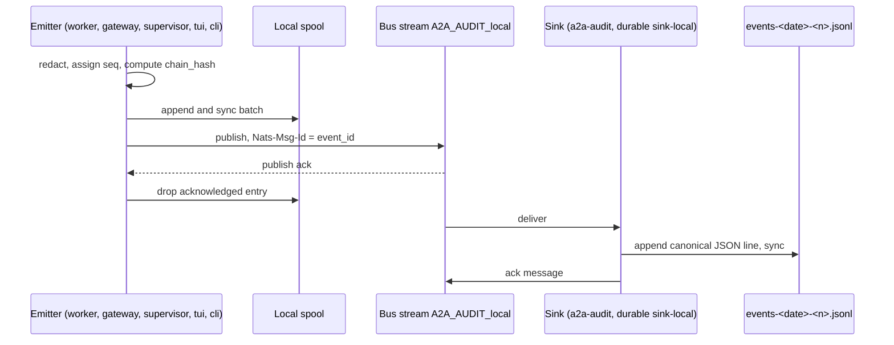

# RFC-0013: Observability and Audit

| Field | Value |
|---|---|
| Status | Proposed |
| Depends on | RFC-0001 (L17 audit subject, seam `AuditSink` rule 0001-006, crate `a2a-audit`); RFC-0002 (`A2AB-Msg-Id`, `traceparent`, L1 payload encoding); RFC-0004 (presence changes); RFC-0005 (task states, `seq`, cancel, crash to FAILED); RFC-0006 (approval payload, delegation chain, budget, loop guard); RFC-0007 (Signer, key ids, signature verification results); RFC-0008 (gateway admissions and rejections); RFC-0009 (Backend usage reports); RFC-0010 (NATS permissions, JetStream stream config); RFC-0011 (`Bus` seam); RFC-0012 (supervisor lifecycle, workspaces, operator actions) |
| Owner area | Audit model and sink (`a2a-audit`), metrics and health endpoints, log output |
| Related interop notes | `docs/interop/nats.md` sec 2.2 (`Nats-Msg-Id` dedupe window), sec 2.3 (durable consumers), sec 4 (KV and streams), sec 5 (subject permissions); `docs/interop/acp-omp-claude.md` sec 2.8 (`usage_update` is context usage, not billing), sec 2.9 (cancel); `docs/interop/hermes.md` sec 6.2 (loop cap), sec 1.7 (rejections); `docs/requirements.md` sec 2 (Hermes local `a2a_audit.jsonl`), M1-11, R-S5, R-O2, R-O3 |

## 1. Summary

Every fact that matters to an operator (agent lifecycle, task transitions, approvals, budget and loop trips, signature failures, workspace decisions, operator actions) becomes one `a2abus.v1.AuditEvent` published to the durable subject `a2a.v1.<tenant>.audit.<emitter>` and written by a single local JSONL sink. Events are redacted before they are hashed or stored, never carry message or artifact bodies, and are chained per emitter so that edits, deletions and reordering are detectable, with signed checkpoints from the supervisor. The same layer exposes a fixed set of Prometheus-style metrics and two loopback health endpoints, and it defines log levels and correlation identifiers that work on both Windows and Linux.

## 2. Motivation and scope

M1-11 requires one append-only audit stream that is the cross-agent source of truth (requirements.md sec 2). Threats T7, T10 and T15 need approval and dangerous-mode records that cannot be silently altered. R-S5 requires redaction, R-O2 requires W3C trace context across hops, and R-O3 requires Windows and Linux parity.

In scope: event model and types, field rules, subject and stream use, the local spool and JSONL sink with rotation and retention, redaction, hash chain and checkpoints, correlation, metrics, health endpoints, log levels, and the `audit verify` procedure.

Non-goals:

- Billing or invoicing. Budget events (D13) are operational metering only.
- Full-text search or a query UI over audit data. The TUI audit tail (RFC-0012) is a read-only view.
- Long-term archival off host. Cross-host archive is open issue 9.
- Distributed tracing backends. We emit W3C `traceparent`; exporters are out of scope.
- Replacing agent-native logs (omp, Claude Code, Hermes). Their local logs are not audit sources.

## 3. Terminology

Terms not defined in RFC-0001:

- **Emitter**: the component identity that publishes an event (an agent id, `supervisor`, `tui`, or `cli`). It is the `<agent>` token of the audit subject.
- **Spool**: the per-emitter local append-only file that holds events until the bus acknowledges them.
- **Sink**: the single consumer that writes the host's JSONL files (`AuditSink` implementation in `a2a-audit`).
- **Chain**: the per-emitter sequence of `chain_hash` values in which each event commits to its predecessor.
- **Checkpoint**: a signed event that records the latest `seq` and `chain_hash` of every emitter on the host.
- **Redaction rule**: a named transformation (R-A1 to R-A6 in sec 4.4) that removes content and records its id.

## 4. Specification

### 4.1 Event model

- [0013-001] MUST encode every audit event as the `a2abus.v1.AuditEvent` message in `proto/a2abus/v1/audit.proto`. On the bus the payload is its protobuf binary encoding; the canonical JSON form (proto3 JSON mapping) is used in the JSONL sink and in examples. This extends the L1 payload rule to A2A-Bus messages that are not `lf.a2a.v1` messages (see sec 9, open issue 1).
- [0013-002] MUST set on every event: `event_id`, `time`, `seq`, `tenant`, `emitter`, `emitter_kind`, `type`.
- [0013-003] MUST number `seq` per emitter starting at 1, increase it by exactly 1 per event, and persist the high-water mark in the spool so that a restart continues the sequence. A consumer that sees a gap MUST record it; it MUST NOT renumber.
- [0013-004] MUST assign `event_id` as a UUIDv7 (RFC-0001 id rule). `event_id` is the dedupe key (`Nats-Msg-Id`, sec 4.3) and the idempotency key for consumers.
- [0013-005] MUST write `time` as RFC 3339 UTC with millisecond precision and a trailing `Z` (for example `2026-10-26T09:14:03.218Z`). Clock source is the emitter's system clock; no clock correction is applied to already-written events.
- [0013-006] MUST emit each fact from the component that observed it. The supervisor MAY emit process facts about agents it runs. No component emits facts about another component's internal state. A component MUST NOT publish under another emitter's subject.
- [0013-007] MUST use only the enum values in table 4.2. Consumers MUST keep events whose `type` they do not recognise (store the canonical JSON as is) and MUST NOT fail on them.
- [0013-008] MUST restrict `details` to the keys listed for the type in table 4.2. `details` values MUST be strings, booleans, or arrays or objects whose members follow the same rules. Numbers and nulls MUST be refused. Every integer (counts, sequence numbers, sizes, budget amounts) MUST be a decimal string, for example `"first_seq": "42"`.

Table 4.2: event types, emitter, and `details` keys (all keys optional unless marked *).

| Enum value (`AUDIT_EVENT_TYPE_*`) | Emitter | `details` keys |
|---|---|---|
| `AGENT_STARTED` | supervisor | `pid`, `backend`, `workspace_mode` |
| `AGENT_STOPPED` | supervisor | `reason` (`graceful`, `forced`, `exited_during_drain`), `exit_code` |
| `AGENT_RESTARTED` | supervisor | `attempt`, `backoff_ms`, `previous_reason` |
| `AGENT_ABANDONED` | supervisor | `failures_in_window`, `window_s` |
| `AGENT_PRESENCE_CHANGED` | worker (050) | `from_state`, `to_state` (RFC-0004 presence states) |
| `DANGEROUS_MODE_ACTIVE` | supervisor | `approval_mode`, `reason` (RFC-0012 sec 4.10) |
| `START_REFUSED` | supervisor | `reason` (`credential_acl`, `shared_checkout`, `path_too_long`, `config`) |
| `TASK_SUBMITTED` | worker | `origin` (`gateway`, `bus-local`, `operator`), `peer` (configured name only) |
| `TASK_STATE_CHANGED` | worker | `from_state`*, `to_state`* (RFC-0005 `TASK_STATE_*` values), `seq` (RFC-0005 task sequence) |
| `TASK_CANCEL_REQUESTED` | worker | `requested_by` (`operator`, `peer`, `supervisor`) |
| `DELEGATION_ISSUED` | worker | `to_agent`*, `budget_remaining_hop`, `depth` (RFC-0006 chain) |
| `APPROVAL_REQUESTED` | worker | `request_id`*, `tool`, `risk_tier`, `expires_at`, `args_summary` (R-A2, 023) |
| `APPROVAL_DECIDED` | worker | `request_id`*, `decision` (`approve_once`, `approve_task`, `deny`, `expired`), `decision_id`, `signature_status` (`verified`, `unsigned`, `failed`), `key_id` |
| `BUDGET_DEBITED` | worker | `budget_kind`*, `amount`*, `remaining` (decimal strings) |
| `BUDGET_TRIPPED` | worker | `budget_kind`*, `limit`, `reason` (RFC-0006) |
| `LOOP_TRIPPED` | worker | `limit`, `count` (RFC-0006 loop guard; Hermes peers see REJECTED) |
| `SIGNATURE_FAILED` | worker or gateway | `component`*, `key_id`, `reason` (`unknown_key`, `bad_signature`, `expired_key`) |
| `PEER_REJECTED` | gateway | `reason` (`auth`, `rate_limited`, `untrusted_peer`, `payload_too_large`), `peer` (configured name), `count` (coalesced, sec 4.11) |
| `WORKSPACE_CREATED` | worker | `mode`, `kind` (`worktree`, `copy`), `base_commit`, `excluded_count` (copy mode only; decimal string; RFC-0012 [0012-074]) |
| `WORKSPACE_RETAINED` | worker or supervisor (050) | `reason` |
| `WORKSPACE_REMOVED` | worker or supervisor (050) | `reason` |
| `WORKSPACE_REFUSED` | worker or supervisor (050) | `reason` (RFC-0012 codes) |
| `OPERATOR_ACTION` | tui or cli | `action` (`approve_once`, `approve_task`, `deny`, `cancel`, `start`, `stop`), `decision_id`, `outcome` (`acked`, `unknown`, `rejected`) |
| `REDACTION_APPLIED` | worker or gateway (050) | `rules` (JSON object: rule id to count as decimal string; no content, 046) |
| `AUDIT_GAP` | emitter | `first_seq`*, `last_seq`* (decimal strings; one per contiguous discarded range, 015) |
| `AUDIT_CHECKPOINT` | supervisor | `emitters` (object: emitter name to `{"seq": decimal string, "chain_hash": 64 lowercase hex}`), `signed_at` (RFC 3339 UTC, 027) |
| `CARD_DECOMMISSIONED` | worker | `agent_id`* |
| `TASK_TRANSITION_REFUSED` | worker | `task_id`*, `from_state`*, `attempted_state`* (RFC-0005 [0005-006]) |
| `LATE_OUTPUT_DROPPED` | worker | `task_id`*, `state`* (RFC-0005 [0005-007]) |
| `SUBMISSION_DROPPED` | worker (050) | `message_id`*, `reason` (`stale_receipt`) (RFC-0005 [0005-027]) |
| `APPROVAL_FLOOD` | worker | `task_id`*, `open_count`* (RFC-0006 [0006-022]) |
| `APPROVAL_NOT_APPLICABLE` | worker | `request_id`*, `reason` (RFC-0006 [0006-013]) |
| `APPROVAL_AUTO_ALLOWED` | worker | `task_id`*, `tool`*, `tier`*, `mode`* (RFC-0006 [0006-003]) |
| `TRUST_RELOAD_REJECTED` | supervisor | `file`*, `reason`* (RFC-0007 [0007-023]) |
| `MESSAGE_REJECTED` | worker or gateway | `reason`* (verification class, RFC-0007 [0007-043]); a signature failure also emits `SIGNATURE_FAILED` |
| `PERMISSION_VIOLATION` | supervisor | `subject`*, `identity` (RFC-0010 [0010-065]) |
| `PROCESS_LEFTOVER` | supervisor | `agent_id`*, `pid`* (RFC-0009 open issue 15) |

### 4.2 Subjects, stream and transport

- [0013-009] MUST publish each event to `a2a.v1.<tenant>.audit.<emitter>` (L17). `<emitter>` is an agent id, `supervisor`, `tui`, or `cli`. The reserved names `supervisor`, `tui` and `cli` MUST NOT be used as `[[agent]]` ids (RFC-0012 sec 4.1).
- [0013-010] MUST set the publish header `Nats-Msg-Id` to `event_id` (`docs/interop/nats.md` sec 2.2) and MAY set `traceparent` (L2) when the event belongs to a traced task. The payload is the protobuf binary of the event (001).
- [0013-011] MUST grant each emitter publish permission only on its own audit subject, and read permission only to the sink and to operator tools (`tui`, `cli`). No peer agent or gateway peer subscribes to audit subjects. Grants are made by RFC-0010 permissions (`docs/interop/nats.md` sec 5; the allow list means unlisted subjects are denied).
- [0013-012] MUST store audit subjects in one JetStream stream `A2A_AUDIT_<tenant>` with subjects `a2a.v1.<tenant>.audit.>`, limits-based retention, file storage, `max_age` 7 days on the bus, and a duplicate window of exactly 15 minutes (RFC-0010 [0010-025]). Stream creation is owned by the supervisor's bus bootstrap (RFC-0010 configuration).
- [0013-013] MUST treat delivery as at-least-once. Every consumer MUST dedupe on `event_id` and MUST use the per-emitter `seq` to detect gaps.

### 4.3 Local spool and JSONL sink

- [0013-014] MUST write an event to the emitter's local spool (`<state_dir>/audit/spool/<emitter>.jsonl`) and sync it before publishing. An entry is removed from the spool only after the publish ack.
- [0013-015] MUST cap each spool at 64 MiB. When a spool is full, the emitter MUST NOT block task processing. It MUST discard the oldest unacknowledged entries, MUST increment `a2abus_audit_dropped_total`, and when space returns it MUST publish `AUDIT_GAP` events with the discarded `seq` ranges. Discarded entries that are contiguous in `seq` form one pending range; a discard adjacent to a pending range extends that range, so one `AUDIT_GAP` covers one contiguous range, and non-adjacent ranges each get their own `AUDIT_GAP`. Each `AUDIT_GAP` takes the next `seq` of its emitter when published. A discarded event MUST NOT be silently absent: the gap is always recorded.
- [0013-016] MUST implement one JSONL sink per host (the `AuditSink` seam, RFC-0001 rule 0001-006, in `a2a-audit`). The sink is the only writer of `events-*.jsonl`. It consumes the durable consumer `sink-local` (`docs/interop/nats.md` sec 2.3) and acks a message only after its line is written and synced.
- [0013-017] MUST make the sink idempotent: an event whose `seq` is less than or equal to the last `seq` written for its emitter is skipped and counted as duplicate.
- [0013-018] MUST write each line as the JCS (RFC 8785) canonical JSON of the event, including `prev_hash` and `chain_hash`, so the line bytes are reproducible. Files are `<state_dir>/audit/events-<UTC yyyymmdd>-<n>.jsonl`, rotated when the file reaches 64 MiB or at the UTC day boundary, whichever is first. Rotation closes the old file before opening the next.
- [0013-019] MUST sync data to disk at least once per second and after every batch; the maximum loss on power failure is the events written after the last sync, which are still in the spool and are re-delivered.
- [0013-020] MUST keep audit files owner-only: mode `0600` on Linux; on Windows a DACL granting only the current user. On Windows the sink opens files with share-read and share-delete so that readers, rotation and retention are never blocked by an open file.
- [0013-021] MUST apply local retention: delete files older than 90 days, or delete the oldest files while the total exceeds 1 GiB. The total is the sum over all `events-*.jsonl` files, the current file included. The current file is never deleted, so the size rule stops once only the current file remains above the limit. Retention runs at sink start and at each rotation.

### 4.4 Redaction (R-S5, T10)

- [0013-022] MUST apply redaction before an event is hashed, spooled, published or written. Nothing downstream sees an unredacted value.
- [0013-023] MUST apply these rules and record each rule id that fired in the `rules` detail of the task's `REDACTION_APPLIED` (046), which is the redactions list; no content is recorded:
  - R-A1: no message text, prompt text, model output, artifact content, diff content, or tool output is ever stored.
  - R-A2: `args_summary` (a field of `details` on `APPROVAL_REQUESTED`, when present) is normalized and limited to 512 characters. R-A2 applies to every string in `details`. Values that look like credentials (assignments to key-like names, bearer tokens, private-key blocks, URL user-info) have the value replaced in place by the marker `[redacted]`. Long high-entropy strings are replaced in place by `[redacted:entropy]`. The detection thresholds (length, entropy, patterns) are those of RFC-0007 [0007-130] and are not restated here.
  - R-A3: absolute filesystem paths are replaced by the workspace id plus a relative path (`<workspace-id>/<relative>`), by `<workspace>` when the path is the workspace root, or by `<path>` when the path is outside the workspace or no workspace is known. Operators resolve the id locally in the TUI (RFC-0012 sec 4.10).
  - R-A4: environment variable values are never stored; only names when a name is itself needed.
  - R-A5: credential material (NKey seeds, bearer tokens, operator or peer keys, push secrets) is never stored, not even redacted.
  - R-A6: remote network addresses are omitted; peers are identified only by their configured names.
- [0013-024] MUST keep `details` under 4 KiB after redaction. A longer value is cut and the event sets `truncated = true`.
- [0013-025] MUST NOT include payload bodies in the bus copy or the sink. Attack strings and secret-shaped values are never copied into audit, logs or examples; detections are reported by rule id only.

### 4.5 Hash chain and checkpoints (tamper evidence)

- [0013-026] MUST chain events per emitter. `chain_hash` = lowercase hex SHA-256 over the JCS canonical JSON of the event with `chain_hash` and `signature` removed. `prev_hash` is the previous event's `chain_hash` from the same emitter, or 64 zero characters for `seq` 1.
- [0013-027] MUST emit an `AUDIT_CHECKPOINT` from the supervisor every hour and at clean supervisor shutdown. `details.emitters` is a JSON object keyed by emitter name, with one entry per emitter whose head the supervisor knows (its own included); each value is `{"seq": "<decimal string>", "chain_hash": "<64 lowercase hex>"}`, the emitter's latest `seq` and `chain_hash`. `details.signed_at` is the signing time as an RFC 3339 UTC millisecond timestamp (005). The checkpoint is signed with the supervisor key through the RFC-0007 Signer; the base64url signature is in `signature` and the key id in `key_id`.
- [0013-028] MUST provide `audit verify <file>` (RFC-0012 [0012-054]). It recomputes every `chain_hash` and checkpoint signature in the file, reports the first broken line for an in-place edit, a deletion or a reordering, and exits 0 only when the file verifies; any other outcome uses a non-zero exit code from RFC-0012 [0012-055].
- [0013-029] MUST state the guarantee plainly: the chain detects in-place edit, deletion and reordering within a stream, and checkpoints detect rewriting of the stream prefix after a checkpoint. Verify reports a late `seq` that fills an earlier jump as `SeqOrder` (a break), not as a gap. Not detected: a full rewrite with a recomputed chain and a stolen supervisor key (open issue 2); a deleted tail (lines removed from the end leave no seq jump) unless a later checkpoint covers the removed events; and any rewrite of events after the last checkpoint.

### 4.6 Correlation

- [0013-030] MUST carry, when known: `traceparent` (W3C, unchanged across hops, L2), `context_id`, `task_id`, `message_id` (value of `A2AB-Msg-Id`), `chain` (ordered root-to-leaf list of `agent_id`/`task_id`), and `workspace_id` (the RFC-0012 workspace `<short-id>`: the first 12 hexadecimal characters of the session or task UUIDv7, RFC-0012 sec 4.8). The schema check admits any token of 1 to 64 characters from `[A-Za-z0-9_-]` for `workspace_id`; that check guards against paths and is not a second format.
- [0013-031] MUST use the same `traceparent` for every event of one task, including events emitted by other hops that carry the task's chain.
- [0013-032] MUST write `event_id` into the log line of any log entry that is associated with an audit event, so that logs and audit can be joined.

### 4.7 Metrics (R-O2, R-O3)

- [0013-033] MUST serve Prometheus text exposition at `http://127.0.0.1:9465/metrics` by default (port configurable under `[supervisor]`). The listener MUST bind to a loopback address; any non-loopback bind value MUST be refused at start.
- [0013-034] MUST expose the metrics in table 4.8 with the given types and labels. Label values MUST come from bounded sets: configured agent ids, enum values, and reason codes. Task ids, context ids, message ids, text, paths and peer addresses MUST NOT be labels.
- [0013-035] SHOULD name metrics with the `a2abus_` prefix, the unit as suffix (`_seconds`, `_bytes`), and `_total` for counters. Gauges need no unit suffix; gauges that count things (for example `a2abus_tasks_inflight`) are named without one.

Table 4.8: metrics.

| Name | Type | Labels | Meaning |
|---|---|---|---|
| `a2abus_task_transitions_total` | counter | `agent`, `state` | Task state transitions (`TASK_STATE_*` without prefix) |
| `a2abus_task_duration_seconds` | histogram | `agent`, `outcome` | Submit to terminal time |
| `a2abus_tasks_inflight` | gauge | `agent` | Non-terminal tasks |
| `a2abus_approvals_total` | counter | `agent`, `decision` | Approval decisions including `expired` |
| `a2abus_approval_latency_seconds` | histogram | `agent` | Requested to decided |
| `a2abus_budget_debited_total` | counter | `agent`, `budget_kind` | Debited amount (RFC-0006 units) |
| `a2abus_budget_trips_total` | counter | `agent`, `budget_kind` | Budget trips |
| `a2abus_loop_trips_total` | counter | `agent` | Loop guard trips |
| `a2abus_signature_failures_total` | counter | `component`, `reason` | Verification failures |
| `a2abus_peer_rejections_total` | counter | `reason` | Gateway rejections (coalesced counts) |
| `a2abus_process_state` | gauge | `agent`, `state` | 1 for the current state of each supervised process |
| `a2abus_restarts_total` | counter | `agent` | Restarts |
| `a2abus_workspaces` | gauge | `agent`, `state` | `active` or `retained` |
| `a2abus_workspace_refusals_total` | counter | `reason` | Refusals (RFC-0012 codes) |
| `a2abus_presence_agents` | gauge | `state` | Agents by presence state (RFC-0004) |
| `a2abus_audit_events_total` | counter | `type` | Events emitted |
| `a2abus_audit_dropped_total` | counter | `emitter` | Events dropped from spool overflow |
| `a2abus_audit_sink_lag_events` | gauge | (none) | Stream messages not yet acked by the sink |
| `a2abus_bus_errors_total` | counter | `component`, `kind` | Bus operation errors (`kind` from a fixed list) |

### 4.8 Health endpoints

- [0013-036] MUST serve `GET /healthz` and `GET /readyz` on the same loopback listener as 033. `/healthz` returns 200 while the supervisor loop runs. `/readyz` returns 200 only when the bus is connected, the sink can write, and no spool is above 80% of its cap; otherwise 503.
- [0013-037] MUST return JSON bodies of the form `{"status":"ok","bus":"connected","sink":"writing","agents":{"omp":"ready"}}` with no configuration values, no paths, and no credential names. `status` is `ok` when `/readyz` would return 200 and `unavailable` otherwise; `bus` is `connected` or `disconnected`; `sink` is `writing` or `unavailable`; `agents` maps each configured agent id to its supervisor state label. Both endpoints return this body; `/healthz` returns 200 with it even when `status` is `unavailable`. Health endpoints MUST NOT require authentication and MUST NOT accept writes.

Workers expose no HTTP listener in M1; their health is their presence key (RFC-0004) as seen by `/readyz` and `a2a discover`. Gateway health is its A2A card endpoint and its own `/health` as defined in RFC-0008.

### 4.9 Log levels and output

- [0013-038] MUST use these levels: `error` (an operation failed and needs action); `warn` (degraded or retried); `info` (lifecycle, decisions, refusals; default); `debug` (diagnostic detail without payload); `trace` (wire-level, development only, still redacted). The level is set with the `A2AB_LOG` environment variable, for example `info` or `warn,a2ad=debug`.
- [0013-039] MUST write logs to stderr and to `<state_dir>/logs/<component>.log`, rotated at 10 MiB with 5 files kept. Behavior is identical on Windows and Linux; no ANSI sequences in files.
- [0013-040] MUST NOT log seeds, tokens, provider key values, decision signatures (log `key_id` only), payload bodies, or absolute paths outside the state directory. The redaction rules of sec 4.4 apply to log fields too.

### 4.10 Required emission points

- [0013-041] MUST emit `APPROVAL_DECIDED` for every decision including `expired` (RFC-0012 045), with `signature_status`. A decision whose signature failed MUST still be recorded as `SIGNATURE_FAILED` and MUST NOT be applied.
- [0013-042] MUST emit `DANGEROUS_MODE_ACTIVE` at each start of an agent in a dangerous mode (RFC-0012 051).
- [0013-043] MUST emit `BUDGET_DEBITED` once per hop at task terminal and `BUDGET_TRIPPED` at the moment of a trip. Per-token or per-message debits MUST NOT produce events. Usage numbers come from RFC-0009 usage reports; ACP `usage_update` values are context usage, not billing (`docs/interop/acp-omp-claude.md` sec 2.8), and MUST NOT be debited as money.
- [0013-044] MUST emit `LOOP_TRIPPED` with the loop guard limit and count. The reply to the peer is the RFC-0006 error; the audit event never includes the message body.
- [0013-045] SHOULD emit `OPERATOR_ACTION` for every operator decision and cancel, with `outcome = unknown` when no ack arrived (RFC-0012 050). The operator identity is the operator key id, not a name typed in the UI.
- [0013-046] MUST emit `REDACTION_APPLIED` at most once per task, at task terminal, when any redaction rule fired for that task. Its `rules` detail is a JSON object mapping each rule id that fired (R-A1 to R-A6) to its number of firings as a decimal string. The event carries no other count and no content.

### 4.11 Coalescing and rate limits

- [0013-047] MUST coalesce `PEER_REJECTED` events: rejections are counted per (peer, reason) in a window of 10 seconds that opens at the first rejection. One `PEER_REJECTED` event per window is emitted when the window closes, with `count` equal to the total rejections in that window, including the first. A window still open at clean shutdown is emitted then. Coalescing prevents audit flooding by an unauthenticated caller (T12) while counts remain accurate in metrics.
- [0013-048] MUST NOT coalesce any other event type. Approval, budget, loop, signature and lifecycle events are always recorded.

### 4.12 Retention summary

- [0013-049] MUST keep the bus stream for 7 days (0013-012), the spool until acknowledged, the JSONL files for 90 days or 1 GiB (0013-021), and the logs for 5 rotated files (0013-039).
- [0013-050] MUST emit the types that table 4.2 lists with two emitter kinds from the component named here: `AGENT_PRESENCE_CHANGED` from the worker of the agent whose presence changed; `REDACTION_APPLIED` from the worker that owns the task, or from a gateway only for redactions it applied to its own events of that task; `SUBMISSION_DROPPED` from the worker that received the submission (RFC-0005 [0005-027]); `WORKSPACE_RETAINED` and `WORKSPACE_REMOVED` from the worker when it acts at task end, and from the supervisor when it acts at agent stop or on an operator action; `WORKSPACE_REFUSED` from the worker when refused while a task acquires its workspace, and from the supervisor when refused at agent start.
- [0013-051] MUST keep a consumer-observed sequence gap (a jump in a stream that the sink sees, `SeqGap`) durable as a `warn` log line in the sink's log under `<state_dir>/logs/` (039), with the emitter, `first` and `last`. The consumer MUST NOT write an `AUDIT_GAP` into the audit files or the stream: only the emitter publishes under its subject (006), and the emitter's own chain must not be altered. The in-memory accessor `take_gaps()` is the source of that line, not the record itself. The emitter-side record of a spool discard is the `AUDIT_GAP` of 015.

Normative and advisory split: sec 4 IDs are normative. The default log text format, JSON field order of logs, and the dashboards are advisory.

## 5. Interoperability

- **Stock A2A peer**: sees none of this. Audit uses only bus subjects and a stream that peers have no permission to read (011). A stock A2A HTTP client never sees `traceparent` changes beyond the W3C header it already may send.
- **Hermes** (`docs/interop/hermes.md`): Hermes keeps its own local `~/.hermes/a2a_audit.jsonl` (requirements.md sec 2). That file is Hermes' local record; this RFC neither reads nor writes it, and the bus audit stream is the cross-agent source of truth. Hermes rejections seen by the gateway (sec 1.7 error codes, sec 6.2 loop cap) are recorded by the gateway as `PEER_REJECTED` or as the task's `LOOP_TRIPPED` event with the peer's configured name. The Hermes-facing error text is unchanged. The local JSONL on Hermes' side is `[UNVERIFIED]` for exact fields.
- **ACP agents** (`docs/interop/acp-omp-claude.md`): omp and claude-agent-acp emit no audit events; the worker observes their session updates and records only lifecycle, state and usage-report facts. `usage_update` is recorded as context usage (sec 2.8), not billing. Operator cancel is recorded as `TASK_CANCEL_REQUESTED`, and the ACP cancel obligations are unchanged (sec 2.9). No ACP capability is added or removed by this RFC.
- **Gateway** (RFC-0008): emits `PEER_REJECTED` and `SIGNATURE_FAILED`; it adds no fields to A2A messages.

No change is visible to existing clients. The audit subject and stream are new and private; the metrics listener is loopback-only and does not collide with Hermes' port 9900 (`hermes.md` sec 9.3).

## 6. Security considerations

- **T10 metadata leakage**: redaction rules R-A1 to R-A6 (023); no absolute paths on the bus (R-A3); no peer addresses (R-A6); labels bounded (034).
- **T5 credential leakage**: credential material is never stored (R-A5); logs follow the same rules (040); health bodies carry no config (037).
- **T7 forged or fatigued approval**: approval decisions are always recorded with signature status (041); expiry is recorded as denial (RFC-0012 045).
- **T15 native-mode bypass**: dangerous-mode starts are recorded at each start (042).
- **T12 gateway attack surface**: coalescing (047) prevents a flood of auth failures from filling the stream while counts remain in metrics.
- **Forging events from another emitter**: prevented by per-subject publish permissions (011). A component that is compromised could still write its own events; chains and checkpoints detect later edits (026, 027).
- **Editing the local files**: detected by verify (028) within the limits of 029. Not detected: a deleted tail with no later checkpoint, a full recomputed rewrite with a stolen supervisor key, and events rewritten after the last checkpoint. A late `seq` that fills an earlier jump is a `SeqOrder` break, not a gap.
- **Spool and disk exhaustion**: caps (015, 021) with counted drops, never silent loss.
- **Loopback-only listener**: 033 forbids binding metrics to a non-loopback address, so metrics are not a remote surface.
- **Windows file sharing**: share-delete (020) keeps rotation and operator tooling from being blocked by an open audit file.

## 7. Rationale and alternatives

- **One subject per emitter** (`audit.<emitter>`) instead of a single subject: enables per-emitter publish permissions with the allow-list model of `docs/interop/nats.md` sec 5, which cannot restrict by payload. A single subject would let any emitter forge another's events.
- **Spool before publish**: the bus can be down; the spool guarantees the event exists locally before the action it describes is visible to a peer. Alternative of publishing only, rejected because a bus outage would lose events.
- **Per-emitter chains** instead of one global chain: emitters run independently and concurrently; a global chain would need a serialized writer. Cross-emitter order is recovered by checkpoints and timestamps.
- **Protobuf payload with JSON in the sink**: follows L1 and proto/AGENTS.md (canonical JSON required for extension payloads), and gives JCS-stable lines for hashing.
- **Coalescing rejected-peer events** instead of sampling: counts stay exact in metrics, and every distinct reason still appears in the stream.
- **Prometheus text over an OpenMetrics-only format**: widely readable on both platforms with no extra dependency.
- **Loopback-only metrics**: avoids a second authenticated surface in M1.

## 8. Conformance

| ID | Test idea | Level |
|---|---|---|
| 0013-001 | Round-trip binary and canonical JSON encodings of each enum example; decoders accept both | Unit |
| 0013-002 | Event without any required field is rejected by the emitter helper | Unit |
| 0013-003 | Restart mid-stream continues `seq` from spool high-water mark; gap detection fires on removed line | Integration |
| 0013-004 | Event ids are UUIDv7 and unique over 10000 emissions | Unit |
| 0013-005 | Timestamps match the RFC 3339 UTC millisecond pattern with trailing Z | Unit |
| 0013-006 | Publishing under another emitter's subject fails under the RFC-0010 permission fixture | Integration |
| 0013-007 | Unknown enum value stored verbatim by the sink; sink keeps running | Unit |
| 0013-008 | Each type's `details` keys match table 4.2; numbers and nulls are refused; integers are decimal strings | Unit |
| 0013-009 | Each emitter publishes only to `a2a.v1.<tenant>.audit.<emitter>`; reserved ids rejected in config | Integration |
| 0013-010 | Published message has `Nats-Msg-Id` equal to `event_id`; redelivery is deduped | Integration |
| 0013-011 | Peer identity cannot subscribe to `a2a.v1.<tenant>.audit.>` (fixture) | Integration |
| 0013-012 | Stream exists with subjects, file storage and `max_age` 7 days | Integration |
| 0013-013 | Duplicate delivery yields one sink line; gap recorded | Integration |
| 0013-014 | Event present in spool before publish; removed after ack (kill test between steps) | Integration |
| 0013-015 | Full spool increments dropped counter; one `AUDIT_GAP` per contiguous range published on recovery with correct range; non-adjacent ranges give separate events | Integration |
| 0013-016 | Sink acks only after line sync (fault injection on sync) | Integration |
| 0013-017 | Event with seq at or below last written is skipped and counted | Unit |
| 0013-018 | Line bytes equal JCS output; rotation at 64 MiB and at UTC midnight (fake clock) | Unit |
| 0013-019 | Power-cut simulation loses no acked event; unsynced events re-delivered | Integration |
| 0013-020 | Linux mode 0600; Windows DACL owner-only; readers can open file while sink writes (share-delete) | Integration (Windows and Linux) |
| 0013-021 | Retention deletes oldest by age and size; never the current file | Integration |
| 0013-022 | Fixture with secret-shaped values: none appears in spool, bus payload or sink | Integration |
| 0013-023 | Each rule R-A1 to R-A6 fires on its fixture and records only its rule id | Unit |
| 0013-024 | Oversized details are cut and `truncated` is true | Unit |
| 0013-025 | Grep of sink, logs and examples for attack fixtures finds nothing | Integration |
| 0013-026 | Verify passes on a generated chain; `chain_hash` recomputed independently matches | Unit |
| 0013-027 | Hourly and shutdown checkpoints verify with the supervisor public key; `emitters` and `signed_at` have the 027 shapes | Integration |
| 0013-028 | Verify reports first broken line for an edit, a deletion and a reordering; exit codes match | Integration (Windows and Linux) |
| 0013-029 | Documented limit tests: full recomputed rewrite passes verify; deleted tail passes without a later checkpoint; late seq filling a jump reports `SeqOrder` | Manual |
| 0013-030 | Task events carry context id, task id, message id, chain and workspace id when known | Integration |
| 0013-031 | All events of one task share one traceparent across two hops | Integration |
| 0013-032 | Log line for an audited action includes its `event_id` | Unit |
| 0013-033 | Listener refuses non-loopback bind at start; metrics served on loopback | Integration (Windows and Linux) |
| 0013-034 | Label cardinality check: no label carries task, context, message ids, text or paths | Unit |
| 0013-035 | Metric names follow `_total`, `_seconds` and prefix rules (lint over table 4.8) | Unit |
| 0013-036 | `/readyz` returns 503 when bus disconnected, sink not writable, or spool above 80% | Integration |
| 0013-037 | Health bodies match the shape and contain no paths or config names | Unit |
| 0013-038 | `A2AB_LOG` levels filter as stated; default is info | Unit |
| 0013-039 | Log rotation at 10 MiB keeps 5 files; no ANSI in files on Windows and Linux | Integration (Windows and Linux) |
| 0013-040 | Secret fixtures never appear in logs (grep over captured stderr and files) | Integration |
| 0013-041 | Expired approval produces `APPROVAL_DECIDED` with `expired`; bad signature produces `SIGNATURE_FAILED` and no decision applied | Integration |
| 0013-042 | Dangerous-mode start emits `DANGEROUS_MODE_ACTIVE` each time | Integration |
| 0013-043 | One `BUDGET_DEBITED` per hop per task; no event per usage update | Integration |
| 0013-044 | Loop trip emits `LOOP_TRIPPED` with no message body | Integration |
| 0013-045 | Cancel from TUI emits `OPERATOR_ACTION` with key id; unacked decision shows `unknown` | Integration |
| 0013-046 | `REDACTION_APPLIED` appears at most once per task, at terminal, with `rules` counts as decimal strings | Unit |
| 0013-047 | 100 rejections in one window from one peer produce one event at window close with count 100 | Unit |
| 0013-048 | Approval, budget, loop, signature and lifecycle events are never coalesced | Unit |
| 0013-049 | Retention settings match the stated values in the config defaults | Unit |
| 0013-050 | Each two-kind type in table 4.2 is emitted only by the component named in 050 | Unit |
| 0013-051 | Consumer-observed gap is logged at warn with emitter, first and last; sink writes no AUDIT_GAP | Integration |

## 9. Open issues

1. **Payload encoding rule**: L1 names `lf.a2a.v1` messages; this RFC applies the same binary-protobuf rule to `a2abus.v1.AuditEvent`. Default: accept; the integrator should widen L1 wording or confirm.
2. **Off-host checkpoints**: a stolen supervisor key plus a full rewrite is undetected (029). Default: keep checkpoints also in the bus stream (they are, as events) and defer off-host anchoring.
3. **Cross-host audit**: the sink is per host; multi-host audit is out of M1. Default: each host's stream is separate; RFC-0010 defines any bridge.
4. **Bus retention vs local retention**: bus 7 days, local 90 days or 1 GiB. Default as stated; tune in RFC-0010 if disk budgets differ.
5. **Hermes local audit format**: `[UNVERIFIED]` exact fields of `~/.hermes/a2a_audit.jsonl` on Windows. Default: not consumed.
6. **Metric port**: 9465 is a default chosen to avoid Hermes 9900 and common ports. Default: configurable under `[supervisor]`.
7. **Spool cap**: 64 MiB per emitter. Default; revisit after measuring event sizes.
8. **Reserved emitter ids**: `supervisor`, `tui`, `cli` must be added to the RFC-0012 reserved list (requested in the final message).
9. **Archival and export**: no export format beyond the JSONL lines in M1. Default: JSONL with canonical JSON is the export.
