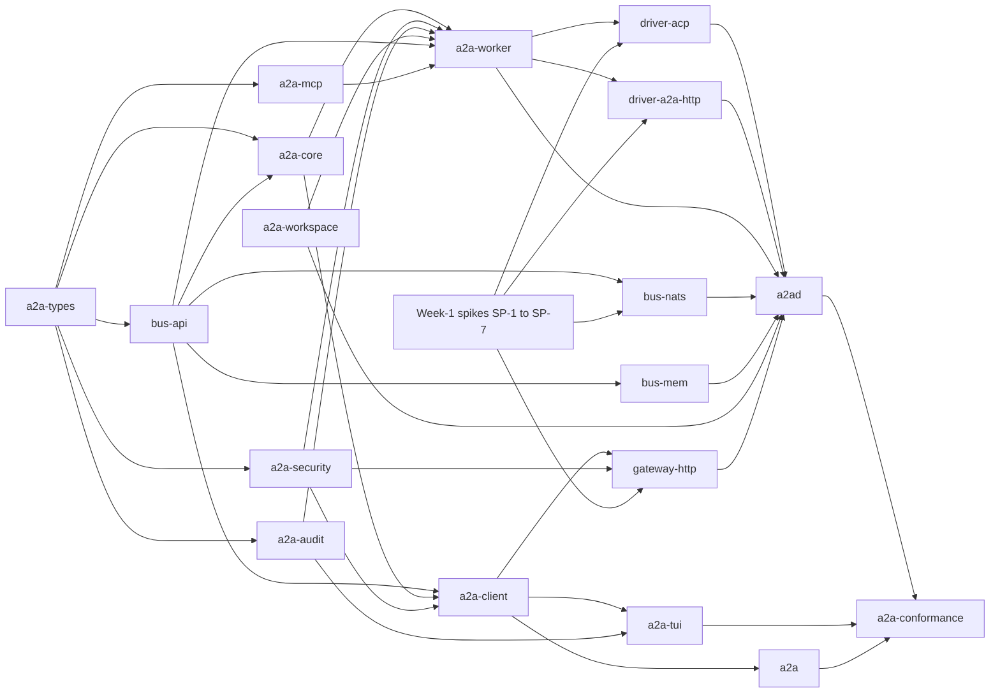

# RFC-0014: Milestone 1 plan

| Field | Value |
|---|---|
| Status | Proposed |
| Depends on | RFC-0000, RFC-0001, RFC-0002 to RFC-0013 |
| Owner area | Milestone 1 plan: scope, build order, spikes, gate (integrator-facing) |
| Related interop notes | `docs/interop/a2a-spec-notes.md`, `docs/interop/acp-omp-claude.md`, `docs/interop/hermes.md`, `docs/interop/nats.md` |

Normative language follows RFC-0000 section 1 (BCP 14). Requirement IDs are `[0014-NNN]`, zero-padded and never renumbered. Cross-RFC references use `RFC-NNNN [NNNN-xxx]`.

## 1. Summary

Milestone 1 (M1) is a single-tenant, single-host A2A-Bus with three agents (omp, claude-agent-acp, Hermes through its gateway) and one external stock A2A client, running on Windows and Linux under one supervisor.
This RFC defines when M1 is done: the nine scenarios of `docs/requirements.md` section 5.3 as concrete, testable acceptance cases, plus negative scenarios.
It fixes the build order and per-crate work slices, the first-week spike plan for unverified items that could change a normative RFC, the conformance strategy, the risks, and the checklist that gates RFC-0001 through RFC-0013 moving from Draft to Accepted.
It defines no wire behavior; where a case depends on a rule, the owning RFC is cited and not restated.

## 2. Motivation and scope

M1 proves the architecture of RFC-0001 end to end on the two first-class platforms before any cross-host work begins.
It exercises every locked decision that M1 needs (L1 to L17 of RFC-0001 section 4.6) and every binding that M1 ships (`bus-nats`, `bus-mem`, the HTTP gateway, the ACP drivers).

### 2.1 In scope

The M1 requirements are `docs/requirements.md` M1-1 to M1-11.
This plan maps them to acceptance cases in section 4.2 and to the risks in section 4.6.

Specific in-scope items:

- One supervisor (`a2ad`) that starts, stops and contains the bus, the workers, the gateway and the external agent (RFC-0012).
- Workers for omp and claude-agent-acp over ACP (RFC-0009, `driver-acp`).
- A worker for Hermes through `driver-a2a-http` (RFC-0008, RFC-0009).
- The HTTP gateway for stock A2A clients and Hermes (RFC-0008).
- The NATS plus JetStream binding (RFC-0010) and the in-memory reference binding (RFC-0011, `bus-mem`).
- Approval, budgets and loop control (RFC-0006), identity and trust at the single-host level (RFC-0007), audit to one JSONL sink per host (RFC-0013).

### 2.2 Non-goals

These are out of M1 and MUST NOT be built for M1:

- Cross-machine federation and cross-host delivery of tasks.
- Cross-organization trust, accounts per tenant, and a registry service.
- End-to-end payload encryption (RFC-0007 O6 default: none in M1).
- REST or HTTP+JSON beyond the A2A gateway (RFC-0008 O1).
- MCP token delegation; MCP access uses the proxy defaults of RFC-0007.
- Windows service for the broker (RFC-0010 rejects it for M1).
- Bus push notifications (RFC-0002 O-1: webhooks are served by the gateway from the event subject).
- Partition tolerance as a claimed property of `a2a-bus-m1` (RFC-0011 O2).
- Multi-instance presence and failover of task ownership (RFC-0002 O-4, RFC-0004 section 9).

## 3. Terminology

Terms from RFC-0001 section 4.4 are used verbatim.
New terms defined here:

- **Acceptance case**: one numbered scenario in section 4.2 with steps, an assertion and a test tier.
- **Negative case**: an acceptance case whose assertion is that something is refused, denied or not performed.
- **Test tier**: where a case runs. `mem` means `bus-mem` with fault injection; `nats` means `bus-nats` against a real `nats-server` with JetStream; `live` means real agent processes (omp, claude-agent-acp, Hermes) on the host.
- **Spike**: a time-boxed experiment against a real dependency that answers one question from section 4.4. Spike code is throwaway.
- **Gate run**: one execution of every acceptance case and every section 8 row on both platforms, with versions recorded (`[0014-003]`).

## 4. Specification

### 4.1 Exit criteria

- [0014-001] M1 is complete only when every acceptance case in section 4.2 passes on Windows 10/11 x64 and on Linux x64 in one gate run, and every section 8 row marked MUST passes.
- [0014-002] The gate run MUST use `bus-nats` as the bus. Cases marked `mem` also run on `bus-mem` earlier in the build order (section 4.3); a `bus-mem`-only pass does not satisfy the gate.
- [0014-003] The gate run MUST record the exact versions of omp, claude-agent-acp, Hermes, the a2a-sdk Python client, nats-server, async-nats, the Rust toolchain and the pinned `proto/A2A_VERSION`.

Exit also requires: every open issue in section 9 marked "blocks M1" is closed, and the gate checklist in section 4.7 is complete.

### 4.2 Acceptance cases

Each case names its tier. Cases marked `live` MUST run on both platforms. Where the operating system changes the mechanism (job object versus process group), the case asserts the equivalent outcome on each platform.

#### Positive scenarios (requirements section 5.3)

| ID | Scenario | Steps | Assertion | Tier |
|---|---|---|---|---|
| [0014-010] | S1: omp asks Claude Code to review a file | omp sends a delegated task to `claude` through the bus peer-call tool (RFC-0015 [0015-022]; child budget per [0015-055]); claude reads the named file in its worktree | Parent and child both COMPLETED; the child's reply is an artifact containing the review; both tasks share one `context_id`; `hops` is 1 on the child | live |
| [0014-011] | S2: Hermes `a2a_call` to the gateway asks omp, with visible streaming status | Hermes calls the gateway with a streaming send; gateway routes to omp worker | Gateway SSE stream shows at least one WORKING status before COMPLETED; Hermes receives the final artifact; if the Hermes-side rendering of intermediate status fails SP-4, the case still passes on the gateway SSE stream and the limitation is recorded in section 9 | live |
| [0014-012] | S3: Claude Code asks Hermes a research question over the HTTP driver | claude sends to the Hermes agent id; the Hermes worker (`driver-a2a-http`) calls the Hermes A2A endpoint | Claude's task COMPLETED with the Hermes answer; the outbound Hermes request carries `A2A-Version: 1.0` and no `A2A-Extensions` or `urn:a2abus:` metadata (RFC-0009 [0009-040]) | live |
| [0014-013] | S4a: write approval, operator approves | omp requests a write; the worker opens an approval request (INPUT_REQUIRED); the operator approves through the TUI | Task INPUT_REQUIRED, then WORKING, then COMPLETED; the file has the new content; the audit contains the decision with `decided_by` set to the verified operator identity | live |
| [0014-014] | S4b: write approval, operator denies | Same as 0014-013 with a deny decision | The file is unchanged (hash compared before and after); the task ends FAILED with APPROVAL_DENIED if the backend ends the turn unsuccessfully, or COMPLETED without the write if the turn succeeds (RFC-0006 [0006-019]) | live |
| [0014-015] | S4c: write approval, no decision | Same as 0014-013 with no decision until the request expires (default 300 s, shortened by test configuration) | The backend receives `cancelled`; the file is unchanged; the task ends FAILED APPROVAL_TIMEOUT (RFC-0006 [0006-017]); a late decision is refused and changes nothing | live |
| [0014-016] | S5: two agents delegate back and forth | omp and claude alternate delegated tasks with different text; the first return to an agent already in the chain is refused at admission | The return is FAILED LOOP_DETECTED with detail `reentrant` ([0006-059]); an identical (agent, fingerprint) pair gives LOOP_DETECTED ([0006-045]); every child and parent is terminal; no task remains non-terminal | mem and live |
| [0014-017] | S6: kill the bus mid-task and restart | Start a task that is WORKING; kill `nats-server`; wait; restart it | No backend turn is started twice for one admitted `A2AB-Msg-Id` (count backend starts in the audit); the task ends terminal, either COMPLETED once or FAILED with BACKEND_CRASHED; event `seq` is contiguous | nats and live |
| [0014-018] | S7: duplicate submission delivery | Publish the same `A2AB-Msg-Id` and the same `messageId` twice, plus a third delivery after a simulated ack loss | The backend is started once; the second and third deliveries return the existing Task id; events are not duplicated for consumers that dedupe on (task id, seq) | mem and nats |
| [0014-019] | S8: cancel a long task | Start a long WORKING turn; send CancelTask | The turn stops; CANCELED is committed within 15 s of the request (RFC-0005 [0005-037]); if the backend does not acknowledge, the session is killed and CANCELED is still committed; no child process remains | live |
| [0014-020] | S9: stock a2a-sdk client uses omp through the gateway | A pinned Python a2a-sdk client fetches the card from the gateway HTTP view and sends a message | Client receives COMPLETED with an artifact; the client code contains no A2A-Bus-specific logic; the card has the fields of RFC-0003 [0003-029] and no bus URLs (RFC-0008 [0008-015]) | live |

#### Negative scenarios

| ID | Scenario | Steps | Assertion | Tier |
|---|---|---|---|---|
| [0014-021] | N1: publish with another agent's identity | A client with the credentials of agent B publishes a request for agent A | Refused at the bus; no event, no task created; the refusal is audited | nats |
| [0014-022] | N2: two workers on one checkout; workspace root inside checkout | (a) Configure two workers with the same `repo` (b) Configure a worker whose state directory lies inside its `repo` | (a) Both start, each in its own worktree and branch; workspaces do not overlap. (b) The worker refuses to start with `shared_checkout` naming the directory, before any lock or workspace is created (RFC-0012 [0012-031]) | live |
| [0014-023] | N3: unauthenticated gateway request | Send an HTTP request with no or invalid credentials | 401; nothing is published to the bus (RFC-0008, L14) | live |
| [0014-024] | N4: unsupported operation on the bus | Send an operation token that the binding does not define | Refused with an unsupported-operation error; no state change | mem |
| [0014-025] | N5: stale request | Send a request whose `A2AB-Ts` is outside the allowed skew | Refused with REQUEST_EXPIRED; no backend start (RFC-0002 [0002-070] to [0002-073]) | mem and nats |
| [0014-026] | N6: duplicate agent id | Start a second worker with the id of a running worker | The second instance does not serve the card and does not accept tasks (RFC-0004 [0004-025]) | nats |
| [0014-027] | N7: card-driven mode escalation | An agent card or task content asks for a dangerous ACP mode | The mode is ignored; the session stays in the configured mode; a dangerous mode without acknowledgement is refused with `config-refused` (RFC-0009 [0009-064], [0009-065]) | live |
| [0014-028] | N8: supervisor killed | Kill `a2ad` on each platform while all children run | Windows: job object closes and kills the tree; Linux: worker lifeline reads EOF and terminates its process group (RFC-0012 [0012-018], [0012-020]); no agent process remains after shutdown grace | live |
| [0014-029] | N9: worker crash | Kill a worker while its presence is `ready` | Presence expires within 30 s (RFC-0004); requests to that agent are refused with the gateway error RFC-0008 defines for an unavailable agent; the supervisor restarts the worker with backoff (RFC-0012 [0012-011]); in-flight tasks become FAILED BACKEND_CRASHED, not re-run (RFC-0012 [0012-013]) | live |

### 4.3 Build order and work breakdown

- [0014-030] Slices MUST be built in the order of the graph below. A slice MUST NOT start its integration tests until the contract tests of its dependencies pass on `bus-mem`.
- [0014-031] Each slice MUST ship its `AGENTS.md` (RFC-0001 [0001-005]) and the section 8 rows that name it. No slice is complete with its rows missing.
- [0014-032] `bus-nats` MUST NOT be used by a case in section 4.2 until spike SP-3 (section 4.4) has recorded its result in RFC-0010.

Phases and slices (each row is a unit of work with a named exit):

| Phase | Slice | Crate | Owning RFCs | Deliverable | Depends on | Exit |
|---|---|---|---|---|---|---|
| P0 | Spikes | none (throwaway) | 0009, 0010, 0008, 0002, 0003, 0004 | Result notes for SP-1 to SP-7 | none | 0014-040 |
| P1 | Types | `a2a-types` | 0001, 0002, 0005 | Generated A2A and A2A-Bus protobuf types, pinned | none | Compiles on both platforms; rows 0014-030 and 0014-031 |
| P1 | Bus contract | `bus-api` | 0011 | Binding traits, capability flags, error type, M1 profile check | `a2a-types` | 0011-034 and 0011-035 rows in the contract suite |
| P1 | Reference bus | `bus-mem` | 0011 | Deterministic in-process binding with fault injection (drop, duplicate, delay, partition) | `bus-api` | Contract suite green; fault modes in section 4.5 |
| P1 | Core | `a2a-core` | 0005, 0006 | Envelope, subjects, state machine, admission, sequencing, dedupe, budgets, error mapping | `a2a-types`, `bus-api` | Cases 0014-016, 0014-017 (mem), 0014-018 (mem) |
| P2 | Security | `a2a-security` | 0007 | Ed25519 keys, trust file, signing and verification, redaction, provenance marking | `a2a-types` | Rows in RFC-0007 section 8 for keys and trust |
| P2 | Audit | `a2a-audit` | 0013 | Event model, `AuditSink` trait, spool, JSONL sink, dedupe on seq | `a2a-types` | RFC-0013 section 8 rows for spool and sink |
| P2 | Workspace | `a2a-workspace` | 0012 | Worktree policy, refuse-shared-checkout, non-git refuse | none | Case 0014-022 |
| P3 | Worker | `a2a-worker` | 0005, 0006, 0009 | Worker runtime against a `Backend`, outbox, approvals, budgets, mock backend | P1 and P2 crates, `bus-api` | Cases 0014-016 to 0014-018 on mem; mock contract suite (RFC-0009) |
| P3 | ACP driver | `driver-acp` | 0009 | omp and claude-agent-acp backends over stdio | `a2a-worker`, `a2a-types` | Cases 0014-010, 0014-013 to 0014-015, 0014-019, 0014-027 |
| P3 | Peer-call shim | `a2a-mcp` | 0015 | `a2abus-mcp-shim` MCP stdio server (pinned protocol), tool schemas, IPC types and client; the worker-side delegation endpoint is part of the P3 worker slice | `a2a-types` | Case 0014-010 (tool side); RFC-0015 section 8 rows |
| P4 | NATS binding | `bus-nats` | 0010, 0011 | Streams, KV, claims, permissions, JetStream consumers | `bus-api` | Case 0014-017 (nats), 0014-021, 0014-025, 0014-026 |
| P5 | Client | `a2a-client` | 0005, 0002 | Discovery, SendMessage, streaming, resume, cancel | P2 crates, `bus-api` | Case 0014-010 (client side) |
| P5 | HTTP bridge | `driver-a2a-http` | 0008, 0009 | Hermes backend over A2A HTTP; card fetch with fallback | `a2a-worker`, `a2a-types` | Cases 0014-012, 0014-011 (Hermes side) |
| P5 | Gateway | `gateway-http` | 0008 | JSON-RPC server and SSE for bus agents | `a2a-client`, `a2a-security` | Cases 0014-011, 0014-020, 0014-023 |
| P6 | Supervisor | `a2ad` | 0012 | Config, start order, readiness, restarts, drain, containment | P3 to P5 crates, `bus-nats`, `bus-mem`, `a2a-workspace` | Cases 0014-022, 0014-028, 0014-029 |
| P6 | Operator | `a2a-tui`, `a2a` | 0012, 0006 | Approval card, task view, scripted send, watch, cancel | `a2a-client`, `a2a-audit` | Case 0014-013 to 0014-015 (operator path) |
| P7 | Conformance | `a2a-conformance` | 0011, 0009, all | Suites from requirement IDs; boundary check from `cargo metadata` | all | Gate run (0014-001) |

Per-slice notes that are not obvious from the table:

- `a2a-core` is testable on `bus-mem` alone (RFC-0001 [0001-004]); a run that needs NATS in P1 is a defect in the slice.
- `driver-acp` and `driver-a2a-http` MUST NOT depend on each other, the gateway or a bus (RFC-0001 [0001-002]); the boundary check in P7 enforces it.
- The gateway MUST NOT depend on any driver (RFC-0001 [0001-003]); the HTTP client that bridges Hermes lives in `driver-a2a-http` (section 9, item 5).

### 4.4 First-week spike plan

Spikes run in parallel on day one. Each spike is time-boxed to one day unless the owning RFC says otherwise.

- [0014-040] Each spike MUST end with a result note recorded in the owning RFC's open issues (the question, the observed answer, the version tested, and the RFC change or default confirmed). Spike scripts MUST stay committed under `spikes/<spike>/` (the NATS scripts under `spikes/nats/`) as reproducible evidence. They are not production code, are not part of the Rust workspace, and MUST NOT be built by the workspace.
- [0014-041] A spike whose result contradicts a MUST in an RFC MUST block that RFC's move to Accepted until the RFC is revised.

| Spike | Question | Source of the unverified item | Owning RFC to update |
|---|---|---|---|
| SP-1 | Does `omp --mode acp` with `elicitation.form` not advertised block a write tool call until a `session/request_permission` answer? Does `initialize`, `session/new` and `session/load` match the driver fields? | `acp-omp-claude.md` section 3.3, 2.x; RFC-0006 [0006-025], [0006-029]; RFC-0009 open issues O1, O3, O4 | RFC-0009, RFC-0006 |
| SP-2 | Does `claude-agent-acp` install and launch on Windows as `node <absolute entry path>`? Does `session/resume` exist in the pinned version? What does a stop signal do on Windows and what exit code does a kill leave? | `acp-omp-claude.md` sections 4.x and 2.x; RFC-0009 [0009-038], open issues O2, O5; RFC-0012 open issue 6 | RFC-0009, RFC-0012 |
| SP-3 | Does `nats-server` run on Windows as a job-contained child with `store_dir` on a short path? Do per-key KV TTL, the duplicate window (3630 s), the owner-only DACL and the permission-violation read bundle behave as RFC-0010 requires? | `docs/interop/nats.md` sections 2.x, 4.x, 5; RFC-0010 section 4 spike checklist and open issues 1 to 4 | RFC-0010, RFC-0011 |
| SP-4 | Does a Hermes SendMessage round trip work with `A2A-Version: 1.0` and no extension headers? Does `[INPUT_REQUIRED]` appear as text in the reply and is it detectable? Are intermediate statuses visible in streaming? Does `hermes gateway` run A2A on Windows? | `docs/interop/hermes.md` sections 8.3 to 8.5, 9.3, 11; RFC-0009 open issues O8, O9; RFC-0008 open issues O2, O4, O12 | RFC-0008, RFC-0009, RFC-0012 |
| SP-5 | Does `async-nats` build on MSVC and Linux; can it set the inbox prefix (0010-066); does it support ordered consumers with heartbeats and `allow_responses` as configured? | RFC-0010 open issues 4 to 8 | RFC-0010 |
| SP-6 | Read the A2A custom-binding conformance text against the bus. Which of the transition, terminal-immutability, `TASK_STATE_UNSPECIFIED` and error-spelling items in `docs/interop/a2a-spec-notes.md` are normative for the bus? Does the gateway need HTTP 401 and 403 mapped to A2A errors? | `docs/interop/a2a-spec-notes.md` sections 6, 8, 10 (D-6 to D-9); RFC-0002 section 7 conflicts (a) to (d) | RFC-0002, RFC-0008 |
| SP-7 | Does the pinned a2a-sdk Python client fetch the gateway card and send a message with no bus knowledge? Does a card with unknown fields parse? How does the client react to 503 with `Retry-After`? | RFC-0003 open issue 3; RFC-0004 open issue 3; RFC-0008 open issue 4 | RFC-0003, RFC-0004, RFC-0008 |

Spike verdicts (results in `docs/spikes/*.md`; stub-observed results are protocol evidence, not real-model evidence):

- SP-1: verified by spike omp-acp (stub). omp does not use `session/request_permission` for write or read tools; under always-ask it sends `elicitation/create` when the client advertises `elicitation.form`, and denies outright otherwise. Driver advertises `elicitation.form` (RFC-0009). `ask-all` is not declared (D21). Real-model behavior remains UNVERIFIED.
- SP-2: verified by spike claude-acp (stub). Launch and `session/load` work; `session/resume` works; `CLAUDE_CONFIG_DIR/settings.json` sets `defaultMode`; process cleanup observed (stdin close exit 0; terminate, kill and taskkill exit 1; CTRL_BREAK exit 0xC000013A). Real-model Q4 to Q8 and Q10 remain UNVERIFIED.
- SP-3: verified by spike nats (nats-server v2.15.2) for the items it covers; see `docs/spikes/nats.md` and AmendNats' RFC-0010/0011 changes.
- SP-4: verified by spike hermes-a2a (stub, Hermes v0.22.5). Standalone profile required; SendMessage and SSE work; INPUT_REQUIRED detectable from the enum; cross-peer contextId shares history; error deviations confirmed. Unobserved items are listed in RFC-0008 section 9, item 13.
- SP-5: verified by spike nats (async-nats 0.50.0 builds on MSVC).
- SP-6: verified by spike a2a-binding-conformance (text reading and stub checks); GAP items assigned to RFC-0002 and RFC-0008.
- SP-7: no result in `docs/spikes/`; remains open.

Residual real-model re-runs (not yet observed): omp write allow and reject under always-ask, usage, cancel, and resume with a completed turn; claude Q4 write allow and reject, Q5 usage, Q6 cancel, Q7 resume, Q8 advertise, Q10 `claude -p`.

### 4.5 Test levels and conformance mapping

- [0014-050] Every section 8 row MUST be run at one of these levels, and the level MUST be recorded with its result: `contract` (against a trait or mock in one crate), `integration` (multiple processes on one host), `live` (real agent processes), `interop` (stock or pinned external clients), `fault` (injected faults on `bus-mem` or `bus-nats`).
- Fault modes required by the `mem` tier: drop, duplicate, delay and partition, as named in RFC-0001 section 4.2 for `bus-mem`.
- The `a2a-conformance` crate (RFC-0001) owns the suite. Rows are keyed by requirement ID; a test that asserts no requirement ID is not conformance.

### 4.6 Risks register

Likelihood and impact are H, M or L. Mitigations link to spikes or cases.

| Ref | Risk | L | I | Mitigation | Trigger that changes the plan | Owner |
|---|---|---|---|---|---|---|
| RK-1 | omp does not gate writes under ACP without elicitation (0006-029 fails) | M | H | SP-1 (stub) observed the elicitation path; the driver advertises `elicitation.form` and answers `elicitation/create`; `ask-all` is not declared; the driver fails the task on unanswered calls (0006-025). Real-model run still required | SP-1 failure in the real-model run | RFC-0009 driver |
| RK-2 | NATS per-key KV TTL or JetStream behaviour on Windows differs from RFC-0010 | M | H | SP-3 before any `bus-nats` integration (0014-032); fallback is bucket-level TTL with periodic re-claim | SP-3 failure | RFC-0010 |
| RK-3 | claude-agent-acp on Windows does not launch under `node` or does not stop cleanly | H | M | SP-2 (stub) observed launch and stdin-close exit 0; forced kill at `grace_ms` (RFC-0012 0012-061 and open issue 6) | SP-2 failure or a non-zero exit on stdin close in the real-model run | RFC-0009, RFC-0012 |
| RK-4 | Hermes does not expose `[INPUT_REQUIRED]` reliably; approvals from Hermes are not detected | M | M | SP-4; detection is enum-only (0009-048); Hermes-side approval is out of the S-cases if not detectable, and the limitation is recorded | SP-4 failure | RFC-0008, RFC-0009 |
| RK-5 | Stock a2a-sdk rejects extra card fields or the gateway card shape | M | M | SP-7; `[UNVERIFIED]` card tolerance (RFC-0003 open issue 3) | SP-7 failure | RFC-0003 |
| RK-6 | Duplicate delivery re-runs a turn after a bus restart | L | H | Case 0014-017 and 0014-018; claims and `A2AB-Msg-Id` admission (0005-023, 0005-024) | Any duplicate start | RFC-0005 |
| RK-7 | Windows long paths under the state directory break the NATS store | M | M | SP-3 checks `LongPathsEnabled`; short store path under `<state_dir>` (RFC-0010 open issue 2) | SP-3 | RFC-0010, RFC-0012 |
| RK-8 | Event retention (7 d) is shorter than some non-terminal task lifetimes | L | M | GetTask fallback (RFC-0010 open issue 10); deadline default 3600 s (0005-040) | Task older than retention | RFC-0002, RFC-0010 |
| RK-9 | Approval fatigue or flooding from one agent | M | M | Coalescing, per-task cap and decision rate (0006-021, 0006-022, 0006-023) | Measurement after M1 | RFC-0006 |
| RK-10 | Scope creep into cross-host behaviour | M | H | Non-goals in section 2.2; boundary check in P7 | Any cross-host code path | Integrator |
| RK-11 | Multiple open RFC conflicts block acceptance late | H | M | Section 9 lists each with a default; gate checklist in section 4.7 is worked from week one | Conflicts unresolved at week 3 | Integrator |

### 4.7 RFCs accepted gate checklist

- [0014-060] An RFC MUST NOT move to Accepted until every line for it below is checked. The integrator performs the status change.

- [ ] RFC-0001: integrator ruling applied (reserved ids `gateway`, `tui`, `cli`, `supervisor`; HTTP client bridge in `driver-a2a-http`; progress extension; `a2abus.failure` key; widened L1 for audit payload); `proto/A2A_VERSION` pinned.
- [ ] RFC-0002: error domain per section 9, item 1 in [0002-090]; conflicts (a) to (d) of RFC-0002 section 7 resolved; SP-6 result recorded; O-9 (ev read authorization) closed or scheduled as a blocker.
- [ ] RFC-0003: open issue 4 closed with `capabilities.streaming` true (section 9, item 3); SP-7 result recorded; Hermes card tolerance result recorded.
- [ ] RFC-0004: R-F2 versus L6 settled (section 9, item 4); SP-7 503 result recorded; presence expiry test planned for case 0014-029.
- [ ] RFC-0005: transition `(create) -> FAILED LOOP_DETECTED` confirmed (RFC-0006 section 9 request 1); open issue 2 states the retention rule of section 9, item 7; SP-6 result recorded.
- [ ] RFC-0006: approval field names confirmed with RFC-0012 (section 9, item 14); SP-1 result recorded for 0006-025 and 0006-029.
- [ ] RFC-0007: [0007-141] error domain changed to `a2abus.v1` (section 9, item 1).
- [ ] RFC-0008: SP-4 result recorded (stub); unobserved Hermes items listed in section 9, item 13; `[UNVERIFIED]` items O2, O4, O12 recorded with their defaults; binary name settled with RFC-0012 (section 9, item 13).
- [ ] RFC-0009: PEER_* split from BackendAuthor merged and consistent with 0009-051 and 0009-072; SP-1 and SP-2 results recorded; SP-4 result recorded.
- [ ] RFC-0010: [0010-025] matches section 9, item 2 exactly; open issue 10 states the retention rule of item 7; SP-3 and SP-5 results recorded; open issues 1 to 4 and 17 closed or defaulted.
- [ ] RFC-0011: O2 partition-tolerance wording confirmed (not claimed in M1); O7 read authorization recorded against RFC-0010.
- [ ] RFC-0012: open issues 1 to 6 defaulted or resolved; CTRL_BREAK result from SP-2 (claude 0xC000013A, nats-server exit 0) recorded.
- [ ] RFC-0013: [0013-012] matches section 9, item 2 exactly; L1 wording covered by RFC-0001 (item 6); reserved emitter ids (RFC-0001 section 4.4, item 16); spool and sink rows run.
- [ ] Every section 9 item marked "blocks M1" is closed.

### 4.8 Test tiers for the gate

- [0014-070] Every threat in section 6 MUST map to at least one case in section 4.2 or one row in section 8, and the mapping MUST be present in the gate report.

## 5. Interoperability

M1 interop is tested against three external parties:

- A pinned stock a2a-sdk Python client (case 0014-020, SP-7).
- Hermes as a real A2A v1.0 HTTP peer (cases 0014-011 and 0014-012, SP-4). Hermes is not patched (requirements M1-4).
- omp and claude-agent-acp as ACP agents (cases 0014-010, 0014-013 to 0014-015, SP-1 and SP-2).

Each external behavior claim used by a case MUST cite `docs/interop/*.md`. A claim marked `[UNVERIFIED]` in those notes MUST NOT be relied on by a case until its spike has recorded a result (0014-040).

The bus is not an external interop surface in M1; no case has a non-NATS third-party client on the bus.

## 6. Security considerations

Threats are the T-numbers of `docs/requirements.md` section 8. Each row names the cases or rows that verify the control. No attack strings are quoted here; the test fixtures live with the suites.

| Threat | Control (owning RFC) | Verified by |
|---|---|---|
| T1 prompt injection through agent or peer text | Agent-originated marking; approvals only from operator identity; no bus-driven mode change (RFC-0009, RFC-0006 [0006-014]) | 0014-013, 0014-027 |
| T2 confused deputy | Delegation by reference, scoped capability (RFC-0007) | 0014-010, 0014-016 |
| T3 ping-pong and cost runaway | Hops, depth, loop rule, breaker (RFC-0006) | 0014-016 |
| T4 replay | Admission keys and staleness window (RFC-0002, RFC-0005) | 0014-018, 0014-025 |
| T5 credential leak | Redaction and no credentials in envelopes (RFC-0007, RFC-0009 [0009-069] to [0009-071]) | 0014-021, 0014-023 |
| T6 impersonation | Per-agent identity and bus permissions (RFC-0010, RFC-0007) | 0014-021 |
| T7 forged approval | Operator identity and single-use nonce (RFC-0006 [0006-013] to [0006-015]) | 0014-013 to 0014-015 |
| T8 poisoned discovery | Card only from the owning identity (RFC-0004 [0004-038]) | 0014-026 |
| T9 flooding | Coalescing and caps (RFC-0006 [0006-021] to [0006-023]) | 0014-016 |
| T10 metadata leak | Redacted summaries in audit (RFC-0013, L17) | Gate report scan |
| T11 stale authority | Expiry wins; deadlines owned by the worker (RFC-0005 [0005-035]) | 0014-015 |
| T12 gateway attack surface | Authenticate before publish (RFC-0008, L14) | 0014-023 |
| T13 concurrent writes | Isolated working directories (RFC-0012, L16) | 0014-022 |
| T14 driver confused deputy | Driver cannot reach the bus; no fs or terminal capability | 0014-027, 0014-028 |
| T15 approval bypass via modes | Permission modes fixed; no `yolo`; no accept-all modes (RFC-0006 [0006-025] to [0006-026]) | 0014-027 |

- [0014-071] Every threat row above MUST keep its verifying case in the gate run; removing a case requires a change to this table.

## 7. Rationale and alternatives considered

- **Bus-mem before NATS.** Core behaviour (admission, state machine, budgets) is testable without a network, which isolates logic errors from broker behaviour. Rejected alternative: NATS first, which mixes domain defects with broker defects.
- **Worker before drivers.** Drivers implement a `Backend` (RFC-0009) that the worker owns; building the worker's contract first makes the driver contract suite the same for omp, claude and Hermes.
- **Spikes in week one.** Four of the M1 risks (RK-1 to RK-4) can invalidate an RFC's normative text. Finding out in week one is cheaper than after the drivers exist.
- **Windows and Linux in every gate run.** Both are first-class (requirements). Rejected alternative: Linux-only gate with Windows as a later port; it would hide job-object and path defects until integration.
- **Hermes through HTTP, not a patched Hermes.** Requirements M1-4 forbids a Hermes patch; RFC-0008 L15 keeps the wire shape A2A v1.0.
- **No cross-host case in M1.** Cross-host needs signing as required (RFC-0007 L11) and transfer design (RFC-0010 open issue for transfers); both are post-M1.

## 8. Conformance

| Requirement ID | Test idea | Level |
|---|---|---|
| [0014-001] | Run every case in 4.2 and every MUST row on Windows and Linux in one gate run; compare to the report template | MUST |
| [0014-002] | Gate run configuration asserts `bus-nats` as the bus; a run with `bus-mem` only is rejected by the gate script | MUST |
| [0014-003] | Gate report contains the version fields of 0014-003; a report missing any field fails | MUST |
| [0014-010] | live: S1 with real omp and claude; artifact content and task chain checked | MUST |
| [0014-011] | live: S2 with Hermes; gateway SSE shows WORKING before COMPLETED | MUST |
| [0014-012] | live: S3; request headers to Hermes checked for absence of extension metadata | MUST |
| [0014-013] | live: S4a approve path; file hash changed; audit `decided_by` verified | MUST |
| [0014-014] | live: S4b deny path; file hash unchanged; terminal state per RFC-0006 [0006-019] | MUST |
| [0014-015] | live: S4c no-decision path; backend receives `cancelled`; FAILED APPROVAL_TIMEOUT; late decision refused | MUST |
| [0014-016] | mem and live: two agents alternate; LOOP_DETECTED observed for the re-entrancy rule ([0006-059]) and for an identical (agent, fingerprint) pair ([0006-045]); all tasks terminal | MUST |
| [0014-017] | nats and live: kill and restart the bus mid-turn; backend start count per admitted message is at most 1 | MUST |
| [0014-018] | mem and nats: three deliveries of one submission; one backend start; one Task id | MUST |
| [0014-019] | live: S8 cancel; CANCELED within 15 s; no child process after cancel | MUST |
| [0014-020] | interop: pinned a2a-sdk client; card fetched; message completed; no bus-specific import | MUST |
| [0014-021] | nats: publish with wrong identity; refused; no event; audit record present | MUST |
| [0014-022] | live: two workers on one `repo` both start in separate worktrees; a worker whose workspace root lies inside its `repo` refuses with `shared_checkout`; no lock or workspace is created | MUST |
| [0014-023] | live: request without credentials; 401; bus publish count is zero | MUST |
| [0014-024] | mem: unknown operation token; unsupported-operation error; no state change | MUST |
| [0014-025] | mem and nats: request outside skew; REQUEST_EXPIRED; no backend start | MUST |
| [0014-026] | nats: second worker with the same agent id; card not served; tasks refused | MUST |
| [0014-027] | live: card requests dangerous mode; mode unchanged; refused without acknowledgement | MUST |
| [0014-028] | live: kill `a2ad` on each OS; no agent process remains after shutdown grace | MUST |
| [0014-029] | live: kill worker while ready; presence expires within 30 s; in-flight task FAILED BACKEND_CRASHED; not re-run | MUST |
| [0014-030] | Dependency check from `cargo metadata` against the graph in 4.3; any extra edge fails | MUST |
| [0014-031] | Each crate directory has an `AGENTS.md`; each slice's rows are present in the suite | MUST |
| [0014-032] | `bus-nats` integration suite refuses to run unless the SP-3 result is recorded in RFC-0010 | MUST |
| [0014-040] | Spike notes exist in the owning RFCs; spike scripts stay committed under `spikes/` (NATS under `spikes/nats/`) as reproducible evidence, not production code and not in the Rust workspace | MUST |
| [0014-041] | Gate checklist shows the affected RFC not Accepted when a spike contradicts it | MUST |
| [0014-050] | Each row in the gate report carries one of the five level names | MUST |
| [0014-060] | Gate checklist check: each RFC line in 4.7 checked before its status changes | MUST |
| [0014-070] | Threat table in section 6 cross-checked against the gate report | MUST |
| [0014-071] | Diff of the threat table against the gate report; a removed verifying case fails the gate | MUST |

## 9. Open issues

Each item has a proposed default. The default holds unless the named RFC changes.

1. **Error domain (resolved by integrator ruling).** A2A-defined errors use `a2a-protocol.org` with A2A reasons; all A2A-Bus and bus-level errors, including trust failures, use `a2abus.v1`. RFC-0002 [0002-090] and RFC-0007 [0007-141] are changed to say exactly this. Blocks M1 until both edits land.
2. **Audit stream (resolved by integrator ruling).** Stream `A2A_AUDIT_<tenant>`, subjects `a2a.v1.<tenant>.audit.>`, duplicate window 15 min, `max_age` 7 d. RFC-0010 [0010-025] and RFC-0013 [0013-012] are changed to match exactly. Blocks M1 until both edits land.
3. **Streaming capability (resolved by integrator ruling).** `capabilities.streaming` is true for bus agent cards and for the gateway card; the gateway serves SSE. RFC-0003 open issue 4 is closed to say this. RFC-0002 [0002-103] and RFC-0008 [0008-013] already agree.
4. **Presence versus card TTL.** `docs/requirements.md` R-F2 says cards carry a TTL; L6 says cards have no TTL and presence has one. Default: L6 (RFC-0004 and RFC-0010 follow it). Change the requirements wording at the integrator's discretion. Blocks M1 only as a wording item.
5. **HTTP client crate placement (resolved by integrator ruling).** RFC-0001 section 4.2 places the HTTP client bridge in `driver-a2a-http`; `gateway-http` does not link it (RFC-0001 [0001-003]). Closed.
6. **Audit payload encoding (resolved by integrator ruling).** Binary protobuf `a2abus.v1.AuditEvent` with header `A2AB-Payload-Type` is covered by the widened L1 in RFC-0001 section 4.6. Closed.
7. **Event retention (resolved by integrator ruling).** Event stream `max_age` is at least max(7 d, `T_task` + 24 h); `T_task` defaults to 24 h, so M1 uses 7 d. RFC-0005 open issue 2 and RFC-0010 open issue 10 are changed to state this same rule. RFC-0002 confirms the GetTask fallback for events older than the window. Blocks M1 until the three edits land.
8. **`T_task` default (resolved by integrator ruling).** `T_task` defaults to 24 h (RFC-0005 [0005-043]); the event `max_age` rule of item 7 applies. Closed.
9. **Single live worker per agent id.** RFC-0005 open issue 1 names the store lease as the enforcer. Default: one live worker per agent id per tenant, enforced by the store lease. Closed.
10. **Dedupe window.** RFC-0010 [0010-026] and RFC-0011 [0011-031] both use 3630 s for event streams. Default: 3630 s. Closed.
11. **Omp elicitation (resolved by SP-1, stub).** Driver advertises `elicitation.form`; `elicitation/create` maps to the approval extension and is answered (RFC-0006 [0006-025] and [0006-029]). `ask-all` is not declared; `ask-exec` maps to `always-ask-cached`, beyond-stub behavior UNVERIFIED. Real-model re-run remains. Does not block M1 on the stub result.
12. **Claude session restore (resolved by SP-2, stub).** `session/load` and `session/resume` work with claude; omp returns "ACP session not found" (-32603) after a completed turn, so the driver treats not-found as a fresh session and rebuilds context from the bus Worker task history (RFC-0009 [0009-013]). Never assume resume.
13. **Binary name for the gateway.** RFC-0012 open issue 4 uses `a2a-gateway` as an example; RFC-0008 names the binary. Default: RFC-0008 name wins; RFC-0012 example is aligned. Change RFC-0012 example.
14. **Approval field names.** RFC-0012 open issue 9 defers to RFC-0006. Default: RFC-0006 names. Closed by RFC-0012 following them.
15. **Transition for loop rule.** RFC-0006 section 9 request 1 adds `(create) -> FAILED LOOP_DETECTED`; RFC-0005 table row 66 carries it. Default: keep the row; integrator confirms. Blocks RFC-0005 acceptance.
16. **Reserved emitter ids (resolved by integrator ruling).** RFC-0001 now lists reserved ids `gateway`, `tui`, `cli` and `supervisor`, plus the progress extension and the `a2abus.failure` key. RFC-0001 is treated as updated. Closed.
17. **Store loss recovery.** RFC-0010 open issue 11. Default: backup (RFC-0010 [0010-068]) is the recovery path; no automatic reconciliation in M1. Closed for M1.
18. **Windows graceful stop of nats-server.** RFC-0010 open issue 1. Default: process termination after client drain (RFC-0010 [0010-070]). Confirmed by SP-3.
19. **Abrupt supervisor death on Linux.** RFC-0012 open issue 1. Default: accept for M1; backend children are reaped by the next start. Closed for M1 by case 0014-028.
20. **Hermes intermediate status and input-needed detection.** RFC-0009 open issues O8 and O9; RFC-0008 open issue 2. Default: enum-only detection of input-needed; the S2 pass criterion as stated in 0014-011. Resolved by SP-4.
21. **Hermes Windows command.** RFC-0012 open issue 5 and `docs/interop/hermes.md` sections 9.3 and 11.2. Default: supervisor runs the configured command verbatim; readiness probe decides. Resolved by SP-4.
22. **Mode canonicalization for claude.** RFC-0009 [0009-063] and `acp-omp-claude.md` 4.3. Default: `defaultMode` `default` only (RFC-0006 [0006-026]). Resolved by SP-2.
23. **Read bundle subjects for NATS clients.** RFC-0010 open issue 5. Default: derived from permission-violation logs (RFC-0010 [0010-059]). Resolved by SP-3 and SP-5.
24. **Windows MSVC client.** RFC-0010 open issue 4. Default: async-nats must build and pass the permission and inbox tests (SP-5). Failure escalates to the integrator; no alternate client is chosen silently.
25. **A2A custom-binding conformance reading and transition matrix.** `docs/interop/a2a-spec-notes.md` items D-6 to D-9; RFC-0002 section 7 conflicts (a) to (d). Default: RFC-0002 defaults stand; SP-6 confirms or changes them. Blocks RFC-0002 acceptance.
26. **Payload confidentiality.** RFC-0007 O6. Default: none in M1. Out of scope per section 2.2.
27. **MCP session and `mcpCapabilities.http`.** RFC-0007 O7 and O8. Default: new MCP session per grant; stdio shim only; HTTP MCP not offered in M1. Out of scope for M1 cases.
28. **Redaction thresholds.** RFC-0007 O9. Default: 4.5 bits per character, length 32. Confirmed by case 0014-021 and the gate report scan.
29. **Operator approval cap.** RFC-0007 O10 and RFC-0006 [0006-022]. Default: 3 open requests per task (RFC-0006 [0006-022]); 3 pending prompts per agent (RFC-0007 [0007-099], SHOULD; O10). Change neither unless measured.
30. **Gateway attested card.** RFC-0008 O6. Default: none in M1; gateway card unsigned (RFC-0008 [0008-016]).
31. **Peer timeout.** RFC-0009 [0009-053] default 330 s and RFC-0008 [0008-092] blocking wait 100 s with a 20 s margin under the Hermes 120 s client timeout. Default: as written. Recorded so the values are not changed independently.
32. **Backend mapping of PEER_* names.** RFC-0009 is being edited by BackendAuthor to split PEER_* into `health_class` and bus reasons. Default: the names in RFC-0009 [0009-051] and [0009-072] as merged. The RFC-0014 references are re-checked at gate.
33. **Hermes-side approval detection.** If SP-4 finds input-needed is not detectable, case 0014-013 for Hermes is removed (not for omp or claude) and the limitation is recorded here. Default: keep the case as written; SP-4 decides.
