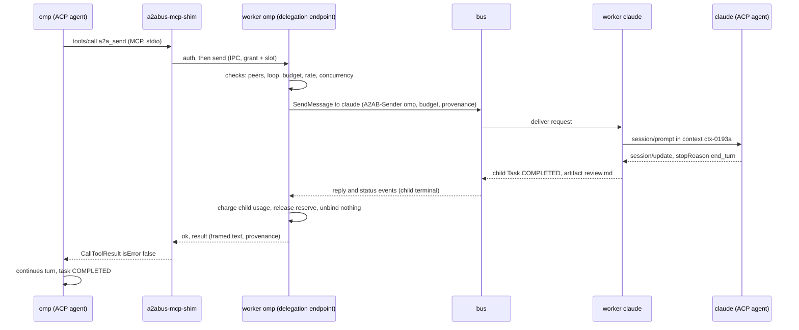

# RFC-0015: Peer-Call Tool and Delegation Plumbing

| Field | Value |
|---|---|
| Status | Proposed |
| Depends on | RFC-0001, RFC-0002, RFC-0005, RFC-0006, RFC-0007, RFC-0009, RFC-0012, RFC-0013, RFC-0014 |
| Owner area | Peer-call MCP shim (`a2a-mcp`, binary `a2abus-mcp-shim`), worker delegation endpoint, supervisor MCP injection |
| Related interop notes | `docs/interop/acp-omp-claude.md` (sections 2.12 and 3.3 for tool tiers); `docs/spikes/omp-acp.md` (Q2, shutdown); `docs/spikes/claude-acp.md` (mcp_servers in init event) |

## 1. Summary

ACP agents (omp, claude) reach other bus agents only through a tool they call inside their own session. This RFC specifies that tool: an MCP stdio server, `a2abus-mcp-shim` in crate `a2a-mcp`, started by the agent from a session-level `mcpServers` entry. The shim exposes four tools (`a2a_discover`, `a2a_send`, `a2a_get`, `a2a_cancel`) and forwards each call over a local IPC endpoint to the delegation endpoint of the calling agent's worker. The worker turns each call into a bus operation under the delegating task's budget, loop rule, approval and cancellation rules, and returns the outcome as framed, untrusted tool output. The shim holds no bus credential and authenticates to the worker with a grant credential from RFC-0007.

## 2. Motivation and scope

RFC-0014 case [0014-010] (S1) requires omp to delegate a task to claude "through the bus peer-call tool". No RFC defines that tool, the shim, the IPC between the shim and the worker, or how a worker performs an outbound delegation (budget child derivation, loop check, cancellation and failure propagation). RFC-0007 section 4.9 defines the grant credential and the MCP proxy only as principles. This RFC closes that gap for the Milestone 1 ACP agents.

Goals:

- A single, pinned tool surface that both omp and claude can call through a stdio MCP server.
- A worker-side delegation path that reuses the budget (RFC-0006), loop, context and cancellation rules rather than inventing new ones.
- No bus credential, provider credential or signing key outside the worker.

Non-goals (M1):

- MCP direct mode (`MCP_MODE_DIRECT`, RFC-0007 [0007-118]) and cross-host MCP ([0007-119]).
- MCP resources, prompts, sampling, elicitation, roots, and HTTP or SSE MCP transports.
- Streaming tool results (progress notifications). A tool call returns once.
- Delegation to targets outside the bus tenant, and any push delivery.
- Cross-task capability tokens for child tasks (see section 9, issue 4).

## 3. Terminology

Only terms not defined in RFC-0001 are listed.

- **Peer-call tool**: one of the four MCP tools of section 4.3.
- **Peer-call shim**: the MCP stdio server process `a2abus-mcp-shim`, one per ACP session.
- **Delegation endpoint**: the local IPC server that a worker exposes for its own agent's shims.
- **Grant credential**: the 256-bit random secret of RFC-0007 [0007-116], here scoped to one worker run. Stored and compared only by the supervisor and the worker.
- **Session slot**: an opaque random identifier that the worker assigns to each ACP session. It routes calls and is not a secret.
- **Delegating task**: the task whose turn issued a peer-call tool call.
- **Child task**: a task created on a target agent by `a2a_send` from a delegating task.
- **Task binding**: the association of a session slot with the delegating task whose turn is running on that session.

## 4. Specification

### 4.1 Architecture and process topology

- [0015-001] The peer-call path MUST be: ACP agent session -> peer-call shim (MCP over stdio) -> local IPC -> worker delegation endpoint -> `a2a-client` -> bus. No other path from an ACP agent to a bus peer is permitted in M1.
- [0015-002] The shim MUST hold no bus connection, bus credential, signing key or provider credential. It MUST depend only on `a2a-types` and standard or IPC libraries; it MUST NOT depend on `bus-*`, `a2a-security` or `a2a-client`. (RFC-0001 section 4.2, row `a2a-mcp`.)
- [0015-003] The shim MUST be started by the ACP agent from the stdio entry of `mcpServers` that the worker's driver passes to `session/new`, `session/load` and `session/resume` (RFC-0009 [0009-017]; `docs/interop/acp-omp-claude.md` section 2.12). The worker MUST NOT start the shim itself. The shim is therefore a child of the agent process, which the driver starts as RFC-0009 requires. Section 9, issue 1 covers the wording of RFC-0001 [0001-008].
- [0015-004] The IPC endpoint MUST be a named pipe on Windows and a Unix domain socket on Linux. The supervisor chooses its path under `<state_dir>/run/<agent>/`, unique per worker run. On Linux the parent directory MUST be mode 0700 and the socket file mode 0600. On Windows the pipe's security descriptor MUST grant access to the worker's OS user only.
- [0015-005] The supervisor MUST refuse to start a worker whose Unix socket path exceeds 107 bytes, the `sockaddr_un` limit on Linux. [INFERENCE] the limit is the Linux value; macOS is out of scope for M1.

### 4.2 MCP surface

- [0015-010] The shim MUST implement MCP over stdio as newline-delimited JSON-RPC 2.0 messages, with the protocol version pinned to `2025-06-18`. The pin is this RFC's choice; the revision string MUST be checked against the MCP specification at implementation time. Negotiation by omp and claude is [UNVERIFIED].
- [0015-011] The shim MUST implement exactly these methods: `initialize`, `ping`, `tools/list`, `tools/call`, and the notifications `notifications/initialized` (accepted, no reply) and `notifications/cancelled` (section 4.2 [0015-018]). Any other request MUST be answered with JSON-RPC error `-32601`. Any other notification MUST be ignored.
- [0015-012] The shim MUST declare only the `tools` capability in `initialize`. It MUST answer `initialize` with its pinned protocol version whatever version the client requested. Client reaction to a mismatch is [UNVERIFIED].
- [0015-013] The shim MUST write nothing to stdout except complete MCP frames, one JSON object per line with no embedded newline. All diagnostics MUST go to stderr, MUST NOT contain credential material, and MUST be capped at 65536 bytes per process.
- [0015-014] The shim MUST answer `initialize`, `ping` and `tools/list` without waiting for the IPC connection. After answering `initialize` it MUST start the IPC connection and authentication (section 4.5) in the background. A `tools/call` received before the connection is ready MUST wait for it, bounded by the call's own deadline.
- [0015-015] The shim SHOULD answer `initialize` within 500 ms of process start. [INFERENCE] the target is a development-machine figure, to be confirmed by the M1 spike.
- [0015-016] A tool execution failure MUST be returned as a successful JSON-RPC result with `isError: true` in `CallToolResult`, so the model sees the failure. JSON-RPC errors MUST be used only for protocol faults.
- [0015-017] When stdin reaches EOF the shim MUST cancel pending IPC calls, close the connection and exit with status 0 within 1 second. The agent's exit closes stdin on omp (observed, `docs/spikes/omp-acp.md` section 5).
- [0015-018] On `notifications/cancelled` naming a pending `tools/call`, the shim MUST send a `cancel-call` frame for that call (section 4.5 [0015-046]). It MUST NOT send a response for the cancelled request. Whether omp and claude send this notification is [UNVERIFIED].

### 4.3 Tool set and schemas

All schemas are JSON Schema (draft 2020-12) in `inputSchema`.

- [0015-020] The shim MUST advertise exactly four tools with these names: `a2a_discover`, `a2a_send`, `a2a_get`, `a2a_cancel`. Names are fixed for M1. The MCP server name is `a2abus`. Every object schema MUST set `additionalProperties: false`.
- [0015-021] `a2a_discover` takes optional `skill` (string, 1 to 128 bytes), `tag` (string, 1 to 64 bytes) and `limit` (integer 1 to 50, default 20). It returns `peers`, each with `agent`, `name`, `description` (at most 512 bytes), `skills` (`id`, `name`) and `tags`. It MUST list only agent ids in the worker's peer allowlist (section 4.8 [0015-087]) and MUST NOT reveal the existence of any other agent.
- [0015-022] `a2a_send` takes `agent` (required; pattern `^[a-z0-9][a-z0-9-]{0,47}$`), `text` (required; UTF-8, 1 to 32768 bytes), `contextId` (optional; section 4.6 [0015-059]), `wait` (`blocking` or `return`, default `blocking`) and `timeoutMs` (integer 1 to 3600000, default the remaining child deadline). It has no `taskId` input: `a2a_send` MUST always create a new child task, and the model MUST NOT be able to address or answer an existing task through it.
- [0015-023] `a2a_get` and `a2a_cancel` take `taskId` (UUIDv7 string, lowercase, 36 characters). They MUST accept only child task ids created by the delegating task of this session. Any other id MUST be answered `TASK_NOT_FOUND`, whether or not the task exists, so the tools reveal nothing about other tasks.
- [0015-024] `a2a_get` takes `includeText` (boolean, default true). `a2a_cancel` returns `taskId` and the state reported after the cancel request. Cancel is idempotent (RFC-0005 [0005-038]).

### 4.4 Results: size, truncation, redaction and untrusted marking

- [0015-030] The shim MUST reject arguments that violate the schema before any IPC call, returning `isError: true` with `MALFORMED_MESSAGE`. The worker MUST validate every argument again and MUST NOT rely on the shim.
- [0015-031] A single IPC frame MUST NOT exceed 262144 bytes (RFC-0002 [0002-110]). `a2a_send` `text` above 32768 bytes MUST be refused with `MALFORMED_MESSAGE`.
- [0015-032] Text in a tool result MUST NOT exceed 65536 bytes. Truncation MUST occur on a UTF-8 boundary, MUST set `truncated: true`, and MUST report `omittedBytes`. Artifact bytes MUST NOT be inlined; artifacts are summarized by name, media type, byte count and, when above the inline limit, by blob reference (RFC-0002 [0002-111]).
- [0015-033] Before framing, the worker MUST apply the redaction of RFC-0007 [0007-132] to every text and artifact summary. Text containing NUL or control characters other than tab, LF and CR MUST be refused, not repaired (RFC-0007 [0007-125]); the tool result is then `isError: true` with `MALFORMED_MESSAGE`, and the child's state is still reported.
- [0015-034] The worker MUST apply the data-block framing of RFC-0007 [0007-125] exactly once, with a fresh 128-bit boundary per result, and MUST mark the result trust class `TRUST_CLASS_TOOL_OUTPUT` (RFC-0007 [0007-127]). The framed text MUST be returned in `content[0].text`. The shim MUST forward it unchanged and MUST NOT add a second frame (RFC-0007 [0007-126]).
- [0015-035] `structuredContent` MUST carry `taskId`, `contextId`, `state`, `artifacts`, `truncated`, `omittedBytes` and `provenance` (`sourceAgent`, `taskId`, `delegatingTaskId`, `chainLength`). The framed text MUST name the source agent id. Provenance follows RFC-0007 [0007-120] and [0007-121].
- [0015-036] Results and errors MUST NOT contain host filesystem paths, stack traces, grant or bearer material, bus subjects, or any budget or chain content beyond `chainLength` (RFC-0002 [0002-095]; T5, T10).
- [0015-037] Tool descriptions MUST state the function, the limits and that peer output is untrusted. They MUST NOT instruct the model to trust, obey or prefer any peer's output (T1).

### 4.5 IPC protocol (`a2a-mcp` library types)

The IPC types are defined in the `a2a-mcp` crate. They are not bus messages and not protobuf.

- [0015-040] Each IPC message MUST be a 4-byte unsigned big-endian length followed by that many bytes of UTF-8 JSON encoding one object. A length of zero or above 262144 MUST cause the receiver to close the connection after answering `MALFORMED_MESSAGE` if it can.
- [0015-041] The first message of every connection MUST be `hello` with `ipcVersion: 1`. The server answers with its own `ipcVersion` or with reason `IPC_VERSION_UNSUPPORTED`. M1 defines major version 1 only.
- [0015-042] The client MUST then send `auth` with `grantId` (16 random bytes, base64url), `grantCredential` (32 random bytes, base64url) and `sessionSlot` (16 random bytes, base64url). The server MUST compare the credential with the stored value in constant time. Unknown `grantId` and wrong credentials MUST both be answered `UNAUTHENTICATED` with the same message.
- [0015-043] Before successful authentication the server MUST accept only `hello` and `auth`, MUST close a connection that is idle for 5 seconds, and MUST close a connection after 5 failed authentications within 60 seconds, writing an audit event (RFC-0013).
- [0015-044] A request MUST carry `id` (integer, unique per connection), `deadlineMs` (integer 1 to 3600000), `method` (`discover`, `send`, `get` or `cancel`) and `params`. The server MUST answer `REQUEST_EXPIRED` for a request whose deadline has passed when processing starts (RFC-0002 [0002-071] applied to IPC). The shim sets `deadlineMs` as follows: `discover` 10000; `get` 10000; `cancel` 10000; `send` the `timeoutMs` argument (or the remaining child deadline) plus 5000.
- [0015-045] A response MUST be either `{id, ok: true, result}` or `{id, ok: false, error: {reason, message}}`. `reason` MUST be one of: the bus-level reasons of RFC-0002 [0002-092], the A2A reasons of RFC-0002 [0002-091] (for example `TASK_NOT_FOUND`), the failure codes of RFC-0005 and RFC-0006, or the IPC-local reasons `IPC_VERSION_UNSUPPORTED`, `SLOT_UNBOUND` and `GRANT_REVOKED`. `message` MUST be a fixed short English sentence (RFC-0002 [0002-095]).
- [0015-046] A `cancel-call` frame carries `callId` (the IPC `id` of a pending call). The server MUST cancel the child created by that call, if any, through the path of section 4.7 [0015-069], and MUST answer `ok: true`. The original call's response is then not delivered to the shim.
- [0015-047] The shim MUST keep at most one IPC connection per session slot. On connection loss it MUST reconnect once and retry `discover` and `get`. It MAY retry `send` and `cancel` only with the same `idempotencyKey` (section 4.6 [0015-062]).
- [0015-048] `send` params MUST carry `idempotencyKey` (string, 1 to 128 bytes, the MCP request id joined with the session slot). The worker MUST treat a repeated key on the same slot as the same request and return the original result or the child's current state; it MUST NOT create a second child.

### 4.6 Worker delegation endpoint: binding, budget and loop rules

- [0015-050] The worker MUST serve the delegation endpoint only for agents whose configuration contains a `delegation` table with a non-empty `delegation.peers` list (section 4.8). An agent without that table, or with an empty `delegation.peers` list, MUST receive no endpoint and no grant.
- [0015-051] The worker MUST map each authenticated (grant, session slot) pair to at most one task binding. A call on an unbound slot MUST be answered `SLOT_UNBOUND`.
- [0015-052] The worker MUST create a task binding when it starts a turn on the slot's session (`Effect::StartBackend` for that task in `a2a-core`), and MUST remove it at the task's terminal state, on cancel, and on kill (section 4.7 [0015-073]).
- [0015-053] The session slot MUST be generated by the worker per ACP session from a CSPRNG, and MUST be passed to the shim in its `--slot` argument (section 4.8 [0015-084]). The slot MUST NOT be treated as authentication.
- [0015-054] The worker MUST evaluate a `send` in this order and stop at the first refusal, creating no child on refusal: (a) target is not in the peer allowlist, or is the worker's own agent id: `PERMISSION_DENIED`, with the same message for unknown and unlisted targets; (b) the origin breaker of RFC-0006 [0006-048] is open: `RATE_LIMITED` with detail `{"breaker": "open"}`; (c) the loop rule of [0015-057]: the delegating task fails with `LOOP_DETECTED`; (d) child preconditions of RFC-0006 [0006-033]: `BUDGET_EXHAUSTED` with detail `{"dimension": "<name>"}`; (e) rate limits of [0015-072]: `RATE_LIMITED`; (f) concurrency limits of [0015-071]: `QUEUE_FULL`.
- [0015-055] The child allowance MUST be derived with the arithmetic of RFC-0006 [0006-033] and [0006-034], as the `a2a-client` budget helper computes it. Let `avail` = allowance - used - reserved. Then `child.max_hops` = (max_hops - hops_used) - 1, `child.max_depth` = max_depth - 1 and `child.max_children` = max_children - 1. `child.max_tokens` and `child.max_cost_units` = `avail` (margin 0) when the parent's allowance for that dimension is finite; when it is the unlimited sentinel, the child keeps the sentinel (RFC-0006 [0006-032]). `child.max_wall_ms` = `avail - 1000` (saturating), which is always finite. The worker MUST reserve the child allowance at creation and charge the child's final `BudgetUsage` to the parent at its terminal state.
- [0015-056] The child's `Budget.chain` MUST be the delegating task's chain, root first, followed by one `Hop` naming the target agent and the fingerprint (RFC-0006 [0006-043]). Each task's `hops_used` MUST be incremented before that task's own backend turn (RFC-0006 [0006-036]); a child's first turn therefore sets its `hops_used` to 1.
- [0015-057] The worker MUST compute the fingerprint of RFC-0006 [0006-044] over the target agent id and the normalized text. If the (target, fingerprint) pair already appears in the delegating task's chain, the worker MUST refuse the create with `LOOP_DETECTED` and fail the delegating task with `LOOP_DETECTED` (RFC-0006 [0006-045]). If the target agent id already appears in the delegating task's chain, the refusal is the same whatever the text (re-entrancy, RFC-0006 [0006-059]).
- [0015-058] Alternating delegations are re-entrancies once they return to an agent already in the chain; the return is refused as in [0015-057] with `LOOP_DETECTED` (RFC-0006 [0006-046], [0006-059]). Only distinct-agent delegations reach the hard caps of RFC-0006 [0006-042]: `max_hops`, `max_depth` and wall time.
- [0015-059] `a2a_send` without `contextId` MUST use the delegating task's `context_id`. A `contextId` supplied by the model MUST equal the delegating task's `context_id`; otherwise the call MUST be refused with `MALFORMED_MESSAGE`. The S1 case (RFC-0014 [0014-010]) therefore shares one context id.
- [0015-060] The child Message MUST be sent with `A2AB-Sender` equal to the delegating worker's agent id (RFC-0002 [0002-011]). The worker MUST NOT set `A2AB-Origin`, which only the gateway may set (RFC-0002 [0002-014]). The child Message MUST carry `urn:a2abus:ext:budget:1` (the child `Budget`) and `urn:a2abus:ext:provenance:1` metadata naming the originating agent, the delegating task id and the hop number. Contexts are scoped to origin (RFC-0002 [0002-089]).
- [0015-061] M1 child messages MUST NOT carry a `DelegationRef` (RFC-0007 section 4.8 tokens are scoped to a single task). The target agent's own approval policy governs the child (section 9, issue 4).
- [0015-062] The worker MUST record `(session slot, idempotencyKey)` to child task id in durable state before sending the child Message, so a retry after a crash returns the existing child (RFC-0005 [0005-023] applied to delegation).
- [0015-063] Every `a2a_send` attempt that creates a child MUST be recorded in the delegating task's journal with the child task id, target agent id and the child allowance. [INFERENCE] the journal is the existing task journal of RFC-0005; no new store is introduced.

### 4.7 Approvals, cancellation, failure, concurrency and teardown

- [0015-065] When a child reports `INPUT_REQUIRED`, the delegating task MUST remain `WORKING`, the pending tool call MUST remain unanswered, and the approval MUST be presented to the operator on the child task through the RFC-0006 approval path (RFC-0002 [0002-065]). The operator's decision is a `send` on the child, never through the parent. The approval presentation MUST show the origin and the chain (RFC-0007 [0007-129]).
- [0015-066] A blocking `a2a_send` returns when the child is terminal or interrupted (RFC-0002 [0002-050]). If the call deadline passes while the child is interrupted or running, the tool result MUST be `isError: false` with the child's current state (for example `INPUT_REQUIRED` or `WORKING`), the child MUST NOT be cancelled, and the model can continue with `a2a_get`.
- [0015-067] The worker MUST NOT commit a terminal `COMPLETED` for a delegating task while any child it created is non-terminal. A child that later fails then fails the parent under [0015-070]. (Section 9, issue 5.)
- [0015-068] When a delegating task reaches `CANCELED`, `DEADLINE_EXCEEDED` or a budget or loop failure, the worker MUST cancel every non-terminal child it created (RFC-0005 [0005-039]; RFC-0006 [0006-050]). Each cancel MUST be issued through `Effect::CancelChild` in the same commit as the parent's terminal state.
- [0015-069] A `cancel-call` frame or `a2a_cancel` MUST cancel only the named child (idempotent, RFC-0005 [0005-038]) and MUST NOT cancel the delegating task. A child that ends `CANCELED` because of such a cancel counts as cancelled by the parent for RFC-0006 [0006-049] and does not fail the delegating task.
- [0015-070] When a child ends `FAILED`, `REJECTED` or `CANCELED` for any other reason, the tool result MUST be `isError: true` with `reason` equal to the child's failure code, `state` and the child task id. The delegating task MUST then commit `FAILED` with `CHILD_FAILED` and detail containing the child task id and child code (RFC-0006 [0006-049]). A child that ends `COMPLETED` MUST map to `isError: false` with framed text and artifacts (section 4.4).
- [0015-071] The worker MUST enforce a maximum of in-flight peer-call calls per delegating task (default 4, section 4.8). An excess call is refused with `QUEUE_FULL`. The number of children per task is bounded by `max_children` through RFC-0006 [0006-033].
- [0015-072] The worker MUST enforce per-slot rate limits (defaults in section 4.8): at most `max_sends_per_min` `send` calls and `max_calls_per_min` total calls per minute. A call over the limit MUST be refused with `RATE_LIMITED` and MUST NOT create a child.
- [0015-073] When the delegating task reaches a terminal state, the worker MUST remove the slot's binding, close in-flight IPC calls for that slot, and refuse further calls on the slot with `SLOT_UNBOUND` until a new turn binds it. Removing the binding is the per-task teardown of RFC-0007 [0007-119] (section 9, issue 3).
- [0015-074] When the worker process stops, the worker MUST close the delegation endpoint, invalidate the grant credential and answer any remaining call with `GRANT_REVOKED`. The shim MUST then exit under [0015-017].
- [0015-075] The worker MUST write one audit event (RFC-0013) per delegation outcome: created, refused (with reason), completed, cancelled or failed. The event MUST carry the delegating task id, child task id, target agent id, `chainLength` and reason, and MUST NOT carry message text.

### 4.8 Supervisor duties and worker configuration

- [0015-080] For each worker with a `delegation` table, the supervisor MUST create the delegation endpoint (section 4.1 [0015-004]) and the grant before the worker starts (RFC-0012 [0012-007] dependency order, [0012-004] validate before start).
- [0015-081] The supervisor MUST generate, per worker run, a 16-byte grant id and a 32-byte grant credential from a CSPRNG (RFC-0007 [0007-116]). The grant credential MUST NOT appear on any command line, in any `A2AB_*` value, or in any log (RFC-0012 [0012-027]).
- [0015-082] The supervisor MUST write a delegation file `<state_dir>/run/<agent>/delegation.json`, containing the grant id, grant credential, endpoint path, shim path, peer allowlist and limits. The file MUST be readable only by the worker's OS user (mode 0600 on Linux; a user-only ACL on Windows). The worker receives only its path, in the environment variable `A2AB_DELEGATION_FILE`. The supervisor MUST delete the file when the worker stops.
- [0015-083] The supervisor MUST resolve the shim binary to an absolute path, by default the `a2abus-mcp-shim` binary beside `a2ad`, overridable by `delegation.shim_path`. A missing shim MUST block the worker from starting (RFC-0012 [0012-004]).
- [0015-084] The worker's driver MUST pass, in `mcpServers` of `session/new`, `session/load` and `session/resume`, exactly this stdio entry (extending RFC-0007 [0007-117] with the endpoint and slot arguments):

  ```json
  {"name": "a2abus", "command": "<absolute shim path>",
   "args": ["--grant", "<grant id base64url>", "--endpoint", "<endpoint path>", "--slot", "<session slot base64url>"],
   "env": [{"name": "A2ABUS_MCP_GRANT", "value": "<grant credential base64url>"}]}
  ```

- [0015-085] For an agent without a `delegation` table, or with an empty `delegation.peers` list, the driver MUST pass `mcpServers: []` (RFC-0009 [0009-017]).
- [0015-086] The supervisor MUST refuse to start a worker whose `delegation.peers` contains an id that does not match the agent id grammar, equals the worker's own id, or names an agent absent from the configuration (RFC-0012 [0012-004]).
- [0015-087] Configuration keys, to be merged into the RFC-0012 `[[agent]]` table (RFC-0012 owns the file format; section 9, issue 9):
  - `delegation.peers`: array of agent ids; default `[]` (no peers, no tools usable).
  - `delegation.max_inflight`: integer 1 to 16; default 4.
  - `delegation.max_sends_per_min`: integer 1 to 600; default 30.
  - `delegation.max_calls_per_min`: integer 1 to 1200; default 120.
  - `delegation.shim_path`: optional absolute path.
  - `delegation.auto_allow_peer_tools`: boolean; default false; per agent. When true, the owner Worker MAY auto-allow a peer-call approval only under RFC-0006 [0006-061].
- [0015-088] On worker stop the supervisor MUST remove the endpoint (socket file or pipe), delete the delegation file, and record the removal in the run record (RFC-0012 [0012-021]).

### 4.9 Agent-side requirements

- [0015-090] The shim MUST read no agent configuration file and no provider environment variable. Its only inputs are its arguments and `A2ABUS_MCP_GRANT`. It MUST NOT forward any environment variable to any other process (RFC-0009 [0009-069], T5).

## 5. Interoperability

### 5.1 omp and claude

Observed facts (cited):

- ACP agents support stdio MCP servers and receive them at session creation. The entry shape is `{name, command (absolute), args, env: [{name, value}]}` (`docs/interop/acp-omp-claude.md` section 2.12).
- A stdio entry with a non-existent command is accepted silently by omp at `session/new` (`docs/spikes/omp-acp.md`, Q2). The bus therefore cannot learn that the shim failed from the session response.
- omp exits with its stdin closed; its stdio MCP child exits with it (`docs/spikes/omp-acp.md`, shutdown). claude is stopped with SIGTERM in the headless spike (`docs/spikes/claude-acp.md`).
- claude's headless `system` init event lists `mcp_servers` and `mcp_server_errors` (`docs/spikes/claude-acp.md`, CC-HEADLESS). That is the only observed channel for MCP health.
- omp does not expose client MCP tools as function tools. Its system prompt lists them under `## MCP Tool Routes` as `xd://mcp__<server>_<tool>` (for example `xd://mcp__a2abus_a2a_send`). The model calls one by calling omp's `write` tool with `path` set to the route and `content` set to the JSON arguments (`tools.xdev` default true). Source: live run S1Debug (`docs/interop/acp-omp-claude.md` 3.7).
- The settings `tools.discoveryMode` and `mcp.discoveryMode` had no observed effect on the route list (same source).
- [0015-102] The M1 claude driver MUST NOT pass `--bare` to claude until a spike shows that `--bare` keeps session-level `mcpServers` working.

Unverified (all [UNVERIFIED] until the M1 spike):

- The tool name the model sees for claude, expected `mcp__a2abus__<tool>`. The omp form is observed (route text, section 5.1).
- Whether omp and claude send `notifications/cancelled`, and their tool-call timeouts.
- MCP protocol version negotiation and the reaction to a pinned-version mismatch.
- Whether `--bare` in the claude driver suppresses session-level `mcpServers`; see [0015-102].

Requirement for slot readiness:

- [0015-100] The worker MUST treat a slot as delegation-ready only after it receives an authenticated `auth` on the endpoint with that slot id. A slot that is not ready within 10 seconds of `session/new` MUST be recorded in the audit log, and the turn MUST continue; the agent simply has no working peer tools.
- [0015-101] The worker MUST NOT fail a task because a shim is absent, late or disconnected. Only a `send` attempted while unbound or disconnected fails, with the reasons of section 4.5.

Requirement for peer-call identity:

- [0015-116] The worker MUST NOT infer a peer call, its target or its tool from route text an agent writes (for omp, `xd://mcp__<server>_<tool>`, section 5.1) or from the text of an approval message (RFC-0006 [0006-052]). A peer call is identified only by the `tools/call` that reaches the shim (section 4.2 [0015-020]). Route text MAY be shown to the operator as untrusted text (RFC-0006 [0006-060]).

### 5.2 Worked example: S1 (omp -> claude)

Case [0014-010]. Operator config: omp has `delegation.peers = ["claude"]`; claude has no peers. Root budget for the omp task: defaults of RFC-0006 (`max_hops` 8, `max_depth` 3, `max_children` 8). At the time of the call, omp's task has `hops_used` 1 and has used 12000 ms of wall time; the root `max_wall_ms` is 3600000.

Derived child allowance (section 4.6 [0015-055]): `max_hops` = (8 - 1) - 1 = 6; `max_depth` = 3 - 1 = 2; `max_children` = 8 - 1 = 7; tokens and cost unlimited; `max_wall_ms` = (3600000 - 12000) - 1000 = 3587000.



The MCP request from omp:

```json
{"jsonrpc": "2.0", "id": 7, "method": "tools/call",
 "params": {"name": "a2a_send",
            "arguments": {"agent": "claude",
                          "text": "Review src/parser.rs for error-handling gaps. Reply with a short markdown review.",
                          "wait": "blocking"}}}
```

IPC frames (each prefixed by its 4-byte length; the values are placeholders of the stated sizes):

```json
{"ipcVersion": 1, "shim": "0.1.0"}
{"grantId": "<16 bytes base64url>", "grantCredential": "<32 bytes base64url>", "sessionSlot": "<16 bytes base64url>"}
{"id": 1, "deadlineMs": 605000, "method": "send",
 "params": {"agent": "claude", "text": "Review src/parser.rs for error-handling gaps. Reply with a short markdown review.",
            "wait": "blocking", "timeoutMs": 600000, "idempotencyKey": "7:<slot>"}}
```

Bus request from the omp worker (subject `a2a.v1.local.rpc.claude.send`, proto-JSON rendering of `SendMessageRequest`; uint64 values are JSON strings):

```json
{"message": {"messageId": "0193a6e0-5c11-7d2a-9b44-2f1c8e7a0b11",
             "contextId": "ctx-0193a6df", "role": "ROLE_USER",
             "parts": [{"text": "Review src/parser.rs for error-handling gaps. Reply with a short markdown review."}],
             "metadata": {
               "urn:a2abus:ext:budget:1": {
                 "maxTokens": "18446744073709551615", "maxCostUnits": "18446744073709551615",
                 "maxWallMs": "3587000", "maxHops": "6", "maxDepth": "2", "maxChildren": "7",
                 "chain": [{"agentId": "omp", "fingerprint": "5f1c0a9d2b7e4c18a3d6f0e9b2c41d7a"},
                           {"agentId": "claude", "fingerprint": "5f1c0a9d2b7e4c18a3d6f0e9b2c41d7a"}]},
               "urn:a2abus:ext:provenance:1": {"originAgent": "omp", "delegatingTaskId": "0193a6df-0a2e-7c10-8f3d-5b9e4a1c2d33", "hop": "1"}}}},
 "configuration": {"returnImmediately": false}}
```

The child task on claude (state `COMPLETED`, `hops_used` 1 on its first turn, `context_id` `ctx-0193a6df`, `A2AB-Sender` `omp`) carries one artifact `review.md`. The worker of omp converts that outcome into the IPC response:

```json
{"id": 1, "ok": true, "result": {
  "taskId": "0193a6e1-44b0-7e91-a0c2-6d5f3b8e9a07",
  "contextId": "ctx-0193a6df", "state": "COMPLETED",
  "text": "<framed per RFC-0007 [0007-125]: boundary 128-bit hex, trust class TRUST_CLASS_TOOL_OUTPUT, source claude> ... review text ... <end frame>",
  "artifacts": [{"artifactId": "a-01", "name": "review.md", "mediaType": "text/markdown", "bytes": 2311}],
  "truncated": false, "omittedBytes": 0,
  "provenance": {"sourceAgent": "claude", "taskId": "0193a6e1-44b0-7e91-a0c2-6d5f3b8e9a07",
                 "delegatingTaskId": "0193a6df-0a2e-7c10-8f3d-5b9e4a1c2d33", "chainLength": 2}}}
```

The shim returns this to omp as an MCP result, with the same framed text in `content[0].text` and `structuredContent` as above:

```json
{"jsonrpc": "2.0", "id": 7, "result": {
  "content": [{"type": "text", "text": "<framed per RFC-0007 [0007-125]> ... review text ..."}],
  "structuredContent": {"taskId": "0193a6e1-44b0-7e91-a0c2-6d5f3b8e9a07", "contextId": "ctx-0193a6df",
                        "state": "COMPLETED", "artifacts": [{"artifactId": "a-01", "name": "review.md", "mediaType": "text/markdown", "bytes": 2311}],
                        "truncated": false, "omittedBytes": 0,
                        "provenance": {"sourceAgent": "claude", "taskId": "0193a6e1-44b0-7e91-a0c2-6d5f3b8e9a07", "delegatingTaskId": "0193a6df-0a2e-7c10-8f3d-5b9e4a1c2d33", "chainLength": 2}},
  "isError": false}}
```

Checks against case [0014-010]: parent and child reach COMPLETED; the review is an artifact on the child; both tasks share `context_id` `ctx-0193a6df`; the child's `hops_used` is 1.

Context note: the child shares ctx-0193a6df with its parent ([0015-059]). If claude delegated back to omp in that context, the guard of [0015-115] fails the return at admission rather than letting it wait behind omp's open turn.

Refusal example: a `send` to `codex`, which is not in omp's allowlist, returns `isError: true` with `PERMISSION_DENIED` and creates no child; the message is identical to the one for a nonexistent agent (section 4.6 [0015-054]).

- [0015-114] The S1 run in section 5.2 SHOULD be executed end-to-end on the live omp and claude drivers before Milestone 1 acceptance; the spike result is the evidence.
- [0015-115] In the S1 shared context, a child that delegates back to a chain member MUST NOT wait for the open turn: the receiving Worker creates the task FAILED with `LOOP_DETECTED` (RFC-0006 [0006-059]). Waiting would deadlock until the deadline, because turns are serialized per `context_id` (RFC-0005 [0005-054]).

## 6. Security considerations

Threats from `requirements.md` section 8 that this RFC addresses:

- **T1 Prompt injection through task text or results.** A peer's text can carry instructions to the calling model. Mitigations: framing and trust class on every result ([0015-033], [0015-034]); neutral descriptions ([0015-037]); no tool can answer approvals or address existing tasks ([0015-022], [0015-111]). Framing is hygiene only; authority comes from budgets and approvals.
- **T2 Confused deputy via delegation.** A child could use its own peers to reach further agents on the parent's behalf. Mitigations: each worker's peer allowlist is its own configuration and gives no transitive authority ([0015-112]); the chain is visible in the child's budget and provenance and in approval presentation ([0015-065]); child allowances are strictly smaller than the parent's ([0015-055]). M1 has no cross-task capability token (section 9, issue 4), so the residual is documented.
- **T5 Credential leakage.** The shim holds no bus or provider credential ([0015-002], [0015-090]). The grant credential is never on a command line, in an `A2AB_*` value or in a log ([0015-081]), and is never forwarded to a child or peer ([0015-113]). Results and errors exclude paths, stack traces and credentials ([0015-036]).
- **T14 Driver as privileged confused deputy.** The delegation endpoint exists only for agents with a delegation table ([0015-050]) and is reachable only by the worker's own OS user ([0015-004]). The worker, not the shim, is the only bus client ([0015-001]).
- **T3 Ping-pong and cost runaway.** Loop and re-entry rule ([0015-057]), hard caps for distinct-agent chains ([0015-058]), the breaker ([0015-054]), concurrency and rate limits ([0015-071], [0015-072]).
- **T4 Replay.** Idempotency keys ([0015-048], [0015-062]) prevent duplicate children on retry.
- **T9 Flooding.** Rate limits and in-flight caps refuse excess calls before any child is created ([0015-071], [0015-072]).
- **T15 Approval bypass via native modes.** The shim exposes no approval answer. Child approvals are answered only on the child, by the operator ([0015-065]).

Residual risk (A5 in RFC-0007 section 6): any process of the same OS user can connect to the endpoint if it obtains the grant credential, which the agent process itself holds in its environment. The grant is scoped to one worker run and one allowlist, so the residual is bounded by the same limits. Stronger isolation is out of M1 scope.

### 6.1 Normative requirements

- [0015-110] With an empty `delegation.peers` list, the worker MUST refuse every `a2a_send` with `PERMISSION_DENIED`, MUST return an empty `peers` list from `a2a_discover`, and MUST create no child in either case.
- [0015-111] The tool set MUST NOT include any tool that answers an approval or addresses an existing task (section 4.3 [0015-022], [0015-023]).
- [0015-112] A child worker's own peer calls MUST be checked against the peer allowlist of the child's worker configuration, never against the parent's allowlist.
- [0015-113] The worker MUST NOT place the grant credential, or any value derived from it, in any child message, peer message, audit event or tool result.

## 7. Rationale and alternatives

- **Shim as MCP stdio server started by the agent.** This is the only tool-provisioning path both omp and claude support today (`docs/interop/acp-omp-claude.md` section 2.12). A custom ACP extension method was rejected: no observed agent support.
- **Shim talks to the worker, not the bus.** Bus credentials and signing keys stay in the worker, which already enforces budgets and approvals (RFC-0014 build order). An agent process is untrusted for credentials (T5, T14).
- **Named pipe or Unix socket instead of TCP.** Loopback TCP is reachable by any local process without filesystem permissions. Named pipes and sockets allow owner-only access.
- **One grant per worker run with session slots.** ACP sessions are created by the worker after startup (RFC-0009 [0009-012]), so a per-session credential cannot be generated by the supervisor in advance. A per-run credential plus an opaque slot keeps the supervisor as the generator of the credential (assignment) while still routing each call to the right task. The slot is not authentication, and both slots belong to the same agent identity.
- **Blocking send by default.** It matches the S1 assertion and the A2A default blocking behaviour (RFC-0002 [0002-050]). `wait: return` is provided for models that want to poll.
- **Parent cannot complete with open children.** Required children (RFC-0006 [0006-049]) would otherwise fail the parent after it has already reported success.
- **Rejected:** direct MCP mode (no M1 need; RFC-0007 [0007-118]); HTTP MCP transport (requires a listening socket and extra auth); a sidecar process per agent (cost, no benefit over the agent's own child).

## 8. Conformance

Levels: MUST = required for conformance of `a2a-mcp` and the worker delegation path; SHOULD = recommended, reported by the suite.

| ID | Test idea | Level |
|---|---|---|
| [0015-001] | Trace a delegated call; assert the only bus-side process is the worker | MUST |
| [0015-002] | Build `a2a-mcp` dependency graph; assert no `bus-*`, `a2a-security` or `a2a-client` edge; scan shim env and files for credentials | MUST |
| [0015-003] | Start a worker; assert the worker process never spawns the shim; the shim's parent is the agent process | MUST |
| [0015-004] | Inspect socket and pipe permissions on Linux and Windows; a second OS user cannot connect | MUST |
| [0015-005] | Configure an endpoint path of 108 bytes; supervisor refuses to start | MUST |
| [0015-010] | `initialize` returns `2025-06-18`; check the pin in the source | MUST |
| [0015-011] | Call `resources/list`; expect -32601; send notification `foo/bar`; expect no reply | MUST |
| [0015-012] | `initialize` with another version returns pinned version; only `tools` capability declared | MUST |
| [0015-013] | Fuzz tool arguments and IPC errors; every stdout line parses as one MCP object; stderr capped at 65536 bytes and contains no credential | MUST |
| [0015-014] | Block the endpoint; `initialize` and `tools/list` still answer; `tools/call` waits up to its deadline | MUST |
| [0015-015] | Measure `initialize` latency from process start on the reference machine | SHOULD |
| [0015-016] | Force a child failure; response is `isError: true`, not a JSON-RPC error | MUST |
| [0015-017] | Close shim stdin; exit 0 within 1 s; pending IPC calls cancelled | MUST |
| [0015-018] | Send `notifications/cancelled` for a pending call; expect cancel-call and no response | MUST |
| [0015-020] | `tools/list` returns exactly four named tools with `additionalProperties: false` | MUST |
| [0015-021] | `a2a_discover` output contains only allowlisted peers; a non-listed id is not revealed | MUST |
| [0015-022] | `a2a_send` with unknown properties, a `taskId` property, or text of 32769 bytes is refused | MUST |
| [0015-023] | `a2a_get` and `a2a_cancel` on a task of another context return `TASK_NOT_FOUND` identical to unknown ids | MUST |
| [0015-024] | `a2a_cancel` twice returns the same state without error | MUST |
| [0015-030] | Schema-invalid call is refused by the shim; a crafted IPC frame with the same content is refused by the worker | MUST |
| [0015-031] | IPC frame of 262145 bytes is refused; 32768-byte text accepted | MUST |
| [0015-032] | Child text of 200000 bytes returns at most 65536 bytes, `truncated` true, `omittedBytes` correct, UTF-8 valid | MUST |
| [0015-033] | Child text containing NUL is refused with `MALFORMED_MESSAGE`; secret-shaped strings are redacted before framing | MUST |
| [0015-034] | Result text is framed once; the shim output equals the worker output byte for byte | MUST |
| [0015-035] | `structuredContent` contains all listed keys; framed text names the source agent | MUST |
| [0015-036] | Force a worker error; scan result and error for paths, stacks and credentials | MUST |
| [0015-037] | Tool descriptions contain no imperative trust language; reviewed against a fixed list | MUST |
| [0015-040] | Length prefix 0 and 262145 are refused | MUST |
| [0015-041] | `hello` with `ipcVersion: 2` returns `IPC_VERSION_UNSUPPORTED` | MUST |
| [0015-042] | Wrong credential and unknown grant id return the same `UNAUTHENTICATED` message; timing comparison is constant-time by review | MUST |
| [0015-043] | Idle connection closed at 5 s; 5 failed auths within 60 s close the connection and write an audit event | MUST |
| [0015-044] | Request after its deadline returns `REQUEST_EXPIRED`; `deadlineMs` 0 is refused | MUST |
| [0015-045] | Every reason token in responses appears in the allowed set of section 4.5 | MUST |
| [0015-046] | `cancel-call` cancels the child and not the parent; response `ok: true` | MUST |
| [0015-047] | Kill the connection mid-`send`; shim reconnects and retries with the same key; exactly one child exists | MUST |
| [0015-048] | Repeat `send` with the same `idempotencyKey`; one child; same result | MUST |
| [0015-050] | Agent without `delegation` table, or with empty `delegation.peers`, has no endpoint and receives `mcpServers: []` | MUST |
| [0015-051] | Call on an unbound slot returns `SLOT_UNBOUND` | MUST |
| [0015-052] | Binding exists from `StartBackend` to terminal state; removed on cancel and kill | MUST |
| [0015-053] | Two sessions get distinct slots; slot values are 16 random bytes | MUST |
| [0015-054] | Each refusal case (allowlist, self, breaker, loop, budget, rate, concurrency) creates no child and returns its reason | MUST |
| [0015-055] | Child allowance equals the arithmetic of section 5.2 for the S1 example; unlimited sentinel preserved | MUST |
| [0015-056] | S1 child chain is `[omp, claude]`; child `hops_used` 1 on first turn | MUST |
| [0015-057] | Target already in the delegating chain, with the same or different text, yields `LOOP_DETECTED` and fails the delegating task | MUST |
| [0015-058] | Alternating A to B to A: the return is refused with `LOOP_DETECTED`; no child is created on the return; distinct-agent chains end by hard caps | MUST |
| [0015-059] | Child shares the parent `context_id`; a different model-supplied `contextId` is refused | MUST |
| [0015-060] | Child `A2AB-Sender` is the delegating agent; no `A2AB-Origin` is set; metadata keys present | MUST |
| [0015-061] | Child message has no `DelegationRef` | MUST |
| [0015-062] | Crash the worker after recording and before sending; restart returns the same child | MUST |
| [0015-063] | Journal contains one entry per created child with the allowance | MUST |
| [0015-065] | Child `INPUT_REQUIRED`: parent stays WORKING, tool call unanswered; operator approves on child; call returns COMPLETED | MUST |
| [0015-066] | Deadline passes while child WORKING: `isError: false`, state WORKING, child not cancelled | MUST |
| [0015-067] | Parent tries to complete with a running child; parent stays non-terminal until the child is terminal | MUST |
| [0015-068] | Parent cancelled with two running children; both receive CancelChild in the parent's terminal commit | MUST |
| [0015-069] | `a2a_cancel` on a child; child CANCELED, parent WORKING, no CHILD_FAILED | MUST |
| [0015-070] | Child FAILED with `BACKEND_TIMEOUT`; tool result carries reason; parent FAILED `CHILD_FAILED` with child id | MUST |
| [0015-071] | Fifth in-flight call with limit 4 returns `QUEUE_FULL`; children beyond `max_children` return `BUDGET_EXHAUSTED` | MUST |
| [0015-072] | 31st send in a minute returns `RATE_LIMITED`; no child created | MUST |
| [0015-073] | After parent terminal, a call on its slot returns `SLOT_UNBOUND` | MUST |
| [0015-074] | Stop the worker; endpoint closed; shim exits; in-flight calls get `GRANT_REVOKED` | MUST |
| [0015-075] | Each outcome produces one audit event with listed fields and no text | MUST |
| [0015-080] | Worker with delegation starts only after endpoint and grant exist | MUST |
| [0015-081] | Grant credential absent from process command line, `A2AB_*` values and logs | MUST |
| [0015-082] | Delegation file mode is user-only; file removed at worker stop | MUST |
| [0015-083] | Missing shim blocks worker start with a validation error | MUST |
| [0015-084] | Captured `session/new` params equal the entry format exactly | MUST |
| [0015-085] | Agent without delegation table, or with empty `delegation.peers`, receives `mcpServers: []` | MUST |
| [0015-086] | Peer id equal to self, unknown peer, or invalid id refuses start | MUST |
| [0015-087] | Config defaults match section 4.8; out-of-range values refused | MUST |
| [0015-088] | Worker stop leaves no socket file, pipe, or delegation file | MUST |
| [0015-090] | Shim with a planted config file and provider env var does not read or forward them | MUST |
| [0015-100] | Shim never authenticates: slot marked not ready after 10 s; audit event written; turn continues | MUST |
| [0015-101] | Kill the shim during a turn; task does not fail for that reason | MUST |
| [0015-102] | Claude argv has no `--bare` until suppression is verified; driver argv test | MUST |
| [0015-110] | Fresh worker with no `peers` refuses every `a2a_send` with `PERMISSION_DENIED` | MUST |
| [0015-111] | Tool list contains no approval or task-addressing tool; `a2a_send` has no `taskId` | MUST |
| [0015-112] | Child with its own allowlist cannot reach a peer that only the parent could | MUST |
| [0015-113] | Grant credential absent from child messages, peer messages and audit events | MUST |
| [0015-114] | S1 end-to-end run (RFC-0014 [0014-010]) on the live omp and claude drivers | SHOULD |
| [0015-115] | Child in the S1 shared context delegating back to omp is created FAILED LOOP_DETECTED at admission, with no queueing; both tasks terminal before the deadline | MUST |
| [0015-116] | Peer-call identity: no route string or approval text names a peer call or target; no test relies on the model's route text | MUST |

Note: the table above is the complete set of normative IDs of this RFC. IDs [0015-110] to [0015-113] are defined in section 6.1, [0015-114] and [0015-115] in section 5.2, and [0015-116] in section 5.1.

## 9. Open issues

1. **RFC-0001 [0001-008] wording.** The shim is started by the agent, which the driver starts. Default: the spawn rule is read as "the supervisor starts or stops all processes except ACP agents and the MCP servers they start for their sessions". Integrator decision: amend RFC-0001 wording or accept the reading.
2. **Grant scope.** The assignment asks the supervisor to generate grants per worker session. Default: one grant per worker run plus a worker-assigned slot per ACP session (section 7). RFC-0007 owner to confirm the grant model of [0007-116].
3. **Teardown wording of RFC-0007 [0007-119].** Default: the per-task teardown removes the slot binding (section 4.7 [0015-073]); the grant credential lives until the worker stops (section 4.7 [0015-074]). RFC-0007 owner to confirm or amend.
4. **Cross-task authority.** RFC-0007 [0007-104] defines child grants only for the same task, and the delegation proto requires `task_id` to equal the envelope task. Default: M1 child messages carry no token (section 4.6 [0015-061]); the child's authority is its own approval policy. RFC-0007 owner to define cross-task delegation tokens, otherwise T2 residual remains.
5. **Parent completion with open children.** Default: the worker holds the parent non-terminal until children are terminal (section 4.7 [0015-067]). RFC-0005 owner to confirm and add the state rule.
6. **Child failure with non-blocking send.** RFC-0006 [0006-049] applies to every delegation, including `wait: return`. Default: applied as written; a child that fails after the call returned still fails the parent.
7. **MCP client behaviours.** Tool naming, cancellation notifications, timeouts and protocol negotiation are [UNVERIFIED]. Default: M1 spike records them for omp and claude; if observed behaviour differs, this RFC is amended before the S1 case is accepted.
8. **Audit event type.** Section 4.7 [0015-075] needs an event type. Default: a delegation event with the fields listed; RFC-0013 owner to name and register it.
9. **RFC-0012 file format.** The keys of section 4.8 [0015-087] and the environment variable `A2AB_DELEGATION_FILE` extend RFC-0012 [0012-022]. Default: added here; RFC-0012 owner merges them into section 4 and the env list.
10. **Numeric defaults.** 32768-byte input, 65536-byte result text, 4 in-flight calls, 30 sends and 120 calls per minute, 5 failed authentications per 60 seconds, 5-second idle close. Default: as stated; tuned by measurement in RFC-0014 and changed only in this RFC.
11. **Protocol pin.** `2025-06-18` is this RFC's choice. Default: pinned; the value is confirmed against the MCP specification and against omp and claude before implementation.
12. **Windows pipe ACL.** The exact security descriptor for a named pipe is [INFERENCE]. Default: owner-only DACL, verified on Windows in the M1 spike.
